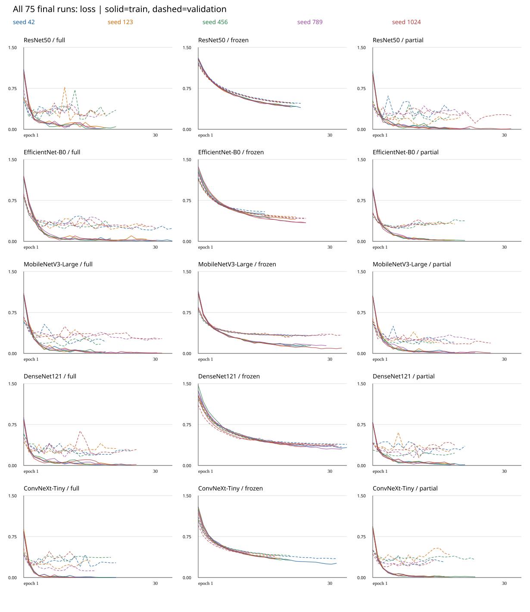
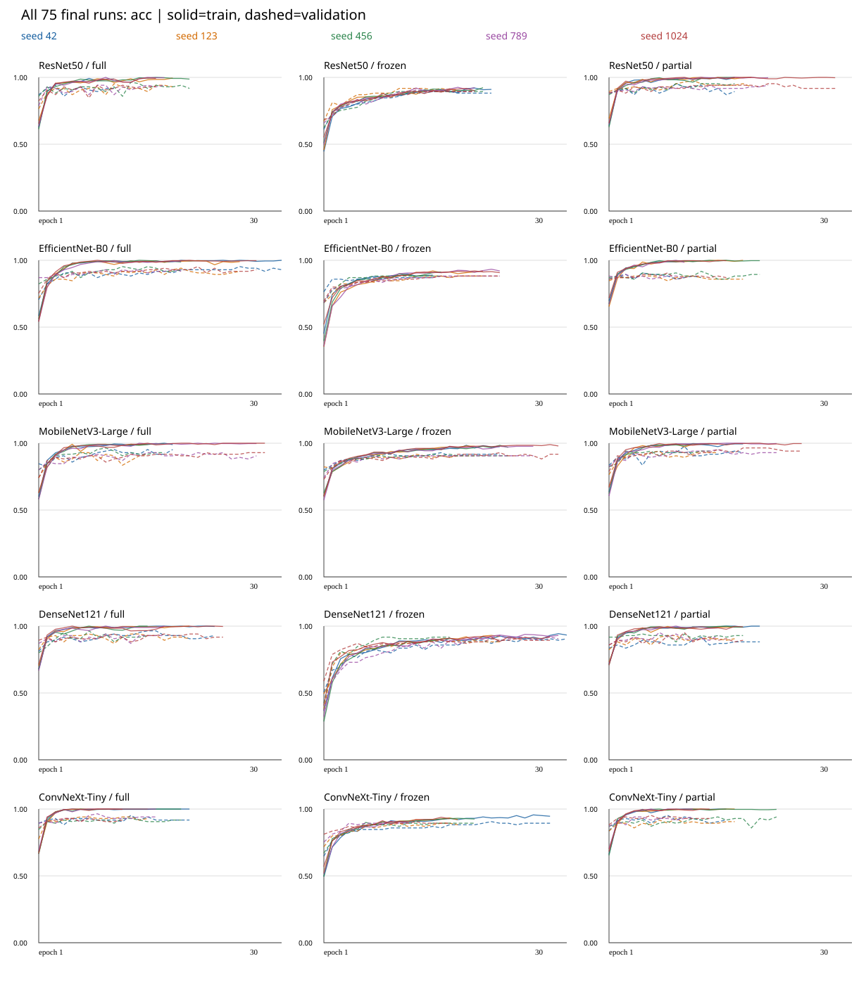
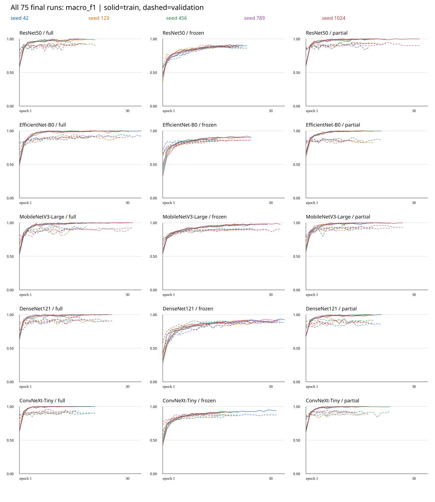

# DADS7202 — การจำแนกภาพศาลไทยด้วย Transfer Learning

**รายงานผลการทดลอง (Finding Report)** · จัดทำ 19 ตุลาคม 2026 · ผลรอบ `outputs_modes_v3_td` เท่านั้น

> รายงานนี้จัดทำเป็น Markdown สำหรับอ่านบน GitHub ตามคำขอผู้ใช้ แทนรูปแบบ PDF ในไฟล์แนบ ใช้ผล 75 tuning trials และ 75 final runs จาก protocol เดียว ไม่รวมผล Full-only รุ่นเก่าหรือ smoke tests การจัดหัวข้อยึดลำดับ 7 ส่วนที่ระบุใน `CODEX_DADS7202_REPORT_INSTRUCTIONS.md` แต่ไม่พบ PDF guideline/example ต้นฉบับ จึงยังไม่อ้างว่าได้ตรวจข้อกำหนดผู้สอนจาก PDF แล้ว

**บทคัดย่อ** — ศึกษาการจำแนกภาพศาล 4 ประเภท จำนวน 560 ภาพ ด้วย pretrained CNN 5 สถาปัตยกรรมและการปรับน้ำหนัก Full/Frozen/Partial รวม 15 คู่ แบ่งข้อมูลแบบ group-aware เป็น train/validation/test 390/85/85 ภาพ ค้น hyperparameters แยกแต่ละคู่ด้วยงบ 5 trials เท่ากัน และประเมินสูตรที่ล็อกแล้วด้วย matched seeds 5 ค่า คู่ที่เลือกจาก validation คือ MobileNetV3-Large/Partial ส่วนค่าเฉลี่ย test Macro F1 สูงสุดที่สังเกตคือ ResNet50/Full ที่ **0.9256 ± 0.0181** และ Accuracy **93.65% ± 1.34%** อย่างไรก็ตาม การเปรียบเทียบ reference กับคู่นี้ไม่ significant หลังปรับ Holm จึงไม่สรุปความเหนือกว่าเชิงสถิติ ผลทั้งหมดเป็น exploratory follow-up บน test split เดิมที่เคยถูกใช้ในงานก่อนหน้า ไม่ใช่ external confirmation

ลิงก์ประกอบ: [หลักฐานและขอบเขตแต่ละรอบ](report/report_inventory.md) · [ผลตรวจความถูกต้องและข้อจำกัด](report/report_validation.md) · [ผลตรวจซ้ำ 75 runs](report/verified_run_metrics.csv) · [paired tests พร้อม effect size/CI](report/verified_statistics.csv)

## 1) Dataset description

### 1.1 วัตถุประสงค์และแหล่งข้อมูล

โจทย์คือแยกภาพ **ศาลพระพรหม (san_phraphrom)**, **ศาลพระภูมิ (san_phraphum)**, **ศาลตายาย (san_tayay)** และ **ศาลตี่จู้เอี๊ยะ (tee_ju_eia)** ซึ่งเป็นป้ายจำแนกเฉพาะทางที่ไม่ตรงกับ label space 1,000 classes ของ ImageNet ผู้ใช้ระบุว่าตรวจ labels ด้วยมนุษย์แล้ว ข้อมูลหลักคือ `dataset_cleaned/` และ metadata `filename,category,source_url` ไม่รวมภาพ padded เป็นตัวอย่างอิสระเพิ่มเติม

Metadata มี 560 แถว, URL ไม่ว่าง 448 ภาพ และ URL ไม่ทราบ 112 ภาพ หลักฐานที่มีระบุแหล่งภาพระดับ URL/domain แต่ยังไม่เพียงพอจะอธิบาย crawler/query/วันที่เก็บหรือยืนยันสิทธิการใช้ภาพทุกภาพ จึงไม่สมมติขั้นตอน scraping ที่ไม่มี log รองรับ ตารางต่อไปแสดงโดเมนต้นทางที่พบมากที่สุด โดยนับจำนวนภาพ ไม่ใช่จำนวนผู้เผยแพร่อิสระ

<!-- generated:DOMAINS -->
| Source domain | จำนวนภาพ |
| --- | --- |
| Unknown | 112 |
| down-th.img.susercontent.com | 65 |
| cy.lnwfile.com | 41 |
| brahmansiam.com | 38 |
| www.kt-spirithouse.com | 36 |
| www.korwattana.com | 35 |
| cf.shopee.co.th | 24 |
| fw.lnwfile.com | 14 |
| maneesuk.com | 14 |
| image.makewebeasy.net | 13 |
<!-- /generated:DOMAINS -->

### 1.2 ขนาดข้อมูล ความสมดุล และคุณสมบัติภาพ

<!-- generated:CLASS_COUNTS -->
| Class | Images | Proportion |
| --- | --- | --- |
| san_phraphrom | 103 | 18.39 | % |
| san_phraphum | 124 | 22.14 | % |
| san_tayay | 133 | 23.75 | % |
| tee_ju_eia | 200 | 35.71 | % |
<!-- /generated:CLASS_COUNTS -->

ข้อมูลไม่สมดุล: class ใหญ่สุดมี 200 ภาพ เทียบกับ class เล็กสุด 103 ภาพ อัตราส่วนประมาณ 1.94:1 จึงใช้ Macro F1 ร่วมกับ class-weighted loss แทนการตัดสินด้วย accuracy อย่างเดียว

*ภาพที่ 1 ตัวอย่างภาพจริงจากข้อมูลเดิม ใช้ดูรูปทรง มุมมอง และ background ที่หลากหลาย ไม่ใช่ภาพ augmentation หรือ prediction ที่สร้างขึ้นใหม่*

*ภาพที่ 2 จำนวนภาพในแต่ละ class: ความต่างของจำนวนภาพทำให้ accuracy รวมอาจซ่อนความผิดพลาดของ class ที่มีภาพน้อย*

*ภาพที่ 3 คำนวณ histogram จาก audit properties ของ 560 ภาพ: width/height หน่วย pixels, aspect ratio = width/height และขนาดไฟล์หน่วย kB; bin สุดท้ายรวมค่าที่เกินขอบแกน ไม่ได้คำนวณ brightness ใหม่เพราะไม่มีค่าดังกล่าวใน audit ที่ใช้*

Audit เดิมบันทึก 206 distinct dimensions; กว้าง 145–4,032 pixels และสูง 225–4,214 pixels; modes RGB=543, RGBA=9, CMYK=3, palette=5; actual formats JPEG=526, PNG=22, WEBP=11, GIF=1 และไม่พบ animated image ใน snapshot นั้น ไฟล์นามสกุลไม่จำเป็นต้องตรง actual format

### 1.3 Duplicate และความสมบูรณ์

Audit ที่บันทึกไว้ไม่พบ read errors/identity issues และพบ exact decoded-RGB duplicate pairs ในพระภูมิ `0002/0046` และ `0073/0077` พร้อม reviewed near-duplicate groups รวมข้อมูลเป็น 550 groups ก่อนแบ่งชุด เก็บ originals ไว้ ไม่ลบ/ย้าย labels อัตโนมัติ ชื่อโดเมนเดียวกันไม่ถูกตีความเป็น duplicate เสมอไป การทำรายงานรอบนี้ตรวจ manifests, IDs และผลการจัด group ซ้ำ แต่ไม่ได้ decode ภาพหรือทบทวน near-duplicate ทุกคู่ใหม่

## 2) Data preparation

### 2.1 Split และ leakage control

ใช้ canonical split seed **42** วิธี deterministic GroupShuffleSplit candidates 256×12 เพื่อหาการแบ่งที่ใกล้ 70/15/15 และคง class balance โดยไม่แยก group ภาพซ้ำออกจากกัน ทุก architecture/mode/training seed ใช้ ID assignments เดียวกัน

<!-- generated:SPLIT_TABLE -->
| Split | Total | พระพรหม | พระภูมิ | ตายาย | ตี่จู้ |
| --- | --- | --- | --- | --- | --- |
| train | 390 | 70 | 89 | 91 | 140 |
| validation | 85 | 17 | 17 | 21 | 30 |
| test | 85 | 16 | 18 | 21 | 30 |
<!-- /generated:SPLIT_TABLE -->

ตรวจจาก `splits.csv` แล้วไม่มี group ข้ามชุด และทั้ง 4 classes ปรากฏครบในทุกชุด Predictions ทุก final run มี test IDs 85 ภาพเรียงตรง canonical test order ภาพ augmented สร้างเฉพาะ train ตอนโหลด ไม่ถูกเพิ่มเป็นไฟล์ใน validation/test อย่างไรก็ตาม source URLs ที่ไม่ทราบและภาพคล้ายกันที่อาจตรวจไม่พบทำให้ยังไม่อ้างว่าไม่มี leakage ทุกชนิด และ test เดิมเคยถูกเปิดดูในงานก่อนหน้าแล้ว

### 2.2 Preprocessing และ augmentation

ลำดับทำงานคือ decode actual format → EXIF transpose → consistent RGB (composite alpha บน neutral background และแปลง CMYK) → resize รักษาสัดส่วนด้วย LANCZOS ให้ด้านยาวพอดี canvas 224×224 → วางกลาง neutral RGB `(124,116,104)` → train-only augmentation → tensor → ImageNet normalization mean `(0.485,0.456,0.406)`, std `(0.229,0.224,0.225)` ไม่ยืดภาพและไม่ตัด dark content อัตโนมัติ

*ภาพที่ 4 ภาพก่อนและหลัง preprocessing: รักษาโครงสร้างศาลและสัดส่วน แต่ padding/aspect ratio/background ยังอาจสัมพันธ์กับ class จึงไม่ถือว่าตัด shortcut หมดแล้ว*

Train augmentation: rotation ±12°, horizontal translation ±5%, scale .92–1.08, perspective distortion .10 ด้วย probability .20, horizontal flip .5, brightness/contrast/saturation jitter .10, hue .02 และ Random Erasing probability .05/area .02–.08 ใช้ neutral fill ส่วน validation/test deterministic ไม่มี random augmentation ไม่มี vertical flip หรือ rotation 90°/180°

DataLoader: shuffle เฉพาะ train, `num_workers=0`, `drop_last=False`, seeded generator/workers และ pinned memory เมื่อใช้ CUDA Batch size ที่เลือกแยกคู่คือ 16 หรือ 32 เพื่อใช้ทุกภาพรวม unequal final batch; train class weights คำนวณด้วย `390/(4×n_train_class)` ได้ `[1.392857,1.095506,1.071429,0.696429]` ไม่ใช้ validation/test มาคำนวณ weights และไม่ใช้ oversampling ซ้อน

## 3) Model architecture

### 3.1 สถาปัตยกรรมและ classifier ที่ใช้จริง

ใช้ official torchvision ImageNet pretrained `Weights.DEFAULT` และคงโครงสร้าง head เดิมนอกจาก final linear layer ที่เปลี่ยนเป็น **4 logits** ตารางจำนวน parameters มาจาก saved config ของโมเดลที่ใช้จริง ไม่ใช่จำนวนของ head 1,000 classes เดิม

<!-- generated:ARCH_TABLE -->
| Architecture | Backbone/classifier replacement | Head regularization | เหตุผลและข้อพิจารณา |
| --- | --- | --- | --- |
| ResNet50 | Residual blocks; fc→Linear(in_features,4) | ไม่มี head dropout เพิ่ม | Residual connections ช่วยการฝึก backbone ลึก; มีparametersมากกว่าMobileNetในโมเดลที่บันทึก |
| EfficientNet-B0 | MBConv; classifier[-1]→Linear(in_features,4) | คง Dropout .2 | MBConv/compound design เน้นประสิทธิภาพเชิงโครงสร้าง; ไม่ได้จับเวลาbenchmarkในงานนี้ |
| MobileNetV3-Large | InvertedResidual; classifier[-1]→Linear(in_features,4) | คง hidden Linear/Hardswish/Dropout .2 | ออกแบบสำหรับงานทรัพยากรจำกัด; มีmeanสูงหรือต่ำขึ้นกับmode ไม่ใช่ดีที่สุดทุกเงื่อนไข |
| DenseNet121 | Dense connections; classifier→Linear(in_features,4) | ไม่มี head dropout เพิ่ม; default dense drop_rate0 | ใช้feature reuse; ข้อดีของการเชื่อมต่อไม่แทนผลเชิงสถิติ |
| ConvNeXt-Tiny | ConvNeXt stages; classifier[-1]→Linear(in_features,4) | คง normalization/flatten; ไม่มี head dropoutเพิ่ม | CNN designที่ปรับให้ทันสมัย; จำนวนparametersสูงสุดใน5โมเดลนี้ |
<!-- /generated:ARCH_TABLE -->

<!-- generated:PARAM_TABLE -->
| Architecture | Total parameters | Trainable Full | Trainable Frozen | Trainable Partial |
| --- | --- | --- | --- | --- |
| ResNet50 | 23516228 | 23516228 | 8196 | 14972932 |
| EfficientNet-B0 | 4012672 | 4012672 | 5124 | 1134516 |
| MobileNetV3-Large | 4207156 | 4207156 | 1235204 | 3414668 |
| DenseNet121 | 6957956 | 6957956 | 4100 | 2164228 |
| ConvNeXt-Tiny | 27823204 | 27823204 | 4612 | 14294020 |
<!-- /generated:PARAM_TABLE -->

จำนวน trainable น้อยกว่าไม่ได้รับประกันว่าจะ generalize ดีกว่า และขนาดโมเดลไม่ใช่ benchmark เวลา inference ในงานนี้ เพราะไม่ได้บันทึกการจับเวลา/การใช้หน่วยความจำที่ควบคุมเงื่อนไขสำหรับเปรียบเทียบ

### 3.2 Transfer learning modes

Full เปิด backbone+classifier ทั้งหมด; Frozen ฝึก classifier head โดย backbone frozen/eval และไม่อัปเดต BatchNorm buffers; Partial เปิด final semantic backbone stage+classifier และ frozen/eval ส่วนต้น นำ mode ไปใช้ก่อนสร้าง optimizer ทุก trial/final ไม่ใช่เปลี่ยน freeze/unfreeze ทีหลังโดยยืมสูตร Full

Partial ได้แก่ ResNet layer4; DenseNet denseblock4/norm5; EfficientNet final MBConv/projection; ConvNeXt final feature stage; MobileNet final semantic InvertedResidual group/projection (reference logs ระบุ `features.13–16` และ `classifier`) นโยบายนี้เป็นการฝึกแต่ละ mode จากจุดเริ่ม pretrained ไม่ใช่ staged frozen-then-unfreeze ต่อเนื่องใน run เดียว

### 3.3 Unmodified ImageNet baseline

Baseline ที่พบเป็น **ResNet50 ImageNet เดิม** บน fixed training examples ใช้ประกอบปัญหา label-space mismatch ไม่ใช่การประเมิน baseline 4 classes หรือ baseline ครบทั้ง 5 architectures ภาพ/log เดิมถูกคัดลอกมาเป็น contextual evidence ใน output ล่าสุด

*ภาพที่ 5 ตัวอย่าง top prediction/confidence จริงของ ImageNet model; ป้ายเช่น stupa เกี่ยวข้องกับรูปทรงบางส่วนได้ แต่ไม่ใช่ชื่อ class ศาลไทย จึงต้องเปลี่ยน classifier และ fine-tune ไม่คำนวณ shrine accuracy จาก logits 1,000 classes*

## 4) Training method

### 4.1 Protocol และ tuning

เปรียบเทียบ **5 architectures × 3 modes** ค้นสูตรแยก 15 คู่ คู่ละ 5 trials รวม 75 trials จาก train/validation เท่านั้น Objective คือ validation Macro F1 ไม่มี Full-only screening gate ตัดคู่ใดออก

Search space: LR log-uniform `[1e-5,1e-3]`, weight decay log-uniform `[1e-6,1e-2]`, optimizer `{AdamW,Adam,SGD}`, batch `{16,32}` วิธีรันจริงคือ **local seeded random search โดยแต่ละ trial ถูก log เป็น W&B run** ไม่ใช่ cloud W&B Sweep service ทั้ง 15 คู่ได้รับ sampled candidates ชุดเดียวกันเพื่อคงงบและตัวเลือกเท่ากัน แต่เลือกสูตรชนะของตัวเอง

<!-- generated:SEARCH_TABLE -->
| Trial | LR | Weight decay | Optimizer | Batch |
| --- | --- | --- | --- | --- |
| 1 | 0.0003531117 | 5.695263E-05 | adam | 32 |
| 2 | 0.0002481624 | 2.380726E-06 | adam | 32 |
| 3 | 0.0003328736 | 0.001393982 | adam | 16 |
| 4 | 7.957413E-05 | 3.04223E-05 | adamw | 32 |
| 5 | 0.0001939681 | 0.001954549 | adam | 16 |
<!-- /generated:SEARCH_TABLE -->

5 configurations ที่สุ่มจริงมี Adam 4 ชุดและ AdamW 1 ชุด **ไม่มี SGD ที่ถูกทดลอง** จึงไม่อ้างผลเปรียบเทียบ SGD แม้เป็นหนึ่งใน search space การสุ่มเพียง 5 ชุดเป็นข้อจำกัดด้าน coverage และไม่รับประกัน optimum

*ภาพที่ 6–7 แกน x เป็น log scale, y เป็น selected-checkpoint validation F1; markers แยก mode รวมหลาย architectures จุดหนึ่งจุดเป็น trial ที่รันจริง ไม่ใช่ test result และไม่แยก causal effect ของ LR/WD เพราะ optimizer/batch/architecture เปลี่ยนร่วมกัน*

### 4.2 Shared training settings

ใช้ class-weighted cross entropy ไม่มี label smoothing; Adam betas (.9,.999), epsilon 1e-8; optimizer ที่รันจริงตามตาราง Max 30 epochs, early stopping patience 7/min_delta .0001 และ ReduceLROnPlateau(mode=max,factor=.5,patience=3) ตรวจ validation Macro F1 เลือก checkpoint ด้วย F1 สูงสุด; exact tie ใช้ lower validation loss แล้ว earlier epoch ไม่ใช้ peak accuracy ที่ epoch อื่นแทน accuracy ณ checkpoint ที่เลือก

Tuning seed=42; final matched seeds **42,123,456,789,1024** ทุกคู่ฝึกใหม่จาก ImageNet weights ด้วยสูตรคงที่ของคู่นั้น ไม่เริ่มต่อจาก tuning checkpoint และไม่เปลี่ยน split ตาม training seed หลังเลือกและ reload validation checkpoint จึงทำนาย test ครั้งเดียวต่อ run

Lock เก็บสูตรชนะทั้ง 15 คู่และ reference ก่อนอ่าน test Reference คือ **MobileNetV3-Large/Partial**, selected tuning validation F1 .9734, accuracy 97.65%, loss .1718 และ representative seed42 การเลือกนี้ต่างจาก descriptive test ranking และไม่เปลี่ยนย้อนหลังเพราะผล test

<!-- generated:WINNER_TABLE -->
| Architecture | Mode | Trial | Optimizer | LR | WD | Batch | Val Macro F1 |
| --- | --- | --- | --- | --- | --- | --- | --- |
| ResNet50 | full | 5 | adam | 0.0001939681 | 0.001954549 | 16 | 0.9317 |
| ResNet50 | frozen | 3 | adam | 0.0003328736 | 0.001393982 | 16 | 0.8776 |
| ResNet50 | partial | 5 | adam | 0.0001939681 | 0.001954549 | 16 | 0.9440 |
| EfficientNet-B0 | full | 2 | adam | 0.0002481624 | 2.380726E-06 | 32 | 0.9468 |
| EfficientNet-B0 | frozen | 1 | adam | 0.0003531117 | 5.695263E-05 | 32 | 0.8504 |
| EfficientNet-B0 | partial | 3 | adam | 0.0003328736 | 0.001393982 | 16 | 0.8887 |
| MobileNetV3-Large | full | 5 | adam | 0.0001939681 | 0.001954549 | 16 | 0.9468 |
| MobileNetV3-Large | frozen | 5 | adam | 0.0001939681 | 0.001954549 | 16 | 0.9250 |
| MobileNetV3-Large | partial | 5 | adam | 0.0001939681 | 0.001954549 | 16 | 0.9734 |
| DenseNet121 | full | 5 | adam | 0.0001939681 | 0.001954549 | 16 | 0.9628 |
| DenseNet121 | frozen | 3 | adam | 0.0003328736 | 0.001393982 | 16 | 0.8906 |
| DenseNet121 | partial | 3 | adam | 0.0003328736 | 0.001393982 | 16 | 0.9061 |
| ConvNeXt-Tiny | full | 2 | adam | 0.0002481624 | 2.380726E-06 | 32 | 0.9463 |
| ConvNeXt-Tiny | frozen | 3 | adam | 0.0003328736 | 0.001393982 | 16 | 0.8902 |
| ConvNeXt-Tiny | partial | 5 | adam | 0.0001939681 | 0.001954549 | 16 | 0.9490 |
<!-- /generated:WINNER_TABLE -->

รันครบ 150 runs: tuning 1,350 epochs และ final 1,411 epochs รวม 2,761 epochs เทียบเพดาน 4,500; ไม่รวม historical runs และ synthetic smoke Environment ที่บันทึกคือ Windows, Python3.13.5, torch2.13.0+cu130, torchvision0.28.0+cu130, CUDA13.0, RTX5060, AMP=false และ deterministic algorithms แบบ warn_only จึงไม่รับประกัน bitwise reproducibility ข้าม hardware/software versions

W&B project: [thai-shrine-classifier-td](https://wandb.ai/wichaidit-m-nida/thai-shrine-classifier-td) Local registry ระบุ online ทั้ง 150 runs พร้อม URLs แต่รายงานนี้ไม่ได้ตรวจว่า cloud artifacts ทุกชิ้นแสดงครบ การใช้ชื่อ W&B project ไม่ใช่หลักฐานว่าฝึกบนเครื่อง CoreWeave

## 5) Evaluation metrics

- **Accuracy** = จำนวนทายถูก/จำนวนภาพ ใช้เปอร์เซ็นต์ในตาราง
- **Precision, Recall, F1** ต่อ class: Precision=TP/(TP+FP), Recall=TP/(TP+FN), F1=2PR/(P+R) กรณี denominator ว่างใช้ zero_division=0
- **Macro precision/recall/F1** คือค่าเฉลี่ย 4 classes เท่ากัน โดย Macro F1 เป็นค่าเฉลี่ย per-class F1 ไม่ใช่ F1 ที่คำนวณจาก macro precision/recall อีกครั้ง ใช้ช่วง 0–1 ในตารางรายงานนี้ ไม่มีการเรียก macro ว่า micro/weighted
- **Mean ± sample SD** คำนวณข้าม matched seeds 5 ค่า โดย SD ใช้ ddof=1 ไม่ใช้ maximum seed แทนภาพรวม และไม่ใช่ confidence interval ของ performance บนประชากรข้อมูลใหม่
- **Confusion matrix** แถว true/คอลัมน์ predicted; row-normalized เป็นสัดส่วนภายใน true class ส่วน support คือ test count เดิม 16/18/21/30 ไม่คูณ 5
- **Calibration** ใช้ ECE10bins ดูความต่าง confidence กับ accuracy ใน bins; ต่ำกว่าหมายถึง calibrated กว่าตามนิยามนี้ ไม่จำเป็นต้องมี Macro F1 สูงกว่า
- **Test loss** weighted cross entropy ถูกบันทึกต่อ run เป็น diagnostic; ค่าหลักเปรียบเทียบคือ test Macro F1 และ Accuracy ไม่ใช้ test loss retune

Paired statistics ใช้ two-sided paired t-test ของ seed IDs เดียวกัน n=5 โดย primary reference-vs-other14pairs×2metrics=28 hypotheses และ secondary within-architecture3mode-pairs×5architectures×2metrics=30 hypotheses ปรับ Holm แยก family ที่ล็อกไว้ alpha=.05 และไม่ลด family หลังเห็นผล รายงานเพิ่ม Cohen's d_z=mean paired difference/SD ของ paired differences และ 95% CI ของ mean difference (t critical, df4); CI นี้ **ไม่ได้ปรับ multiple comparisons** จึงพิจารณาร่วมกับ Holm p ไม่ใช้ CI แทน corrected test

## 6) Experimental results

### 6.1 Independent numerical validation

คำนวณใหม่จาก `test_predictions.csv` ของ 75 final runs รวม 6,375 prediction rows โดยตรวจ IDs/order และ class metrics พร้อมเทียบกับ per-run JSON และ summary CSV ตรวจ sample SD, matched seeds, duplicate hypotheses, paired t/raw p และ Holm ซ้ำครบ 58 comparisons ความต่างสูงสุดอยู่ในระดับ floating-point ไม่พบความขัดแย้งของผลหลัก [รายละเอียดวิธีและค่าคลาดเคลื่อน](report/verification.json)

### 6.2 Learning curves: ครบทุก seed

กราฟต่อไปแสดง 15 panels (5 architectures × 3 modes) แต่ละ panel มี 5 seeds สีคงที่ เส้นทึบ=train เส้นประ=validation ทุกเส้นจบที่ stopping epoch จริง ไม่เติมค่าต่อจนถึง epoch30 และไม่เฉลี่ยเฉพาะ surviving runs เป็น SD band ที่อาจทำให้เข้าใจผิด กดภาพเพื่อดูขนาดเต็ม

*ภาพที่ 8–10 Learning curves จาก histories ทุก final run; ความต่างของ best/stop epoch และการแยกตัวของ train/validation สำคัญกว่าการดูว่า train accuracy แตะ1หรือไม่*

<!-- generated:DYNAMICS_TABLE -->
| Architecture | Mode | Mean best epoch | Mean stop epoch | Train F1@best | Val F1@best | Late-divergence runs |
| --- | --- | --- | --- | --- | --- | --- |
| ResNet50 | full | 8.4 | 15.4 | 0.9707 | 0.9402 | 5/5 |
| ResNet50 | frozen | 15.6 | 19.2 | 0.8855 | 0.8886 | 0/5 |
| ResNet50 | partial | 12.6 | 19.6 | 0.9891 | 0.9480 | 4/5 |
| EfficientNet-B0 | full | 17.6 | 23.6 | 0.9941 | 0.9376 | 1/5 |
| EfficientNet-B0 | frozen | 15.8 | 18.6 | 0.8853 | 0.8593 | 0/5 |
| EfficientNet-B0 | partial | 7.8 | 14.6 | 0.9756 | 0.8826 | 5/5 |
| MobileNetV3-Large | full | 13.4 | 20.4 | 0.9929 | 0.9335 | 2/5 |
| MobileNetV3-Large | frozen | 17.2 | 23.8 | 0.9587 | 0.9111 | 1/5 |
| MobileNetV3-Large | partial | 11.4 | 17.8 | 0.9882 | 0.9488 | 3/5 |
| DenseNet121 | full | 12.4 | 18.8 | 0.9995 | 0.9442 | 2/5 |
| DenseNet121 | frozen | 21.4 | 25.0 | 0.9049 | 0.8963 | 0/5 |
| DenseNet121 | partial | 9.6 | 16.6 | 0.9849 | 0.9303 | 4/5 |
| ConvNeXt-Tiny | full | 8.4 | 15.4 | 0.9982 | 0.9338 | 3/5 |
| ConvNeXt-Tiny | frozen | 13.2 | 18.2 | 0.8913 | 0.8826 | 0/5 |
| ConvNeXt-Tiny | partial | 9.6 | 15.2 | 0.9917 | 0.9354 | 4/5 |
<!-- /generated:DYNAMICS_TABLE -->

ตารางแสดง mean best/stop epochs และ train/validation F1 ณ selected checkpoint ของทั้ง 5 seeds ส่วนคอลัมน์ late-divergence นับ runs ที่ช่วงหลัง checkpoint จนจบ train loss ลดลงแต่ validation loss เพิ่มขึ้น เป็นหลักฐานประกอบการอธิบาย late overfitting ไม่ใช่การทดสอบนัยสำคัญ และ train มี augmentation ต่างจาก validation

<!-- generated:DYNAMICS_TEXT -->
สำหรับ DenseNet121/Full ทั้ง5histories มี mean train F1 ณ checkpoint=0.9995, validation F1=0.9442, mean best/stop epochs=12.4/18.8 และ late-divergence ตามนิยามข้างต้น 2/5 runs จึงมีหลักฐานการแยกตัวช่วงท้ายในบางseed ไม่ควรสรุป underfitting จากoverallscoreเพียงอย่างเดียว ดูเส้นlossและvalidationplateauประกอบทุกseed
<!-- /generated:DYNAMICS_TEXT -->

### 6.3 Overall performance และ stability

เมื่อพิจารณาแต่ละ architecture จากเส้นและ histories ร่วมกัน:

- **ResNet50:** Full/Partial มี train metrics สูงกว่า Frozen; Full มี late-loss divergence ตามนิยามข้างต้น 5/5 seeds จึงมีหลักฐานของการแยกตัวระหว่าง train/validation ช่วงท้าย แม้ mean test F1 ของ Full สูงสุดในงานนี้
- **EfficientNet-B0:** Full เข้าใกล้ train F1=1 แต่ validation อยู่ระดับต่ำกว่า; Partial มี late divergence 5/5 seeds และ mean test F1 สูงกว่า Full เชิงตัวเลข แสดงว่า training loss ต่ำอย่างเดียวไม่เพียงพอต่อการเลือก mode
- **MobileNetV3-Large:** Full/Partial มี train F1 สูงและ validation plateau ขณะที่ Frozen ยังมี gap กับ train ที่เล็กกว่า Reference Partial มี late divergence 3/5 seeds และ SD ของ test F1 สูงกว่า Full จึงไม่อ้างว่าคะแนน validation สูงรับประกันความสม่ำเสมอที่สุด
- **DenseNet121:** Full มี mean train F1 ณ checkpoint ใกล้ 1 และ validation F1 ประมาณ .9442 พร้อม late divergence 2/5 seeds สอดคล้องกับการ convergence ที่ดีและการแยกตัวช่วงท้ายในบาง seed มากกว่าจะอ้าง underfitting จากผลรวม
- **ConvNeXt-Tiny:** Full/Partial มี train metrics สูงกว่า Frozen และมี late divergence 3/5 และ 4/5 seeds ตามลำดับ; Full มี mean test F1 สูงกว่า Partial แต่ยังไม่ควรอธิบายความต่างเชิงสาเหตุจากกราฟเพียงอย่างเดียว

ทุกแถวมี 5 seeds; Accuracy เป็น **เปอร์เซ็นต์ ± SD (percentage points)** และ Macro metrics เป็น **0–1 ± SD** จัดอันดับด้วยค่าเฉลี่ย test Macro F1 เพื่ออธิบายผลที่สังเกตเท่านั้น ไม่ใช้เปลี่ยน reference/hyperparameters

<!-- generated:RESULT_TABLE -->
| Rank | Architecture | Mode | Test Accuracy | Macro precision | Macro recall | Macro F1 |
| --- | --- | --- | --- | --- | --- | --- |
| 1 | ResNet50 | full | 93.65% ± 1.34% | 0.9292 ± 0.0207 | 0.9277 ± 0.0169 | 0.9256 ± 0.0181 |
| 2 | ResNet50 | partial | 93.18% ± 1.53% | 0.9239 ± 0.0163 | 0.9211 ± 0.0180 | 0.9182 ± 0.0209 |
| 3 | MobileNetV3-Large | partial | 93.18% ± 2.41% | 0.9271 ± 0.0204 | 0.9217 ± 0.0266 | 0.9168 ± 0.0305 |
| 4 | DenseNet121 | partial | 92.71% ± 1.74% | 0.9181 ± 0.0210 | 0.9149 ± 0.0200 | 0.9142 ± 0.0185 |
| 5 | ConvNeXt-Tiny | full | 92.94% ± 1.66% | 0.9236 ± 0.0194 | 0.9179 ± 0.0190 | 0.9135 ± 0.0212 |
| 6 | DenseNet121 | full | 92.71% ± 1.53% | 0.9202 ± 0.0193 | 0.9144 ± 0.0185 | 0.9127 ± 0.0189 |
| 7 | EfficientNet-B0 | partial | 92.71% ± 2.10% | 0.9166 ± 0.0264 | 0.9129 ± 0.0246 | 0.9105 ± 0.0267 |
| 8 | ConvNeXt-Tiny | partial | 92.00% ± 1.53% | 0.9205 ± 0.0146 | 0.9080 ± 0.0172 | 0.9074 ± 0.0178 |
| 9 | MobileNetV3-Large | full | 91.76% ± 0.83% | 0.9145 ± 0.0157 | 0.9040 ± 0.0085 | 0.8986 ± 0.0096 |
| 10 | EfficientNet-B0 | full | 91.06% ± 1.34% | 0.8998 ± 0.0143 | 0.8925 ± 0.0153 | 0.8921 ± 0.0152 |
| 11 | MobileNetV3-Large | frozen | 90.35% ± 0.98% | 0.8914 ± 0.0093 | 0.8923 ± 0.0112 | 0.8869 ± 0.0133 |
| 12 | ResNet50 | frozen | 88.47% ± 1.53% | 0.8793 ± 0.0172 | 0.8765 ± 0.0159 | 0.8755 ± 0.0167 |
| 13 | DenseNet121 | frozen | 88.00% ± 1.29% | 0.8637 ± 0.0173 | 0.8586 ± 0.0157 | 0.8587 ± 0.0165 |
| 14 | ConvNeXt-Tiny | frozen | 87.06% ± 2.76% | 0.8614 ± 0.0352 | 0.8566 ± 0.0269 | 0.8517 ± 0.0248 |
| 15 | EfficientNet-B0 | frozen | 85.65% ± 2.41% | 0.8366 ± 0.0262 | 0.8378 ± 0.0230 | 0.8338 ± 0.0236 |
<!-- /generated:RESULT_TABLE -->

*ภาพที่ 11–12 ค่าเฉลี่ยและ sample SD ข้าม 5 seeds ของทุก architecture-mode pair; SD ไม่ใช่ uncertainty ข้าม datasets*

ResNet50/Full มี mean F1 สูงสุด .9256±.0181 ขณะที่ validation-selected MobileNetV3-Large/Partial ได้ .9168±.0305 ต่างประมาณ **0.0088 F1 หรือ0.88 percentage points** Macro F1 SD ต่ำสุดใน15คู่เป็น MobileNetV3-Large/Full (.0096) แต่ mean=.8986 จึงต้องพิจารณาทั้งความแม่นยำและความแปรปรวน ไม่ใช้ SD ต่ำสุดยืนยัน superiority

ภายใน architecture ค่าเฉลี่ย F1 ของ Partial สูงสุดสำหรับ EfficientNet/MobileNet/DenseNet ส่วน Full สูงสุดสำหรับ ResNet/ConvNeXt Frozen ต่ำสุดในทุก architecture แต่ความต่างเชิง descriptive ไม่เท่ากับความต่าง significant ทุกคู่

### 6.4 Paired statistics และ effect size

ทุก comparison มี n=5, status=ok ซึ่งหมายถึงคำนวณได้ ไม่ได้หมายความว่ามีนัยสำคัญ หลัง Holm พบ **2/28 primary และ3/30 secondary** significant ตารางนี้แสดงทุกแถวที่ significant รวมทั้ง reference-vs-numerical-top เพื่อแสดงข้อจำกัดการจัดอันดับ ค่าผลต่าง/CI ใช้หน่วย **0–1** และทิศ reference−competitor ค่าลบหมายถึง competitor สูงกว่า

<!-- generated:STATS_TABLE -->
| Family | Reference vs competitor | Metric | n | Mean Δ | 95% CI (unadjusted) | d_z | Raw p | Holm p |
| --- | --- | --- | --- | --- | --- | --- | --- | --- |
| Primary | mobilenet_v3_large::partial |  vs  | resnet50::full | test_acc | 5 | -0.0047 | [-0.0442, 0.0348] | -0.148 | 0.757228 | 1.000000 |
| Primary | mobilenet_v3_large::partial |  vs  | resnet50::full | test_macro_f1 | 5 | -0.0088 | [-0.0589, 0.0413] | -0.218 | 0.651391 | 1.000000 |
| Primary | mobilenet_v3_large::partial |  vs  | convnext_tiny::frozen | test_acc | 5 | 0.0612 | [0.0452, 0.0772] | 4.747 | 0.000446 | 0.012352 |
| Primary | mobilenet_v3_large::partial |  vs  | convnext_tiny::frozen | test_macro_f1 | 5 | 0.0650 | [0.0481, 0.0820] | 4.760 | 0.000441 | 0.012352 |
| Secondary | resnet50::full |  vs  | resnet50::frozen | test_acc | 5 | 0.0518 | [0.0351, 0.0684] | 3.859 | 0.000992 | 0.027767 |
| Secondary | densenet121::frozen |  vs  | densenet121::partial | test_acc | 5 | -0.0471 | [-0.0617, -0.0325] | -4.000 | 0.000864 | 0.025062 |
| Secondary | densenet121::frozen |  vs  | densenet121::partial | test_macro_f1 | 5 | -0.0555 | [-0.0716, -0.0395] | -4.295 | 0.000657 | 0.019714 |
<!-- /generated:STATS_TABLE -->

Primary พบ reference ดีกว่า ConvNeXt-Tiny/Frozen ใน Accuracy และ Macro F1 ส่วน secondary พบ ResNet50/Full ดีกว่า Frozen ใน Accuracy และ DenseNet121/Partial ดีกว่า Frozen ทั้ง Accuracy/F1 การเปรียบเทียบ reference กับ ResNet50/Full ไม่ผ่านเกณฑ์ Holm; ไม่สรุปว่าโมเดลเท่ากันเพียงเพราะไม่ significant [ครบ58แถวพร้อม d_z/CI](report/verified_statistics.csv)

### 6.5 Per-class metrics

ตารางแสดง reference ที่เลือกจาก validation และ ResNet50/Full ที่ mean test F1 สูงสุด แต่ละ cell precision/recall/F1 เป็น mean±sampleSD ช่วง0–1; support เป็นจำนวน test ต่อ run

<!-- generated:PERCLASS_TABLE -->
| Pair | Class | Support | Precision | Recall | F1 |
| --- | --- | --- | --- | --- | --- |
| ResNet50/full san_phraphrom 16 0.8898 ± 0.0648 0.9750 ± 0.0342 0.9294 ± 0.0396 |
| ResNet50/full san_phraphum 18 0.9217 ± 0.0539 0.7778 ± 0.0393 0.8435 ± 0.0443 |
| ResNet50/full san_tayay 21 0.9055 ± 0.0501 0.9714 ± 0.0261 0.9363 ± 0.0231 |
| ResNet50/full tee_ju_eia 30 1.0000 ± 0.0000 0.9867 ± 0.0183 0.9932 ± 0.0093 |
| MobileNetV3-Large/partial san_phraphrom 16 0.8448 ± 0.0519 1.0000 ± 0.0000 0.9152 ± 0.0312 |
| MobileNetV3-Large/partial san_phraphum 18 0.9589 ± 0.0377 0.7222 ± 0.1039 0.8193 ± 0.0675 |
| MobileNetV3-Large/partial san_tayay 21 0.9047 ± 0.0405 0.9714 ± 0.0261 0.9361 ± 0.0174 |
| MobileNetV3-Large/partial tee_ju_eia 30 1.0000 ± 0.0000 0.9933 ± 0.0149 0.9966 ± 0.0076 |
<!-- /generated:PERCLASS_TABLE -->

Reference มีศาลพระภูมิเป็น class ที่ F1 ต่ำสุด (.8193±.0675) และ recall เฉลี่ย .7222 ส่วนศาลตี่จู้ F1=.9966±.0076 ความต่างนี้เป็นเหตุผลที่ต้องรายงาน class-specific performance แม้ overall accuracy สูง ศาลพระพรหม recall=1.0 ของ reference ไม่ได้หมายถึง precision=1.0 เพราะมีภาพ class อื่นถูกทายเป็นพระพรหม [ตารางทุก60แถว](report/verified_per_class_summary.csv)

### 6.6 Confusion matrices

เลือก seed42 ตามที่ล็อกไว้ก่อน test ไม่เลือก best seed เพื่อให้เส้น/ภาพดูดี Reference seed42 มี test accuracy95.29%, F1=.9427 ซึ่งสูงกว่า reference five-seed mean จึงไม่ใช้ผล seedนี้แทนภาพรวม เมทริกซ์ต่อไปเป็น **แยก run ไม่ใช่ average matrix** และมี class order เดียวกัน แถวถูก normalize เป็นช่วง0–1

Normalized confusion matrices ของ Full ทั้ง5architectures (seed42 เดียวกัน)

การอ่าน diagonal คือ recall ต่อ true class ส่วน off-diagonal บอก class ที่สับสน Seed42 มีตัวอย่างพระภูมิทายเป็นตายายใน selected case; การดู matrix seedเดียวไม่อธิบายความถี่ข้าม seeds ทั้งหมด จึงคำนวณ error frequency จาก75runsเพิ่มในหัวข้อถัดไป สีใน PNG เดิมใช้ normalization เดียวกัน แต่ autoscaled colorbar ของแต่ละ run อาจมีขอบไม่เท่ากัน จึงใช้ตัวเลขใน cells เปรียบเทียบ ไม่ใช้ความเข้มสีเพียงอย่างเดียว

### 6.7 Grad-CAM และ Eyeball/error analysis

ใช้ reference MobileNetV3-Large/Partial seed42 เลือก true-class-correct และ misclassified เมื่อมี มิฉะนั้นใช้ difficult correct ที่ confidence ต่ำ ตัวอย่าง8ภาพมี7correct/1incorrect ไม่ได้สร้างภาพผิดเพื่อให้ครบทุกclass และ CSV fallback บางภาพถูกบันทึกเป็น `correct case` ไม่ใช่ misclassification

*ภาพที่ 13 Original/heatmap/overlay ของ reference เท่านั้น Explained target เป็น predicted class; ภาพที่ทายผิดจึงอธิบาย target san_tayay ไม่ใช่ true san_phraphum ไม่มี cross-model Grad-CAM ที่จับคู่ภาพเดียวกันครบ5architecturesในหลักฐานปัจจุบัน*

หลายตัวอย่างมีจุดร้อนบริเวณโครงสร้างกลางศาล/หลังคา/ฐาน กรณี `san_phraphum_0076` ทายเป็นศาลตายายด้วยconfidence .6001 โดย heatmap กระจุกใกล้ศาลด้านล่างขวา แต่ยังสรุปเชิงเหตุผลไม่ได้ว่าบริเวณนี้เป็นต้นเหตุของการผิด บางภาพมี text/watermarks และภาพศาลตี่จู้มีตัวอักษรอยู่บริเวณจุดร้อน จึงยังแยกไม่ได้ว่าใช้รูปทรงหรือข้อความ CAM เป็น diagnostic ไม่ใช่ causal proof หรือ segmentation mask

*ภาพที่ 14 เปรียบเทียบ original, ImageNet label และ fine-tuned prediction/confidence ของภาพเดียวกัน หลัง final evaluation แล้ว เช่น ImageNet stupa/altar/china cabinet เทียบกับ label ศาลไทย*

<!-- generated:CASE_TABLE -->
| Image ID | True | Fine-tuned prediction | Confidence | ImageNet top1 |
| --- | --- | --- | --- | --- |
| san_phraphrom/san_phraphrom_0057 | san_phraphrom | san_phraphrom | 1.0000 | stupa |
| san_phraphrom/san_phraphrom_0066 | san_phraphrom | san_phraphrom | 0.6149 | stupa |
| san_phraphum/san_phraphum_0093 | san_phraphum | san_phraphum | 1.0000 | altar |
| san_phraphum/san_phraphum_0076 | san_phraphum | san_tayay | 0.6001 | altar |
| san_tayay/san_tayay_0068 | san_tayay | san_tayay | 1.0000 | boathouse |
| san_tayay/san_tayay_0003 | san_tayay | san_tayay | 0.7219 | church |
| tee_ju_eia/tee_ju_eia_0001 | tee_ju_eia | tee_ju_eia | 1.0000 | china cabinet |
| tee_ju_eia/tee_ju_eia_0080 | tee_ju_eia | tee_ju_eia | 0.8600 | vestment |
<!-- /generated:CASE_TABLE -->

<!-- generated:ERROR_TABLE -->
| Image ID | True class | Wrong/75 | Wrong reference/5 | Wrong ResNet Full/5 |
| --- | --- | --- | --- | --- |
| san_phraphum/san_phraphum_0043 | san_phraphum | 69 | 2 | 5 |
| san_phraphum/san_phraphum_0121 | san_phraphum | 66 | 5 | 4 |
| san_phraphum/san_phraphum_0114 | san_phraphum | 60 | 3 | 1 |
| san_phraphum/san_phraphum_0015 | san_phraphum | 42 | 3 | 4 |
| san_phraphum/san_phraphum_0076 | san_phraphum | 42 | 3 | 2 |
| san_phraphum/san_phraphum_0113 | san_phraphum | 35 | 3 | 1 |
| san_tayay/san_tayay_0046 | san_tayay | 32 | 1 | 0 |
| san_tayay/san_tayay_0093 | san_tayay | 28 | 0 | 2 |
| tee_ju_eia/tee_ju_eia_0061 | tee_ju_eia | 23 | 1 | 1 |
| san_phraphum/san_phraphum_0064 | san_phraphum | 20 | 4 | 1 |
<!-- /generated:ERROR_TABLE -->

ตาราง error frequency แสดงภาพที่ผิดบ่อยสุดจาก final predictions ทั้ง75runs พร้อม reference5seedsและResNetFull5seeds โดยใช้ canonical test IDs ไม่ใช่ตัวอย่างใหม่ 75datasets ความถี่ระหว่าง architectures/modes มี dependency จึงเป็น descriptive error analysis ไม่ใช้เป็น hypothesis test หรือสั่ง retune จาก test

### 6.8 Confidence/calibration

*ภาพที่ 15 Reliability ของ reference seed42: bin accuracy เทียบ confidence; test85ภาพอาจทำให้บางbinมีข้อมูลน้อย จึงไม่ตีความเป็น probability guarantee*

Reference mean ECE=.04528±.01666, ResNetFull=.04941±.01565; DenseNetPartial มี mean ECE ต่ำสุดใน15คู่ (.04437±.01184) แต่ไม่ได้ทำ significance test สำหรับ calibration จึงไม่อ้างว่าชนะการ calibration เชิงสถิติ Metric นี้ใช้10binsและไม่ใช่MacroF1

## 7) Discussion and conclusions

ผลตอบคำถามเชิง protocol คือ ทุกarchitecture-modeได้รับงบค้นหาเท่ากันและเลือกสูตรด้วยvalidationของตัวเอง จากนั้นใช้matched5seedsเพื่อวัดความแปรปรวน **MobileNetV3-Large/Partial เป็น validation-selected reference** ขณะที่ **ResNet50/Full เป็น numerical test leader** การแยกสองบทบาทนี้ป้องกันการใช้testเปลี่ยนการตัดสินใจย้อนหลัง ผลต่างF1เฉลี่ย.0088ระหว่างสองคู่นี้ไม่ significant ตามplanned Holm test

ในเชิงงานจำแนกศาล ความผิดพลาดไม่ได้กระจายเท่ากัน: referenceมีความยากกับศาลพระภูมิมากกว่าศาลตี่จู้ ต้องให้ความสำคัญกับrecallรายclassและตัวอย่างสับสนก่อนนำไปใช้งานจริง Frozenให้meanF1ต่ำสุดในทุกarchitecture แต่Full/Partialไม่ได้ชนะกันอย่างมีนัยสำคัญทุกกรณี และการให้hyperparametersต่างกันในแต่ละmodeตอบผลของการฝึกที่tuneแล้ว ไม่ใช่causal ablationของการfreezeเพียงปัจจัยเดียว

ข้อจำกัดและงานต่อไป:

1. Test split เดิมเคยถูกดูในงานก่อนหน้าแล้ว ควรประเมินexternal holdoutจากแหล่ง/ช่วงเวลาใหม่ก่อนสรุปการใช้งานทั่วไป โดยไม่เปลี่ยนprotocolจากผลtestชุดนี้ย้อนหลัง
2. มีเพียง5searchconfigsและtuning seed42 จึงยังไวต่อcoverage/seedและไม่มีSGD trialจริง การเพิ่มsearchหรือreplicated tuningต้องประกาศเป็นprotocolใหม่ก่อนประเมินtest
3. Unknown provenance112ภาพและข้อความ/โลโก้/backgroundที่สัมพันธ์กับclassยังเป็นsource biasได้ การgroupภาพซ้ำลดleakageที่ตรวจพบแต่ไม่พิสูจน์ว่าไม่มีsame-session/near-duplicateที่ยังตรวจไม่พบ
4. SD/testsสะท้อนtraining randomnessบนsplitเดียว n=5 ไม่ใช่uncertaintyข้ามdatasets; d_zอาจสูงเมื่อpaired-differenceSDเล็กและไม่ใช่หลักฐานสรุปcausality
5. ไม่ได้รันno-augmentation/no-class-weight/padded-input ablationรอบนี้ จึงไม่อ้างผลถอดองค์ประกอบเหล่านั้น ไม่มีbenchmarklatencyที่ควบคุมเงื่อนไขและไม่มีcross-modelCAMครบ5แบบ
6. ควรตรวจภาพพระภูมิที่ผิดซ้ำและตรวจรูปทรง/text/backgroundด้วยชุดข้อมูลใหม่; ไม่ใช้eyeballชุดtestนี้retuneทันที และCAMไม่ใช่คำอธิบายเชิงเหตุผลที่ยืนยันแล้ว

สำหรับการใช้อ้างอิงรายงาน ให้คงreferenceที่ล็อกไว้ พร้อมรายงานResNet50/Fullเป็นnumericalleaderที่ต้องตรวจยืนยันในexternalholdout ไม่สรุปว่าเลือกbestmodelจากtestใหม่แล้ว การตัดสิน deployment ยังต้องพิจารณาต้นทุนและข้อมูลใช้งานจริงที่ไม่ได้ทดสอบในงานนี้

---

### Reproducibility และไฟล์ประกอบ

- [Inventory](report/report_inventory.md): รอบอื่นที่พบและเหตุผลคัดออก พร้อม map claims/figuresกลับไปevidence
- [Validation](report/report_validation.md): การคำนวณซ้ำและmissingevidence
- [75 raw-derived runs](report/verified_run_metrics.csv), [15 pair summaries](report/verified_pair_summary.csv), [60 per-class summaries](report/verified_per_class_summary.csv), [58 paired tests + d_z/CI](report/verified_statistics.csv)
- [ตัวสร้างหลักฐานรายงาน PowerShell](report/build_report.ps1) อ่านsavedoutputsเท่านั้น ไม่ใช้Python/training การสร้างรายงานนี้ไม่ได้ยืนยันว่าsourcecodeทุกpathผ่านtestsล่าสุด
- รูปที่แสดงทั้งหมดอยู่ใน `report/report_assets/` และอ้างผ่านrelativepaths เพื่อให้GitHubแสดงได้โดยไม่พึ่งdrive `C:` ต้องcommitREADMEและโฟลเดอร์`report/`พร้อมกัน ไม่จำเป็นต้องนำcheckpointsหลายGBเข้าGit
- วัตถุประสงค์และรายละเอียดวิธี/modelในรายงานยึดsourcecode/configที่ใช้ในโครงการ ไม่ยืมranking/ตัวเลขหรือเนื้อหาโครงการรถจากไฟล์ตัวอย่าง

รายงานนี้ไม่มีPDF และไม่ได้เผยแพร่/commit/pushขึ้นGitHubให้อัตโนมัติ
