<a id="top" name="top"></a>

# DADS7202: Thai shrine image classification using transfer learning

<a id="ข้อมูลสมาชิกในกลุ่ม" name="ข้อมูลสมาชิกในกลุ่ม"></a>
## Members

1. 6810422001 Jedsadaporn Jinasena
2. 6810422002 Pichaya Jandokmai
3. 6810422030 Sittidet Wichaidit

---

## Abstract

การศึกษานี้เปรียบเทียบโมเดลที่ผ่านการฝึกบน ImageNet จำนวน 5 แบบ สำหรับจำแนกภาพศาลไทย 4 ประเภทจากข้อมูล 560 ภาพ แต่ละโมเดลนำมาฝึกด้วย 3 fine-tuning strategies ได้แก่ Full ซึ่งปรับน้ำหนักทั้งโมเดล Frozen ซึ่งตรึงส่วนสกัดลักษณะภาพและฝึกเฉพาะส่วนจำแนกคลาส และ Partial ซึ่งปรับน้ำหนักเฉพาะส่วนท้ายของส่วนสกัดลักษณะภาพร่วมกับส่วนจำแนกคลาส รวมเป็น 15 setups

ข้อมูลแบ่งโดยจัดภาพซ้ำและภาพใกล้เคียงที่ผ่านการตรวจสอบให้อยู่ในกลุ่มเดียวกัน แล้วแบ่งกลุ่มเป็น train 390 ภาพ validation 85 ภาพ และ test 85 ภาพ โดยเลือกการแบ่งที่รักษาสัดส่วนคลาสให้ใกล้เคียงกัน แต่ละ setup ค้นหา hyperparameters แยกกันจำนวน 5 trials ก่อนฝึกซ้ำด้วย 5 seeds รวม 75 tuning trials และ 75 final runs

**MobileNetV3-Large/Partial ได้รับเลือกเป็นโมเดลสุดท้ายของการศึกษา** สอดคล้องกับโมเดลอ้างอิงที่เลือกจาก validation เดิม โดยมี test Accuracy 93.18% ± 2.41 pp และ Macro F1 91.68% ± 3.05 pp แม้ ResNet50/Full มีค่าเฉลี่ยสูงกว่าเล็กน้อย แต่ยังไม่พบความแตกต่างของ Accuracy และ Macro F1 อย่างมีนัยสำคัญหลังปรับ Holm (p = 1.000 ทั้งสอง metrics) งานนี้จึงให้น้ำหนักกับข้อจำกัดทรัพยากร: MobileNet/Partial มี trainable parameters 3,414,668 ตัว เทียบกับ 23,516,228 ตัวของ ResNet/Full น้อยกว่า 85.48% และ Grad-CAM ที่ตรวจแสดงบริเวณตอบสนองใกล้ตัวศาลในหลายภาพ การไม่พบนัยสำคัญไม่ได้ยืนยันว่าโมเดลเท่ากัน จำนวน parameters ไม่ใช่ผลวัดความเร็วจริง และข้อสรุปจาก test split ที่เคยดูแล้วคงมีสถานะเชิงสำรวจ

การศึกษา ablation ของ MobileNetV3-Large/Partial เปรียบเทียบ baseline กับการนำ augmentation หรือ class weights ออกทีละอย่าง โดยใช้ matched seeds 5 ค่าและสูตรเดิม ไม่ tune หรือฝึก baseline ซ้ำ การนำ augmentation ออกทำให้ Macro F1 เปลี่ยน -0.40 pp ส่วนการนำ class weights ออกเปลี่ยน -1.18 pp พบ 0/4 comparisons ที่มีนัยสำคัญหลัง Holm การศึกษาใหม่นี้ฝึก 10 runs / 180 epochs และเก็บผล ResNet ablation เดิมไว้เป็นหลักฐานย้อนหลัง รวมงานที่ฝึกจริงทั้งหมด 170 runs / 3,086 epochs

---

## Table of Contents

- [Members](#members)
- [Abstract](#abstract)
- [1. Dataset overview](#1-dataset-overview)
  - [1.1 Study objective and data sources](#11-study-objective-and-data-sources)
  - [1.2 Class distribution and loss weighting](#12-class-distribution-and-loss-weighting)
  - [1.3 Image dimensions, colour modes and brightness](#13-image-dimensions-colour-modes-and-brightness)
- [2. Data preparation](#2-data-preparation)
  - [2.1 Group-based data splitting](#21-group-based-data-splitting)
  - [2.2 Image preprocessing and normalization](#22-image-preprocessing-and-normalization)
  - [2.3 Training augmentation](#23-training-augmentation)
  - [2.4 Batch loading](#24-batch-loading)
- [3. Model architecture](#3-model-architecture)
  - [3.1 Feature extraction and classification](#31-feature-extraction-and-classification)
  - [3.2 Fine-tuning strategies](#32-fine-tuning-strategies)
  - [3.3 Predictions before fine-tuning](#33-predictions-before-fine-tuning)
- [4. Training method](#4-training-method)
  - [4.1 Hyperparameter search](#41-hyperparameter-search)
  - [4.2 Training settings and checkpoint selection](#42-training-settings-and-checkpoint-selection)
  - [4.3 Selected configurations and final evaluation](#43-selected-configurations-and-final-evaluation)
- [5. Evaluation metrics](#5-evaluation-metrics)
  - [5.1 Classification metrics](#51-classification-metrics)
  - [5.2 Paired statistical comparisons](#52-paired-statistical-comparisons)
  - [5.3 Confidence calibration](#53-confidence-calibration)
- [6. Experimental results](#6-experimental-results)
  - [6.1 Experiment completeness](#61-experiment-completeness)
  - [6.2 Learning curves across five seeds](#62-learning-curves-across-five-seeds)
  - [6.3 Test performance](#63-test-performance)
  - [6.4 Statistical comparisons](#64-statistical-comparisons)
    - [Worked example: MobileNetV3-Large/Partial vs ResNet50/Full](#worked-example-mobilenetv3-largepartial-vs-resnet50full)
  - [6.5 Per-class performance](#65-per-class-performance)
  - [6.6 Confusion matrices](#66-confusion-matrices)
  - [6.7 Matched-image Grad-CAM comparison](#67-matched-image-grad-cam-comparison)
  - [6.8 Confidence and calibration](#68-confidence-and-calibration)
  - [6.9 Final model selection](#69-final-model-selection)
  - [6.10 Ablation study of MobileNetV3-Large/Partial](#610-ablation-study-of-mobilenetv3-largepartial)
- [7. Discussion and conclusions](#7-discussion-and-conclusions)
  - [7.1 Limitations](#71-limitations)
  - [7.2 Future Work](#72-future-work)

## 1. Dataset overview

### 1.1 Study objective and data sources

การศึกษามีวัตถุประสงค์เพื่อจำแนกภาพศาลพระพรหม ศาลพระภูมิ ศาลตายาย และศาลตี่จู้เอี๊ยะ ซึ่งมีรูปทรงและบริบทในภาพบางส่วนคล้ายกัน ข้อมูลผ่านการตรวจป้ายกำกับโดยมนุษย์และจัดเก็บใน `dataset_cleaned/` ตารางใช้รหัสคลาสเดียวกับไฟล์ผลการทดลองและลำดับคะแนนที่โมเดลส่งออก

| Class | Class ID | Image count | Proportion (%) |
| --- | --- | ---: | ---: |
| พระพรหม | san_phraphrom | 103 | 18.39 |
| พระภูมิ | san_phraphum | 124 | 22.14 |
| ตายาย | san_tayay | 133 | 23.75 |
| ตี่จู้เอี๊ยะ | tee_ju_eia | 200 | 35.71 |

รวบรวมภาพด้วย **web scraping** และบันทึกชื่อไฟล์ คลาส และ URL ต้นทางใน `metadata_cleaned.csv` มี URL สำหรับ 448 ภาพ และไม่ทราบ URL 112 ภาพ รายการ URL ต้นทางอยู่ใน [metadata_cleaned.csv](dataset_cleaned/metadata_cleaned.csv)

### 1.2 Class distribution and loss weighting

ศาลตี่จู้เอี๊ยะมีภาพมากที่สุด 200 ภาพ ขณะที่ศาลพระพรหมมี 103 ภาพ อัตราส่วนประมาณ 1.94:1 การประเมินจึงใช้ Macro metrics ซึ่งให้น้ำหนักแต่ละคลาสเท่ากัน และการฝึกใช้ **class-weighted cross-entropy** เพื่อชดเชยความไม่สมดุลของจำนวนภาพ

น้ำหนักคำนวณจากข้อมูล train เท่านั้นด้วยสูตร `weight_c = N_train / (K × n_c)` โดย `N_train = 390`, `K = 4` และ `n_c` คือจำนวนภาพ train ของคลาสนั้น

| Class | Training images | Class weight |
| --- | ---: | ---: |
| พระพรหม | 70 | 1.392857 |
| พระภูมิ | 89 | 1.095506 |
| ตายาย | 91 | 1.071429 |
| ตี่จู้เอี๊ยะ | 140 | 0.696429 |

ค่า loss ของแต่ละภาพถูกคูณด้วยน้ำหนักของคลาสจริง ก่อนรวมและหารด้วยจำนวนภาพ ดังนั้น หากโมเดลให้ความน่าจะเป็นของคลาสจริงเท่ากัน ภาพพระพรหมจะมีน้ำหนักใน loss ประมาณสองเท่าของภาพตี่จู้เอี๊ยะ วิธีนี้เพิ่มบทบาทของคลาสที่มีภาพน้อยระหว่างฝึก โดยไม่เพิ่มจำนวนภาพหรือสุ่มภาพซ้ำ และไม่ได้รับประกันว่าคะแนนทุกคลาสจะสูงขึ้นเสมอ

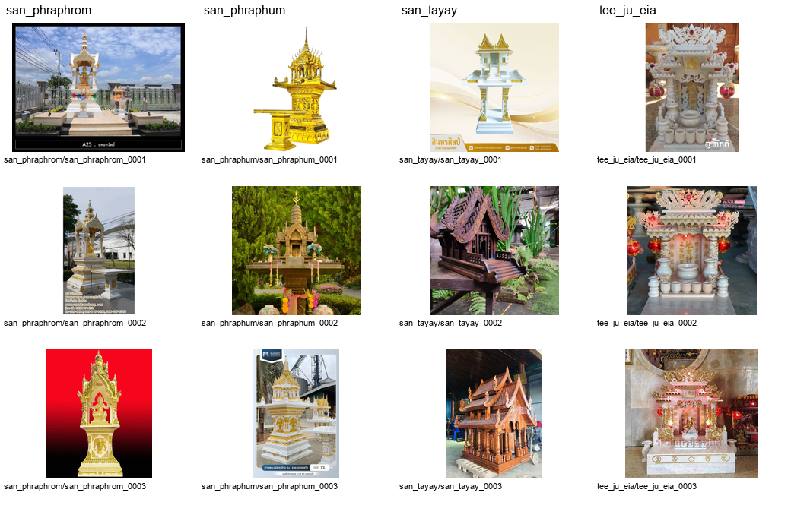

*Figure 1. ตัวอย่างภาพทั้งสี่คลาส แสดงความแตกต่างของรูปทรง มุมมอง และฉากหลัง*

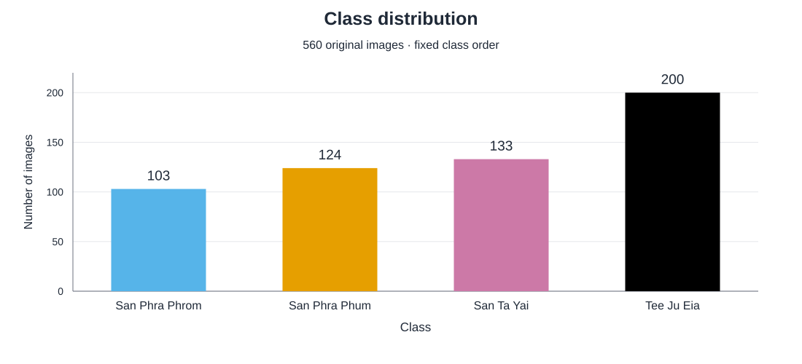

*Figure 2. จำนวนภาพต่อคลาสก่อนแบ่งข้อมูล*

### 1.3 Image dimensions, colour modes and brightness

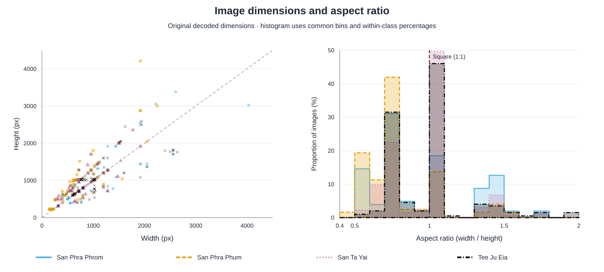

*Figure 3. ขนาดภาพต้นฉบับและ histogram ของอัตราส่วนกว้างต่อสูง โดยใช้ bins ร่วมกันและแสดงสัดส่วนภาพภายในแต่ละคลาส*

ภาพมีขนาดต่างกัน 206 แบบ ทั้งแนวตั้ง แนวนอน และจัตุรัส โดยเป็นภาพจัตุรัส 190 ภาพ จึงเตรียมภาพด้วยการย่อโดยรักษาสัดส่วนแล้วเติมขอบให้ครบ 224 × 224 พิกเซล เพื่อคงรูปทรงศาลไว้

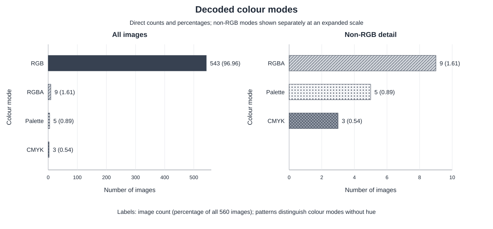

*Figure 4. จำนวนและสัดส่วนของโหมดสีที่ถอดรหัสได้จริง พร้อมกราฟขยายกลุ่ม non-RGB เพื่อให้เห็นกลุ่มที่มีภาพน้อย*

ภาพส่วนใหญ่เป็น RGB 543 ภาพ อีก 17 ภาพเป็น RGBA, Palette หรือ CMYK จึงแปลงทุกภาพเป็น RGB และผสมส่วนโปร่งใสกับสีพื้นกลางก่อนเข้าโมเดล


*Figure 5. ความสว่างเฉลี่ยรายภาพแยกคลาส กล่องแสดง IQR และมัธยฐาน เครื่องหมาย × แสดงค่าเฉลี่ยรายคลาส เส้นประแนวนอนแสดงค่าเฉลี่ยรวม*

ความสว่างของภาพกระจายกว้างและทับซ้อนกันระหว่างคลาส ภาพประเภทเดียวกันจึงมีสภาพแสงหลากหลาย การฝึกใช้การปรับแสงและสีเล็กน้อยเพื่อให้โมเดลพบความแปรผันนี้มากขึ้น

<p align="right"><a href="#top">กลับสู่ด้านบน</a></p>

## 2. Data preparation

### 2.1 Group-based data splitting

แบ่งข้อมูลเป็น train, validation และ test ในสัดส่วนใกล้เคียง 70/15/15 โดยจัดภาพที่ซ้ำหรือใกล้เคียงกันให้อยู่ในกลุ่มเดียวกันก่อน แล้วใช้ GroupShuffleSplit ด้วย split seed 42 เพื่อแยกกลุ่มภาพพร้อมรักษาสัดส่วนคลาสให้ใกล้เคียงกัน

| Split | Total images | Phra Phrom | Phra Phum | Ta Yai | Tee Ju Eia |
| --- | ---: | ---: | ---: | ---: | ---: |
| Train | 390 | 70 | 89 | 91 | 140 |
| Validation | 85 | 17 | 17 | 21 | 30 |
| Test | 85 | 16 | 18 | 21 | 30 |

ชุด train ใช้ให้โมเดลเรียนรู้ ส่วน validation ใช้เลือก hyperparameters และน้ำหนักที่ดีที่สุดระหว่างฝึก จากนั้นจึงประเมินด้วย test หลังล็อกสูตรแล้ว ทุก setup และทุก seed ใช้การแบ่งภาพชุดเดียวกันเพื่อให้เปรียบเทียบผลได้ตรงกัน โดยแบ่งข้อมูลก่อนทำ augmentation และไม่มีภาพกลุ่มเดียวกันข้ามชุดข้อมูล

### 2.2 Image preprocessing and normalization

ขั้นตอนเตรียมภาพประกอบด้วยการถอดรหัส จัดทิศทางตาม EXIF แปลงโหมดสีและจัดการความโปร่งใส จากนั้นย่อด้วย LANCZOS โดยรักษาอัตราส่วน ให้ด้านยาวเท่ากับ 224 พิกเซล แล้ววางกึ่งกลางบนพื้น RGB (124,116,104) ขนาด 224 × 224 โดยคงขอบเดิมที่ติดมากับภาพไว้


*Figure 6. ภาพ train `san_phraphrom_0001` ขนาด 960 × 720 เทียบกับผล preprocessing 224 × 224 ที่ขยายให้เห็นรายละเอียด*

หลัง augmentation สำหรับ train ภาพถูกแปลงเป็น tensor โดยปรับค่าพิกเซล RGB จาก 0–255 เป็น 0–1 แล้ว normalize ด้วยสูตร `(x − mean) / SD` ใช้ mean `(0.485,0.456,0.406)` และ SD `(0.229,0.224,0.225)` ของ ImageNet ให้สอดคล้องกับโมเดล pretrained

### 2.3 Training augmentation

Augmentation ใช้เฉพาะ train เพื่อเพิ่มความหลากหลายของภาพที่โมเดลพบระหว่างฝึก ส่วน validation และ test ใช้ preprocessing แบบคงที่

| Transformation | Parameter / probability | Description | Purpose |
| --- | --- | --- | --- |
| Rotation | ±12° | หมุนภาพเล็กน้อย | จำลองการถือกล้องเอียง |
| Translation | ±5% | เลื่อนภาพแนวนอนและแนวตั้ง | ลดการยึดติดกับตำแหน่งเดิม |
| Scale | 0.92–1.08 | ย่อหรือขยายภาพเล็กน้อย | จำลองขนาดวัตถุที่ต่างกัน |
| Perspective | Distortion 0.10; probability 0.20 | ปรับมุมมองภาพเล็กน้อยใน 20% ของโอกาส | เพิ่มความแปรผันของมุมถ่าย |
| Horizontal flip | Probability 0.50 | สะท้อนภาพซ้าย–ขวา | เพิ่มความหลากหลายของการจัดวาง |
| Color jitter | Brightness/contrast/saturation 0.10; hue 0.02 | ปรับแสงและสีภายในช่วงที่กำหนด | จำลองสภาพแสงและสีที่ต่างกัน |
| Random erasing | Probability 0.05; area 0.02–0.08 | แทนที่พื้นที่เล็ก ๆ ด้วยสีพื้นกลาง | จำลองการบดบังบางส่วน |

Probability คือโอกาสที่การแปลงจะเกิดขึ้นกับแต่ละภาพ ส่วน area ของ erasing คือสัดส่วนพื้นที่ที่เลือกแทนที่ พื้นที่ว่างจากการแปลงเชิงเรขาคณิตและ erasing ใช้สีพื้นกลางเดียวกัน โดยคำนึงถึงสเกลหลัง normalization สำหรับ erasing

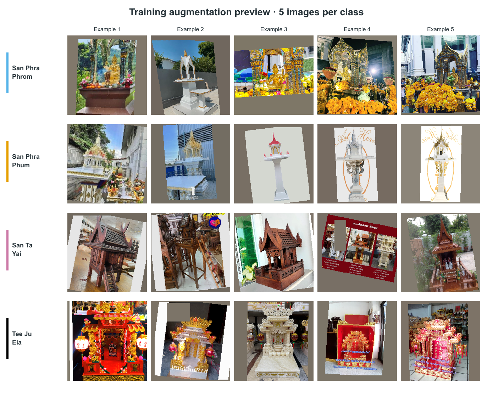

*Figure 7. ตัวอย่าง augmentation จากภาพ train จริงคลาสละห้าภาพ ใช้ seed คงที่เพื่อสร้างซ้ำได้*

ภาพนี้สร้างเพื่อสาธิตนโยบาย augmentation โดย seed ควบคุมการสุ่มให้สร้างตัวอย่างเดิมซ้ำได้ ไม่ใช่ minibatch ที่บันทึกระหว่างฝึก การเรนเดอร์ JavaScript อาจต่างจาก torchvision ในรายละเอียดระดับพิกเซล

### 2.4 Batch loading

ระหว่างฝึก DataLoader ส่งภาพให้โมเดลครั้งละ 16 หรือ 32 ภาพตาม batch size ที่เลือก โมเดลคำนวณข้อผิดพลาดจากภาพกลุ่มนั้นแล้วปรับน้ำหนักหนึ่งครั้ง เมื่อใช้ภาพ train ครบ 390 ภาพถือว่าจบหนึ่ง epoch จากนั้นสุ่มลำดับภาพใหม่สำหรับรอบถัดไป

ใช้ภาพใน batch สุดท้ายด้วยแม้จำนวนไม่ครบ เช่น batch size 32 จะแบ่งได้ 12 batches เต็มและ batch สุดท้ายอีก 6 ภาพ ส่วน validation และ test ใช้ลำดับภาพคงที่และคำนวณผลโดยไม่ปรับน้ำหนัก

<p align="right"><a href="#top">กลับสู่ด้านบน</a></p>

## 3. Model architecture

### 3.1 Feature extraction and classification

โมเดลประกอบด้วย **backbone** ซึ่งสกัดลักษณะจากภาพ และ **classifier** ซึ่งนำลักษณะเหล่านั้นมาให้คะแนนแต่ละคลาส ใช้ pretrained weights อย่างเป็นทางการของ torchvision ผ่าน `Weights.DEFAULT` ตาม environment ที่บันทึกไว้

โมเดล ImageNet เดิมให้คะแนน 1,000 คลาส การศึกษานี้เปลี่ยนเฉพาะชั้นให้คะแนนสุดท้ายให้เหลือ 4 คะแนนสำหรับศาลไทย ชั้นดังกล่าวเรียกว่า **linear layer** เพราะคำนวณคะแนนจากผลรวมถ่วงน้ำหนักของลักษณะภาพ แล้วบวกค่าคงที่หรือ bias ตามสมการ `z = Wx + b` โดย `x` คือลักษณะที่สกัดได้ `W` และ `b` เป็นค่าที่เรียนรู้ และ `z` คือคะแนน logits ของแต่ละคลาส คลาสที่ได้คะแนนสูงสุดเป็นคำทำนาย

| Architecture | Backbone structure | Classification-head adaptation |
| --- | --- | --- |
| ResNet50 | Residual blocks | เปลี่ยนชั้น `fc` สุดท้ายเป็นชั้นให้คะแนน 4 คลาส |
| EfficientNet-B0 | MBConv blocks | เปลี่ยนชั้นให้คะแนนสุดท้าย คง Dropout 0.2 |
| MobileNetV3-Large | InvertedResidual blocks | เปลี่ยนชั้นให้คะแนนสุดท้าย คง hidden linear, Hardswish และ Dropout 0.2 |
| DenseNet121 | Dense blocks | เปลี่ยน `classifier` เป็นชั้นให้คะแนน 4 คลาส |
| ConvNeXt-Tiny | ConvNeXt feature stages | เปลี่ยนชั้นให้คะแนนสุดท้าย คง normalization และ flatten |

สถาปัตยกรรมทั้งห้าเป็นกลุ่มเปรียบเทียบที่กำหนดไว้ล่วงหน้า เพื่อศึกษาวิธีเชื่อมต่อและขอบเขตการปรับน้ำหนักที่ต่างกัน เหตุผลที่เลือก MobileNetV3-Large/Partial โดยพิจารณาทั้งผลทดสอบและข้อจำกัดทรัพยากรอยู่ในหัวข้อ 6.9

### 3.2 Fine-tuning strategies

เปรียบเทียบ 3 วิธี โดย **freeze** คือคงน้ำหนักจาก ImageNet ไว้ และ **unfreeze** คือเปิดให้น้ำหนักเรียนรู้จากภาพ train เพิ่มเติม

| Strategy | Trainable parts | Backbone state during training | Purpose |
| --- | --- | --- | --- |
| Full | Backbone และ classifier ทั้งหมด | Train ทั้งหมด | ปรับทั้งโมเดลให้เข้ากับภาพศาล |
| Frozen | Classifier head เท่านั้น | Freeze และ eval | ใช้ลักษณะภาพจาก ImageNet โดยตรง |
| Partial | Backbone stage สุดท้ายและ classifier | ส่วนต้น freeze และ eval; ส่วนท้าย train | ปรับส่วนท้ายโดยเก็บลักษณะพื้นฐานไว้ |

ส่วนที่ freeze ใช้ eval mode เพื่อคงสถิติ BatchNorm และปิดการสุ่มของ Dropout ส่วนที่ฝึกใช้ train mode ขณะ validation/test ทุกส่วนใช้ eval ทั้งนี้ eval mode เพียงอย่างเดียวไม่ได้ตรึงน้ำหนัก ต้องปิดการคำนวณ gradient ของส่วนนั้นด้วย

**Partial เลือกเปิดตาม stage ของสถาปัตยกรรม** ไม่ได้กำหนดให้ทุกโมเดลเปิดจำนวน layers เท่ากัน ใช้ stage สุดท้ายทั้งกลุ่มและ classifier ตามตาราง

| Architecture | Unfrozen modules (including head) | Stage boundary |
| --- | --- | --- |
| [ResNet50](https://github.com/pytorch/vision/blob/v0.28.0/torchvision/models/resnet.py) | `layer4` + `fc` | Residual stage สุดท้าย: 3 Bottleneck blocks |
| [EfficientNet-B0](https://github.com/pytorch/vision/blob/v0.28.0/torchvision/models/efficientnet.py) | `features.7–8` + `classifier` | MBConv stage สุดท้าย 1 block และ final projection |
| [MobileNetV3-Large](https://github.com/pytorch/vision/blob/v0.28.0/torchvision/models/mobilenetv3.py) | `features.13–16` + `classifier` | กลุ่ม InvertedResidual สุดท้าย 3 blocks ที่ให้ output 160 channels และ final projection |
| [DenseNet121](https://github.com/pytorch/vision/blob/v0.28.0/torchvision/models/densenet.py) | `features.denseblock4`, `features.norm5` + `classifier` | Dense block สุดท้าย 16 DenseLayers และ normalization หลัง block |
| [ConvNeXt-Tiny](https://github.com/pytorch/vision/blob/v0.28.0/torchvision/models/convnext.py) | `features.7` + `classifier` | Feature stage สุดท้าย 3 CNBlocks; downsampling ก่อน stage นี้ยัง freeze |

แนวคิดคือเก็บลักษณะทั่วไปจากชั้นต้นไว้ แล้วปรับลักษณะชั้นท้ายให้เข้ากับงานศาล สอดคล้องกับ [Yosinski et al. (2014)](https://proceedings.neurips.cc/paper_files/paper/2014/hash/532a2f85b6977104bc93f8580abbb330-Abstract.html) ส่วนขอบเขตที่ใช้เป็นกติกาของการทดลองนี้ อ้างอิงโครงสร้าง torchvision 0.28.0 และไม่ได้ค้นหาว่าควรเปิดกี่ layers จึงจะได้คะแนนดีที่สุด

ตารางต่อไปนับ **Conv2d, Linear และ normalization ที่มี parameters รวม classifier** ไม่รวม activation, pooling และ Dropout จึงเป็นคนละนิยามกับจำนวน layers ในชื่อโมเดล

| Architecture | Total layers | Trainable layers in Partial | Frozen layers in Partial |
| --- | ---: | ---: | ---: |
| ResNet50 | 107 | 21 | 86 |
| EfficientNet-B0 | 131 | 11 | 120 |
| MobileNetV3-Large | 110 | 28 | 82 |
| DenseNet121 | 242 | 66 | 176 |
| ConvNeXt-Tiny | 82 | 14 | 68 |

เช่น ResNet เปิด 3 Bottleneck blocks แต่เมื่อนับ Conv, BatchNorm และ head จะเป็น 21 layers ส่วน MobileNet รวม final projection และ head เป็น 28 layers สำหรับ ConvNeXt ยังมี `layer_scale` vectors ซึ่งรวมในจำนวน parameters แต่ไม่นับเป็น layer ในตารางนี้

ค่า Dropout คงตามโครงสร้างเดิม: EfficientNet-B0 และ MobileNetV3-Large มี Dropout ใน classifier ส่วนความลึกของการ unfreeze และค่า Dropout ไม่ได้อยู่ใน hyperparameter search

กราฟใช้สีน้ำเงินแทน Frozen สีส้มแดงแทน Partial และสีเขียวแทน Full พร้อมรูปทรงและเส้นต่างกันเพื่อช่วยแยกกลุ่ม

<p align="right"><a href="#top">กลับสู่ด้านบน</a></p>

### 3.3 Predictions before fine-tuning

ผล ResNet50/ImageNet เดิมบนตัวอย่าง train แสดงว่าชุดป้ายกำกับ 1,000 คลาสยังไม่ตรงกับสี่ประเภทศาล เช่น ผลทำนาย `stupa` อาจสัมพันธ์กับรูปทรง แต่ไม่ใช่ป้ายศาลไทยตามการศึกษานี้ ใช้ตัวเลข baseline เดิมที่เข้ากันได้กับข้อมูลชุดเดียวกัน โดยไม่นำมาคำนวณ Accuracy แบบสี่คลาส

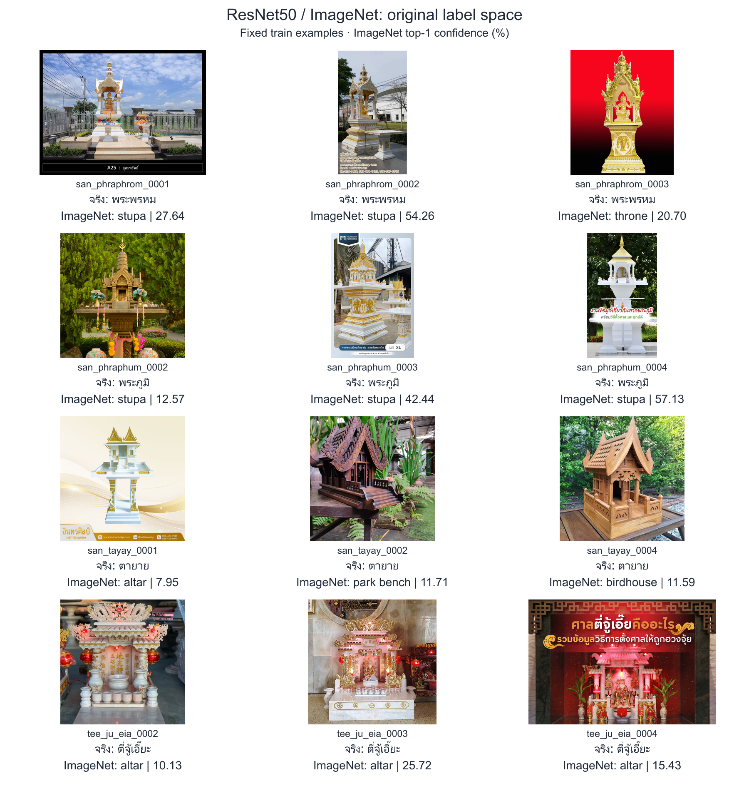

*Figure 8. ป้าย ImageNet และ confidence (%) จากตัวอย่าง train เดิม ใช้อธิบายความต่างของชุดป้ายกำกับก่อนปรับ classifier*

<p align="right"><a href="#top">กลับสู่ด้านบน</a></p>

## 4. Training method

### 4.1 Hyperparameter search

ลำดับการทดลองคือเตรียมข้อมูล → ค้นหา hyperparameters แยกทุก setup → เลือกสูตรแต่ละ setup ด้วย validation → ล็อกสูตรและโมเดลอ้างอิง → ฝึก final ด้วย 5 seeds → ประเมิน test และวิเคราะห์ผล

| Term | Meaning | Count in this study |
| --- | --- | --- |
| Setup | Architecture × fine-tuning strategy | 5 × 3 = 15 |
| Tuning trial | ทดลอง hyperparameters หนึ่งชุดภายใน setup ด้วย seed 42 | 5 ต่อ setup รวม 75 |
| Final run | นำ best hyperparameters ของแต่ละ setup มาฝึกด้วย 5 seeds โดยหนึ่ง seed เป็นหนึ่ง run | 5 ต่อ setup รวม 75 |
| Selected checkpoint | น้ำหนักที่เลือกจาก validation ภายในแต่ละ run | หนึ่ง checkpoint ต่อ run |

การค้นหา hyperparameters หรือ **sweep** ในงานนี้ใช้ random search ที่กำหนด seed โดยสุ่มค่าจากช่วงที่กำหนด แล้วบันทึกผลแต่ละ trial ผ่าน W&B ทุก setup ทดลองชุดค่าเดียวกัน 5 ชุด ชุดละไม่เกิน 30 epochs จึงมีงบค้นหาเท่ากันที่ **5 trials และสูงสุด 150 epochs ต่อ setup** แต่เลือกชุดที่ดีที่สุดจาก validation ของตนเองแยกกันทั้ง 15 setups

ตารางต่อไปนี้คือ **search space ของ hyperparameters 4 ตัวที่ tune** ค่า learning rate และ weight decay สุ่มบนสเกล logarithm เพื่อครอบคลุมค่าหลายระดับขนาด ส่วน optimizer และ batch size สุ่มจากตัวเลือกที่ระบุ

| Hyperparameter | Search space |
| --- | --- |
| Learning rate | Log-uniform [1e-5, 1e-3] |
| Weight decay | Log-uniform [1e-6, 1e-2] |
| Optimizer | AdamW, Adam, SGD |
| Batch size | 16, 32 |

จาก search space ข้างต้น ได้ **configurations ที่ใช้ทดลองจริง 5 ชุด** ดังตาราง แต่ละ trial ทดลองค่าทั้ง 4 ตัวร่วมกัน

| Trial | Learning rate | Weight decay | Optimizer | Batch |
| ---: | ---: | ---: | --- | ---: |
| 1 | 3.531117e-4 | 5.695263e-5 | Adam | 32 |
| 2 | 2.481624e-4 | 2.380726e-6 | Adam | 32 |
| 3 | 3.328736e-4 | 1.393982e-3 | Adam | 16 |
| 4 | 7.957413e-5 | 3.042230e-5 | AdamW | 32 |
| 5 | 1.939681e-4 | 1.954549e-3 | Adam | 16 |

ค่าที่สุ่มได้จริงเป็น Adam 4 ชุดและ AdamW 1 ชุด จึงไม่มีผลของ SGD ในรอบนี้ ส่วน Dropout เป็นค่าคงที่ตาม architecture เมื่อทดลองแต่ละ configuration ครบแล้ว นำ validation Macro F1 มาเปรียบเทียบภายใน setup ดัง Figure 9a เพื่อเลือกสูตรที่นำไปฝึก final


*Figure 9a. คะแนน validation ของ 5 trials ภายในแต่ละ setup วงแหวนระบุสูตรที่เลือก แต่ละจุดเป็นหนึ่ง configuration*

คะแนนของแต่ละ setup เปลี่ยนตาม configuration ที่ใช้ จึงเลือกสูตรแยกตาม architecture และ mode จากนั้น Figure 9b รวมผล 75 trials เพื่อดูความสัมพันธ์ระหว่างค่าที่ทดลอง พัฒนาการระหว่างฝึก และคะแนน validation

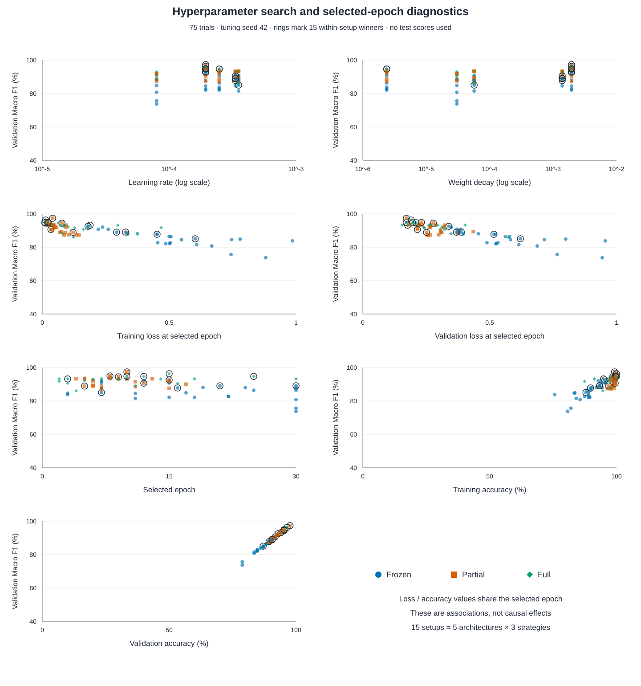

*Figure 9b. Learning rate, weight decay และผลที่ selected epoch เทียบกับ Validation Macro F1 (%) จาก 75 tuning trials*

ภาพรวมแสดงว่า configuration เดียวกันให้คะแนนต่างกันได้ตาม architecture และ mode อีกทั้งการฝึกได้นานหรือทำคะแนน train ได้สูงไม่ได้รับประกันว่าจะได้ validation Macro F1 สูงสุด จึงใช้ผล validation ของแต่ละ setup เป็นเกณฑ์เลือกสูตร ส่วนกราฟนี้ใช้ช่วยอธิบายผลการค้นหา เพราะแต่ละ trial เปลี่ยนหลาย hyperparameters พร้อมกัน จึงยังแยกผลของตัวแปรใดตัวแปรหนึ่งไม่ได้

### 4.2 Training settings and checkpoint selection

แต่ละ run ฝึกได้สูงสุด 30 epochs โดยหนึ่ง epoch คือการใช้ภาพ train ครบหนึ่งรอบ ภายในรอบนั้นโมเดลรับภาพทีละ batch แล้วปรับน้ำหนักด้วย optimizer ที่เลือก ค่า learning rate กำหนดขนาดก้าวในการปรับน้ำหนัก ส่วน weight decay ช่วยจำกัดขนาดน้ำหนักระหว่างฝึก เมื่อจบแต่ละ epoch จะประเมิน validation เพื่อติดตามพัฒนาการและเลือก checkpoint

| Setting | Value | Role |
| --- | --- | --- |
| Loss | Class-weighted cross-entropy | ให้น้ำหนักข้อผิดพลาดตามจำนวนภาพ train |
| Maximum epochs | 30 | จำกัดความยาวของแต่ละ run |
| Early stopping | Patience 7; min_delta 0.0001 (0.01 pp) | หยุดเมื่อไม่มีการพัฒนาตามเกณฑ์ต่อเนื่องเจ็ด epochs |
| Scheduler | ReduceLROnPlateau; mode=max; factor=0.5; patience=3 | ลด learning rate ลงครึ่งหนึ่งเมื่อ validation Macro F1 ไม่พัฒนาตามเกณฑ์ |
| Monitored metric | Validation Macro F1 | ใช้กับ scheduler และ early stopping |
| Adam defaults | Betas (0.9,0.999); epsilon 1e-8 | ค่าร่วมของ optimizer ตาม config |
| Tuning seed | 42 | ควบคุมการสุ่มในการฝึก tuning |
| Final seeds | 42, 123, 456, 789, 1024 | ฝึกสูตรเดิมด้วย 5 seeds เพื่อดูความแปรปรวน |

**Checkpoint** คือน้ำหนักโมเดลที่บันทึกไว้ ณ epoch หนึ่ง งานนี้เลือก checkpoint ที่มี validation Macro F1 สูงที่สุด หากเท่ากันจะเลือก validation loss ต่ำกว่า และถ้ายังเท่ากันจะเลือก epoch ที่เกิดก่อน

ส่วน **early stopping** ใช้ตัดสินว่าจะหยุดฝึกเมื่อใด โดยหยุดเมื่อ validation Macro F1 ไม่ดีขึ้นตามเกณฑ์ `min_delta` ติดต่อกัน 7 epochs ดังนั้น epoch ที่เลือก checkpoint อาจเกิดก่อน epoch ที่หยุดฝึก และคะแนนที่ดีขึ้นเล็กน้อยอาจทำให้เปลี่ยน checkpoint ได้ แม้ยังไม่มากพอให้เริ่มนับ patience ใหม่

เมื่อครบ 5 trials ของแต่ละ setup จะเลือก best hyperparameters จาก validation Macro F1 ของ checkpoint ที่เลือก หากคะแนนเท่ากัน ใช้ validation Accuracy ที่สูงกว่า ตามด้วย validation loss ที่ต่ำกว่า และ trial index ที่น้อยกว่าตามลำดับ

### 4.3 Selected configurations and final evaluation

ตารางแสดง best hyperparameters ของทั้ง 15 setups พร้อม validation Macro F1 จากรอบ tuning seed 42

| Setup | Learning rate | Weight decay | Optimizer | Batch size | Tuning validation F1 (%) |
| --- | ---: | ---: | --- | ---: | ---: |
| ResNet50/Full | 1.939681e-4 | 1.954549e-3 | Adam | 16 | 93.17 |
| ResNet50/Frozen | 3.328736e-4 | 1.393982e-3 | Adam | 16 | 87.76 |
| ResNet50/Partial | 1.939681e-4 | 1.954549e-3 | Adam | 16 | 94.40 |
| EfficientNet-B0/Full | 2.481624e-4 | 2.380726e-6 | Adam | 32 | 94.68 |
| EfficientNet-B0/Frozen | 3.531117e-4 | 5.695263e-5 | Adam | 32 | 85.04 |
| EfficientNet-B0/Partial | 3.328736e-4 | 1.393982e-3 | Adam | 16 | 88.87 |
| MobileNetV3-Large/Full | 1.939681e-4 | 1.954549e-3 | Adam | 16 | 94.68 |
| MobileNetV3-Large/Frozen | 1.939681e-4 | 1.954549e-3 | Adam | 16 | 92.50 |
| MobileNetV3-Large/Partial | 1.939681e-4 | 1.954549e-3 | Adam | 16 | 97.34 |
| DenseNet121/Full | 1.939681e-4 | 1.954549e-3 | Adam | 16 | 96.28 |
| DenseNet121/Frozen | 3.328736e-4 | 1.393982e-3 | Adam | 16 | 89.06 |
| DenseNet121/Partial | 3.328736e-4 | 1.393982e-3 | Adam | 16 | 90.61 |
| ConvNeXt-Tiny/Full | 2.481624e-4 | 2.380726e-6 | Adam | 32 | 94.63 |
| ConvNeXt-Tiny/Frozen | 3.328736e-4 | 1.393982e-3 | Adam | 16 | 89.02 |
| ConvNeXt-Tiny/Partial | 1.939681e-4 | 1.954549e-3 | Adam | 16 | 94.90 |

MobileNetV3-Large/Partial ได้รับเลือกเป็น **statistical reference** ด้วย tuning validation Macro F1 97.34%, Accuracy 97.65% และ loss 0.1718 ผลการเลือกและสูตรทั้ง 15 setups ถูกล็อกใน `selection.json` ก่อน final evaluation

จากนั้นนำ best hyperparameters ของแต่ละ setup มาฝึกใหม่ด้วย **5 seeds** ทุก run เริ่มจาก ImageNet weights และเลือก checkpoint ของตนเองด้วย validation ก่อนนำ checkpoint นั้นไปประเมิน test หนึ่งครั้ง จึงได้ผล 5 ค่าในแต่ละ setup สำหรับคำนวณค่าเฉลี่ยและ SD

ตารางด้านล่างสรุป epoch ที่เลือก checkpoint ของแต่ละ setup ทั้งค่าเฉลี่ยและช่วงจาก 5 seeds ค่า **Mean selected epoch** จึงเป็นจุดสรุปการเลือก checkpoint และไม่ใช่จุดที่กำหนดให้ทุก run หยุดฝึกพร้อมกัน

| Setup | Final runs | Mean selected epoch | Selected epoch range | Seeds |
| --- | ---: | ---: | --- | --- |
| ResNet50/Full | 5 | 8.4 | 3–12 | 42, 123, 456, 789, 1024 |
| ResNet50/Frozen | 5 | 15.6 | 13–19 | 42, 123, 456, 789, 1024 |
| ResNet50/Partial | 5 | 12.6 | 9–21 | 42, 123, 456, 789, 1024 |
| EfficientNet-B0/Full | 5 | 17.6 | 11–25 | 42, 123, 456, 789, 1024 |
| EfficientNet-B0/Frozen | 5 | 15.8 | 7–22 | 42, 123, 456, 789, 1024 |
| EfficientNet-B0/Partial | 5 | 7.8 | 3–12 | 42, 123, 456, 789, 1024 |
| MobileNetV3-Large/Full | 5 | 13.4 | 7–21 | 42, 123, 456, 789, 1024 |
| MobileNetV3-Large/Frozen | 5 | 17.2 | 12–22 | 42, 123, 456, 789, 1024 |
| MobileNetV3-Large/Partial | 5 | 11.4 | 6–20 | 42, 123, 456, 789, 1024 |
| DenseNet121/Full | 5 | 12.4 | 7–19 | 42, 123, 456, 789, 1024 |
| DenseNet121/Frozen | 5 | 21.4 | 15–30 | 42, 123, 456, 789, 1024 |
| DenseNet121/Partial | 5 | 9.6 | 7–12 | 42, 123, 456, 789, 1024 |
| ConvNeXt-Tiny/Full | 5 | 8.4 | 4–12 | 42, 123, 456, 789, 1024 |
| ConvNeXt-Tiny/Frozen | 5 | 13.2 | 7–21 | 42, 123, 456, 789, 1024 |
| ConvNeXt-Tiny/Partial | 5 | 9.6 | 4–21 | 42, 123, 456, 789, 1024 |

<p align="right"><a href="#top">กลับสู่ด้านบน</a></p>

## 5. Evaluation metrics

### 5.1 Classification metrics

ประเมินด้วย 4 metrics เพื่อดูทั้งความถูกต้องรวมและผลต่อแต่ละคลาส

| Metric | Definition | Interpretation |
| --- | --- | --- |
| Accuracy | จำนวนภาพที่ทายถูก / จำนวนภาพทั้งหมด | ทายภาพทั้งหมดถูกมากเพียงใด |
| Precision | TP / (TP + FP) | ภาพที่ทายว่าเป็นคลาสนี้ เป็นคลาสนี้จริงกี่ส่วน |
| Recall | TP / (TP + FN) | ภาพที่เป็นคลาสนี้จริง โมเดลตรวจพบกี่ส่วน |
| F1 | 2 × Precision × Recall / (Precision + Recall) | สรุป Precision และ Recall ร่วมกัน |

เมื่อพิจารณาทีละคลาส TP คือภาพที่ทายเป็นคลาสนั้นถูกต้อง FP คือภาพคลาสอื่นที่ทายมาเป็นคลาสนั้น และ FN คือภาพของคลาสนั้นที่ทายไปเป็นคลาสอื่น กรณีตัวหารเป็นศูนย์ให้ค่าเป็น 0

**Macro precision, Macro recall และ Macro F1** คำนวณ metric ของแต่ละคลาสก่อน แล้วเฉลี่ยทั้ง 4 คลาสเท่ากัน จึงให้ความสำคัญกับคลาสที่มีภาพน้อยด้วย โดย Macro F1 เฉลี่ยจาก F1 รายคลาสโดยตรง

รายงานผลแต่ละ setup เป็น **ค่าเฉลี่ย (%) ± sample SD (pp) จาก 5 seeds** ค่าเฉลี่ยแสดงระดับคะแนน ส่วน SD แสดงว่าคะแนนแปรผันระหว่างการฝึกมากเพียงใด เช่น 93.65% ± 1.34 pp หมายถึงคะแนนเฉลี่ย 93.65% และ SD 1.34 จุดเปอร์เซ็นต์ ใช้ sample SD (`ddof=1`) โดยทุก seed ประเมินบน test ชุดเดียวกัน

### 5.2 Paired statistical comparisons

ใช้ **two-sided paired t-test** เปรียบเทียบ Accuracy และ Macro F1 โดยหาผลต่างของโมเดลสองแบบที่ใช้ seed เดียวกัน จึงได้ผลต่าง 5 คู่ แล้วทดสอบว่าค่าเฉลี่ยผลต่างต่างจากศูนย์หรือไม่

เมื่อทดสอบหลายคู่ โอกาสพบความแตกต่างโดยบังเอิญจะเพิ่มขึ้น จึงปรับ p-value ด้วย **Holm** เพื่อควบคุมโอกาสสรุปว่ามีความแตกต่างทั้งที่ไม่มีจริงภายในแต่ละกลุ่มการทดสอบ โดยตัดสินนัยสำคัญเมื่อ Holm-adjusted p < 0.05 แบ่งเป็น 2 กลุ่มตามคำถามวิจัยที่กำหนดไว้ก่อนดู test:

| Comparison group | Question and comparisons | Number of tests |
| --- | --- | ---: |
| Primary | โมเดลอ้างอิง MobileNetV3-Large/Partial ต่างจากอีก 14 setups หรือไม่: 14 คู่ × Accuracy และ Macro F1 | 28 |
| Secondary | ใน architecture เดียวกัน Full–Frozen, Full–Partial และ Partial–Frozen ต่างกันหรือไม่: 3 คู่ × 5 architectures × 2 metrics | 30 |

ปรับ Holm ภายในแต่ละกลุ่มตามจำนวนการทดสอบข้างต้น และคงทั้ง 28 และ 30 รายการไว้ครบ ผลนี้อธิบายความแปรผันจาก training seeds บน split เดียวกัน ตัวอย่างการตั้งสมมติฐานและคำนวณอยู่ในหัวข้อ 6.4

### 5.3 Confidence calibration

Confidence คือความน่าจะเป็นสูงสุดที่โมเดลให้กับคลาสที่ทำนาย Calibration ตรวจว่าระดับความมั่นใจนั้นสอดคล้องกับความถูกต้องที่สังเกตหรือไม่ Expected Calibration Error (ECE) แบ่งผลทำนายเป็นสิบช่วงความกว้างเท่ากันตั้งแต่ 0–10% ถึง 90–100% ตาม implementation จริง จากนั้นคำนวณขนาดความต่างระหว่าง confidence เฉลี่ยกับ accuracy ของแต่ละช่วง แล้วเฉลี่ยโดยถ่วงน้ำหนักตามจำนวนภาพ ช่วงที่ไม่มีภาพไม่มีส่วนร่วมในผลรวม

**ตัวอย่างเพื่ออธิบาย:** กลุ่มที่มี confidence เฉลี่ย 85% แต่ทายถูก 70% มี calibration gap 15 pp ECE รวมพิจารณาทุกกลุ่ม ค่า ECE ต่ำจึงหมายถึงความมั่นใจกับความถูกต้องสอดคล้องกันมากขึ้นภายใต้วิธีแบ่ง bins นี้ ไม่ได้วัด Accuracy โดยตรง และอาจเปลี่ยนตามวิธีแบ่ง bins กับจำนวนตัวอย่าง ตัวอย่างตัวเลขนี้ไม่ใช่ผลทดลองเพิ่มเติม

<p align="right"><a href="#top">กลับสู่ด้านบน</a></p>

## 6. Experimental results

### 6.1 Experiment completeness

งานหลักเสร็จครบทั้ง 15 setups: setup ละ 5 tuning trials และ 5 final seeds รวม 75 tuning + 75 final runs โดยประเมินบน test 85 ภาพชุดเดียวกันเฉพาะ final runs หลังล็อกสูตรแล้ว หัวข้อ 6.10 แสดง MobileNet/Partial ablation ที่ฝึกเพิ่ม 10 runs / 180 epochs โดย reuse baseline เดิม 5 seeds ส่วน ResNet ablation เดิม 10 runs / 145 epochs เก็บไว้เป็นหลักฐานย้อนหลัง รวมงานที่ฝึกจริง 170 runs / 3,086 epochs โดยไม่บวก baseline ซ้ำ

### 6.2 Learning curves across five seeds

กราฟแสดงพัฒนาการระหว่างฝึกของ 5 seeds แยก Full, Frozen และ Partial เส้นเป็นค่าเฉลี่ยและพื้นที่แรเงาเป็น ±1 sample SD โดยเส้นทึบแทน train และเส้นประแทน validation

เส้นแนวตั้ง **Mean selected epoch** แสดงในกราฟ **loss, accuracy และ Validation Macro F1** ของทุก mode โดยเป็นค่าเฉลี่ย epoch ของ checkpoint ที่เลือกด้วย validation จากครบ 5 seeds ของ setup นั้น ส่วนเครื่องหมาย **×** บนกราฟ Validation Macro F1 แสดง selected checkpoint ของแต่ละ seed เส้นแนวตั้งนี้ไม่ใช่ค่าเฉลี่ย stopping epoch และไม่ได้หมายความว่าทุก run ใช้ checkpoint epoch เดียวกัน

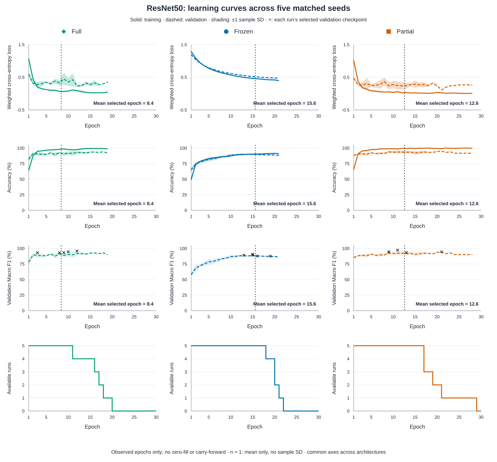

*Figure 10. ResNet50: mean ± sample SD ของ loss, accuracy และ Validation Macro F1 พร้อมจำนวน runs ต่อ epoch*

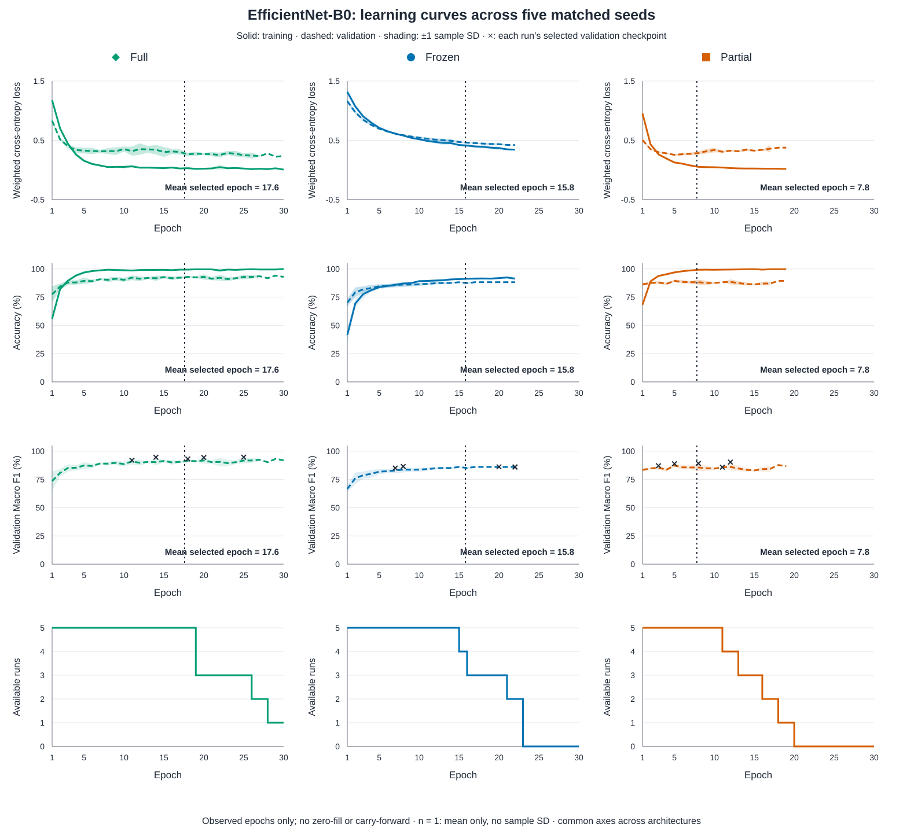

*Figure 11. EfficientNet-B0: mean ± sample SD ของ loss, accuracy และ Validation Macro F1 พร้อมจำนวน runs ต่อ epoch*


*Figure 12. MobileNetV3-Large: mean ± sample SD ของ loss, accuracy และ Validation Macro F1 พร้อมจำนวน runs ต่อ epoch*

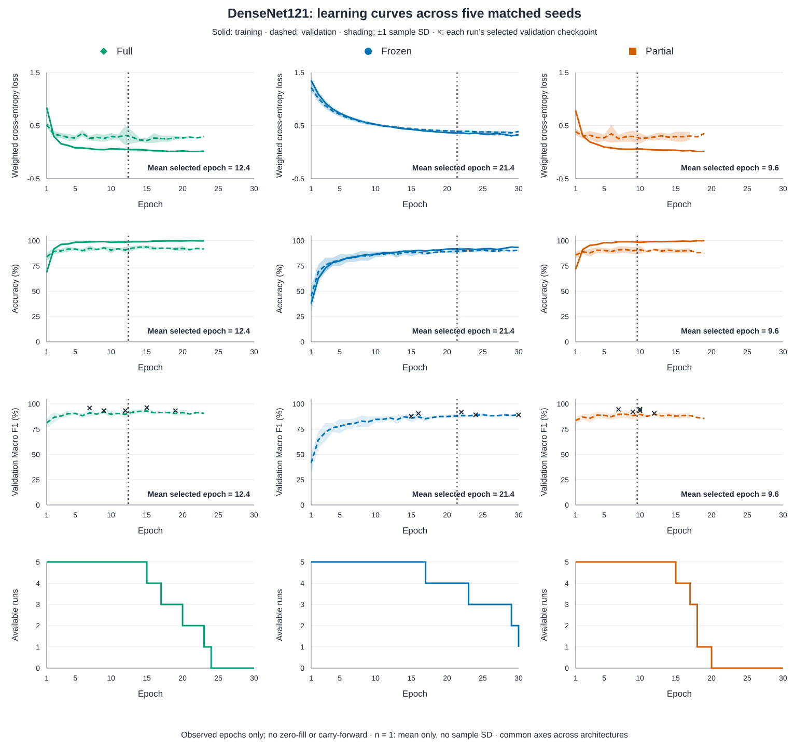

*Figure 13. DenseNet121: mean ± sample SD ของ loss, accuracy และ Validation Macro F1 พร้อมจำนวน runs ต่อ epoch*

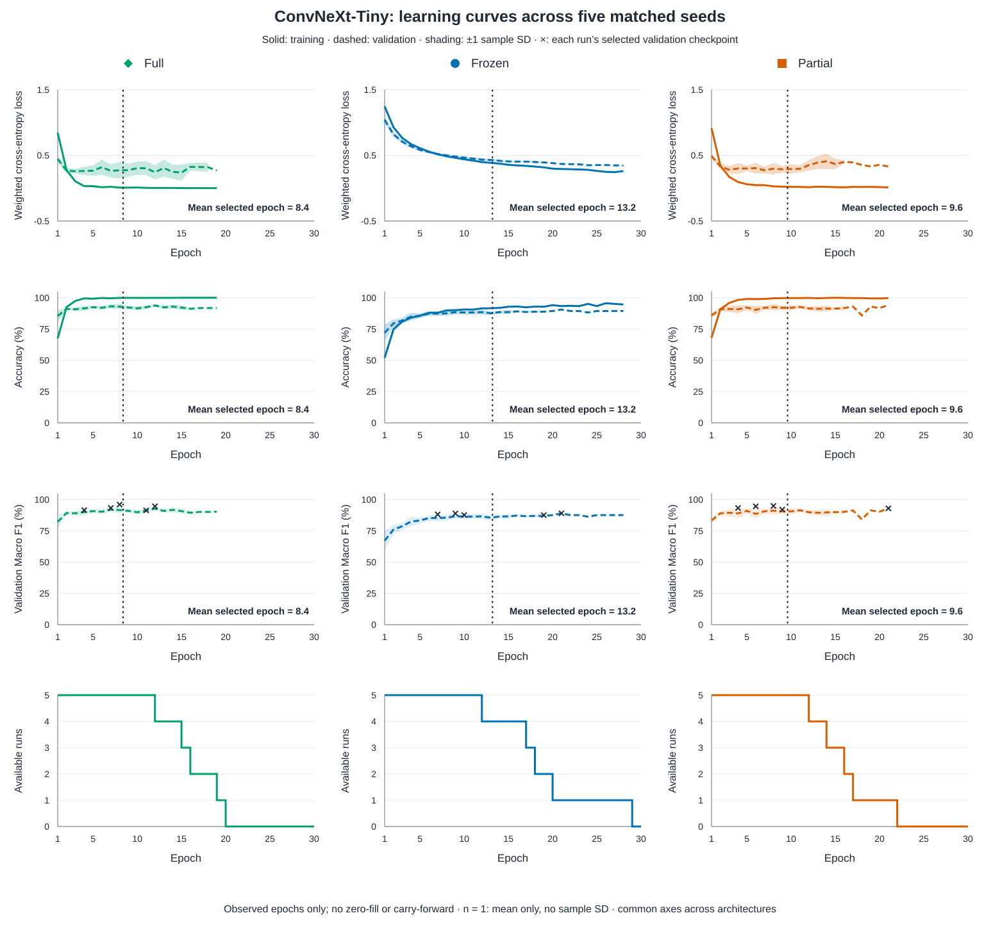

*Figure 14. ConvNeXt-Tiny: mean ± sample SD ของ loss, accuracy และ Validation Macro F1 พร้อมจำนวน runs ต่อ epoch*

แถวล่าง **Available runs** คือจำนวน runs ที่ยังมีข้อมูล ณ epoch นั้น เมื่อบาง run หยุดฝึก จำนวนจะลดลงจาก 5 เส้นเฉลี่ยจึงคำนวณจาก runs ที่เหลือจริง โดยไม่เติมค่าหลังหยุด หากเหลือเพียงหนึ่ง run จะไม่มีแถบ SD ช่วงท้ายจึงควรอ่านคู่กับจำนวน runs เสมอ

Train วัดระหว่างฝึกด้วย augmentation ส่วน validation วัดด้วยภาพที่เตรียมแบบคงที่ จึงมีเงื่อนไขต่างกัน แถบ ±SD แสดงการกระจายของคะแนน ไม่ใช่ช่วงความเชื่อมั่น และจุดสูงสุดของเส้นเฉลี่ยไม่ใช่ checkpoint ที่ใช้ร่วมกันทุก seed

### 6.3 Test performance

**ResNet50/Full มีค่าเฉลี่ยสูงสุดทั้ง 4 classification metrics จาก 15 setups** ได้แก่ Accuracy 93.65%, Macro precision 92.92%, Macro recall 92.77% และ Macro F1 92.56% อันดับนี้เป็นผลเชิงพรรณนาบน test ส่วนการเลือก MobileNet/Partial โดยพิจารณาทรัพยากรร่วมด้วยอธิบายในหัวข้อ 6.9 ตารางแสดง mean (%) ± sample SD (pp) จาก 5 seeds เรียงตาม Macro F1

| Setup | Accuracy (%) | Macro precision (%) | Macro recall (%) | Macro F1 (%) |
| --- | ---: | ---: | ---: | ---: |
| ResNet50/Full | 93.65 ± 1.34 | 92.92 ± 2.07 | 92.77 ± 1.69 | 92.56 ± 1.81 |
| ResNet50/Partial | 93.18 ± 1.53 | 92.39 ± 1.63 | 92.11 ± 1.80 | 91.82 ± 2.09 |
| MobileNetV3-Large/Partial | 93.18 ± 2.41 | 92.71 ± 2.04 | 92.17 ± 2.66 | 91.68 ± 3.05 |
| DenseNet121/Partial | 92.71 ± 1.74 | 91.81 ± 2.10 | 91.49 ± 2.00 | 91.42 ± 1.85 |
| ConvNeXt-Tiny/Full | 92.94 ± 1.66 | 92.36 ± 1.94 | 91.79 ± 1.90 | 91.35 ± 2.12 |
| DenseNet121/Full | 92.71 ± 1.53 | 92.02 ± 1.93 | 91.44 ± 1.85 | 91.27 ± 1.89 |
| EfficientNet-B0/Partial | 92.71 ± 2.10 | 91.66 ± 2.64 | 91.29 ± 2.46 | 91.05 ± 2.67 |
| ConvNeXt-Tiny/Partial | 92.00 ± 1.53 | 92.05 ± 1.46 | 90.80 ± 1.72 | 90.74 ± 1.78 |
| MobileNetV3-Large/Full | 91.76 ± 0.83 | 91.45 ± 1.57 | 90.40 ± 0.85 | 89.86 ± 0.96 |
| EfficientNet-B0/Full | 91.06 ± 1.34 | 89.98 ± 1.43 | 89.25 ± 1.53 | 89.21 ± 1.52 |
| MobileNetV3-Large/Frozen | 90.35 ± 0.98 | 89.14 ± 0.93 | 89.23 ± 1.12 | 88.69 ± 1.33 |
| ResNet50/Frozen | 88.47 ± 1.53 | 87.93 ± 1.72 | 87.65 ± 1.59 | 87.55 ± 1.67 |
| DenseNet121/Frozen | 88.00 ± 1.29 | 86.37 ± 1.73 | 85.86 ± 1.57 | 85.87 ± 1.65 |
| ConvNeXt-Tiny/Frozen | 87.06 ± 2.76 | 86.14 ± 3.52 | 85.66 ± 2.69 | 85.17 ± 2.48 |
| EfficientNet-B0/Frozen | 85.65 ± 2.41 | 83.66 ± 2.62 | 83.78 ± 2.30 | 83.38 ± 2.36 |

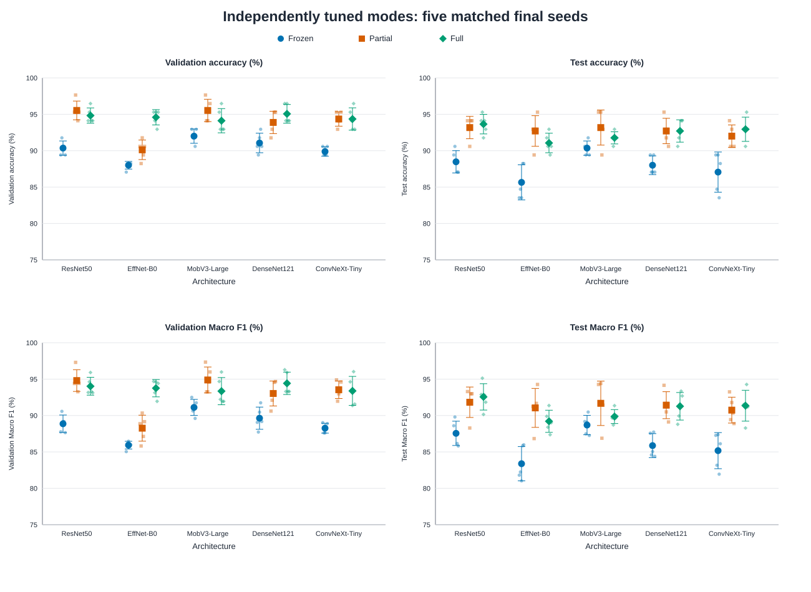

*Figure 15 Validation และ test Accuracy / Macro F1 ของ 15 setups จุดใหญ่คือค่าเฉลี่ย จุดจางคือแต่ละ seed เส้นคือ ± 1 SD (n = 5)*

เมื่อพิจารณา mode ภายในแต่ละ architecture พบว่า Full ให้ Macro F1 เฉลี่ยสูงสุดใน ResNet50 และ ConvNeXt-Tiny ส่วน Partial สูงสุดใน EfficientNet-B0, MobileNetV3-Large และ DenseNet121 ขณะที่ Frozen ต่ำสุดทั้ง 5 architectures จึงเห็นว่าขอบเขตการปรับ backbone ที่เหมาะสมขึ้นกับโมเดล

คำว่า “สูงสุด” ข้างต้นหมายถึงค่าเฉลี่ยของ 4 classification metrics รวม ไม่ได้หมายถึง SD ต่ำสุด ทุกคลาสดีที่สุด หรือ calibration ดีที่สุด รายละเอียดเหล่านี้และผลทางสถิตินำมาประกอบการเลือกโมเดลในหัวข้อถัดไป

### 6.4 Statistical comparisons

หลังปรับ Holm มี 2 จาก 28 สมมติฐานใน Primary และ 3 จาก 30 ใน Secondary ที่มีนัยสำคัญ ตารางแสดงรายการเหล่านั้นและการเทียบโมเดลอ้างอิงกับ ResNet50/Full Δ = A − B หน่วย pp

| Family | A − B | Metric | Mean Δ (pp) | 95% CI (pp)¹ | Holm p |
| --- | --- | --- | ---: | --- | ---: |
| Primary | MobileNetV3-Large/Partial<br>− ResNet50/Full | Accuracy | -0.47 | [-4.42, 3.48] | 1.000 |
| Primary | MobileNetV3-Large/Partial<br>− ResNet50/Full | Macro F1 | -0.88 | [-5.89, 4.13] | 1.000 |
| Primary | MobileNetV3-Large/Partial<br>− ConvNeXt-Tiny/Frozen | Accuracy | 6.12 | [4.52, 7.72] | 0.012 |
| Primary | MobileNetV3-Large/Partial<br>− ConvNeXt-Tiny/Frozen | Macro F1 | 6.50 | [4.81, 8.20] | 0.012 |
| Secondary | ResNet50/Full<br>− ResNet50/Frozen | Accuracy | 5.18 | [3.51, 6.84] | 0.028 |
| Secondary | DenseNet121/Frozen<br>− DenseNet121/Partial | Accuracy | -4.71 | [-6.17, -3.25] | 0.025 |
| Secondary | DenseNet121/Frozen<br>− DenseNet121/Partial | Macro F1 | -5.55 | [-7.16, -3.95] | 0.020 |

ผลที่มีนัยสำคัญคือ MobileNetV3-Large/Partial สูงกว่า ConvNeXt-Tiny/Frozen ทั้ง Accuracy และ Macro F1, ResNet50/Full สูงกว่า ResNet50/Frozen ใน Accuracy และ DenseNet121/Partial สูงกว่า DenseNet121/Frozen ทั้งสอง metrics ส่วน ResNet50/Full เทียบกับ MobileNetV3-Large/Partial ได้ Holm-adjusted p = 1.000 ทั้ง Accuracy และ Macro F1

¹ ช่วงความเชื่อมั่น 95% ในตารางยังไม่ปรับสำหรับการทดสอบหลายคู่ จึงใช้ Holm-adjusted p เป็นเกณฑ์ตัดสินนัยสำคัญ

#### Worked example: MobileNetV3-Large/Partial vs ResNet50/Full

เลือกทดสอบ **Macro F1** โดยกำหนดผลต่างของแต่ละ seed เป็น `d = F1(MobileNet/Partial) − F1(ResNet/Full)` ค่าบวกหมายถึง MobileNet ได้คะแนนสูงกว่า และค่าลบหมายถึง ResNet ได้คะแนนสูงกว่า

- **H₀: μd = 0** — ค่าเฉลี่ยผลต่าง Macro F1 ของสอง setup เท่ากับศูนย์
- **H₁: μd ≠ 0** — ค่าเฉลี่ยผลต่าง Macro F1 ของสอง setup ต่างจากศูนย์
- ใช้ two-sided paired t-test และระดับนัยสำคัญ **α = 0.05**

จับคู่ผลด้วย seed เดียวกัน ได้ข้อมูลดังนี้:

| Seed | MobileNet/Partial F1 (%) | ResNet/Full F1 (%) | Difference (pp) |
| ---: | ---: | ---: | ---: |
| 42 | 94.2680 | 92.8788 | 1.3893 |
| 123 | 91.4255 | 95.1296 | -3.7042 |
| 456 | 94.3978 | 90.1515 | 4.2462 |
| 789 | 86.8811 | 92.8030 | -5.9219 |
| 1024 | 91.4255 | 91.8312 | -0.4057 |

ค่าเฉลี่ยผลต่าง `d̄ = −0.8793 pp` และ sample SD ของผลต่าง `s_d = 4.0327 pp` เมื่อมี `n = 5` คู่ จะได้

```text
t = d̄ / (s_d / √n)
  = −0.8793 / (4.0327 / √5)
  ≈ −0.4875,  df = n − 1 = 4
```

ค่า **raw p = 0.6514** และหลังปรับร่วมกับการทดสอบทั้งหมด 28 รายการในกลุ่ม Primary ได้ **Holm-adjusted p = 1.0000 > α = 0.05** จึง **ไม่ปฏิเสธ H₀** แม้ ResNet50/Full มี Macro F1 เฉลี่ยสูงกว่า 0.88 pp แต่ผลจาก 5 seeds ยังไม่แสดงความแตกต่างอย่างมีนัยสำคัญ การไม่ปฏิเสธ H₀ ไม่ได้ยืนยันว่าโมเดลทั้งสองให้ผลเท่ากัน

ตัวอย่างนี้เป็นหนึ่งรายการจากแผนทดสอบที่กำหนดไว้รวม 58 รายการ

### 6.5 Per-class performance

เปรียบเทียบ MobileNetV3-Large/Partial (โมเดลที่เลือกและ validation reference) กับ ResNet50/Full (โมเดลเปรียบเทียบ) ค่าเป็น mean (%) ± sample SD (pp) จาก 5 seeds Support คือจำนวนภาพ test ต่อ run

| Setup | Class | Support | Precision (%) | Recall (%) | F1 (%) |
| --- | --- | ---: | ---: | ---: | ---: |
| ResNet50/Full | พระพรหม | 16 | 88.98 ± 6.48 | 97.50 ± 3.42 | 92.94 ± 3.96 |
| ResNet50/Full | พระภูมิ | 18 | 92.17 ± 5.39 | 77.78 ± 3.93 | 84.35 ± 4.43 |
| ResNet50/Full | ตายาย | 21 | 90.55 ± 5.01 | 97.14 ± 2.61 | 93.63 ± 2.31 |
| ResNet50/Full | ตี่จู้เอี๊ยะ | 30 | 100.00 ± 0.00 | 98.67 ± 1.83 | 99.32 ± 0.93 |
| MobileNetV3-Large/Partial | พระพรหม | 16 | 84.48 ± 5.19 | 100.00 ± 0.00 | 91.52 ± 3.12 |
| MobileNetV3-Large/Partial | พระภูมิ | 18 | 95.89 ± 3.77 | 72.22 ± 10.39 | 81.93 ± 6.75 |
| MobileNetV3-Large/Partial | ตายาย | 21 | 90.47 ± 4.05 | 97.14 ± 2.61 | 93.61 ± 1.74 |
| MobileNetV3-Large/Partial | ตี่จู้เอี๊ยะ | 30 | 100.00 ± 0.00 | 99.33 ± 1.49 | 99.66 ± 0.76 |

พระภูมิเป็นคลาสที่ยากที่สุดของทั้งสองโมเดล ResNet50/Full ได้ Recall 77.78% และ F1 84.35% สูงกว่า MobileNetV3-Large/Partial (72.22% และ 81.93%) แต่ MobileNetV3-Large/Partial ได้ Recall ของพระพรหมและตี่จู้เอี๊ยะสูงกว่า ดังนั้น ResNet50/Full ไม่ได้ชนะทุกคลาส

### 6.6 Confusion matrices

คำนวณสัดส่วนภายในแต่ละ true class ของแต่ละ seed ก่อน แล้วเฉลี่ยและหา sample SD ข้าม 5 seeds ช่องแนวทแยงคือ Recall ของคลาสนั้น สเกลสีเป็น 0–100 เท่ากันทุกภาพ


*Figure 16 Confusion matrix ของ MobileNetV3-Large/Partial (ค่าเฉลี่ย % และ SD เป็น pp ข้าม 5 seeds) พระภูมิถูกทายถูกเฉลี่ย 72.2% ± 10.4 pp ซึ่งต่ำสุดในสี่คลาส*

<details>
<summary>Confusion matrices for all 15 setups (five seeds each)</summary>

| Architecture | Frozen | Partial | Full |
| --- | --- | --- | --- |
| ResNet50 | [ดูภาพ](outputs/figures/evaluation/confusion_matrices/resnet50_frozen.svg) | [ดูภาพ](outputs/figures/evaluation/confusion_matrices/resnet50_partial.svg) | [ดูภาพ](outputs/figures/evaluation/confusion_matrices/resnet50_full.svg) |
| EfficientNet-B0 | [ดูภาพ](outputs/figures/evaluation/confusion_matrices/efficientnet_b0_frozen.svg) | [ดูภาพ](outputs/figures/evaluation/confusion_matrices/efficientnet_b0_partial.svg) | [ดูภาพ](outputs/figures/evaluation/confusion_matrices/efficientnet_b0_full.svg) |
| MobileNetV3-Large | [ดูภาพ](outputs/figures/evaluation/confusion_matrices/mobilenet_v3_large_frozen.svg) | [ดูภาพ](outputs/figures/evaluation/confusion_matrices/mobilenet_v3_large_partial.svg) | [ดูภาพ](outputs/figures/evaluation/confusion_matrices/mobilenet_v3_large_full.svg) |
| DenseNet121 | [ดูภาพ](outputs/figures/evaluation/confusion_matrices/densenet121_frozen.svg) | [ดูภาพ](outputs/figures/evaluation/confusion_matrices/densenet121_partial.svg) | [ดูภาพ](outputs/figures/evaluation/confusion_matrices/densenet121_full.svg) |
| ConvNeXt-Tiny | [ดูภาพ](outputs/figures/evaluation/confusion_matrices/convnext_tiny_frozen.svg) | [ดูภาพ](outputs/figures/evaluation/confusion_matrices/convnext_tiny_partial.svg) | [ดูภาพ](outputs/figures/evaluation/confusion_matrices/convnext_tiny_full.svg) |

</details>

### 6.7 Matched-image Grad-CAM comparison

เปรียบเทียบ ResNet50/Full กับ MobileNetV3-Large/Partial จาก **test 85 ภาพของ seed 42** แต่ละแถวเรียงเป็น **ภาพต้นฉบับ → ResNet overlay → MobileNet overlay** เพื่อดูบริเวณที่แต่ละโมเดลตอบสนองบนภาพเดียวกัน โดย CAM อธิบายคลาสที่โมเดลนั้นทำนาย

**ภาพที่ทั้งสองโมเดลทายถูก**

ใช้คลาสละ 1 ภาพ รวม 4 ภาพ โดยเลือกภาพที่ ResNet มั่นใจสูงสุดในแต่ละคลาสและทั้งสองโมเดลทายถูก

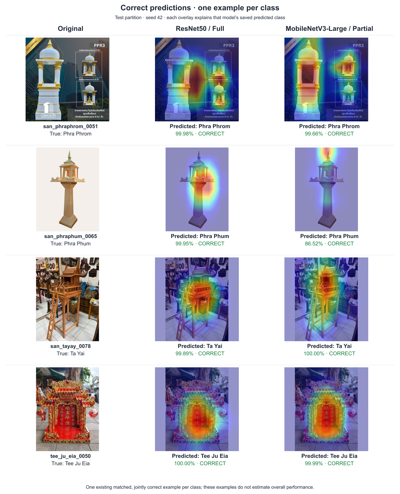

*Figure 17a. ภาพทายถูกคลาสละ 1 ภาพ พร้อม overlay ของทั้งสองโมเดล*

**ภาพที่อย่างน้อยหนึ่งโมเดลทายผิด**

ResNet ทายผิด 5 ภาพ ส่วน MobileNet ผิด 4 ภาพ และผิดร่วมกัน 2 ภาพ จึงมีภาพไม่ซ้ำ **7 ภาพ** แสดง overlay ทั้งสองฝั่งครบทุกแถว แม้ฝั่งหนึ่งจะทายถูก โดยสีเขียวหมายถึงทายถูกและสีแดงหมายถึงทายผิดเมื่อเทียบกับป้ายกำกับที่ใช้ในการทดลอง

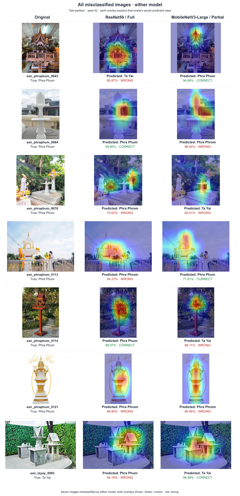

*Figure 17b. ภาพผิดครบ 7 ภาพของสอง checkpoints นี้ พร้อมคำทำนายและ confidence ของแต่ละโมเดล*

ตารางสรุปคำทำนายของทั้ง 11 ภาพ โดยใช้ผล final เดิม

| Image ID (stem) | True class | ResNet prediction | Confidence (%) | MobileNet prediction | Confidence (%) |
| --- | --- | --- | ---: | --- | ---: |
| san_phraphrom_0051 | พระพรหม | พระพรหม ✓ | 99.98 | พระพรหม ✓ | 99.66 |
| san_phraphum_0065 | พระภูมิ | พระภูมิ ✓ | 99.95 | พระภูมิ ✓ | 86.52 |
| san_tayay_0078 | ตายาย | ตายาย ✓ | 99.89 | ตายาย ✓ | 100.00 |
| tee_ju_eia_0050 | ตี่จู้เอี๊ยะ | ตี่จู้เอี๊ยะ ✓ | 100.00 | ตี่จู้เอี๊ยะ ✓ | 99.99 |
| san_phraphum_0043 | พระภูมิ | ตายาย ✗ | 60.87 | พระภูมิ ✓ | 94.88 |
| san_phraphum_0064 | พระภูมิ | พระภูมิ ✓ | 99.80 | พระพรหม ✗ | 86.44 |
| san_phraphum_0076 | พระภูมิ | พระพรหม ✗ | 72.62 | ตายาย ✗ | 60.01 |
| san_phraphum_0113 | พระภูมิ | พระพรหม ✗ | 94.37 | พระภูมิ ✓ | 71.91 |
| san_phraphum_0114 | พระภูมิ | พระภูมิ ✓ | 99.57 | ตายาย ✗ | 66.11 |
| san_phraphum_0121 | พระภูมิ | พระพรหม ✗ | 96.80 | พระพรหม ✗ | 99.46 |
| san_tayay_0093 | ตายาย | พระภูมิ ✗ | 94.18 | ตายาย ✓ | 98.98 |

ภาพ `san_phraphum_0065` แสดงความต่างได้ชัด: ResNet ตอบสนองใกล้เรือนและฐาน ส่วน MobileNet อยู่ใกล้ยอดหลังคา แม้ทั้งคู่ทายเป็นพระภูมิ ส่วนภาพ `san_phraphrom_0051` มีศาลหลายองค์และข้อความ จึงอ่าน CAM ได้ยากกว่า

ในภาพ `san_phraphum_0076` ทั้งคู่ทายผิดคนละคลาส ขณะที่ `san_phraphum_0121` ทั้งคู่ทายเป็นพระพรหม ต่างจากป้ายพระภูมิที่ใช้ประเมิน แม้ confidence สูงถึง 96.80% และ 99.46% จึงเห็นว่าบริเวณเด่นตรงตัวศาลและความมั่นใจสูงยังไม่รับประกันว่าคำทำนายจะตรงกับป้ายกำกับ

บางภาพ MobileNet ถูกแต่ ResNet ผิด เช่น `san_tayay_0093` และบางภาพกลับกัน เช่น `san_phraphum_0064` ภาพเหล่านี้ช่วยเทียบการตอบสนองของสองโมเดล แต่ยังสรุปสาเหตุของคำทำนายจาก CAM อย่างเดียวไม่ได้ สีถูกปรับสเกลแยกแต่ละภาพ และตัวอย่างนี้ใช้ seed 42 จึงไม่แทนผลของทุก seed

เมื่อดูทั้ง 75 final runs ภาพพระภูมิยังผิดบ่อย โดย `san_phraphum_0043` ผิด 69 runs และ `san_phraphum_0121` ผิด 66 runs ตัวเลขนี้นับการทำนายซ้ำบนภาพชุดเดิม

### 6.8 Confidence and calibration

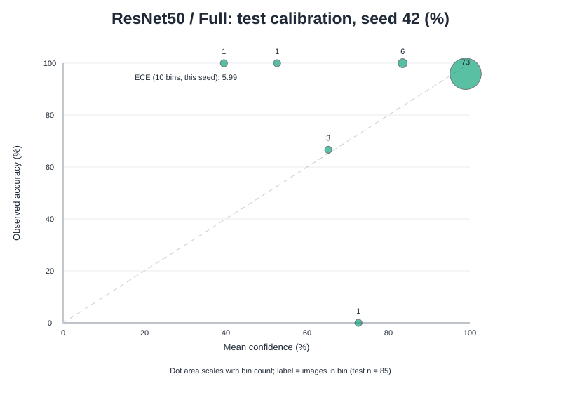

*Figure 18a. Reliability diagram ของ ResNet50/Full seed 42 บน test 85 ภาพ ECE = 5.99% วงกลมคือ bin ที่มีข้อมูล ขนาดสัมพันธ์กับจำนวนภาพ เส้นประคือ confidence เท่ากับ accuracy*

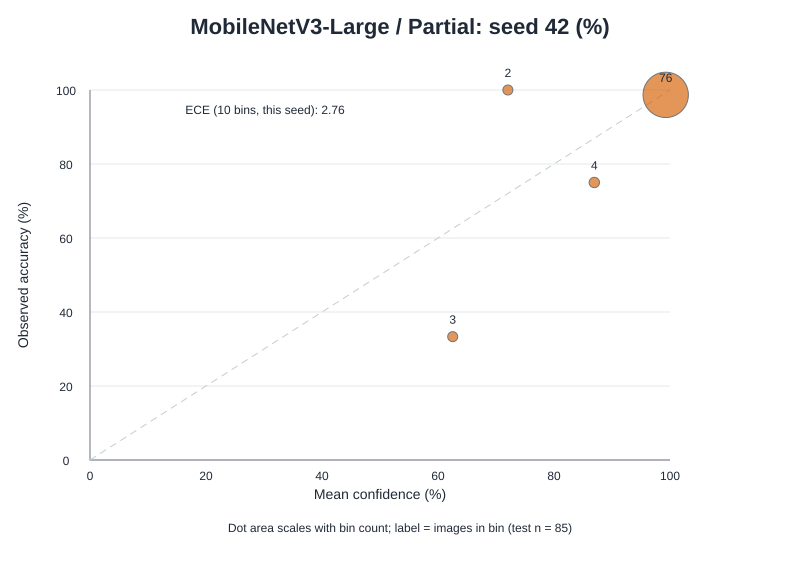

*Figure 18b. Reliability diagram ของ MobileNetV3-Large/Partial seed 42 บน test 85 ภาพเดียวกัน ECE = 2.76% ใช้ 10 bins และช่วงแกนเดียวกับ Figure 18a*

ใน seed 42 MobileNet มี ECE ต่ำกว่า ResNet (2.76% เทียบกับ 5.99%) จึงมีความมั่นใจที่สอดคล้องกับความถูกต้องมากกว่าเมื่อสรุปด้วย 10 bins นี้ จุดใต้เส้นทแยงหมายถึง confidence สูงกว่าสัดส่วนที่ทายถูก เช่น ResNet มีภาพ 73 จาก 85 ภาพอยู่ในช่วง confidence 90–100% จึงมีน้ำหนักต่อ ECE มากกว่าช่วงที่มีภาพเพียงเล็กน้อย

เมื่อสรุปครบ **5 seeds** ResNet มี ECE **4.94% ± 1.56 pp** ส่วน MobileNet มี **4.53% ± 1.67 pp** ความต่างของค่าเฉลี่ยจึงเล็กกว่าที่เห็นใน seed 42 เพียง seed เดียว โดย DenseNet121/Partial มีค่าเฉลี่ย ECE ต่ำสุดใน 15 setups ที่ 4.44% ± 1.18 pp ผลนี้ทำให้เห็นว่าโมเดลที่มี classification metrics สูงสุดอาจไม่ได้มี calibration ดีที่สุด ทั้งนี้ยังไม่ได้ทดสอบนัยสำคัญของ ECE

### 6.9 Final model selection

**เลือก MobileNetV3-Large/Partial** เพราะให้ผลจำแนกใกล้เคียง ResNet50/Full ในการทดลองนี้ ขณะที่มีขนาดโมเดลและจำนวน parameters ที่ต้องฝึกน้อยกว่า จึงเหมาะกับโจทย์ที่คำนึงถึงทรัพยากร โดยใช้สูตรเดิมที่มี augmentation และ class weights

| Metric | MobileNetV3-Large/Partial (selected) | ResNet50/Full (comparison) |
| --- | ---: | ---: |
| Accuracy (%) ↑ | 93.18 ± 2.41 | 93.65 ± 1.34 |
| Macro precision (%) ↑ | 92.71 ± 2.04 | 92.92 ± 2.07 |
| Macro recall (%) ↑ | 92.17 ± 2.66 | 92.77 ± 1.69 |
| Macro F1 (%) ↑ | 91.68 ± 3.05 | 92.56 ± 1.81 |
| Phra Phum recall (%) ↑ | 72.22 ± 10.39 | 77.78 ± 3.93 |
| ECE (10 bins, %) ↓ | 4.53 ± 1.67 | 4.94 ± 1.56 |
| Total parameters (จำนวนตัว) | 4,207,156 | 23,516,228 |
| Trainable parameters (จำนวนตัว) | 3,414,668 | 23,516,228 |

ResNet มี Accuracy เฉลี่ยสูงกว่า 0.47 pp และ Macro F1 สูงกว่า 0.88 pp แต่การทดสอบจาก 5 matched seeds ยังไม่พบความแตกต่างหลังปรับ Holm (**p = 1.000 ทั้งสอง metrics**) ผลนี้ไม่ได้ยืนยันว่าทั้งสองโมเดลเทียบเท่ากัน

MobileNet/Partial มี trainable parameters **3,414,668 ตัว** เทียบกับ ResNet/Full **23,516,228 ตัว** หรือน้อยกว่า **85.48%** ส่วน Grad-CAM แสดงบริเวณตอบสนองบนเรือน ฐาน หรือยอดศาลในหลายตัวอย่าง จึงใช้ประกอบการเลือกได้ แต่ยังไม่มีผลวัดความเร็วหรือหน่วยความจำภายใต้เงื่อนไขเดียวกัน

ข้อแลกเปลี่ยนคือ MobileNet มี Recall ของพระภูมิต่ำกว่า และ Accuracy/F1 แปรผันข้าม seeds มากกว่า ResNet ตามตาราง โมเดลที่เลือกตรงกับตัวอ้างอิงจาก validation เดิม โดยไม่เปลี่ยนสูตรหรือแผนสถิติจากคะแนน test ผลบน test split ที่เคยตรวจดูแล้วคงเป็นเชิงสำรวจ

### 6.10 Ablation study of MobileNetV3-Large/Partial

ทดลองนำ **augmentation** และ **class weights** ออกจากสูตรเดิมทีละอย่าง เพื่อดูว่าคะแนนเปลี่ยนไปเท่าใด โดยคงโมเดล Partial modules และ hyperparameters อื่นเหมือนเดิม

ใช้ baseline final เดิม 5 seeds และฝึกเพิ่มเงื่อนไขละ 5 seeds รวม **10 runs / 180 epochs** โดยไม่ tune ใหม่หรือฝึก baseline ซ้ำ กำหนดสองเงื่อนไขและแผนทดสอบก่อนเริ่มฝึก

| Condition | Accuracy (%) | Macro precision (%) | Macro recall (%) | Macro F1 (%) |
| --- | ---: | ---: | ---: | ---: |
| Baseline | 93.18 ± 2.41 | 92.71 ± 2.04 | 92.17 ± 2.66 | 91.68 ± 3.05 |
| ไม่ใช้ augmentation | 92.94 ± 1.66 | 93.00 ± 1.41 | 91.78 ± 1.88 | 91.28 ± 2.08 |
| ไม่ใช้ class weights | 92.24 ± 2.44 | 91.98 ± 2.02 | 91.03 ± 2.69 | 90.50 ± 3.12 |

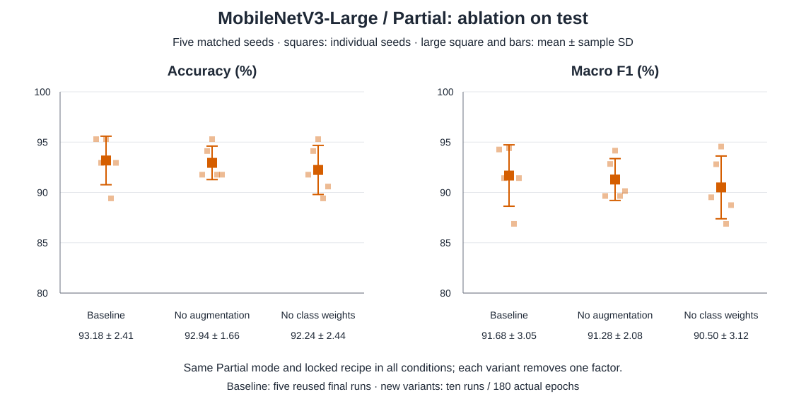

*Figure 19. Test Accuracy และ Macro F1 จาก 5 matched seeds สี่เหลี่ยมเล็กแทนแต่ละ seed ส่วนสี่เหลี่ยมใหญ่และเส้นแสดง mean ± sample SD*

| Removed component | Δ Accuracy (pp) | Δ Macro F1 (pp) | Holm p: Accuracy | Holm p: Macro F1 |
| --- | ---: | ---: | ---: | ---: |
| Augmentation | -0.24 | -0.40 | 1.000 | 1.000 |
| Class weights | -0.94 | -1.18 | 1.000 | 1.000 |

Δ คือคะแนนเมื่อนำองค์ประกอบออก ลบคะแนน baseline และจับคู่ seed เดียวกัน เมื่อตัด augmentation ออก Accuracy ลดเฉลี่ย **0.24 pp** และ Macro F1 ลด **0.40 pp** ส่วนการตัด class weights ออกลด **0.94 pp** และ **1.18 pp** ตามลำดับ

ทั้ง 4 comparisons ใช้ two-sided paired tests และปรับ Holm แยกจากงานหลัก ได้ **p = 1.000 ทุกรายการ** จึงยังยืนยันประโยชน์ของแต่ละองค์ประกอบจากผลนี้ไม่ได้ และไม่ได้แปลว่าแต่ละสูตรเท่ากัน

คงใช้ baseline ที่เลือกจาก validation เดิม ไม่ปรับสูตรจากผล test รอบนี้ ส่วน loss ของสูตรที่ใช้และไม่ใช้ class weights เปรียบเทียบตรง ๆ ไม่ได้ เพราะคำนวณด้วยน้ำหนักต่างกัน การศึกษานี้ยังใช้ test split เดิม จึงเป็นผลเชิงสำรวจ

<p align="right"><a href="#top">กลับสู่ด้านบน</a></p>

---

## 7. Discussion and conclusions

การปรับ backbone ให้เรียนรู้จากภาพศาลเพิ่มเติมช่วยให้ Full และ Partial มี Macro F1 เฉลี่ยสูงกว่า Frozen ในทุก architecture ของการทดลองนี้ อย่างไรก็ตาม mode ที่ได้คะแนนสูงสุดต่างกันตามโมเดล จึงสนับสนุนการค้นหา hyperparameters แยกแต่ละ setup ภายใต้งบเดียวกัน

จากผลประเมินหลายด้าน **MobileNetV3-Large/Partial เป็นโมเดลที่เลือกสำหรับงานนี้** โดยคง validation-selected reference เดิมและให้ความสำคัญกับข้อจำกัดทรัพยากร แม้ค่าเฉลี่ย test ของ ResNet50/Full สูงกว่า แต่ Accuracy และ Macro F1 ยังไม่ต่างอย่างมีนัยสำคัญหลัง Holm ขณะที่ MobileNet/Partial มี trainable parameters น้อยกว่า 85.48% และ Grad-CAM ที่ตรวจแสดงบริเวณตอบสนองบนตัวศาลในหลายตัวอย่าง จึงตอบโจทย์การใช้งานที่ให้น้ำหนักกับขนาดโมเดล โดยไม่อ้างว่าความไม่พบนัยสำคัญพิสูจน์ความเท่ากันหรือยืนยันความเร็วจริง

พระภูมิยังเป็นคลาสที่แยกได้ยากที่สุด Grad-CAM ช่วยให้ตรวจตัวอย่างของโมเดลที่เลือกได้ แต่การตอบสนองตรงตัวศาลยังไม่รับประกันการทายถูก ผล MobileNet ablation ใช้อธิบายผลต่างเมื่อเอา augmentation หรือ class weights ออก ไม่ใช้ปรับสูตรจาก test จึงคง baseline เดิมที่ล็อกจาก validation และอ่านผลเชิงคุณภาพร่วมกับคะแนนรายคลาส calibration และความแปรผันระหว่าง seeds

**การวิเคราะห์ข้อผิดพลาดและการวางนัยทั่วไปของโมเดล (Error Analysis & Model Generalization):**
นอกจากนี้ จากการเจาะลึกผลการทำนายที่ผิดพลาด (Misclassification) พบว่าข้อผิดพลาดบางส่วนไม่ได้เกิดจากความล้มเหลวของตัวโมเดล แต่เกิดจากความคลาดเคลื่อนในการกำหนดป้ายข้อมูล (Labeling Error / Annotation Error) ในชุดข้อมูลอ้างอิง (Ground Truth) ตัวอย่างที่ชัดเจนคือกรณีของภาพ **Figure 17b: san_phraphum_0121** ซึ่งใน Ground Truth ระบุผิดว่าเป็นศาลพระภูมิ (Phra Phum) ทำให้ระบบประเมินว่าโมเดลทายผิด อย่างไรก็ตาม โมเดลสามารถวิเคราะห์ลักษณะทางกายภาพที่ปรากฏในภาพจริงและทำนายคลาสเป็นศาลพระพรหม (Phra Phrom) ได้อย่างถูกต้องด้วยความมั่นใจ (Confidence Score) สูงถึง 99.46% 

ผลลัพธ์นี้สะท้อนให้เห็นถึงข้อค้นพบที่สำคัญ 2 ประการ ได้แก่ 1) **ความสามารถในการสกัดคุณลักษณะภาพและการวางนัยทั่วไป (Feature Extraction & Generalization):** โมเดลสามารถเรียนรู้โครงสร้างทางสถาปัตยกรรมที่แท้จริงของศาลแต่ละประเภทได้อย่างแม่นยำ จึงตัดสินใจจำแนกตามลักษณะทางกายภาพที่ปรากฏจริงในภาพ และ 2) **ข้อจำกัดของตัวชี้วัดเชิงปริมาณ (Underestimated Performance):** กรณีนี้ยืนยันว่าความผิดพลาดที่บันทึกไว้ไม่ได้เกิดจากความล้มเหลวของโมเดล (Model Failure) แต่เป็นความคลาดเคลื่อนของป้ายกำกับในชุดทดสอบ (Test Annotation Error) ซึ่งส่งผลให้คะแนนการประเมินผลเชิงปริมาณ (Quantitative Metrics) ต่ำกว่าความสามารถที่แท้จริงของโมเดล (Pessimistic Evaluation)

ส่วน ablation พบว่าสูตรเดิมมีคะแนนเฉลี่ยสูงกว่าการนำ augmentation หรือ class weights ออก จึงคงสูตร baseline เป็นผลลัพธ์สุดท้าย โดยยังไม่อ้างว่าแต่ละองค์ประกอบเพิ่มคะแนนอย่างมีนัยสำคัญ

### 7.1 Limitations

1. **ข้อมูลและการเลือกโมเดล:** Test มี 85 ภาพบน split เดียวที่เคยตรวจดูแล้ว แม้โมเดลสุดท้ายตรงกับ MobileNet ที่เลือกจาก validation เดิม เหตุผลประกอบจาก test และ follow-up ยังคงเป็นเชิงสำรวจ ส่วน SD และ paired tests สะท้อนความแปรผันระหว่าง seeds บนภาพชุดนี้
2. **การค้นหา hyperparameters:** ใช้ 5 configurations ต่อ setup และ tuning seed เดียว โดยไม่มี SGD ในชุดที่สุ่มได้
3. **บริบทในภาพ:** ภาพจากเว็บมีข้อความ ลายน้ำ และฉากหลังหลากหลาย ซึ่งอาจสัมพันธ์กับคลาส และไม่ทราบ URL ต้นทาง 112 ภาพ
4. **การวิเคราะห์เพิ่มเติม:** Grad-CAM ใช้ checkpoint seed 42 โดยแสดงตัวอย่างทายถูก 4 ภาพและภาพทายผิดของสองโมเดลครบ 7 ภาพไม่ซ้ำ และ ablation ใช้ 5 seeds ต่อเงื่อนไขหลังเลือกโมเดล การไม่พบนัยสำคัญไม่ใช่หลักฐานยืนยันความเท่ากัน อีกทั้งยังไม่มีผลวัด latency ภายใต้เงื่อนไขควบคุม
5. **คุณภาพของป้ายกำกับข้อมูล (Ground Truth Quality):** ดังที่พบในการวิเคราะห์ข้อผิดพลาด ชุดข้อมูลยังคงมี Labeling Error ปะปนอยู่ ซึ่งส่งผลกระทบโดยตรงต่อความแม่นยำในการวัดผลและประเมินประสิทธิภาพโมเดล (Evaluation metric distortion) ทำให้คะแนนที่ได้อาจต่ำกว่าความเป็นจริง

### 7.2 Future Work

จากข้อค้นพบและข้อจำกัดข้างต้น การพัฒนาในอนาคตควรให้ความสำคัญกับประเด็นดังต่อไปนี้:
*   **กระบวนการทำความสะอาดข้อมูล (Data Cleansing & Relabeling):** ควรมีการทบทวนและแก้ไขป้ายกำกับข้อมูล (Ground Truth) ในชุด Test และ Validation อย่างละเอียดโดยผู้เชี่ยวชาญ (Human Evaluation) เพื่อลดปัญหา Noisy Labels และให้การประเมินผลสะท้อนประสิทธิภาพที่แท้จริงของโมเดล
*   **การจัดการความสับสนของคลาสพระภูมิ:** ควรทดลองเพิ่มเทคนิค Data Augmentation ที่เจาะจงเฉพาะคลาสศาลพระภูมิ หรือพิจารณาใช้เทคนิค Explainable AI อื่นๆ นอกเหนือจาก Grad-CAM เพื่อดึงข้อมูลเชิงลึก (Insights) ว่าโมเดลใช้จุดใดในการตัดสินใจเมื่อเกิดความสับสน และนำมาปรับปรุงสถาปัตยกรรมหรือชุดข้อมูลต่อไป

<p align="right"><a href="#top">กลับสู่ด้านบน</a></p>

---
