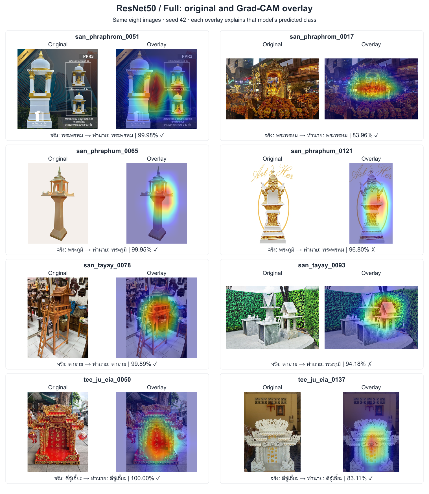
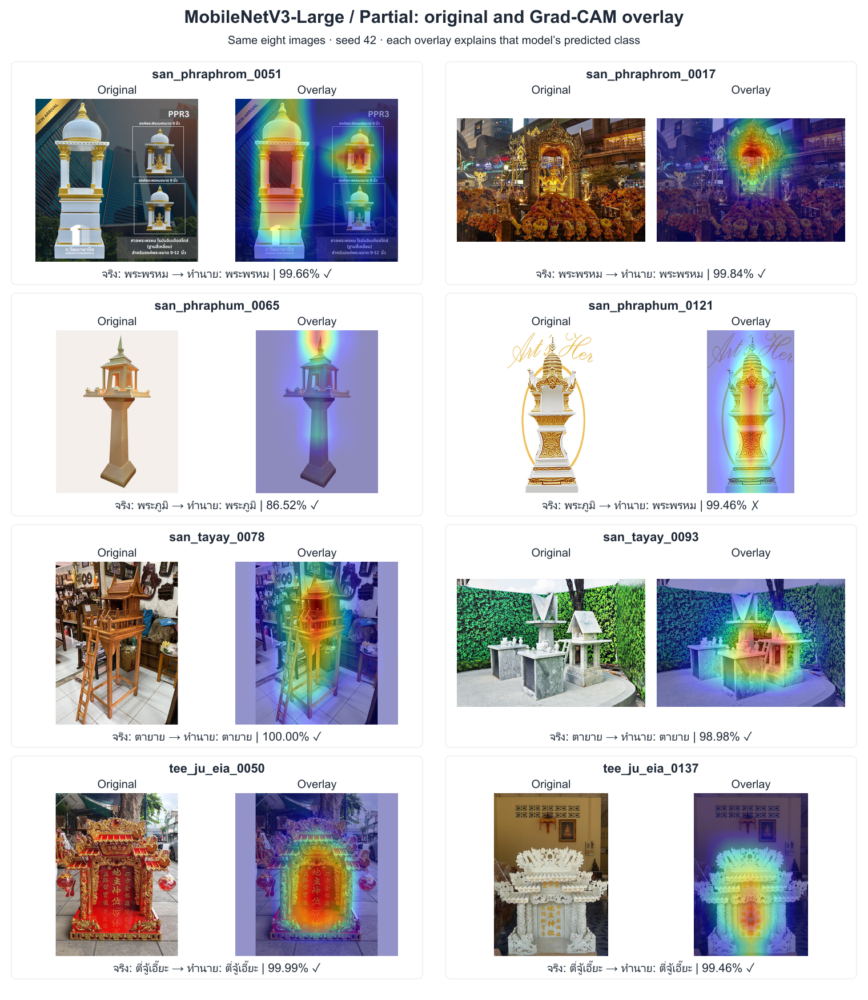

# DADS7202 — Thai shrine image classification using transfer learning

## Abstract

การศึกษานี้เปรียบเทียบโมเดลที่ผ่านการฝึกบน ImageNet จำนวน 5 แบบ สำหรับจำแนกภาพศาลไทย 4 ประเภทจากข้อมูล 560 ภาพ แต่ละโมเดลนำมาฝึกด้วย 3 fine-tuning strategies ได้แก่ Full ซึ่งปรับน้ำหนักทั้งโมเดล Frozen ซึ่งตรึงส่วนสกัดลักษณะภาพและฝึกเฉพาะส่วนจำแนกคลาส และ Partial ซึ่งปรับน้ำหนักเฉพาะส่วนท้ายของส่วนสกัดลักษณะภาพร่วมกับส่วนจำแนกคลาส รวมเป็น 15 setups

ข้อมูลแบ่งโดยจัดภาพซ้ำและภาพใกล้เคียงที่ผ่านการตรวจสอบให้อยู่ในกลุ่มเดียวกัน แล้วแบ่งกลุ่มเป็น train 390 ภาพ validation 85 ภาพ และ test 85 ภาพ โดยเลือกการแบ่งที่รักษาสัดส่วนคลาสให้ใกล้เคียงกัน แต่ละ setup ค้นหา hyperparameters แยกกันจำนวน 5 trials ก่อนฝึกซ้ำด้วย 5 seeds รวม 75 tuning trials และ 75 final runs

**ResNet50/Full ได้รับเลือกเป็นโมเดลสุดท้ายของการศึกษา** เพราะมีค่าเฉลี่ย Accuracy, Macro precision, Macro recall และ Macro F1 บน test สูงสุดจาก 15 setups โดยได้ Accuracy 93.65% ± 1.34 pp และ Macro F1 92.56% ± 1.81 pp นอกจากนี้ยังมี Recall ของศาลพระภูมิสูงกว่า และมี SD ของ Accuracy และ Macro F1 ต่ำกว่า MobileNetV3-Large/Partial ซึ่งเป็นโมเดลอ้างอิงจาก validation ส่วน MobileNet มี ECE ต่ำกว่าเล็กน้อย ความแตกต่างของ Accuracy และ Macro F1 ระหว่างสองโมเดลยังไม่มีนัยสำคัญหลังปรับ Holm การเลือก ResNet จึงเป็นข้อสรุปจากผลที่สังเกตในการศึกษานี้ โดยเปิดเผยว่าเลือกหลังพิจารณา test (post-hoc) บน split ที่เคยตรวจดูแล้ว และผลมีสถานะเชิงสำรวจ (exploratory)

การศึกษา ablation ใช้ตรวจสอบผลของ augmentation และ class weights โดยนำองค์ประกอบออกจากสูตรเดิมทีละอย่าง การไม่ใช้ augmentation มี Macro F1 เฉลี่ยลดลง 1.32 pp ส่วนการไม่ใช้ class weights ลดลง 0.67 pp แต่ยังไม่พบความแตกต่างอย่างมีนัยสำคัญหลังปรับ Holm ทั้ง 4 comparisons การฝึกเพิ่ม 10 runs ทำให้รวมทั้งงานเป็น 160 runs นอกจากนี้ใช้ Grad-CAM จาก checkpoint เดิมวิเคราะห์บริเวณภาพที่สัมพันธ์กับผลทำนาย รวมถึงตัวอย่างที่ทายผิดด้วยความมั่นใจสูง

## 1. Dataset overview

### 1.1 Study objective and data sources

การศึกษามีวัตถุประสงค์เพื่อจำแนกภาพศาลพระพรหม ศาลพระภูมิ ศาลตายาย และศาลตี่จู้เอี๊ยะ ซึ่งมีรูปทรงและบริบทในภาพบางส่วนคล้ายกัน ข้อมูลผ่านการตรวจป้ายกำกับโดยมนุษย์และจัดเก็บใน `dataset_cleaned/` ตารางใช้รหัสคลาสเดียวกับไฟล์ผลการทดลองและลำดับคะแนนที่โมเดลส่งออก

| Class | Class ID | Image count | Proportion (%) |
| --- | --- | ---: | ---: |
| พระพรหม | san_phraphrom | 103 | 18.39 |
| พระภูมิ | san_phraphum | 124 | 22.14 |
| ตายาย | san_tayay | 133 | 23.75 |
| ตี่จู้เอี๊ยะ | tee_ju_eia | 200 | 35.71 |

รวบรวมภาพด้วย **web scraping** และบันทึกชื่อไฟล์ คลาส และ URL ต้นทางใน `metadata_cleaned.csv` มี URL สำหรับ 448 ภาพ และไม่ทราบ URL 112 ภาพ รายการแหล่งภาพอยู่ใน Appendix C

### 1.2 Class distribution and loss weighting

ศาลตี่จู้เอี๊ยะมีภาพมากที่สุด 200 ภาพ ขณะที่ศาลพระพรหมมี 103 ภาพ อัตราส่วนประมาณ 1.94:1 การประเมินจึงใช้ Macro metrics ซึ่งให้น้ำหนักแต่ละคลาสเท่ากัน และการฝึกใช้ **class-weighted cross-entropy** เพื่อชดเชยความไม่สมดุลของจำนวนภาพ

น้ำหนักคำนวณจากข้อมูล train เท่านั้นด้วยสูตร `weight_c = N_train / (K × n_c)` โดย `N_train = 390`, `K = 4` และ `n_c` คือจำนวนภาพ train ของคลาสนั้น

| Class | Training images | Class weight |
| --- | ---: | ---: |
| พระพรหม | 70 | 1.392857 |
| พระภูมิ | 89 | 1.095506 |
| ตายาย | 91 | 1.071429 |
| ตี่จู้เอี๊ยะ | 140 | 0.696429 |

ค่า loss ของแต่ละภาพถูกคูณด้วยน้ำหนักของคลาสจริง ก่อนรวมและหารด้วยจำนวนภาพ ดังนั้น หากโมเดลให้ความน่าจะเป็นของคลาสจริงเท่ากัน ภาพพระพรหมจะมีน้ำหนักใน loss ประมาณสองเท่าของภาพตี่จู้เอี๊ยะ วิธีนี้เพิ่มบทบาทของคลาสที่มีภาพน้อยระหว่างฝึก โดยไม่เพิ่มจำนวนภาพหรือสุ่มภาพซ้ำ และไม่ได้รับประกันว่าคะแนนทุกคลาสจะสูงขึ้นเสมอ


*Figure 1. ตัวอย่างภาพทั้งสี่คลาส แสดงความแตกต่างของรูปทรง มุมมอง และฉากหลัง*


*Figure 2. จำนวนภาพต่อคลาสก่อนแบ่งข้อมูล*

### 1.3 Image dimensions, colour modes and brightness


*Figure 3. ขนาดภาพต้นฉบับและ histogram ของอัตราส่วนกว้างต่อสูง โดยใช้ bins ร่วมกันและแสดงสัดส่วนภาพภายในแต่ละคลาส*

ภาพมีขนาดต่างกัน 206 แบบ ทั้งแนวตั้ง แนวนอน และจัตุรัส โดยเป็นภาพจัตุรัส 190 ภาพ จึงเตรียมภาพด้วยการย่อโดยรักษาสัดส่วนแล้วเติมขอบให้ครบ 224 × 224 พิกเซล เพื่อคงรูปทรงศาลไว้


*Figure 4. จำนวนและสัดส่วนของโหมดสีที่ถอดรหัสได้จริง พร้อมกราฟขยายกลุ่ม non-RGB เพื่อให้เห็นกลุ่มที่มีภาพน้อย*

ภาพส่วนใหญ่เป็น RGB 543 ภาพ อีก 17 ภาพเป็น RGBA, Palette หรือ CMYK จึงแปลงทุกภาพเป็น RGB และผสมส่วนโปร่งใสกับสีพื้นกลางก่อนเข้าโมเดล


*Figure 5. ความสว่างเฉลี่ยรายภาพแยกคลาส กล่องแสดง IQR และมัธยฐาน เครื่องหมาย × แสดงค่าเฉลี่ยรายคลาส เส้นประแนวนอนแสดงค่าเฉลี่ยรวม*

ความสว่างของภาพกระจายกว้างและทับซ้อนกันระหว่างคลาส ภาพประเภทเดียวกันจึงมีสภาพแสงหลากหลาย การฝึกใช้การปรับแสงและสีเล็กน้อยเพื่อให้โมเดลพบความแปรผันนี้มากขึ้น

## 2. Data preparation

### 2.1 Group-based data splitting

แบ่งข้อมูลเป็น train, validation และ test ในสัดส่วนใกล้เคียง 70/15/15 โดยจัดภาพที่ซ้ำหรือใกล้เคียงกันให้อยู่ในกลุ่มเดียวกันก่อน แล้วใช้ GroupShuffleSplit ด้วย split seed 42 เพื่อแยกกลุ่มภาพพร้อมรักษาสัดส่วนคลาสให้ใกล้เคียงกัน

| Split | Total images | Phra Phrom | Phra Phum | Ta Yai | Tee Ju Eia |
| --- | ---: | ---: | ---: | ---: | ---: |
| Train | 390 | 70 | 89 | 91 | 140 |
| Validation | 85 | 17 | 17 | 21 | 30 |
| Test | 85 | 16 | 18 | 21 | 30 |

ชุด train ใช้ให้โมเดลเรียนรู้ ส่วน validation ใช้เลือก hyperparameters และน้ำหนักที่ดีที่สุดระหว่างฝึก จากนั้นจึงประเมินด้วย test หลังล็อกสูตรแล้ว ทุก setup และทุก seed ใช้การแบ่งภาพชุดเดียวกันเพื่อให้เปรียบเทียบผลได้ตรงกัน โดยแบ่งข้อมูลก่อนทำ augmentation และไม่มีภาพกลุ่มเดียวกันข้ามชุดข้อมูล

### 2.2 Image preprocessing and normalization

ขั้นตอนเตรียมภาพประกอบด้วยการถอดรหัส จัดทิศทางตาม EXIF แปลงโหมดสีและจัดการความโปร่งใส จากนั้นย่อด้วย LANCZOS โดยรักษาอัตราส่วน ให้ด้านยาวเท่ากับ 224 พิกเซล แล้ววางกึ่งกลางบนพื้น RGB (124,116,104) ขนาด 224 × 224 โดยคงขอบเดิมที่ติดมากับภาพไว้


*Figure 6. ภาพ train `san_phraphrom_0001` ขนาด 960 × 720 เทียบกับผล preprocessing 224 × 224 ที่ขยายให้เห็นรายละเอียด*

หลัง augmentation สำหรับ train ภาพถูกแปลงเป็น tensor โดยปรับค่าพิกเซล RGB จาก 0–255 เป็น 0–1 แล้ว normalize ด้วยสูตร `(x − mean) / SD` ใช้ mean `(0.485,0.456,0.406)` และ SD `(0.229,0.224,0.225)` ของ ImageNet ให้สอดคล้องกับโมเดล pretrained

### 2.3 Training augmentation

Augmentation ใช้เฉพาะ train เพื่อเพิ่มความหลากหลายของภาพที่โมเดลพบระหว่างฝึก ส่วน validation และ test ใช้ preprocessing แบบคงที่

| Transformation | Parameter / probability | Description | Purpose |
| --- | --- | --- | --- |
| Rotation | ±12° | หมุนภาพเล็กน้อย | จำลองการถือกล้องเอียง |
| Translation | ±5% | เลื่อนภาพแนวนอนและแนวตั้ง | ลดการยึดติดกับตำแหน่งเดิม |
| Scale | 0.92–1.08 | ย่อหรือขยายภาพเล็กน้อย | จำลองขนาดวัตถุที่ต่างกัน |
| Perspective | Distortion 0.10; probability 0.20 | ปรับมุมมองภาพเล็กน้อยใน 20% ของโอกาส | เพิ่มความแปรผันของมุมถ่าย |
| Horizontal flip | Probability 0.50 | สะท้อนภาพซ้าย–ขวา | เพิ่มความหลากหลายของการจัดวาง |
| Color jitter | Brightness/contrast/saturation 0.10; hue 0.02 | ปรับแสงและสีภายในช่วงที่กำหนด | จำลองสภาพแสงและสีที่ต่างกัน |
| Random erasing | Probability 0.05; area 0.02–0.08 | แทนที่พื้นที่เล็ก ๆ ด้วยสีพื้นกลาง | จำลองการบดบังบางส่วน |

Probability คือโอกาสที่การแปลงจะเกิดขึ้นกับแต่ละภาพ ส่วน area ของ erasing คือสัดส่วนพื้นที่ที่เลือกแทนที่ พื้นที่ว่างจากการแปลงเชิงเรขาคณิตและ erasing ใช้สีพื้นกลางเดียวกัน โดยคำนึงถึงสเกลหลัง normalization สำหรับ erasing


*Figure 7. ตัวอย่าง augmentation จากภาพ train จริงคลาสละห้าภาพ ใช้ seed คงที่เพื่อสร้างซ้ำได้*

ภาพนี้สร้างเพื่อสาธิตนโยบาย augmentation โดย seed ควบคุมการสุ่มให้สร้างตัวอย่างเดิมซ้ำได้ ไม่ใช่ minibatch ที่บันทึกระหว่างฝึก การเรนเดอร์ JavaScript อาจต่างจาก torchvision ในรายละเอียดระดับพิกเซล ตรวจ [image IDs และค่าการแปลง](report/preprocessing_preview_sources.json) ได้จากไฟล์ประกอบ

### 2.4 Batch loading

ระหว่างฝึก DataLoader ส่งภาพให้โมเดลครั้งละ 16 หรือ 32 ภาพตาม batch size ที่เลือก โมเดลคำนวณข้อผิดพลาดจากภาพกลุ่มนั้นแล้วปรับน้ำหนักหนึ่งครั้ง เมื่อใช้ภาพ train ครบ 390 ภาพถือว่าจบหนึ่ง epoch จากนั้นสุ่มลำดับภาพใหม่สำหรับรอบถัดไป

ใช้ภาพใน batch สุดท้ายด้วยแม้จำนวนไม่ครบ เช่น batch size 32 จะแบ่งได้ 12 batches เต็มและ batch สุดท้ายอีก 6 ภาพ ส่วน validation และ test ใช้ลำดับภาพคงที่และคำนวณผลโดยไม่ปรับน้ำหนัก

## 3. Model architecture

### 3.1 Feature extraction and classification

โมเดลประกอบด้วย **backbone** ซึ่งสกัดลักษณะจากภาพ และ **classifier** ซึ่งนำลักษณะเหล่านั้นมาให้คะแนนแต่ละคลาส ใช้ pretrained weights อย่างเป็นทางการของ torchvision ผ่าน `Weights.DEFAULT` ตาม environment ที่บันทึกไว้

โมเดล ImageNet เดิมให้คะแนน 1,000 คลาส การศึกษานี้เปลี่ยนเฉพาะชั้นให้คะแนนสุดท้ายให้เหลือ 4 คะแนนสำหรับศาลไทย ชั้นดังกล่าวเรียกว่า **linear layer** เพราะคำนวณคะแนนจากผลรวมถ่วงน้ำหนักของลักษณะภาพ แล้วบวกค่าคงที่หรือ bias ตามสมการ `z = Wx + b` โดย `x` คือลักษณะที่สกัดได้ `W` และ `b` เป็นค่าที่เรียนรู้ และ `z` คือคะแนน logits ของแต่ละคลาส คลาสที่ได้คะแนนสูงสุดเป็นคำทำนาย

| Architecture | Backbone structure | Classification-head adaptation |
| --- | --- | --- |
| ResNet50 | Residual blocks | เปลี่ยนชั้น `fc` สุดท้ายเป็นชั้นให้คะแนน 4 คลาส |
| EfficientNet-B0 | MBConv blocks | เปลี่ยนชั้นให้คะแนนสุดท้าย คง Dropout 0.2 |
| MobileNetV3-Large | InvertedResidual blocks | เปลี่ยนชั้นให้คะแนนสุดท้าย คง hidden linear, Hardswish และ Dropout 0.2 |
| DenseNet121 | Dense blocks | เปลี่ยน `classifier` เป็นชั้นให้คะแนน 4 คลาส |
| ConvNeXt-Tiny | ConvNeXt feature stages | เปลี่ยนชั้นให้คะแนนสุดท้าย คง normalization และ flatten |

สถาปัตยกรรมทั้งห้าเป็นกลุ่มเปรียบเทียบที่กำหนดไว้ล่วงหน้า เพื่อศึกษาวิธีเชื่อมต่อและขอบเขตการปรับน้ำหนักที่ต่างกัน เหตุผลที่เลือก ResNet50/Full จากผลการทดลองอยู่ในหัวข้อ 6.9 ส่วนจำนวน parameters ของแต่ละ mode อยู่ใน Appendix C

### 3.2 Fine-tuning strategies

การใช้โมเดล pretrained เลือกได้ว่าจะให้ส่วนใดเรียนรู้จากภาพศาลเพิ่มเติม งานนี้เปรียบเทียบ 3 strategies โดยส่วนที่ **freeze** จะคงน้ำหนักจาก ImageNet ไว้ ส่วนที่เปิดให้ฝึกจะถูกปรับน้ำหนักจากข้อมูล train ตามตาราง

| Strategy | Updated parameters | Backbone behavior during training | Purpose |
| --- | --- | --- | --- |
| Full | Backbone และ classifier ทั้งหมด | ส่วนทั้งหมดอยู่ใน train mode | ปรับลักษณะ pretrained ให้เข้ากับข้อมูลศาลทั้งโมเดล |
| Frozen | Classifier head ทั้งส่วน | Backbone ตรึงน้ำหนักและอยู่ใน eval mode | ประเมินการใช้ลักษณะ pretrained เดิมกับ classifier ที่ฝึกได้ |
| Partial | Backbone stage สุดท้ายและ classifier | ส่วนต้นตรึงน้ำหนักและอยู่ใน eval; ส่วนท้ายอยู่ใน train | ปรับลักษณะระดับท้ายโดยคงส่วนต้นไว้ |

นอกจากเลือกว่าจะปรับน้ำหนักส่วนใดแล้ว ยังต้องกำหนด **train mode** และ **eval mode** ให้เหมาะสมด้วย ใน train mode ชั้น Dropout จะสุ่มปิดค่าบางส่วน และ BatchNorm จะใช้สถิติจาก batch พร้อมปรับสถิติสะสม ส่วน eval mode จะปิดการสุ่มของ Dropout และให้ BatchNorm ใช้สถิติสะสมที่มีอยู่ จึงใช้ eval mode กับ backbone ที่ freeze รวมถึงทั้งโมเดลขณะประเมิน validation/test การตั้ง eval mode เพียงอย่างเดียวไม่ได้ตรึงน้ำหนัก ต้องกำหนดส่วนที่ freeze แยกด้วย

สำหรับ **Partial** ส่วนท้ายของ backbone หมายถึงกลุ่มชั้นสุดท้ายที่สร้างลักษณะภาพก่อนส่งเข้า classifier จึงเปิดให้กลุ่มนี้ปรับเข้ากับภาพศาล ส่วนต้นยังคงน้ำหนักเดิม ขอบเขตของแต่ละ architecture เป็นดังนี้ โดยทุกแถวฝึก classifier head ร่วมด้วย

| Architecture | Trainable backbone stage in Partial |
| --- | --- |
| ResNet50 | Residual stage สุดท้าย (`layer4`) |
| EfficientNet-B0 | MBConv stage สุดท้ายและชั้น projection ที่ตามมา |
| MobileNetV3-Large | InvertedResidual stage สุดท้ายและ projection (`features.13–16`) |
| DenseNet121 | Dense block สุดท้ายและ normalization (`denseblock4`, `norm5`) |
| ConvNeXt-Tiny | ConvNeXt feature stage สุดท้าย |

ดังนั้น Frozen ยังฝึก classifier ได้ ส่วน Full และ Partial ต่างกันที่ขอบเขตของ backbone ที่เปิดให้เรียนรู้ การมีหรือไม่มี Dropout เป็นอีกเรื่องหนึ่ง: ทุกโมเดลมีส่วนจำแนกคลาส แต่คง Dropout ใน classifier เฉพาะ EfficientNet-B0 และ MobileNetV3-Large ตามโครงสร้างเดิม โดยไม่ได้ tune ค่า Dropout

กราฟเปรียบเทียบใช้ Frozen = น้ำเงิน ●, Partial = ส้มแดง ■ และ Full = เขียว ◆ ตามชุดสี Okabe–Ito ร่วมกับรูปทรงและ line styles ส่วนกราฟคลาสใช้ชุดสีแยกกัน คงลำดับคลาส และไม่อาศัยสีเพียงอย่างเดียวในการสื่อความหมาย

### 3.3 Predictions before fine-tuning

ผล ResNet50/ImageNet เดิมบนตัวอย่าง train แสดงว่าชุดป้ายกำกับ 1,000 คลาสยังไม่ตรงกับสี่ประเภทศาล เช่น ผลทำนาย `stupa` อาจสัมพันธ์กับรูปทรง แต่ไม่ใช่ป้ายศาลไทยตามการศึกษานี้ ใช้ตัวเลข baseline เดิมที่เข้ากันได้กับข้อมูลชุดเดียวกัน โดยไม่นำมาคำนวณ Accuracy แบบสี่คลาส


*Figure 8. ป้าย ImageNet และ confidence (%) จากตัวอย่าง train เดิม ใช้อธิบายความต่างของชุดป้ายกำกับก่อนปรับ classifier*

## 4. Training method

### 4.1 Hyperparameter search

ลำดับการทดลองคือเตรียมข้อมูล → ค้นหา hyperparameters แยกทุก setup → เลือกสูตรแต่ละ setup ด้วย validation → ล็อกสูตรและโมเดลอ้างอิง → ฝึก final ด้วย 5 seeds → ประเมิน test และวิเคราะห์ผล

| Term | Meaning | Count in this study |
| --- | --- | --- |
| Setup | Architecture × fine-tuning strategy | 5 × 3 = 15 |
| Tuning trial | ทดลอง hyperparameters หนึ่งชุดภายใน setup ด้วย seed 42 | 5 ต่อ setup รวม 75 |
| Final run | นำ best hyperparameters ของแต่ละ setup มาฝึกด้วย 5 seeds โดยหนึ่ง seed เป็นหนึ่ง run | 5 ต่อ setup รวม 75 |
| Selected checkpoint | น้ำหนักที่เลือกจาก validation ภายในแต่ละ run | หนึ่ง checkpoint ต่อ run |

การค้นหา hyperparameters หรือ **sweep** ในงานนี้ใช้ random search ที่กำหนด seed โดยสุ่มค่าจากช่วงที่กำหนด แล้วบันทึกผลแต่ละ trial ผ่าน W&B ทุก setup ทดลองชุดค่าเดียวกัน 5 ชุด ชุดละไม่เกิน 30 epochs จึงมีงบค้นหาเท่ากันที่ **5 trials และสูงสุด 150 epochs ต่อ setup** แต่เลือกชุดที่ดีที่สุดจาก validation ของตนเองแยกกันทั้ง 15 setups

ตารางต่อไปนี้คือ **search space ของ hyperparameters 4 ตัวที่ tune** ค่า learning rate และ weight decay สุ่มบนสเกล logarithm เพื่อครอบคลุมค่าหลายระดับขนาด ส่วน optimizer และ batch size สุ่มจากตัวเลือกที่ระบุ

| Hyperparameter | Search space |
| --- | --- |
| Learning rate | Log-uniform [1e-5, 1e-3] |
| Weight decay | Log-uniform [1e-6, 1e-2] |
| Optimizer | AdamW, Adam, SGD |
| Batch size | 16, 32 |

จาก search space ข้างต้น ได้ **configurations ที่ใช้ทดลองจริง 5 ชุด** ดังตาราง แต่ละ trial ทดลองค่าทั้ง 4 ตัวร่วมกัน

<!-- generated:SEARCH_TABLE -->

| Trial | Learning rate | Weight decay | Optimizer | Batch |
| ---: | ---: | ---: | --- | ---: |
| 1 | 3.531117e-4 | 5.695263e-5 | Adam | 32 |
| 2 | 2.481624e-4 | 2.380726e-6 | Adam | 32 |
| 3 | 3.328736e-4 | 1.393982e-3 | Adam | 16 |
| 4 | 7.957413e-5 | 3.042230e-5 | AdamW | 32 |
| 5 | 1.939681e-4 | 1.954549e-3 | Adam | 16 |

<!-- /generated:SEARCH_TABLE -->

ค่าที่สุ่มได้จริงเป็น Adam 4 ชุดและ AdamW 1 ชุด จึงไม่มีผลของ SGD ในรอบนี้ ส่วน Dropout เป็นค่าคงที่ตาม architecture เมื่อทดลองแต่ละ configuration ครบแล้ว นำ validation Macro F1 มาเปรียบเทียบภายใน setup ดัง Figure 9a เพื่อเลือกสูตรที่นำไปฝึก final


*Figure 9a. คะแนน validation ของ 5 trials ภายในแต่ละ setup วงแหวนระบุสูตรที่เลือก แต่ละจุดเป็นหนึ่ง configuration*

คะแนนของแต่ละ setup เปลี่ยนตาม configuration ที่ใช้ จึงเลือกสูตรแยกตาม architecture และ mode จากนั้น Figure 9b รวมผล 75 trials เพื่อดูความสัมพันธ์ระหว่างค่าที่ทดลอง พัฒนาการระหว่างฝึก และคะแนน validation


*Figure 9b. Learning rate, weight decay และผลที่ selected epoch เทียบกับ Validation Macro F1 (%) จาก 75 tuning trials*

ภาพรวมแสดงว่า configuration เดียวกันให้คะแนนต่างกันได้ตาม architecture และ mode อีกทั้งการฝึกได้นานหรือทำคะแนน train ได้สูงไม่ได้รับประกันว่าจะได้ validation Macro F1 สูงสุด จึงใช้ผล validation ของแต่ละ setup เป็นเกณฑ์เลือกสูตร ส่วนกราฟนี้ใช้ช่วยอธิบายผลการค้นหา เพราะแต่ละ trial เปลี่ยนหลาย hyperparameters พร้อมกัน จึงยังแยกผลของตัวแปรใดตัวแปรหนึ่งไม่ได้

### 4.2 Training settings and checkpoint selection

แต่ละ run ฝึกได้สูงสุด 30 epochs โดยหนึ่ง epoch คือการใช้ภาพ train ครบหนึ่งรอบ ภายในรอบนั้นโมเดลรับภาพทีละ batch แล้วปรับน้ำหนักด้วย optimizer ที่เลือก ค่า learning rate กำหนดขนาดก้าวในการปรับน้ำหนัก ส่วน weight decay ช่วยจำกัดขนาดน้ำหนักระหว่างฝึก เมื่อจบแต่ละ epoch จะประเมิน validation เพื่อติดตามพัฒนาการและเลือก checkpoint

| Setting | Value | Role |
| --- | --- | --- |
| Loss | Class-weighted cross-entropy | ให้น้ำหนักข้อผิดพลาดตามจำนวนภาพ train |
| Maximum epochs | 30 | จำกัดความยาวของแต่ละ run |
| Early stopping | Patience 7; min_delta 0.0001 (0.01 pp) | หยุดเมื่อไม่มีการพัฒนาตามเกณฑ์ต่อเนื่องเจ็ด epochs |
| Scheduler | ReduceLROnPlateau; mode=max; factor=0.5; patience=3 | ลด learning rate ลงครึ่งหนึ่งเมื่อ validation Macro F1 ไม่พัฒนาตามเกณฑ์ |
| Monitored metric | Validation Macro F1 | ใช้กับ scheduler และ early stopping |
| Adam defaults | Betas (0.9,0.999); epsilon 1e-8 | ค่าร่วมของ optimizer ตาม config |
| Tuning seed | 42 | ควบคุมการสุ่มในการฝึก tuning |
| Final seeds | 42, 123, 456, 789, 1024 | ฝึกสูตรเดิมด้วย 5 seeds เพื่อดูความแปรปรวน |

**Checkpoint** คือน้ำหนักโมเดลที่บันทึกไว้ ณ epoch หนึ่ง งานนี้เลือก checkpoint ที่มี validation Macro F1 สูงที่สุด หากเท่ากันจะเลือก validation loss ต่ำกว่า และถ้ายังเท่ากันจะเลือก epoch ที่เกิดก่อน

ส่วน **early stopping** ใช้ตัดสินว่าจะหยุดฝึกเมื่อใด โดยหยุดเมื่อ validation Macro F1 ไม่ดีขึ้นตามเกณฑ์ `min_delta` ติดต่อกัน 7 epochs ดังนั้น epoch ที่เลือก checkpoint อาจเกิดก่อน epoch ที่หยุดฝึก และคะแนนที่ดีขึ้นเล็กน้อยอาจทำให้เปลี่ยน checkpoint ได้ แม้ยังไม่มากพอให้เริ่มนับ patience ใหม่

เมื่อครบ 5 trials ของแต่ละ setup จะเลือก best hyperparameters จาก validation Macro F1 ของ checkpoint ที่เลือก หากคะแนนเท่ากัน ใช้ validation Accuracy ที่สูงกว่า ตามด้วย validation loss ที่ต่ำกว่า และ trial index ที่น้อยกว่าตามลำดับ

### 4.3 Selected configurations and final evaluation

ตารางแสดง best hyperparameters ของทั้ง 15 setups พร้อม validation Macro F1 จากรอบ tuning seed 42

<!-- generated:WINNER_TABLE -->

| Setup | Learning rate | Weight decay | Optimizer | Batch size | Tuning validation F1 (%) |
| --- | ---: | ---: | --- | ---: | ---: |
| ResNet50/Full | 1.939681e-4 | 1.954549e-3 | Adam | 16 | 93.17 |
| ResNet50/Frozen | 3.328736e-4 | 1.393982e-3 | Adam | 16 | 87.76 |
| ResNet50/Partial | 1.939681e-4 | 1.954549e-3 | Adam | 16 | 94.40 |
| EfficientNet-B0/Full | 2.481624e-4 | 2.380726e-6 | Adam | 32 | 94.68 |
| EfficientNet-B0/Frozen | 3.531117e-4 | 5.695263e-5 | Adam | 32 | 85.04 |
| EfficientNet-B0/Partial | 3.328736e-4 | 1.393982e-3 | Adam | 16 | 88.87 |
| MobileNetV3-Large/Full | 1.939681e-4 | 1.954549e-3 | Adam | 16 | 94.68 |
| MobileNetV3-Large/Frozen | 1.939681e-4 | 1.954549e-3 | Adam | 16 | 92.50 |
| MobileNetV3-Large/Partial | 1.939681e-4 | 1.954549e-3 | Adam | 16 | 97.34 |
| DenseNet121/Full | 1.939681e-4 | 1.954549e-3 | Adam | 16 | 96.28 |
| DenseNet121/Frozen | 3.328736e-4 | 1.393982e-3 | Adam | 16 | 89.06 |
| DenseNet121/Partial | 3.328736e-4 | 1.393982e-3 | Adam | 16 | 90.61 |
| ConvNeXt-Tiny/Full | 2.481624e-4 | 2.380726e-6 | Adam | 32 | 94.63 |
| ConvNeXt-Tiny/Frozen | 3.328736e-4 | 1.393982e-3 | Adam | 16 | 89.02 |
| ConvNeXt-Tiny/Partial | 1.939681e-4 | 1.954549e-3 | Adam | 16 | 94.90 |

<!-- /generated:WINNER_TABLE -->

MobileNetV3-Large/Partial ได้รับเลือกเป็น **statistical reference** ด้วย tuning validation Macro F1 97.34%, Accuracy 97.65% และ loss 0.1718 ผลการเลือกและสูตรทั้ง 15 setups ถูกล็อกใน `selection.json` ก่อน final evaluation

จากนั้นนำ best hyperparameters ของแต่ละ setup มาฝึกใหม่ด้วย **5 seeds** ทุก run เริ่มจาก ImageNet weights และเลือก checkpoint ของตนเองด้วย validation ก่อนนำ checkpoint นั้นไปประเมิน test หนึ่งครั้ง จึงได้ผล 5 ค่าในแต่ละ setup สำหรับคำนวณค่าเฉลี่ยและ SD

ตารางด้านล่างสรุป epoch ที่เลือก checkpoint ของแต่ละ setup ทั้งค่าเฉลี่ยและช่วงจาก 5 seeds ค่า **Mean selected epoch** จึงเป็นจุดสรุปการเลือก checkpoint และไม่ใช่จุดที่กำหนดให้ทุก run หยุดฝึกพร้อมกัน

<!-- generated:CHECKPOINT_SUMMARY_TABLE -->

| Setup | Final runs | Mean selected epoch | Selected epoch range | Seeds |
| --- | ---: | ---: | --- | --- |
| ResNet50/Full | 5 | 8.4 | 3–12 | 42, 123, 456, 789, 1024 |
| ResNet50/Frozen | 5 | 15.6 | 13–19 | 42, 123, 456, 789, 1024 |
| ResNet50/Partial | 5 | 12.6 | 9–21 | 42, 123, 456, 789, 1024 |
| EfficientNet-B0/Full | 5 | 17.6 | 11–25 | 42, 123, 456, 789, 1024 |
| EfficientNet-B0/Frozen | 5 | 15.8 | 7–22 | 42, 123, 456, 789, 1024 |
| EfficientNet-B0/Partial | 5 | 7.8 | 3–12 | 42, 123, 456, 789, 1024 |
| MobileNetV3-Large/Full | 5 | 13.4 | 7–21 | 42, 123, 456, 789, 1024 |
| MobileNetV3-Large/Frozen | 5 | 17.2 | 12–22 | 42, 123, 456, 789, 1024 |
| MobileNetV3-Large/Partial | 5 | 11.4 | 6–20 | 42, 123, 456, 789, 1024 |
| DenseNet121/Full | 5 | 12.4 | 7–19 | 42, 123, 456, 789, 1024 |
| DenseNet121/Frozen | 5 | 21.4 | 15–30 | 42, 123, 456, 789, 1024 |
| DenseNet121/Partial | 5 | 9.6 | 7–12 | 42, 123, 456, 789, 1024 |
| ConvNeXt-Tiny/Full | 5 | 8.4 | 4–12 | 42, 123, 456, 789, 1024 |
| ConvNeXt-Tiny/Frozen | 5 | 13.2 | 7–21 | 42, 123, 456, 789, 1024 |
| ConvNeXt-Tiny/Partial | 5 | 9.6 | 4–21 | 42, 123, 456, 789, 1024 |

<!-- /generated:CHECKPOINT_SUMMARY_TABLE -->

รายละเอียด checkpoint ราย seed จำนวน epochs ที่ใช้จริง และเครื่องที่ใช้ทดลองอยู่ใน Appendix C


## 5. Evaluation metrics

### 5.1 Classification metrics

ประเมินด้วย 4 metrics เพื่อดูทั้งความถูกต้องรวมและผลต่อแต่ละคลาส

| Metric | Definition | Interpretation |
| --- | --- | --- |
| Accuracy | จำนวนภาพที่ทายถูก / จำนวนภาพทั้งหมด | ทายภาพทั้งหมดถูกมากเพียงใด |
| Precision | TP / (TP + FP) | ภาพที่ทายว่าเป็นคลาสนี้ เป็นคลาสนี้จริงกี่ส่วน |
| Recall | TP / (TP + FN) | ภาพที่เป็นคลาสนี้จริง โมเดลตรวจพบกี่ส่วน |
| F1 | 2 × Precision × Recall / (Precision + Recall) | สรุป Precision และ Recall ร่วมกัน |

เมื่อพิจารณาทีละคลาส TP คือภาพที่ทายเป็นคลาสนั้นถูกต้อง FP คือภาพคลาสอื่นที่ทายมาเป็นคลาสนั้น และ FN คือภาพของคลาสนั้นที่ทายไปเป็นคลาสอื่น กรณีตัวหารเป็นศูนย์ให้ค่าเป็น 0

**Macro precision, Macro recall และ Macro F1** คำนวณ metric ของแต่ละคลาสก่อน แล้วเฉลี่ยทั้ง 4 คลาสเท่ากัน จึงให้ความสำคัญกับคลาสที่มีภาพน้อยด้วย โดย Macro F1 เฉลี่ยจาก F1 รายคลาสโดยตรง

รายงานผลแต่ละ setup เป็น **ค่าเฉลี่ย (%) ± sample SD (pp) จาก 5 seeds** ค่าเฉลี่ยแสดงระดับคะแนน ส่วน SD แสดงว่าคะแนนแปรผันระหว่างการฝึกมากเพียงใด เช่น 93.65% ± 1.34 pp หมายถึงคะแนนเฉลี่ย 93.65% และ SD 1.34 จุดเปอร์เซ็นต์ ใช้ sample SD (`ddof=1`) โดยทุก seed ประเมินบน test ชุดเดียวกัน

### 5.2 Paired statistical comparisons

ใช้ **two-sided paired t-test** เปรียบเทียบ Accuracy และ Macro F1 โดยหาผลต่างของโมเดลสองแบบที่ใช้ seed เดียวกัน จึงได้ผลต่าง 5 คู่ แล้วทดสอบว่าค่าเฉลี่ยผลต่างต่างจากศูนย์หรือไม่

เมื่อทดสอบหลายคู่ โอกาสพบความแตกต่างโดยบังเอิญจะเพิ่มขึ้น จึงปรับ p-value ด้วย **Holm** เพื่อควบคุมโอกาสสรุปว่ามีความแตกต่างทั้งที่ไม่มีจริงภายในแต่ละกลุ่มการทดสอบ โดยตัดสินนัยสำคัญเมื่อ Holm-adjusted p < 0.05 แบ่งเป็น 2 กลุ่มตามคำถามวิจัยที่กำหนดไว้ก่อนดู test:

| Comparison group | Question and comparisons | Number of tests |
| --- | --- | ---: |
| Primary | โมเดลอ้างอิง MobileNetV3-Large/Partial ต่างจากอีก 14 setups หรือไม่: 14 คู่ × Accuracy และ Macro F1 | 28 |
| Secondary | ใน architecture เดียวกัน Full–Frozen, Full–Partial และ Partial–Frozen ต่างกันหรือไม่: 3 คู่ × 5 architectures × 2 metrics | 30 |

ปรับ Holm ภายในแต่ละกลุ่มตามจำนวนการทดสอบข้างต้น และคงทั้ง 28 และ 30 รายการไว้ครบ ผลนี้อธิบายความแปรผันจาก training seeds บน split เดียวกัน ตัวอย่างการตั้งสมมติฐานและคำนวณอยู่ในหัวข้อ 6.4 ส่วนช่วงความเชื่อมั่นและ effect size อธิบายใน Appendix C

### 5.3 Confidence calibration

Confidence คือความน่าจะเป็นสูงสุดที่โมเดลให้กับคลาสที่ทำนาย Calibration ตรวจว่าระดับความมั่นใจนั้นสอดคล้องกับความถูกต้องที่สังเกตหรือไม่ Expected Calibration Error (ECE) แบ่งผลทำนายเป็นสิบช่วงความกว้างเท่ากันตั้งแต่ 0–10% ถึง 90–100% ตาม implementation จริง จากนั้นคำนวณขนาดความต่างระหว่าง confidence เฉลี่ยกับ accuracy ของแต่ละช่วง แล้วเฉลี่ยโดยถ่วงน้ำหนักตามจำนวนภาพ ช่วงที่ไม่มีภาพไม่มีส่วนร่วมในผลรวม

**ตัวอย่างเพื่ออธิบาย:** กลุ่มที่มี confidence เฉลี่ย 85% แต่ทายถูก 70% มี calibration gap 15 pp ECE รวมพิจารณาทุกกลุ่ม ค่า ECE ต่ำจึงหมายถึงความมั่นใจกับความถูกต้องสอดคล้องกันมากขึ้นภายใต้วิธีแบ่ง bins นี้ ไม่ได้วัด Accuracy โดยตรง และอาจเปลี่ยนตามวิธีแบ่ง bins กับจำนวนตัวอย่าง ตัวอย่างตัวเลขนี้ไม่ใช่ผลทดลองเพิ่มเติม

## 6. Experimental results

### 6.1 Experiment completeness

การทดลองเสร็จครบทั้ง 15 setups โดยแต่ละ setup ผ่านการค้นหา 5 trials และฝึก final ด้วย 5 seeds รวมงานหลัก 150 runs จึงเปรียบเทียบทุก architecture และ mode ได้ภายใต้งบเดียวกัน ผลในหัวข้อต่อไปมาจาก 75 final runs ที่ประเมินบน test 85 ภาพชุดเดียวกัน ส่วน ablation อีก 10 runs แสดงในหัวข้อ 6.10

### 6.2 Learning curves across five seeds

กราฟแสดงพัฒนาการระหว่างฝึกของ 5 seeds แยก Full, Frozen และ Partial เส้นเป็นค่าเฉลี่ยและพื้นที่แรเงาเป็น ±1 sample SD โดยเส้นทึบแทน train และเส้นประแทน validation

บนกราฟ **Validation Macro F1** เครื่องหมาย **×** แสดง selected checkpoint ของแต่ละ seed ส่วนเส้นแนวตั้ง **Mean selected epoch** แสดงค่าเฉลี่ย epoch ที่เลือกจากครบ 5 seeds ของ setup นั้น เส้นนี้ช่วยบอกช่วงที่โมเดลมักได้ checkpoint ที่ดีที่สุด โดยไม่ใช่ค่าเฉลี่ย epoch ที่หยุดฝึก


*Figure 10. ResNet50: mean ± sample SD ของ loss, accuracy และ Validation Macro F1 พร้อมจำนวน runs ต่อ epoch*


*Figure 11. EfficientNet-B0: mean ± sample SD ของ loss, accuracy และ Validation Macro F1 พร้อมจำนวน runs ต่อ epoch*


*Figure 12. MobileNetV3-Large: mean ± sample SD ของ loss, accuracy และ Validation Macro F1 พร้อมจำนวน runs ต่อ epoch*


*Figure 13. DenseNet121: mean ± sample SD ของ loss, accuracy และ Validation Macro F1 พร้อมจำนวน runs ต่อ epoch*


*Figure 14. ConvNeXt-Tiny: mean ± sample SD ของ loss, accuracy และ Validation Macro F1 พร้อมจำนวน runs ต่อ epoch*

แถวล่าง **Available runs** คือจำนวน runs ที่ยังมีข้อมูล ณ epoch นั้น เมื่อบาง run หยุดฝึก จำนวนจะลดลงจาก 5 เส้นเฉลี่ยจึงคำนวณจาก runs ที่เหลือจริง โดยไม่เติมค่าหลังหยุด หากเหลือเพียงหนึ่ง run จะไม่มีแถบ SD ช่วงท้ายจึงควรอ่านคู่กับจำนวน runs เสมอ

Train วัดระหว่างฝึกด้วย augmentation ส่วน validation วัดด้วยภาพที่เตรียมแบบคงที่ จึงมีเงื่อนไขต่างกัน แถบ ±SD แสดงการกระจายของคะแนน ไม่ใช่ช่วงความเชื่อมั่น และจุดสูงสุดของเส้นเฉลี่ยไม่ใช่ checkpoint ที่ใช้ร่วมกันทุก seed ตารางค่าราย epoch และ checkpoint ราย seed อยู่ใน Appendix C

### 6.3 Test performance

**ResNet50/Full มีค่าเฉลี่ยสูงสุดทั้ง 4 classification metrics จาก 15 setups** ได้แก่ Accuracy 93.65%, Macro precision 92.92%, Macro recall 92.77% และ Macro F1 92.56% ผลจึงสนับสนุนการเลือกจากหลายด้านร่วมกัน ตารางแสดง mean (%) ± sample SD (pp) จาก 5 seeds เรียงตาม Macro F1

<!-- generated:RESULT_TABLE -->

| Setup | Accuracy (%) | Macro precision (%) | Macro recall (%) | Macro F1 (%) |
| --- | ---: | ---: | ---: | ---: |
| ResNet50/Full | 93.65 ± 1.34 | 92.92 ± 2.07 | 92.77 ± 1.69 | 92.56 ± 1.81 |
| ResNet50/Partial | 93.18 ± 1.53 | 92.39 ± 1.63 | 92.11 ± 1.80 | 91.82 ± 2.09 |
| MobileNetV3-Large/Partial | 93.18 ± 2.41 | 92.71 ± 2.04 | 92.17 ± 2.66 | 91.68 ± 3.05 |
| DenseNet121/Partial | 92.71 ± 1.74 | 91.81 ± 2.10 | 91.49 ± 2.00 | 91.42 ± 1.85 |
| ConvNeXt-Tiny/Full | 92.94 ± 1.66 | 92.36 ± 1.94 | 91.79 ± 1.90 | 91.35 ± 2.12 |
| DenseNet121/Full | 92.71 ± 1.53 | 92.02 ± 1.93 | 91.44 ± 1.85 | 91.27 ± 1.89 |
| EfficientNet-B0/Partial | 92.71 ± 2.10 | 91.66 ± 2.64 | 91.29 ± 2.46 | 91.05 ± 2.67 |
| ConvNeXt-Tiny/Partial | 92.00 ± 1.53 | 92.05 ± 1.46 | 90.80 ± 1.72 | 90.74 ± 1.78 |
| MobileNetV3-Large/Full | 91.76 ± 0.83 | 91.45 ± 1.57 | 90.40 ± 0.85 | 89.86 ± 0.96 |
| EfficientNet-B0/Full | 91.06 ± 1.34 | 89.98 ± 1.43 | 89.25 ± 1.53 | 89.21 ± 1.52 |
| MobileNetV3-Large/Frozen | 90.35 ± 0.98 | 89.14 ± 0.93 | 89.23 ± 1.12 | 88.69 ± 1.33 |
| ResNet50/Frozen | 88.47 ± 1.53 | 87.93 ± 1.72 | 87.65 ± 1.59 | 87.55 ± 1.67 |
| DenseNet121/Frozen | 88.00 ± 1.29 | 86.37 ± 1.73 | 85.86 ± 1.57 | 85.87 ± 1.65 |
| ConvNeXt-Tiny/Frozen | 87.06 ± 2.76 | 86.14 ± 3.52 | 85.66 ± 2.69 | 85.17 ± 2.48 |
| EfficientNet-B0/Frozen | 85.65 ± 2.41 | 83.66 ± 2.62 | 83.78 ± 2.30 | 83.38 ± 2.36 |

<!-- /generated:RESULT_TABLE -->


*Figure 15 Validation และ test Accuracy / Macro F1 ของ 15 setups จุดใหญ่คือค่าเฉลี่ย จุดจางคือแต่ละ seed เส้นคือ ± 1 SD (n = 5)*

เมื่อพิจารณา mode ภายในแต่ละ architecture พบว่า Full ให้ Macro F1 เฉลี่ยสูงสุดใน ResNet50 และ ConvNeXt-Tiny ส่วน Partial สูงสุดใน EfficientNet-B0, MobileNetV3-Large และ DenseNet121 ขณะที่ Frozen ต่ำสุดทั้ง 5 architectures จึงเห็นว่าขอบเขตการปรับ backbone ที่เหมาะสมขึ้นกับโมเดล

คำว่า “สูงสุด” ข้างต้นหมายถึงค่าเฉลี่ยของ 4 classification metrics รวม ไม่ได้หมายถึง SD ต่ำสุด ทุกคลาสดีที่สุด หรือ calibration ดีที่สุด รายละเอียดเหล่านี้และผลทางสถิตินำมาประกอบการเลือกโมเดลในหัวข้อถัดไป

### 6.4 Statistical comparisons

หลังปรับ Holm มี 2 จาก 28 สมมติฐานใน Primary และ 3 จาก 30 ใน Secondary ที่มีนัยสำคัญ ตารางแสดงรายการเหล่านั้นและการเทียบโมเดลอ้างอิงกับ ResNet50/Full Δ = A − B หน่วย pp

<!-- generated:STATS_TABLE -->

| Family | A − B | Metric | Mean Δ (pp) | 95% CI (pp)¹ | Holm p |
| --- | --- | --- | ---: | --- | ---: |
| Primary | MobileNetV3-Large/Partial<br>− ResNet50/Full | Accuracy | -0.47 | [-4.42, 3.48] | 1.000 |
| Primary | MobileNetV3-Large/Partial<br>− ResNet50/Full | Macro F1 | -0.88 | [-5.89, 4.13] | 1.000 |
| Primary | MobileNetV3-Large/Partial<br>− ConvNeXt-Tiny/Frozen | Accuracy | 6.12 | [4.52, 7.72] | 0.012 |
| Primary | MobileNetV3-Large/Partial<br>− ConvNeXt-Tiny/Frozen | Macro F1 | 6.50 | [4.81, 8.20] | 0.012 |
| Secondary | ResNet50/Full<br>− ResNet50/Frozen | Accuracy | 5.18 | [3.51, 6.84] | 0.028 |
| Secondary | DenseNet121/Frozen<br>− DenseNet121/Partial | Accuracy | -4.71 | [-6.17, -3.25] | 0.025 |
| Secondary | DenseNet121/Frozen<br>− DenseNet121/Partial | Macro F1 | -5.55 | [-7.16, -3.95] | 0.020 |

<!-- /generated:STATS_TABLE -->

ผลที่มีนัยสำคัญคือ MobileNetV3-Large/Partial สูงกว่า ConvNeXt-Tiny/Frozen ทั้ง Accuracy และ Macro F1, ResNet50/Full สูงกว่า ResNet50/Frozen ใน Accuracy และ DenseNet121/Partial สูงกว่า DenseNet121/Frozen ทั้งสอง metrics ส่วน ResNet50/Full เทียบกับ MobileNetV3-Large/Partial ได้ Holm-adjusted p = 1.000 ทั้ง Accuracy และ Macro F1

¹ ช่วงความเชื่อมั่น 95% ในตารางยังไม่ปรับสำหรับการทดสอบหลายคู่ จึงใช้ Holm-adjusted p เป็นเกณฑ์ตัดสินนัยสำคัญ

#### Worked example: MobileNetV3-Large/Partial vs ResNet50/Full

เลือกทดสอบ **Macro F1** โดยกำหนดผลต่างของแต่ละ seed เป็น `d = F1(MobileNet/Partial) − F1(ResNet/Full)` ค่าบวกหมายถึง MobileNet ได้คะแนนสูงกว่า และค่าลบหมายถึง ResNet ได้คะแนนสูงกว่า

- **H₀: μd = 0** — ค่าเฉลี่ยผลต่าง Macro F1 ของสอง setup เท่ากับศูนย์
- **H₁: μd ≠ 0** — ค่าเฉลี่ยผลต่าง Macro F1 ของสอง setup ต่างจากศูนย์
- ใช้ two-sided paired t-test และระดับนัยสำคัญ **α = 0.05**

จับคู่ผลด้วย seed เดียวกัน ได้ข้อมูลดังนี้:

<!-- generated:HYPOTHESIS_F1_TABLE -->

| Seed | MobileNet/Partial F1 (%) | ResNet/Full F1 (%) | Difference (pp) |
| ---: | ---: | ---: | ---: |
| 42 | 94.2680 | 92.8788 | 1.3893 |
| 123 | 91.4255 | 95.1296 | -3.7042 |
| 456 | 94.3978 | 90.1515 | 4.2462 |
| 789 | 86.8811 | 92.8030 | -5.9219 |
| 1024 | 91.4255 | 91.8312 | -0.4057 |

<!-- /generated:HYPOTHESIS_F1_TABLE -->

ค่าเฉลี่ยผลต่าง `d̄ = −0.8793 pp` และ sample SD ของผลต่าง `s_d = 4.0327 pp` เมื่อมี `n = 5` คู่ จะได้

```text
t = d̄ / (s_d / √n)
  = −0.8793 / (4.0327 / √5)
  ≈ −0.4875,  df = n − 1 = 4
```

ค่า **raw p = 0.6514** และหลังปรับร่วมกับการทดสอบทั้งหมด 28 รายการในกลุ่ม Primary ได้ **Holm-adjusted p = 1.0000 > α = 0.05** จึง **ไม่ปฏิเสธ H₀** แม้ ResNet50/Full มี Macro F1 เฉลี่ยสูงกว่า 0.88 pp แต่ผลจาก 5 seeds ยังไม่แสดงความแตกต่างอย่างมีนัยสำคัญ การไม่ปฏิเสธ H₀ ไม่ได้ยืนยันว่าโมเดลทั้งสองให้ผลเท่ากัน

ตัวอย่างนี้เป็นหนึ่งรายการจากแผนทดสอบเดิม ผลครบ 58 รายการอยู่ใน [verified_statistics.csv](report/verified_statistics.csv)

### 6.5 Per-class performance

เปรียบเทียบ ResNet50/Full (โมเดลที่เลือก) กับ MobileNetV3-Large/Partial (โมเดลอ้างอิง) ค่าเป็น mean (%) ± sample SD (pp) จาก 5 seeds Support คือจำนวนภาพ test ต่อ run

<!-- generated:PERCLASS_TABLE -->

| Setup | Class | Support | Precision (%) | Recall (%) | F1 (%) |
| --- | --- | ---: | ---: | ---: | ---: |
| ResNet50/Full | พระพรหม | 16 | 88.98 ± 6.48 | 97.50 ± 3.42 | 92.94 ± 3.96 |
| ResNet50/Full | พระภูมิ | 18 | 92.17 ± 5.39 | 77.78 ± 3.93 | 84.35 ± 4.43 |
| ResNet50/Full | ตายาย | 21 | 90.55 ± 5.01 | 97.14 ± 2.61 | 93.63 ± 2.31 |
| ResNet50/Full | ตี่จู้เอี๊ยะ | 30 | 100.00 ± 0.00 | 98.67 ± 1.83 | 99.32 ± 0.93 |
| MobileNetV3-Large/Partial | พระพรหม | 16 | 84.48 ± 5.19 | 100.00 ± 0.00 | 91.52 ± 3.12 |
| MobileNetV3-Large/Partial | พระภูมิ | 18 | 95.89 ± 3.77 | 72.22 ± 10.39 | 81.93 ± 6.75 |
| MobileNetV3-Large/Partial | ตายาย | 21 | 90.47 ± 4.05 | 97.14 ± 2.61 | 93.61 ± 1.74 |
| MobileNetV3-Large/Partial | ตี่จู้เอี๊ยะ | 30 | 100.00 ± 0.00 | 99.33 ± 1.49 | 99.66 ± 0.76 |

<!-- /generated:PERCLASS_TABLE -->

พระภูมิเป็นคลาสที่ยากที่สุดของทั้งสองโมเดล ResNet50/Full ได้ Recall 77.78% และ F1 84.35% สูงกว่า MobileNetV3-Large/Partial (72.22% และ 81.93%) แต่ MobileNetV3-Large/Partial ได้ Recall ของพระพรหมและตี่จู้เอี๊ยะสูงกว่า ดังนั้น ResNet50/Full ไม่ได้ชนะทุกคลาส

ไฟล์ประกอบ: [verified_per_class_summary.csv](report/verified_per_class_summary.csv) (ครบ 15 setups)

### 6.6 Confusion matrices

คำนวณสัดส่วนภายในแต่ละ true class ของแต่ละ seed ก่อน แล้วเฉลี่ยและหา sample SD ข้าม 5 seeds ช่องแนวทแยงคือ Recall ของคลาสนั้น สเกลสีเป็น 0–100 เท่ากันทุกภาพ


*Figure 16 Confusion matrix ของ ResNet50/Full (ค่าเฉลี่ย % และ SD เป็น pp ข้าม 5 seeds) พระภูมิถูกทายถูกเฉลี่ย 77.8% ± 3.9 pp ซึ่งต่ำสุดในสี่คลาส*

<details>
<summary>Confusion matrices for all 15 setups (five seeds each)</summary>

| Architecture | Frozen | Partial | Full |
| --- | --- | --- | --- |
| ResNet50 | [ดูภาพ](report/report_assets/latest/confusion_resnet50_frozen.svg) | [ดูภาพ](report/report_assets/latest/confusion_resnet50_partial.svg) | [ดูภาพ](report/report_assets/latest/confusion_resnet50_full.svg) |
| EfficientNet-B0 | [ดูภาพ](report/report_assets/latest/confusion_efficientnet_b0_frozen.svg) | [ดูภาพ](report/report_assets/latest/confusion_efficientnet_b0_partial.svg) | [ดูภาพ](report/report_assets/latest/confusion_efficientnet_b0_full.svg) |
| MobileNetV3-Large | [ดูภาพ](report/report_assets/latest/confusion_mobilenet_v3_large_frozen.svg) | [ดูภาพ](report/report_assets/latest/confusion_mobilenet_v3_large_partial.svg) | [ดูภาพ](report/report_assets/latest/confusion_mobilenet_v3_large_full.svg) |
| DenseNet121 | [ดูภาพ](report/report_assets/latest/confusion_densenet121_frozen.svg) | [ดูภาพ](report/report_assets/latest/confusion_densenet121_partial.svg) | [ดูภาพ](report/report_assets/latest/confusion_densenet121_full.svg) |
| ConvNeXt-Tiny | [ดูภาพ](report/report_assets/latest/confusion_convnext_tiny_frozen.svg) | [ดูภาพ](report/report_assets/latest/confusion_convnext_tiny_partial.svg) | [ดูภาพ](report/report_assets/latest/confusion_convnext_tiny_full.svg) |

[ค่ารายช่องทั้ง 15 คู่](report/confusion_mean_sd.csv) ระบุค่าเฉลี่ย (%) และ SD (pp) ที่ใช้วาดภาพ

</details>

### 6.7 Matched-image Grad-CAM comparison

<!-- resnet-followup:gradcam:start -->

เปรียบเทียบ ResNet50/Full กับ MobileNetV3-Large/Partial โดยใช้ **ภาพเดียวกัน 8 ภาพ ลำดับเดียวกัน และ checkpoint seed 42** ทั้งสองโมเดล แต่ละกรณีแสดงเฉพาะภาพต้นฉบับและ overlay เพื่อให้เห็นตำแหน่งที่ตอบสนองร่วมกับรายละเอียดภาพได้ชัดเจน

ภาพชุดนี้เลือกจากผล ResNet: ในแต่ละคลาสใช้ภาพทายถูกที่มั่นใจสูงสุดและภาพทายผิดที่มั่นใจสูงสุด หากไม่มีภาพทายผิดจึงใช้ภาพทายถูกที่มั่นใจต่ำสุดแทน จากนั้นสร้าง CAM ของ MobileNet บนภาพชุดเดียวกันจาก checkpoint เดิม โดยไม่มีการฝึกเพิ่ม CAM แต่ละภาพอธิบายคลาสที่โมเดลนั้นทำนาย และจัดแนวกลับสู่ภาพต้นฉบับหลังตัด padding



*Figure 17a. ResNet50/Full seed 42: ภาพต้นฉบับและ Grad-CAM overlay ทายถูก 6 ภาพและผิด 2 ภาพในชุดตัวอย่างนี้*



*Figure 17b. MobileNetV3-Large/Partial seed 42: ภาพและลำดับตรงกับ Figure 17a ทายถูก 7 ภาพและผิด 1 ภาพในชุดตัวอย่างนี้*

<!-- resnet-followup:gradcam:end -->

<!-- generated:MATCHED_CAM_TABLE -->

| Image ID (stem) | True class | ResNet prediction | Confidence (%) | MobileNet prediction | Confidence (%) |
| --- | --- | --- | ---: | --- | ---: |
| san_phraphrom_0051 | พระพรหม | พระพรหม ✓ | 99.98 | พระพรหม ✓ | 99.66 |
| san_phraphrom_0017 | พระพรหม | พระพรหม ✓ | 83.96 | พระพรหม ✓ | 99.84 |
| san_phraphum_0065 | พระภูมิ | พระภูมิ ✓ | 99.95 | พระภูมิ ✓ | 86.52 |
| san_phraphum_0121 | พระภูมิ | พระพรหม ✗ | 96.80 | พระพรหม ✗ | 99.46 |
| san_tayay_0078 | ตายาย | ตายาย ✓ | 99.89 | ตายาย ✓ | 100.00 |
| san_tayay_0093 | ตายาย | พระภูมิ ✗ | 94.18 | ตายาย ✓ | 98.98 |
| tee_ju_eia_0050 | ตี่จู้เอี๊ยะ | ตี่จู้เอี๊ยะ ✓ | 100.00 | ตี่จู้เอี๊ยะ ✓ | 99.99 |
| tee_ju_eia_0137 | ตี่จู้เอี๊ยะ | ตี่จู้เอี๊ยะ ✓ | 83.11 | ตี่จู้เอี๊ยะ ✓ | 99.46 |

<!-- /generated:MATCHED_CAM_TABLE -->

ทั้งสองโมเดลมีบริเวณตอบสนองใกล้ตัวศาลในหลายภาพ แต่ตำแหน่งเด่นต่างกัน เช่น `san_phraphum_0065` ของ ResNet เด่นบริเวณตัวเรือนและฐานรอง ขณะที่ MobileNet เด่นใกล้ยอดหลังคา ทั้งคู่ทายถูก ส่วน `san_tayay_0078` และภาพตี่จู้เอี๊ยะทั้งสองภาพ มีบริเวณเด่นทับส่วนตัวศาลและให้คำทำนายตรงกัน

ความต่างที่ชัดคือ `san_tayay_0093`: ResNet ทายเป็นพระภูมิด้วย confidence 94.18% และมีบริเวณเด่นใกล้เรือนศาลด้านขวา ส่วน MobileNet ทายเป็นตายายถูกต้องด้วย confidence 98.98% และมีบริเวณตอบสนองครอบคลุมส่วนเรือนและฐานกว้างกว่า กรณีนี้ CAM ของสองโมเดลอธิบายคนละคลาสตามคำทำนาย จึงใช้บอกตำแหน่งที่สัมพันธ์กับผลแต่ละโมเดล โดยยังสรุปไม่ได้ว่าตำแหน่งใดทำให้ทายถูก

สำหรับ `san_phraphum_0121` ทั้งคู่ทายเป็นพระพรหมผิดด้วย confidence สูง (ResNet 96.80%, MobileNet 99.46%) แม้บริเวณเด่นอยู่ที่ตัวศาล จึงเห็นว่าการตอบสนองตรงวัตถุไม่ได้รับประกันการแยกประเภทที่ถูกต้อง ขณะที่ภาพโฆษณา `san_phraphrom_0051` มีทั้งศาลหลายองค์และข้อความ จึงยังแยกบทบาทของรูปทรงกับบริบทร่วมไม่ได้

ชุดนี้คัดเลือกตามผล ResNet เพื่อวิเคราะห์กรณีเฉพาะ สัดส่วนทายถูก 6/8 และ 7/8 จึงไม่ใช้จัดอันดับประสิทธิภาพรวม สีของ CAM ถูกปรับสเกลภายในแต่ละภาพ และ Grad-CAM ไม่ใช่หลักฐานเชิงสาเหตุ ส่วน confidence แสดงจากผล final ที่บันทึกไว้โดยปัดทศนิยม 2 ตำแหน่ง ค่า 100.00% จึงไม่ใช่การรับประกันความถูกต้อง

**ภาพที่ถูกทายผิดบ่อยที่สุด** นับจากทั้ง 75 runs ภาพพระภูมิอยู่ในกลุ่มที่ผิดบ่อยที่สุดซ้ำ ๆ เช่น `san_phraphum_0043` ผิด 69/75 runs และ `san_phraphum_0121` ผิด 66/75 runs ตัวเลขเหล่านี้มาจากภาพชุดเดียวกันและโมเดลที่เกี่ยวข้องกัน จึงไม่ใช่ตัวอย่างอิสระ 75 ชุด ตารางสิบอันดับแรกอยู่ใน Appendix C และมีผลครบ 85 ภาพใน [error_frequency.csv](report/error_frequency.csv)

ไฟล์ประกอบ: [ผลเปรียบเทียบภาพเดียวกัน](report/matched_cam_comparison.csv) ส่วน Grad-CAM ชุดเดิมและ eyeball ของ MobileNet อยู่ใน Appendix B

### 6.8 Confidence and calibration


*Figure 18a. Reliability diagram ของ ResNet50/Full seed 42 บน test 85 ภาพ ECE = 5.99% วงกลมคือ bin ที่มีข้อมูล ขนาดสัมพันธ์กับจำนวนภาพ เส้นประคือ confidence เท่ากับ accuracy*


*Figure 18b. Reliability diagram ของ MobileNetV3-Large/Partial seed 42 บน test 85 ภาพเดียวกัน ECE = 2.76% ใช้ 10 bins และช่วงแกนเดียวกับ Figure 18a*

ใน seed 42 MobileNet มี ECE ต่ำกว่า ResNet (2.76% เทียบกับ 5.99%) จึงมีความมั่นใจที่สอดคล้องกับความถูกต้องมากกว่าเมื่อสรุปด้วย 10 bins นี้ จุดใต้เส้นทแยงหมายถึง confidence สูงกว่าสัดส่วนที่ทายถูก เช่น ResNet มีภาพ 73 จาก 85 ภาพอยู่ในช่วง confidence 90–100% จึงมีน้ำหนักต่อ ECE มากกว่าช่วงที่มีภาพเพียงเล็กน้อย

เมื่อสรุปครบ **5 seeds** ResNet มี ECE **4.94% ± 1.56 pp** ส่วน MobileNet มี **4.53% ± 1.67 pp** ความต่างของค่าเฉลี่ยจึงเล็กกว่าที่เห็นใน seed 42 เพียง seed เดียว โดย DenseNet121/Partial มีค่าเฉลี่ย ECE ต่ำสุดใน 15 setups ที่ 4.44% ± 1.18 pp ผลนี้ทำให้เห็นว่าโมเดลที่มี classification metrics สูงสุดอาจไม่ได้มี calibration ดีที่สุด ทั้งนี้ยังไม่ได้ทดสอบนัยสำคัญของ ECE

### 6.9 Final model selection

**เลือก ResNet50/Full เป็นโมเดลสุดท้ายของการศึกษา** โดยให้น้ำหนักกับความถูกต้องโดยรวม ความสมดุลระหว่างคลาส และความสม่ำเสมอของผลจาก 5 seeds พร้อมพิจารณา calibration ประกอบ ตารางสรุปการเทียบกับ MobileNetV3-Large/Partial ซึ่งเป็นโมเดลอ้างอิงที่เลือกไว้จาก validation ดังนี้

| Metric (%) | ResNet50/Full (selected) | MobileNetV3-Large/Partial (reference) |
| --- | ---: | ---: |
| Accuracy ↑ | 93.65 ± 1.34 | 93.18 ± 2.41 |
| Macro precision ↑ | 92.92 ± 2.07 | 92.71 ± 2.04 |
| Macro recall ↑ | 92.77 ± 1.69 | 92.17 ± 2.66 |
| Macro F1 ↑ | 92.56 ± 1.81 | 91.68 ± 3.05 |
| Phra Phum recall ↑ | 77.78 ± 3.93 | 72.22 ± 10.39 |
| ECE (10 bins) ↓ | 4.94 ± 1.56 | 4.53 ± 1.67 |

เหตุผลหลักคือ ResNet50/Full มีค่าเฉลี่ยสูงสุดทั้ง 4 classification metrics จาก 15 setups และตรวจพบพระภูมิซึ่งเป็นคลาสที่ยากที่สุดได้มากกว่าโมเดลอ้างอิง โดย Recall สูงกว่า 5.56 pp นอกจากนี้ SD ของ Accuracy, Macro recall และ Macro F1 ยังต่ำกว่า MobileNet/Partial แสดงถึงผลที่สม่ำเสมอกว่าใน metrics เหล่านี้เมื่อเปลี่ยน seed

ข้อแลกเปลี่ยนคือ ECE เฉลี่ยของ ResNet สูงกว่า 0.41 pp และไม่ได้ดีที่สุดทุกคลาส แต่เมื่อพิจารณาผลร่วมกัน งานนี้ให้ความสำคัญกับการจำแนกศาลได้ถูกต้องและผลรายคลาส จึงเลือก **ResNet50/Full พร้อมสูตร baseline ที่มี augmentation และ class weights** เป็นข้อสรุปของการศึกษา

การเลือกนี้อาศัยผล test หลายด้านร่วมกันหลังการทดลอง (post-hoc) และไม่ได้หมายความว่า ResNet เหนือกว่า MobileNet อย่างมีนัยสำคัญทางสถิติ ส่วน MobileNetV3-Large/Partial ยังคงเป็น statistical reference ตาม `selection.json` และแผนทดสอบ 28/30 รายการเดิม

### 6.10 Ablation study of ResNet50/Full

<!-- resnet-followup:ablation:start -->

เพื่อดูว่า augmentation และ class weights มีผลต่อสูตรที่เลือกอย่างไร เปรียบเทียบ **baseline ที่มีทั้งสององค์ประกอบ** กับอีก 2 เงื่อนไข: ไม่ใช้ augmentation แต่คง class weights และไม่ใช้ class weights แต่คง augmentation

ทั้งสองเงื่อนไขใช้ ResNet50/Full, hyperparameters, split และเกณฑ์เลือก checkpoint เดิม โดยล็อกแผนก่อนฝึกเพิ่มจาก ImageNet อย่างละ 5 seeds รวม 10 runs แล้วจับคู่กับ baseline final เดิม 5 seeds จึงไม่มีการ tune ใหม่หรือฝึก baseline ซ้ำ

<!-- generated:ABLATION_TABLE -->

| Condition | Accuracy (%) | Macro precision (%) | Macro recall (%) | Macro F1 (%) |
| --- | ---: | ---: | ---: | ---: |
| Baseline | 93.65 ± 1.34 | 92.92 ± 2.07 | 92.77 ± 1.69 | 92.56 ± 1.81 |
| ไม่ใช้ augmentation | 92.71 ± 1.93 | 92.35 ± 1.92 | 91.41 ± 2.28 | 91.24 ± 2.39 |
| ไม่ใช้ class weights | 93.18 ± 2.10 | 92.77 ± 2.55 | 92.18 ± 2.22 | 91.89 ± 2.54 |

<!-- /generated:ABLATION_TABLE -->


*Figure 19 Accuracy และ Macro F1 ของ baseline กับสอง variants แสดง mean ± SD และแต่ละ seed ใช้ช่วงแกน 80–100*

จุดย่อยแสดงผลแต่ละ seed ส่วนจุดใหญ่และเส้นแสดงค่าเฉลี่ยกับ SD จึงดูได้ทั้งระดับคะแนนและการกระจายของแต่ละเงื่อนไข

<!-- resnet-followup:ablation:end -->

<!-- generated:ABLATION_DELTAS -->

| Removed component | Δ Accuracy (pp) | Δ Macro F1 (pp) | Holm p: Accuracy | Holm p: Macro F1 |
| --- | ---: | ---: | ---: | ---: |
| Augmentation | -0.94 | -1.32 | 1.000 | 0.900 |
| Class weights | -0.47 | -0.67 | 1.000 | 1.000 |

<!-- /generated:ABLATION_DELTAS -->

Δ คือคะแนนของเงื่อนไขที่นำองค์ประกอบออก ลบคะแนน baseline โดยจับคู่ seed เดียวกัน ค่าลบจึงหมายถึงคะแนนลดลงเมื่อเอาองค์ประกอบนั้นออก

เมื่อไม่ใช้ augmentation ค่าเฉลี่ย Accuracy ลดลง **0.94 pp** และ Macro F1 ลดลง **1.32 pp** ส่วนการไม่ใช้ class weights ลดลง **0.47 pp** และ **0.67 pp** ตามลำดับ Baseline จึงมีคะแนนเฉลี่ยสูงกว่าทั้งสองเงื่อนไขในรอบนี้

ทดสอบสองเงื่อนไขเทียบ baseline ด้วย Accuracy และ Macro F1 รวม 4 รายการ แล้วปรับ Holm แยกจากการทดสอบงานหลัก ไม่พบรายการที่มีนัยสำคัญที่ระดับ 0.05 (Holm-adjusted p ต่ำสุด 0.9002) ผลจึงบอกทิศทางคะแนนที่สังเกตได้ แต่ยังไม่ยืนยันว่าประโยชน์เกิดจากแต่ละองค์ประกอบอย่างแน่ชัด และไม่ได้ยืนยันว่าเงื่อนไขต่าง ๆ ให้ผลเท่ากัน

ผลรายคลาสมีข้อแลกเปลี่ยน: Recall ของพระภูมิลดจาก 77.78% เป็น 74.44% ในทั้งสอง variants แต่ Precision ของคลาสนี้ในกรณีไม่ใช้ class weights เพิ่มจาก 92.17% เป็น 95.00% คงเลือกสูตร baseline (มีทั้ง augmentation และ class weights) และไม่นำผล ablation ไปปรับ hyperparameters

Ablation นี้เป็นผลเชิงสำรวจ ทำหลังเลือก ResNet50/Full จาก test บน split ที่เคยดูแล้ว และ loss ของกรณีใช้/ไม่ใช้ class weights อยู่คนละสเกลวัตถุประสงค์

ไฟล์ประกอบ: [matched deltas](report/resnet_ablation_matched_deltas.csv) · [statistical tests](report/resnet_ablation_statistical_tests.csv) · [per-class summary](report/resnet_ablation_per_class_summary.csv)

---

## 7. Discussion and conclusions

การปรับ backbone ให้เรียนรู้จากภาพศาลเพิ่มเติมช่วยให้ Full และ Partial มี Macro F1 เฉลี่ยสูงกว่า Frozen ในทุก architecture ของการทดลองนี้ อย่างไรก็ตาม mode ที่ได้คะแนนสูงสุดต่างกันตามโมเดล จึงสนับสนุนการค้นหา hyperparameters แยกแต่ละ setup ภายใต้งบเดียวกัน

จากผลประเมินหลายด้าน **ResNet50/Full เป็นโมเดลที่เลือกสำหรับงานนี้** ด้วยค่าเฉลี่ยสูงสุดทั้ง 4 classification metrics ผลที่สม่ำเสมอกว่าโมเดลอ้างอิงใน Accuracy และ Macro F1 และ Recall ของพระภูมิที่สูงกว่า ขณะที่ MobileNet/Partial มี calibration เฉลี่ยดีกว่าเล็กน้อย ทั้งนี้ความแตกต่างระหว่างสองโมเดลยังไม่มีนัยสำคัญหลังปรับ Holm

พระภูมิยังเป็นคลาสที่แยกได้ยากที่สุด และการเปรียบเทียบ Grad-CAM บนภาพเดียวกันแสดงให้เห็นว่าทั้งสองโมเดลอาจทายผิดด้วยความมั่นใจสูงแม้บริเวณตอบสนองอยู่ที่ตัวศาล การแปลผลจึงต้องใช้คะแนนรายคลาสและ calibration ร่วมกับภาพอธิบาย ส่วน ablation พบว่าสูตรเดิมมีคะแนนเฉลี่ยสูงกว่าการนำ augmentation หรือ class weights ออก จึงคงสูตร baseline เป็นผลลัพธ์สุดท้าย โดยยังไม่อ้างว่าแต่ละองค์ประกอบเพิ่มคะแนนอย่างมีนัยสำคัญ

### 7.1 Limitations

1. **ข้อมูลและการเลือกโมเดล:** Test มี 85 ภาพบน split เดียวที่เคยตรวจดูแล้ว และเลือก ResNet หลังพิจารณา test ผลจึงเป็นเชิงสำรวจ ส่วน SD และ paired tests สะท้อนความแปรผันระหว่าง seeds บนภาพชุดนี้
2. **การค้นหา hyperparameters:** ใช้ 5 configurations ต่อ setup และ tuning seed เดียว โดยไม่มี SGD ในชุดที่สุ่มได้
3. **บริบทในภาพ:** ภาพจากเว็บมีข้อความ ลายน้ำ และฉากหลังหลากหลาย ซึ่งอาจสัมพันธ์กับคลาส และไม่ทราบ URL ต้นทาง 112 ภาพ
4. **การวิเคราะห์เพิ่มเติม:** Grad-CAM ใช้ตัวอย่างที่คัดเลือก 8 ภาพจาก seed 42 และ ablation ใช้ 5 seeds ต่อเงื่อนไขหลังเลือกโมเดล การไม่พบนัยสำคัญไม่ใช่หลักฐานยืนยันความเท่ากัน อีกทั้งยังไม่มีผลวัด latency ภายใต้เงื่อนไขควบคุม

---

## Appendix

### A. Reproducing the follow-up study

`resnet_followup.py` รันครบแล้ว (Grad-CAM, ablation 10 runs, analysis และการนำผลเข้า README) คำสั่งด้านล่างใช้ทำซ้ำจากโฟลเดอร์โครงการ ใน environment เดิมที่มี PyTorch/torchvision ไม่ต้องฝึกใหม่เพื่ออ่านรายงานนี้

```powershell
python resnet_followup.py --stage gradcam
python resnet_followup.py --stage lock
python resnet_followup.py --stage ablation --resume --wandb-mode online --wandb-project thai-shrine-classifier-td
python resnet_followup.py --stage analyze
python resnet_followup.py --stage report
```

| Stage | Purpose |
|---|---|
| `gradcam` | สร้าง Grad-CAM จาก checkpoint เดิม ไม่ฝึกใหม่ |
| `lock` | ตรวจ baseline, config, split และบันทึกแผน ablation |
| `ablation` | ฝึกเพิ่ม 10 runs (`--resume` ใช้ซ้ำเฉพาะ run ที่เสร็จและไฟล์ตรงกัน) |
| `analyze` | สรุป mean/SD ผลรายคลาส ผลต่างจับคู่ และสถิติ |
| `report` | นำรูปและตารางที่สร้างเสร็จใส่ README ในเครื่อง โดยไม่ push GitHub |

ถ้าหยุดกลางการฝึก run ที่ไม่สมบูรณ์จะเริ่มเป็น attempt ใหม่ ผลใหม่อยู่ใต้ output เดิมในโฟลเดอร์เฉพาะ และไม่แก้ final registry หรือ statistical lock เดิม

### B. Reference-model diagnostics

<details>
<summary>Supplementary Grad-CAM and eyeball: MobileNetV3-Large/Partial</summary>

ใช้ MobileNetV3-Large/Partial, seed 42 วิเคราะห์ 8 ภาพ โดยเลือกตัวอย่างทายถูกและทายผิดแยกตาม true class หากคลาสนั้นไม่มีภาพผิด ใช้ภาพทายถูกที่ confidence ต่ำแทน ชุดตัวอย่างประกอบด้วยภาพทายถูก 7 ภาพและทายผิด 1 ภาพ


*Supplementary figure A1 ภาพต้นฉบับ heatmap และ overlay ของ MobileNetV3-Large/Partial seed 42 จัดวางใหม่จากภาพที่บันทึกไว้*

หลายตัวอย่างมีบริเวณตอบสนองสูงใกล้ส่วนกลางศาล หลังคา หรือฐาน กรณี `san_phraphum_0076` ถูกทายเป็นศาลตายายด้วย confidence 60.01% และมี heatmap กระจุกใกล้ศาลด้านล่างขวา บางภาพมีข้อความและลายน้ำอยู่ใกล้บริเวณตอบสนองสูงด้วย จึงยังแยกไม่ได้ว่าโมเดลใช้รูปทรงหรือข้อความมากน้อยเพียงใด Grad-CAM ช่วยตั้งข้อสังเกต แต่ไม่ได้ยืนยันสาเหตุของการทำนาย


*Supplementary figure A2 ป้ายกำกับจาก ImageNet model และผลหลัง fine-tune ของ MobileNetV3-Large/Partial บนภาพเดียวกัน เช่น stupa, altar และ china cabinet เทียบกับประเภทศาลไทย*

<details>
<summary>Predictions for selected reference examples</summary>

<!-- generated:CASE_TABLE -->

| Image ID (stem) | True class | Fine-tuned prediction | Confidence (%) | ImageNet top-1 |
| --- | --- | --- | ---: | --- |
| san_phraphrom_0057 | พระพรหม | พระพรหม ✓ | 100.00 | stupa |
| san_phraphrom_0066 | พระพรหม | พระพรหม ✓ | 61.49 | stupa |
| san_phraphum_0093 | พระภูมิ | พระภูมิ ✓ | 100.00 | altar |
| san_phraphum_0076 | พระภูมิ | ตายาย ✗ | 60.01 | altar |
| san_tayay_0068 | ตายาย | ตายาย ✓ | 100.00 | boathouse |
| san_tayay_0003 | ตายาย | ตายาย ✓ | 72.19 | church |
| tee_ju_eia_0001 | ตี่จู้เอี๊ยะ | ตี่จู้เอี๊ยะ ✓ | 100.00 | china cabinet |
| tee_ju_eia_0080 | ตี่จู้เอี๊ยะ | ตี่จู้เอี๊ยะ ✓ | 86.00 | vestment |

<!-- /generated:CASE_TABLE -->

</details>

</details>

ตัวอย่าง MobileNet เดิมใน Appendix B เป็นคนละชุดกับ ResNet จึงเก็บไว้เป็นหลักฐานประกอบแยกต่างหาก ส่วนการเปรียบเทียบทั้งสองโมเดลบนภาพเดียวกันอยู่ในหัวข้อ 6.7

### C. Supporting evidence

#### Compute budget and environment

| Stage | Training runs | Actual epochs | Maximum epochs |
| --- | ---: | ---: | ---: |
| Tuning | 75 | 1,350 | 2,250 |
| Final | 75 | 1,411 | 2,250 |
| Main study | 150 | 2,761 | 4,500 |
| Ablation (new runs only) | 10 | 145 | 300 |
| Total | 160 | 2,906 | 4,800 |

Ablation ใช้ baseline final เดิมอีก 5 seeds เป็นตัวเทียบ จึงไม่นับเป็นการฝึกเพิ่ม Environment ที่บันทึกไว้คือ Windows, Python 3.13.5, PyTorch 2.13.0+cu130, torchvision 0.28.0+cu130, CUDA 13.0 และ RTX 5060 ปิด AMP ใช้ deterministic algorithms แบบ `warn_only` และ DataLoader `num_workers=0`, `drop_last=False` การใช้ seed เดิมช่วยควบคุมการสุ่ม แต่ผลอาจต่างกันตาม hardware และ library version

#### Numerical verification and figure sources

ตรวจผลทำนายงานหลัก 75 runs รวม 6,375 แถว พบ test IDs 85 ภาพเรียงตรงกันทุก run และคำนวณ metrics กับ paired tests ซ้ำได้ตรงกับผลที่บันทึก ส่วน ablation ตรวจ 1,275 แถวจาก baseline 5 runs และ variants 10 runs ภาพ test ยังคงเป็น 85 ภาพเดิม จำนวนแถวเหล่านี้จึงไม่ใช่จำนวนภาพอิสระที่เพิ่มขึ้น ดู [main verification](report/verification.json) และ [ablation verification](report/resnet_followup_verification.json)

ตาราง [learning-curve summary](report/learning_curve_summary.csv) เก็บค่าเฉลี่ย SD และจำนวน runs ของแต่ละ epoch ส่วน [final checkpoints](report/final_checkpoint_summary.csv) ระบุ checkpoint และ selected epoch ของแต่ละ seed ค่าเส้นแนวตั้งในกราฟอยู่ใน [mean selected epochs](report/mean_selected_epochs.csv) และ [enhanced figure sources](report/enhanced_figure_sources.json) เชื่อมกราฟกับไฟล์ต้นทางและ SHA256

การตรวจฉบับปรับปรุงใน [revision evidence](report/readme_revision_evidence.json) ยืนยันอันดับค่าเฉลี่ยทั้ง 4 metrics ค่าที่ใช้ในตัวอย่าง paired t-test และที่มาของภาพเปรียบเทียบ CAM โดยตรวจว่าภาพต้นฉบับทั้งสองโมเดลตรงกันทั้ง 8 ภาพ MobileNet CAM ที่เพิ่มใช้ checkpoint seed 42 เดิม ชั้น `features[-1]` เทียบกับ ResNet `layer4[-1]` ไม่มี training/tuning เพิ่ม

Confidence ในกราฟ CAM และตารางใช้ค่าจาก final predictions เดิม การคำนวณ MobileNet CAM ครั้งนี้ตรวจแล้วว่าคลาสทำนายตรงกันทั้ง 8 ภาพ แต่ค่าความน่าจะเป็นบางช่องต่างจากค่าที่บันทึกเดิมเล็กน้อย โดยต่างสูงสุด 0.001588 (0.1588 pp) จึงเก็บทั้งค่าปัจจุบันและค่าเดิมไว้ใน manifest พร้อม checkpoint hash และผลตรวจ heatmap โดยไม่เขียนทับผล final

#### Additional statistical quantities

ไฟล์สถิติเก็บทั้งผลต่างเฉลี่ย ช่วงความเชื่อมั่น 95% และ Cohen’s d_z เพื่ออธิบายขนาดผลต่างประกอบ p-value โดย `d_z = mean(d) / sample SD(d)` และช่วงความเชื่อมั่นใช้ t-distribution ที่ `df=4` ช่วงดังกล่าวยังไม่ปรับสำหรับการทดสอบหลายคู่ จึงใช้ Holm-adjusted p เพื่อตัดสินนัยสำคัญ ผลต่างและช่วงความเชื่อมั่นของ Accuracy/F1 แสดงเป็น pp ส่วน t, p และ d_z ไม่มีหน่วยเปอร์เซ็นต์

#### Source domains

จำนวนภาพจากสิบโดเมนอันดับแรก รวมรายการที่ไม่ทราบ URL

<!-- generated:DOMAINS -->

| Source domain | Image count |
| --- | ---: |
| Unknown | 112 |
| down-th.img.susercontent.com | 65 |
| cy.lnwfile.com | 41 |
| brahmansiam.com | 38 |
| www.kt-spirithouse.com | 36 |
| www.korwattana.com | 35 |
| cf.shopee.co.th | 24 |
| fw.lnwfile.com | 14 |
| maneesuk.com | 14 |
| image.makewebeasy.net | 13 |

<!-- /generated:DOMAINS -->

#### Parameter counts

จำนวนเต็มจาก saved mode configurations

<!-- generated:PARAM_TABLE -->

| Architecture | Total parameters | Trainable Full | Trainable Frozen | Trainable Partial |
| --- | ---: | ---: | ---: | ---: |
| ResNet50 | 23,516,228 | 23,516,228 | 8,196 | 14,972,932 |
| EfficientNet-B0 | 4,012,672 | 4,012,672 | 5,124 | 1,134,516 |
| MobileNetV3-Large | 4,207,156 | 4,207,156 | 1,235,204 | 3,414,668 |
| DenseNet121 | 6,957,956 | 6,957,956 | 4,100 | 2,164,228 |
| ConvNeXt-Tiny | 27,823,204 | 27,823,204 | 4,612 | 14,294,020 |

<!-- /generated:PARAM_TABLE -->

#### Checkpoint distributions

<details>
<summary>Validation Macro F1 and selected-epoch distributions</summary>


กล่องแสดง IQR และมัธยฐาน ปลายเส้นคือ min–max ที่สังเกต และจุดคือแต่ละ seed เป็นการกระจาย ณ selected checkpoint ส่วนพัฒนาการราย epoch แสดงในหัวข้อ 6.2

</details>

[Archived curve exports](report/report_assets/learning_curves/all_pairs_grid.png) · [Archived source mapping](report/learning_curve_sources.json)

#### Training dynamics

<!-- generated:DYNAMICS_TABLE -->

| Setup | Mean selected epoch | Mean stop epoch | Training F1 (%) | Validation F1 (%) | Late loss divergence (runs) |
| --- | ---: | ---: | ---: | ---: | ---: |
| ResNet50/Full | 8.4 | 15.4 | 97.07 | 94.02 | 5/5 |
| ResNet50/Frozen | 15.6 | 19.2 | 88.55 | 88.86 | 0/5 |
| ResNet50/Partial | 12.6 | 19.6 | 98.91 | 94.80 | 4/5 |
| EfficientNet-B0/Full | 17.6 | 23.6 | 99.41 | 93.76 | 1/5 |
| EfficientNet-B0/Frozen | 15.8 | 18.6 | 88.53 | 85.93 | 0/5 |
| EfficientNet-B0/Partial | 7.8 | 14.6 | 97.56 | 88.26 | 5/5 |
| MobileNetV3-Large/Full | 13.4 | 20.4 | 99.29 | 93.35 | 2/5 |
| MobileNetV3-Large/Frozen | 17.2 | 23.8 | 95.87 | 91.11 | 1/5 |
| MobileNetV3-Large/Partial | 11.4 | 17.8 | 98.82 | 94.88 | 3/5 |
| DenseNet121/Full | 12.4 | 18.8 | 99.95 | 94.42 | 2/5 |
| DenseNet121/Frozen | 21.4 | 25.0 | 90.49 | 89.63 | 0/5 |
| DenseNet121/Partial | 9.6 | 16.6 | 98.49 | 93.03 | 4/5 |
| ConvNeXt-Tiny/Full | 8.4 | 15.4 | 99.82 | 93.38 | 3/5 |
| ConvNeXt-Tiny/Frozen | 13.2 | 18.2 | 89.13 | 88.26 | 0/5 |
| ConvNeXt-Tiny/Partial | 9.6 | 15.2 | 99.17 | 93.54 | 4/5 |

<!-- /generated:DYNAMICS_TABLE -->

คอลัมน์สุดท้ายนับ runs ที่ train loss ณ epoch สุดท้ายต่ำกว่าที่ checkpoint แต่ validation loss สูงกว่า เป็นสัญญาณการแยกตัวช่วงท้ายตามนิยามนี้ ยังไม่ใช่การวินิจฉัย overfitting โดยตรง Train metrics มาจากภาพที่ทำ augmentation จึงมีเงื่อนไขต่างจาก validation

#### Frequent classification errors

<!-- generated:ERROR_TABLE -->

| Image ID (stem) | True class | Errors / 75 | Reference errors / 5 | ResNet Full errors / 5 |
| --- | --- | ---: | ---: | ---: |
| san_phraphum_0043 | พระภูมิ | 69 | 2 | 5 |
| san_phraphum_0121 | พระภูมิ | 66 | 5 | 4 |
| san_phraphum_0114 | พระภูมิ | 60 | 3 | 1 |
| san_phraphum_0015 | พระภูมิ | 42 | 3 | 4 |
| san_phraphum_0076 | พระภูมิ | 42 | 3 | 2 |
| san_phraphum_0113 | พระภูมิ | 35 | 3 | 1 |
| san_tayay_0046 | ตายาย | 32 | 1 | 0 |
| san_tayay_0093 | ตายาย | 28 | 0 | 2 |
| tee_ju_eia_0061 | ตี่จู้เอี๊ยะ | 23 | 1 | 1 |
| san_phraphum_0064 | พระภูมิ | 20 | 4 | 1 |

<!-- /generated:ERROR_TABLE -->

นับบน test 85 ภาพเดิม ดูผลครบใน [error_frequency.csv](report/error_frequency.csv) จำนวนครั้งจาก 75 runs ไม่ใช่ตัวอย่างอิสระ 75 ชุด

#### Experiment tracking and CoreWeave

บันทึกการทดลองอยู่ใน [W&B: thai-shrine-classifier-td](https://wandb.ai/wichaidit-m-nida/thai-shrine-classifier-td) ส่วนเว็บไซต์ของ CoreWeave คือ [coreweave.com](https://coreweave.com/)

ไฟล์ environment บันทึกเครื่อง Windows/RTX 5060 จึงยังไม่ยืนยันว่ารันบน CoreWeave Registry ระบุ online สำหรับงานหลัก 150 runs และ ablation เพิ่ม 10 runs แต่ยังไม่ได้ตรวจ cloud artifacts ครบทุกชิ้น

#### Rendering the report from saved results

คำสั่งต่อไปนี้ใช้เฉพาะ Node.js เพื่อจัดรูปและตารางจากไฟล์เดิม

```powershell
node report/generate_latest_figures.js
node report/generate_selected_model_calibration.js
node report/generate_followup_figures.js
node report/generate_context_figures.js
node report/revise_readme_figures.js
node report/render_readme.js
```

หลังใช้คำสั่ง `python resnet_followup.py --stage report` ซึ่ง export รูปแบบเดิม ให้ใช้ `node report/render_readme.js` เพื่อคืนรูปแบบภาษาและหน่วยของรายงานฉบับนี้ โดยอ่านเฉพาะผลที่มีอยู่

สคริปต์ [generate_matched_mobilenet_cam.py](report/generate_matched_mobilenet_cam.py) ใช้สร้าง MobileNet CAM บน 8 ภาพเดียวกับ ResNet จาก checkpoint เดิม ขั้นตอนนี้รันเสร็จแล้วตามการอนุญาตเฉพาะครั้ง จึงใช้ผลที่บันทึกไว้ในการจัดรูปครั้งถัดไปได้

### D. Report files

ผลตรวจฉบับนี้: [revision evidence](report/readme_revision_evidence.json), [numerical and preservation checks](report/qa/readme_revision_checks.json), [table and link validation](report/qa/presentation_validation.json) และ [offline render validation](report/qa/readme_render_validation.json) ส่วน [previous revision validation](report/qa/report_revision_validation.json) เป็นบันทึกตรวจฉบับก่อนหน้า

กราฟเชิงตัวเลขอ่านจากผลที่บันทึกไว้: [enhanced figure sources](report/enhanced_figure_sources.json), [histogram values](report/image_property_histograms.csv), [colour-mode counts](report/colour_mode_counts.csv), [tuning observations](report/tuning_checkpoint_observations.csv), [learning-curve summary](report/learning_curve_summary.csv) และ [final checkpoints](report/final_checkpoint_summary.csv) ตัวสร้างคือ [generate_learning_report.js](report/generate_learning_report.js) ซึ่งถูกเรียกโดย generate_latest_figures.js ส่วน MobileNet CAM บน 8 ภาพที่จับคู่กันเป็น inference เพิ่มจาก checkpoint เดิมตามที่อนุญาต แล้วจัดรูปด้วย [revise_readme_figures.js](report/revise_readme_figures.js)

- ที่มาและการตรวจ: [report_inventory.md](report/report_inventory.md) · [report_validation.md](report/report_validation.md)
- ผลราย run และสรุป: [verified_run_metrics.csv](report/verified_run_metrics.csv) · [verified_pair_summary.csv](report/verified_pair_summary.csv) · [verified_per_class_summary.csv](report/verified_per_class_summary.csv)
- สถิติ: [verified_statistics.csv](report/verified_statistics.csv)
- ResNet50 follow-up: [resnet_followup_sources.json](report/resnet_followup_sources.json) · [resnet_followup_verification.json](report/resnet_followup_verification.json) · [verify_resnet_followup.js](report/verify_resnet_followup.js)
- โมเดลที่เลือกและ calibration: [selected_model_report_sources.json](report/selected_model_report_sources.json) · [generate_selected_model_calibration.js](report/generate_selected_model_calibration.js)
- กราฟรอบล่าสุด: [generate_latest_figures.js](report/generate_latest_figures.js) · [latest_figure_sources.json](report/latest_figure_sources.json) · [derived_brightness.csv](report/derived_brightness.csv) · [confusion_mean_sd.csv](report/confusion_mean_sd.csv)
- Preprocessing: [generate_preprocessing_examples.js](report/generate_preprocessing_examples.js) · [preprocessing_preview_sources.json](report/preprocessing_preview_sources.json)
- Learning curves: [learning_curve_sources.json](report/learning_curve_sources.json) · [learning_curve_epoch_counts.csv](report/learning_curve_epoch_counts.csv)
- การตรวจรูปแบบ: [presentation_validation.json](report/qa/presentation_validation.json) · [evidence_preservation.json](report/qa/evidence_preservation.json)
- รูปแบบรายงาน: [readme_template.md](report/readme_template.md) · [render_readme.js](report/render_readme.js) · [figure_theme.js](report/figure_theme.js)
- ภาพบริบทที่ปรับหน่วย: [generate_context_figures.js](report/generate_context_figures.js) · [context_figure_sources.json](report/context_figure_sources.json)
- รูป follow-up ที่จัดใหม่: [generate_followup_figures.js](report/generate_followup_figures.js) · [followup_figure_sources.json](report/followup_figure_sources.json)
- ตรวจตัวเลข: [build_report.ps1](report/build_report.ps1)
- ตรวจฉบับปรับปรุง: [verify_readme_revision.js](report/verify_readme_revision.js)

ผลเชิงตัวเลขทั้งหมดมาจากการทดลองรอบ `outputs_modes_v3_td` ส่วน audit, canonical split และ ImageNet baseline บางส่วนเป็นหลักฐานเดิมที่ใช้ข้อมูลชุดเดียวกัน และมีสำเนาใน output ล่าสุด รายละเอียดการคัดผลรอบอื่นออกอยู่ใน inventory

---
