# DADS7202 — การจำแนกภาพศาลไทยด้วย Transfer Learning

รายงานผลการทดลองจาก `outputs_modes_v3_td` · ปรับปรุง 20 ตุลาคม 2026

**บทคัดย่อ**

งานนี้ศึกษาการจำแนกภาพศาลไทย 4 ประเภท จากข้อมูล 560 ภาพ โดยเปรียบเทียบโมเดลที่ผ่านการฝึกบน ImageNet จำนวน 5 สถาปัตยกรรม แต่ละสถาปัตยกรรมฝึกด้วยวิธี Full, Frozen และ Partial รวม 15 คู่ แบ่งข้อมูลเป็นชุดฝึก ชุดตรวจสอบ และชุดทดสอบ จำนวน 390, 85 และ 85 ภาพตามลำดับ ค้นหา hyperparameters แยกคู่ละ 5 trials แล้วนำค่าที่เลือกได้มาฝึกซ้ำด้วย 5 seeds รวมทั้งสิ้น 75 tuning trials และ 75 final runs

หลังเลือก ResNet50/Full ได้ศึกษา ablation เพิ่มอีก 10 runs โดยปิด augmentation หรือ class weights ทีละอย่างและใช้ baseline เดิม 5 seeds รวมงานทั้งหมด **160 training runs** ผลเฉลี่ย Macro F1 ลดลง 1.32 และ 0.67 จุดเปอร์เซ็นต์ตามลำดับ แต่ยังไม่พบนัยสำคัญหลังปรับ Holm ทั้ง 4 comparisons นอกจากนี้สร้าง Grad-CAM จาก checkpoint เดิมเพื่อพิจารณาตัวอย่างที่ทายถูกและผิด โดยไม่ฝึกโมเดลเพิ่มสำหรับการสร้างภาพ

**รายงานนี้เลือก ResNet50/Full เป็นโมเดลสุดท้าย** จากการพิจารณาผลประเมินหลายด้านร่วมกัน โดยมีค่าเฉลี่ย test Accuracy, Macro precision, Macro recall และ Macro F1 สูงสุดในบรรดา 15 คู่ ได้ Macro F1 **0.9256 ± 0.0181** และ Accuracy **93.65% ± 1.34 จุดเปอร์เซ็นต์** รวมถึง Recall ของศาลพระภูมิสูงกว่า MobileNetV3-Large/Partial ซึ่งเป็นโมเดลอ้างอิงทางสถิติที่เลือกจาก validation ไว้ก่อนหน้า อย่างไรก็ตาม ความต่างของ Accuracy และ Macro F1 ระหว่างสองคู่นี้ไม่มีนัยสำคัญหลังปรับ Holm การเลือก ResNet50/Full เกิดขึ้นหลังพิจารณาผล test จึงเป็นข้อสรุปเชิงสำรวจที่ยังต้องยืนยันความสามารถในการ generalize ด้วยข้อมูลภายนอกชุดใหม่

## 1) Dataset description

### 1.1 โจทย์และแหล่งข้อมูล

โจทย์คือการจำแนกภาพศาลพระพรหม ศาลพระภูมิ ศาลตายาย และศาลตี่จู้เอี๊ยะ ซึ่งมีรายละเอียดของโครงสร้างและบริบทในภาพแตกต่างกัน ข้อมูลอยู่ใน `dataset_cleaned/` และผ่านการตรวจป้ายกำกับด้วยมนุษย์แล้ว ใช้รหัสคลาสตามตารางเพื่อให้ตรงกับ logits และผลประเมินทุกไฟล์

<!-- generated:CLASS_COUNTS -->

| Class | ประเภทศาล | จำนวนภาพ | สัดส่วน (%) |
| --- | --- | ---: | ---: |
| san_phraphrom | ศาลพระพรหม | 103 | 18.39 |
| san_phraphum | ศาลพระภูมิ | 124 | 22.14 |
| san_tayay | ศาลตายาย | 133 | 23.75 |
| tee_ju_eia | ศาลตี่จู้เอี๊ยะ | 200 | 35.71 |

<!-- /generated:CLASS_COUNTS -->

ไฟล์ `metadata_cleaned.csv` บันทึกชื่อไฟล์ ประเภทศาล และ URL ต้นทาง มี URL ระบุไว้ 448 ภาพ และไม่ทราบ URL 112 ภาพ แหล่งภาพที่พบมากแสดงในตารางต่อไปนี้ โดยนับเป็นจำนวนภาพจากแต่ละโดเมน

<!-- generated:DOMAINS -->

| Source domain | จำนวนภาพ |
| --- | --- |
| Unknown | 112 |
| down-th.img.susercontent.com | 65 |
| cy.lnwfile.com | 41 |
| brahmansiam.com | 38 |
| www.kt-spirithouse.com | 36 |
| www.korwattana.com | 35 |
| cf.shopee.co.th | 24 |
| fw.lnwfile.com | 14 |
| maneesuk.com | 14 |
| image.makewebeasy.net | 13 |

<!-- /generated:DOMAINS -->

### 1.2 การสำรวจข้อมูล

ศาลตี่จู้เอี๊ยะมีจำนวนภาพมากที่สุด คือ 200 ภาพ ขณะที่ศาลพระพรหมมี 103 ภาพ อัตราส่วนประมาณ 1.94:1 ความไม่สมดุลนี้เป็นเหตุผลที่ใช้ทั้ง Macro F1 และ class-weighted loss เพื่อให้แต่ละคลาสมีบทบาทในการฝึกและประเมินผล


*ภาพที่ 1 ตัวอย่างข้อมูล แสดงความแตกต่างของรูปทรง มุมมอง ฉากหลัง และระยะถ่าย*

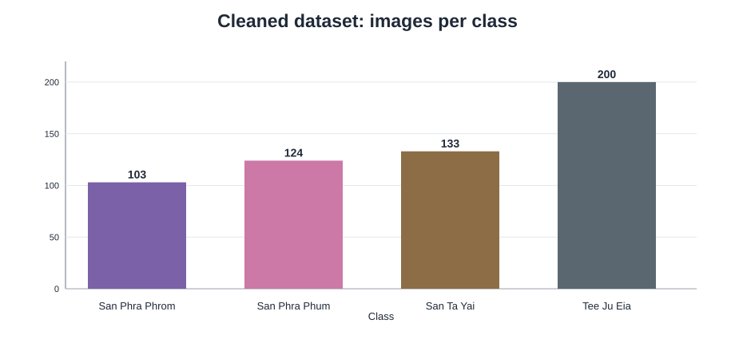

*ภาพที่ 2 การกระจายจำนวนภาพทั้งสี่คลาส*

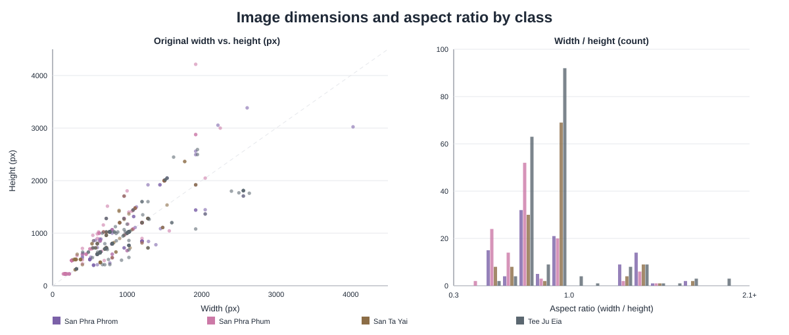

*ภาพที่ 3 ขนาดภาพต้นฉบับและอัตราส่วนกว้างต่อสูงจาก audit 560 ภาพ เส้นทแยงหมายถึงภาพจัตุรัส สีในส่วนสำรวจข้อมูลแทนประเภทศาล ไม่ใช่ mode การฝึก*

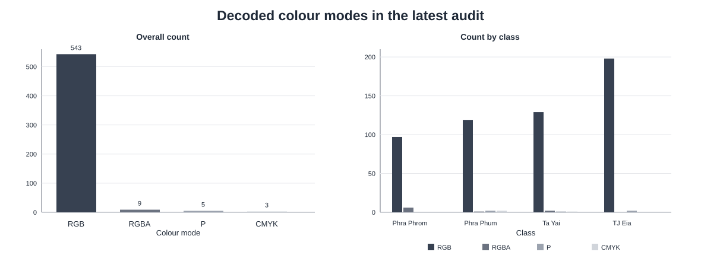

*ภาพที่ 4 โหมดสีที่ถอดรหัสได้จริง ทั้งภาพรวมและแยกประเภทศาล ทำให้เห็นว่าภาพส่วนน้อยต้องผ่านการจัดการ alpha, palette หรือ CMYK*

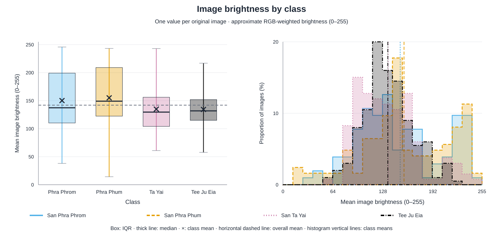

*ภาพที่ 5 ค่าเฉลี่ยความสว่าง 0–255 ของภาพต้นฉบับ 560 ภาพ คำนวณหลังหมุนตาม EXIF และผสม alpha กับพื้นกลาง โดยใช้ Rec.709 luminance กล่องแสดง IQR/มัธยฐานและปลายเส้นแสดงค่าต่ำสุด–สูงสุด กราฟนี้สำรวจข้อมูล ไม่ใช่ผลของโมเดล*

ภาพมีขนาดแตกต่างกัน 206 แบบ ความกว้างอยู่ระหว่าง 145–4,032 พิกเซล และความสูง 225–4,214 พิกเซล ผล audit บันทึกโหมดสี RGB 543 ภาพ, RGBA 9 ภาพ, CMYK 3 ภาพ และ palette 5 ภาพ ส่วนรูปแบบที่ถอดรหัสได้จริงเป็น JPEG 526 ภาพ, PNG 22 ภาพ, WEBP 11 ภาพ และ GIF 1 ภาพ จึงต้องจัดการรูปแบบและโหมดสีให้สอดคล้องกันก่อนเข้าโมเดล

### 1.3 ภาพซ้ำและความสมบูรณ์ของข้อมูล

ผล audit ไม่พบไฟล์ที่อ่านไม่ได้ และพบภาพซ้ำแบบ decoded RGB ในคลาสศาลพระภูมิ 2 คู่ ได้แก่ `0002/0046` และ `0073/0077` เมื่อรวมกับกลุ่มภาพใกล้เคียงที่ผ่านการทบทวนแล้ว ได้ทั้งหมด 550 กลุ่ม การแบ่งข้อมูลใช้กลุ่มเหล่านี้เป็นหน่วย เพื่อเก็บภาพที่ยืนยันว่าเกี่ยวข้องกันไว้ในชุดเดียวกัน

## 2) Data preparation

### 2.1 การแบ่ง train, validation และ test

ใช้ split seed 42 และเลือกการแบ่งจาก deterministic GroupShuffleSplit จำนวน 256 × 12 candidates เพื่อให้ใกล้สัดส่วน 70/15/15 พร้อมรักษาสัดส่วนคลาส ทุกสถาปัตยกรรม ทุก mode และทุก training seed ใช้ภาพในแต่ละชุดตรงกัน

<!-- generated:SPLIT_TABLE -->

| Split | Total | พระพรหม | พระภูมิ | ตายาย | ตี่จู้ |
| --- | --- | --- | --- | --- | --- |
| train | 390 | 70 | 89 | 91 | 140 |
| validation | 85 | 17 | 17 | 21 | 30 |
| test | 85 | 16 | 18 | 21 | 30 |

<!-- /generated:SPLIT_TABLE -->

ตรวจจาก `splits.csv` แล้วไม่พบกลุ่มภาพที่ข้ามชุด และทุกชุดมีครบทั้งสี่คลาส ชุด train ใช้ปรับน้ำหนักโมเดล ชุด validation ใช้เลือก hyperparameters และ checkpoint ส่วน test ใช้ประเมินหลังล็อกค่าการทดลองแล้ว

### 2.2 การเตรียมภาพและ augmentation

ขั้นแรกถอดรหัสภาพ หมุนตาม EXIF และแปลงเป็น RGB โดยผสมส่วนโปร่งใสกับสีพื้นกลาง จากนั้น resize ด้วย LANCZOS โดยรักษาอัตราส่วนเดิม ให้ด้านยาวพอดีกับกรอบ 224 × 224 พิกเซล แล้ววางภาพกึ่งกลางบนพื้น RGB `(124,116,104)` วิธีนี้รักษาสัดส่วนของศาลโดยไม่ยืดภาพให้เป็นสี่เหลี่ยม

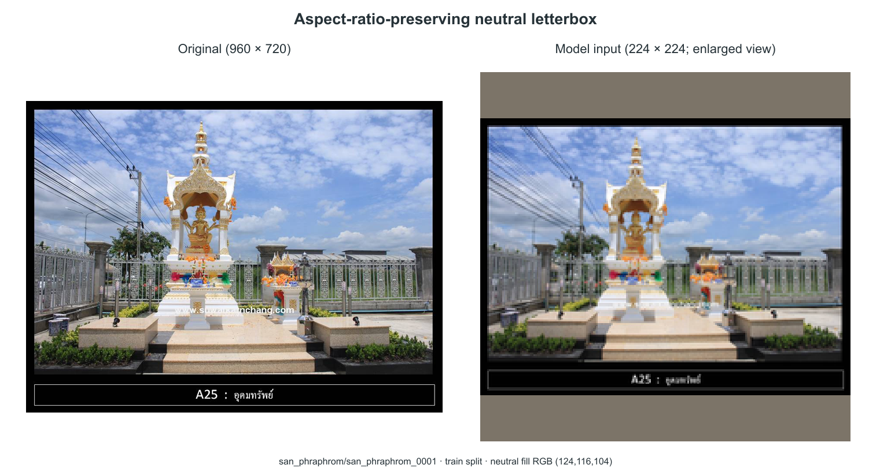

*ภาพที่ 6 ภาพ `san_phraphrom_0001` จากชุด train: ภาพต้นฉบับ 960 × 720 เทียบกับภาพ 224 × 224 ที่รักษาสัดส่วนแล้ววางกึ่งกลางบนพื้น RGB (124,116,104) ด้านขวาขยายขนาดเพื่อให้อ่านรายละเอียดได้ พื้นที่เพิ่มเป็นสีเทากลาง ไม่ใช่การเติมสีดำหรือ edge-replicate ตามภาพตัวอย่างที่แนบมา*

ทำ augmentation เฉพาะชุด train ตามค่าต่อไปนี้

| การแปลง | ค่าที่ใช้ |
| --- | --- |
| Rotation | ±12° |
| Translation | ±5% |
| Scale | 0.92–1.08 |
| Perspective | Distortion 0.10, probability 0.20 |
| Horizontal flip | Probability 0.50 |
| Color jitter | Brightness/contrast/saturation 0.10, hue 0.02 |
| Random Erasing | Probability 0.05, area 0.02–0.08 |

ใช้สีพื้นกลางเติมพื้นที่จากการแปลงเชิงเรขาคณิตและ erasing แล้วแปลงเป็น tensor และ normalize ด้วย ImageNet mean `(0.485,0.456,0.406)` และ standard deviation `(0.229,0.224,0.225)` ส่วน validation และ test ใช้ preprocessing แบบคงที่


*ภาพที่ 7 ตัวอย่างภาพ train ที่ผ่าน neutral letterbox และการแปลงตามช่วงค่าในตาราง คลาสละ 5 ภาพ เลือกจาก canonical train split โดยไม่ใช้ validation/test ภาพนี้สร้างใหม่เพื่ออธิบายนโยบาย augmentation ด้วย seed คงที่ ไม่ใช่ minibatch ที่บันทึกไว้ระหว่างการฝึก และการเรนเดอร์ JavaScript อาจต่างระดับพิกเซลจาก torchvision ดู [image IDs และค่าการแปลงรายภาพ](report/preprocessing_preview_sources.json)*

DataLoader สุ่มลำดับเฉพาะ train ใช้ `num_workers=0` และ `drop_last=False` เพื่อใช้ภาพครบทุก batch คำนวณ class weights จากจำนวนภาพ train ด้วยสูตร `390 / (4 × จำนวนภาพในคลาส)` ได้ `[1.392857, 1.095506, 1.071429, 0.696429]` ตามลำดับคลาสในตารางแรก

## 3) Model architecture

### 3.1 โมเดลและ classifier

ใช้ pretrained weights อย่างเป็นทางการของ torchvision ผ่าน `Weights.DEFAULT` และเปลี่ยนเฉพาะ linear layer สุดท้ายให้ส่งออก 4 logits โดยคงโครงสร้าง classifier ส่วนที่เหลือไว้

| Architecture | ลักษณะ backbone | การเปลี่ยน classifier |
| --- | --- | --- |
| ResNet50 | Residual blocks | เปลี่ยน `fc` เป็น linear สำหรับ 4 คลาส |
| EfficientNet-B0 | MBConv blocks | เปลี่ยน linear สุดท้าย คง Dropout 0.2 |
| MobileNetV3-Large | InvertedResidual blocks | เปลี่ยน linear สุดท้าย คง hidden linear, Hardswish และ Dropout 0.2 |
| DenseNet121 | Dense blocks ที่เชื่อม features ข้ามชั้น | เปลี่ยน `classifier` เป็น linear สำหรับ 4 คลาส |
| ConvNeXt-Tiny | ConvNeXt feature stages | เปลี่ยน linear สุดท้าย คง normalization และ flatten |

จำนวน parameters จาก config ที่บันทึกไว้แสดงดังนี้

<!-- generated:PARAM_TABLE -->

| Architecture | Total parameters | Trainable Full | Trainable Frozen | Trainable Partial |
| --- | --- | --- | --- | --- |
| ResNet50 | 23,516,228 | 23,516,228 | 8,196 | 14,972,932 |
| EfficientNet-B0 | 4,012,672 | 4,012,672 | 5,124 | 1,134,516 |
| MobileNetV3-Large | 4,207,156 | 4,207,156 | 1,235,204 | 3,414,668 |
| DenseNet121 | 6,957,956 | 6,957,956 | 4,100 | 2,164,228 |
| ConvNeXt-Tiny | 27,823,204 | 27,823,204 | 4,612 | 14,294,020 |

<!-- /generated:PARAM_TABLE -->

### 3.2 วิธีปรับน้ำหนัก

เปรียบเทียบสามวิธี โดยกำหนดส่วนที่ฝึกก่อนสร้าง optimizer ในทุก run

| Mode | ส่วนที่ปรับน้ำหนัก | สถานะระหว่างฝึก |
| --- | --- | --- |
| Full | Backbone และ classifier ทั้งหมด | ใช้ train mode ตามปกติ |
| Frozen | Classifier head | Backbone อยู่ใน eval mode รวมถึง BatchNorm buffers |
| Partial | Backbone stage สุดท้ายและ classifier | ส่วนต้นอยู่ใน eval mode ส่วนที่เปิดฝึกอยู่ใน train mode |

Partial ของ ResNet50 ใช้ `layer4`; DenseNet121 ใช้ `denseblock4` และ `norm5`; EfficientNet-B0 ใช้ MBConv stage สุดท้ายและ projection; ConvNeXt-Tiny ใช้ feature stage สุดท้าย ส่วน MobileNetV3-Large ใช้กลุ่ม InvertedResidual สุดท้ายและ projection ซึ่ง config ของโมเดลอ้างอิงระบุเป็น `features.13–16` พร้อม `classifier`

แต่ละ mode เริ่มฝึกจาก ImageNet weights ของตัวเองตลอดทั้ง run การทดลองนี้จึงเปรียบเทียบขอบเขตการปรับน้ำหนักสามแบบ โดยแต่ละแบบได้รับการค้นหา hyperparameters แยกกัน

### 3.3 การทำนายด้วย ImageNet model เดิม

ใช้ผลของ ResNet50 ที่ยังมี classifier 1,000 คลาสบนตัวอย่าง train เพื่อแสดงความต่างของชุดป้ายกำกับ เช่น โมเดลทายภาพศาลเป็น `stupa` ซึ่งสัมพันธ์กับรูปทรง แต่ยังไม่สามารถแยกศาลไทยทั้งสี่ประเภทได้โดยตรง ภาพประกอบส่วนนี้นำมาจาก baseline เดิมที่ใช้ข้อมูลชุดเดียวกัน และเก็บสำเนาไว้ใน output ล่าสุด

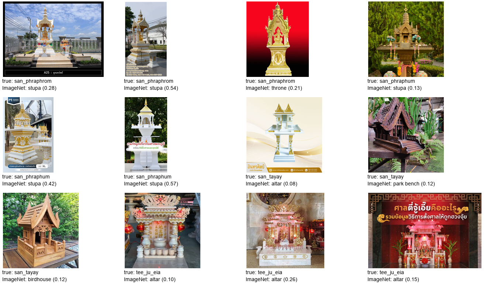

*ภาพที่ 8 ป้ายกำกับและ confidence ของ ResNet50/ImageNet ก่อนปรับ classifier ใช้ประกอบการอธิบาย transfer learning ไม่ได้นำมาคำนวณ accuracy ของโจทย์สี่คลาส*

## 4) Training method

### 4.1 การค้นหา hyperparameters

ลำดับการทดลองคือเตรียมข้อมูล → ค้นหา hyperparameters แยก 15 คู่ → เลือกสูตรชนะของแต่ละคู่ → ล็อกสูตรและโมเดลอ้างอิง → ฝึกซ้ำ 5 seeds → ประเมิน test และวิเคราะห์ผล

ใช้ local seeded random search คู่ละ 5 trials รวม 75 trials โดยบันทึกแต่ละ trial เป็น W&B run ขอบเขตการค้นหาคือ learning rate แบบ log-uniform `[1e-5,1e-3]`, weight decay แบบ log-uniform `[1e-6,1e-2]`, optimizer ใน `{AdamW, Adam, SGD}` และ batch size ใน `{16,32}` ทั้ง 15 คู่ได้รับชุดค่าที่สุ่มเหมือนกันตามตาราง แต่เลือกค่าชนะจาก validation ของตัวเอง

<!-- generated:SEARCH_TABLE -->

| Trial | LR | Weight decay | Optimizer | Batch |
| --- | --- | --- | --- | --- |
| 1 | 0.0003531117 | 5.695263E-05 | adam | 32 |
| 2 | 0.0002481624 | 2.380726E-06 | adam | 32 |
| 3 | 0.0003328736 | 0.001393982 | adam | 16 |
| 4 | 7.957413E-05 | 3.04223E-05 | adamw | 32 |
| 5 | 0.0001939681 | 0.001954549 | adam | 16 |

<!-- /generated:SEARCH_TABLE -->

ค่าที่สุ่มได้จริงประกอบด้วย Adam 4 ชุดและ AdamW 1 ชุด จึงยังไม่มีผลของ SGD ในการทดลองนี้ การสุ่มเพียง 5 ชุดช่วยจำกัดงบ แต่ครอบคลุม search space ได้เพียงบางส่วน

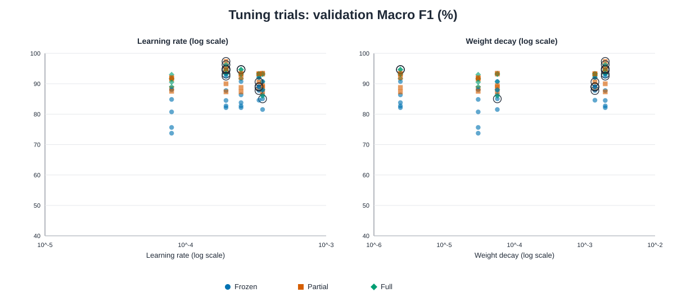

*ภาพที่ 9 จุดทั้ง 75 จุดมาจาก tuning trials ที่บันทึกจริง แกน x เป็น log scale; Frozen = น้ำเงิน/วงกลม, Partial = แดง/สี่เหลี่ยม, Full = เขียว/ข้าวหลามตัด สีและสัญลักษณ์นี้ใช้เหมือนกันทุกกราฟเปรียบเทียบ mode ความสัมพันธ์ที่เห็นยังมีผลจากสถาปัตยกรรม optimizer และ batch size ที่ต่างกัน การทดลองรอบนี้ไม่ได้ sweep dropout*

### 4.2 เงื่อนไขการฝึกและการเลือก checkpoint

| รายการ | ค่าที่ใช้ร่วมกัน |
| --- | --- |
| Loss | Class-weighted cross entropy |
| จำนวน epochs สูงสุด | 30 |
| Early stopping | Patience 7, `min_delta=0.0001` |
| Scheduler | `ReduceLROnPlateau(mode='max', factor=0.5, patience=3)` |
| ค่าที่ใช้กับ scheduler/early stopping | Validation Macro F1 |
| Adam defaults | Betas `(0.9,0.999)`, epsilon `1e-8` |
| Tuning seed | 42 |
| Final seeds | 42, 123, 456, 789, 1024 |

เลือก checkpoint ที่ validation Macro F1 สูงสุด หากเท่ากันใช้ validation loss ต่ำกว่า แล้วจึงเลือก epoch ก่อนหน้า สำหรับการเลือก trial ชนะ ใช้ validation Macro F1 ตามด้วย validation accuracy, validation loss และ trial index ตามลำดับ

### 4.3 สูตรที่เลือกและการประเมินรอบสุดท้าย

ตารางนี้ระบุ trial ที่ชนะของแต่ละคู่ โดยอ่านค่า optimizer, learning rate, weight decay และ batch size ได้จากตารางในหัวข้อ 4.1 ค่า validation ในที่นี้มาจาก tuning seed 42

<!-- generated:WINNER_TABLE -->

| Architecture | Mode | Trial ที่เลือก | Validation Macro F1 |
| --- | --- | ---: | ---: |
| ResNet50 | full | 5 | 0.9317 |
| ResNet50 | frozen | 3 | 0.8776 |
| ResNet50 | partial | 5 | 0.9440 |
| EfficientNet-B0 | full | 2 | 0.9468 |
| EfficientNet-B0 | frozen | 1 | 0.8504 |
| EfficientNet-B0 | partial | 3 | 0.8887 |
| MobileNetV3-Large | full | 5 | 0.9468 |
| MobileNetV3-Large | frozen | 5 | 0.9250 |
| MobileNetV3-Large | partial | 5 | 0.9734 |
| DenseNet121 | full | 5 | 0.9628 |
| DenseNet121 | frozen | 3 | 0.8906 |
| DenseNet121 | partial | 3 | 0.9061 |
| ConvNeXt-Tiny | full | 2 | 0.9463 |
| ConvNeXt-Tiny | frozen | 3 | 0.8902 |
| ConvNeXt-Tiny | partial | 5 | 0.9490 |

<!-- /generated:WINNER_TABLE -->

MobileNetV3-Large/Partial ได้รับเลือกเป็น **โมเดลอ้างอิง (reference)** ด้วย validation Macro F1 0.9734, Accuracy 97.65% และ loss 0.1718 ล็อกผลการเลือกนี้พร้อมสูตรทั้ง 15 คู่ใน `selection.json` ก่อนประเมิน test และกำหนด seed 42 สำหรับภาพวิเคราะห์รายตัวอย่าง

รอบ final ฝึกใหม่จาก ImageNet weights คู่ละ 5 seeds ด้วยสูตรของคู่นั้น เมื่อฝึกเสร็จจึงโหลด checkpoint ที่เลือกจาก validation กลับมาประเมิน test หนึ่งครั้งต่อ run รันครบ 75 final runs ใช้ 1,411 epochs รวมกับ tuning 1,350 epochs เป็น **2,761 epochs** จากเพดาน 4,500 epochs

การศึกษา ablation ภายหลังเพิ่ม 10 runs ใช้จริง 145 epochs จากเพดานเพิ่ม 300 epochs โดย reuse baseline final เดิม รวมการฝึกทั้งงานเป็น **160 runs และ 2,906 epochs** รายละเอียดการล็อกเงื่อนไขและผลแสดงในหัวข้อ 6.10

สภาพแวดล้อมที่บันทึกไว้คือ Windows, Python 3.13.5, PyTorch 2.13.0+cu130, torchvision 0.28.0+cu130, CUDA 13.0 และ RTX 5060 ปิด AMP และตั้ง deterministic algorithms แบบ `warn_only` ผลจึงอาจต่างกันได้เมื่อเปลี่ยน hardware หรือ library version

บันทึกการทดลองใน [Weights & Biases (W&B): thai-shrine-classifier-td](https://wandb.ai/wichaidit-m-nida/thai-shrine-classifier-td) ส่วนเว็บไซต์ของ [CoreWeave](https://coreweave.com/) แสดงไว้ตามชื่อที่ระบุในโจทย์ แต่ไฟล์ `environment.json` ของรอบนี้บันทึกเครื่อง Windows/RTX 5060 และไม่ได้ยืนยันว่าเครื่องฝึกอยู่บน CoreWeave รายงานนี้อ้างอิงไฟล์ผลในเครื่องเป็นหลัก; registry ระบุ online สำหรับงานหลัก 150 runs และ ablation เพิ่ม 10 runs แต่ยังไม่ได้ตรวจความครบถ้วนของ cloud artifacts ทุกชิ้น

## 5) Evaluation metrics

ใช้ **Accuracy** วัดสัดส่วนภาพที่ทายถูก และใช้ **Precision, Recall และ F1 รายคลาส** เพื่อดูว่าข้อผิดพลาดกระจายอย่างไร โดย Precision = TP/(TP+FP), Recall = TP/(TP+FN) และ F1 = 2PR/(P+R) กรณีตัวหารเป็นศูนย์กำหนดค่าเป็น 0

**Macro precision, recall และ F1** เฉลี่ยค่ารายคลาสทั้งสี่เท่ากัน จึงให้ความสำคัญกับคลาสที่มีภาพน้อยด้วย Macro F1 เป็นค่าเฉลี่ยของ F1 รายคลาสโดยตรง ผลรวมรายงานเป็น mean ± sample SD จาก 5 seeds (`ddof=1`) ส่วน confusion matrix แสดง true class ตามแถวและ predicted class ตามคอลัมน์

ใช้ two-sided paired t-test จับคู่ด้วย seed เดียวกัน เพื่อเปรียบเทียบ Accuracy และ Macro F1 แล้วปรับค่า p ด้วย Holm ที่ระดับ 0.05 แยกตามสองกลุ่มสมมติฐานที่ล็อกไว้

| กลุ่มการทดสอบ | การเปรียบเทียบ | จำนวนสมมติฐาน |
| --- | --- | ---: |
| Primary | โมเดลอ้างอิงกับอีก 14 คู่ × 2 metrics | 28 |
| Secondary | สามคู่ mode ภายในแต่ละสถาปัตยกรรม × 5 สถาปัตยกรรม × 2 metrics | 30 |

รายงาน Cohen's d_z เป็น mean paired difference หารด้วย SD ของ paired differences และช่วงความเชื่อมั่น 95% ของ mean difference ด้วย t-distribution (`df=4`) ช่วงความเชื่อมั่นนี้ไม่ได้ปรับ multiple comparisons การตัดสินนัยสำคัญจึงใช้ค่า p หลังปรับ Holm

วิเคราะห์ confidence เพิ่มด้วย Expected Calibration Error (ECE) จำนวน 10 bins เพื่อเปรียบเทียบ confidence กับ accuracy ภายในแต่ละ bin ค่า ECE ต่ำหมายถึงความต่างสองค่านี้น้อยลงตามนิยามที่ใช้

## 6) Experimental results

### 6.1 ความครบถ้วนของผล

ผลรอบนี้ครบ 15 คู่ คู่ละ 5 seeds ตรวจซ้ำจาก `test_predictions.csv` ทั้ง 75 runs รวม 6,375 แถว พบ test IDs 85 ภาพเรียงตรงกันทุก run การคำนวณ Accuracy, Macro metrics, ผลรายคลาส และ paired tests ซ้ำให้ค่าตรงกับผลที่บันทึกไว้ภายในความคลาดเคลื่อนระดับ floating-point ดูรายละเอียดใน [verification.json](report/verification.json)

สำหรับ follow-up ตรวจพบ ablation ครบสองเงื่อนไข เงื่อนไขละ 5 seeds และ baseline ที่ reuse 5 seeds ตรวจตัวเลขจาก predictions รวม 1,275 แถวของ 15 runs เหล่านี้ รวมถึง mean/sample SD, ผลรายคลาส, paired t-tests และ Holm แยก 4 comparisons ได้ตรงกับผลที่บันทึกไว้ ตรวจ SHA256 ของรูปและตารางที่นำมาใช้ตรงกับต้นทาง พร้อมยืนยัน Grad-CAM 8 ภาพจาก ResNet50/Full seed 42 ดู [ผลตรวจ follow-up](report/resnet_followup_verification.json) ภาพ test ยังคงเป็น 85 ภาพเดิม ไม่ได้เพิ่มจำนวนตัวอย่างอิสระตามจำนวน runs

### 6.2 ผลระหว่างฝึก ณ checkpoint ที่เลือก: box plots

กราฟหลักแสดง **validation Macro F1 (%)** และ **best epoch** ของ final runs ทั้ง 5 seeds ต่อ mode กล่องคือช่วงควอร์ไทล์ (IQR) กับมัธยฐาน ปลายเส้นคือค่าต่ำสุด–สูงสุดที่สังเกต และจุดคือ seed แต่ละค่า จึงเห็นการกระจายโดยไม่มี legend ทับชื่อกราฟ กราฟนี้สรุป checkpoint ที่เลือกด้วย validation ของแต่ละ run **ไม่ใช่เส้นการเรียนรู้ตามเวลา**; ประวัติ epoch จริงยังอยู่ใน `history.csv` ของทุก run

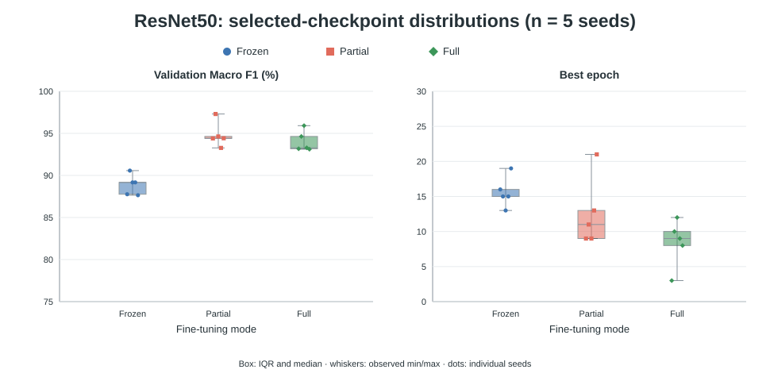

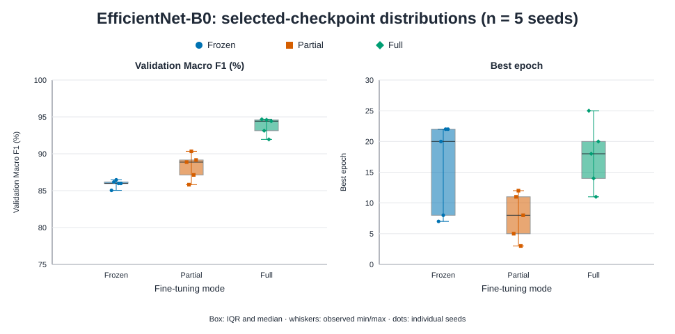

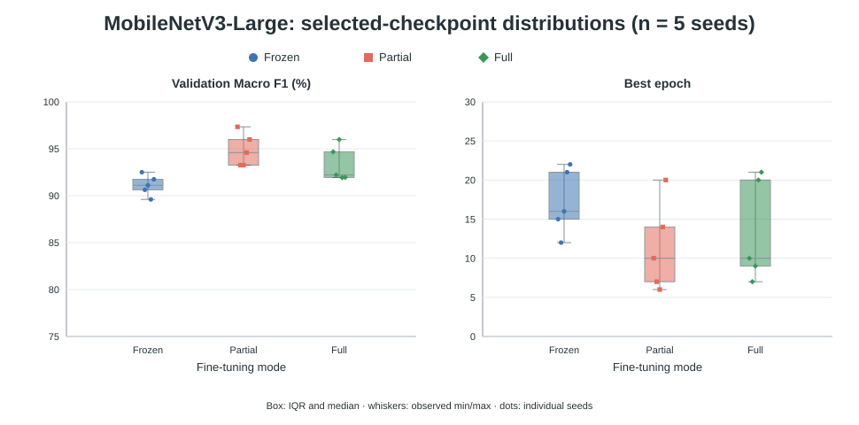

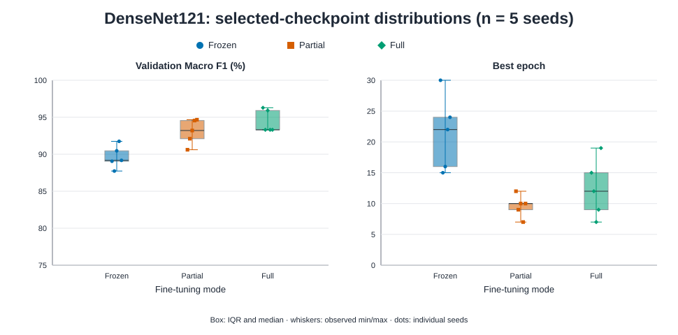

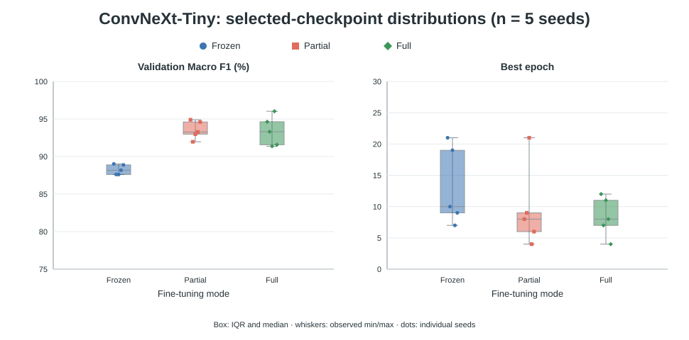

*ภาพที่ 10–14 สรุปคะแนน validation และ epoch ที่ดีที่สุดของแต่ละคู่จาก 5 final seeds สี/สัญลักษณ์ของ Full, Frozen และ Partial ตรงกับภาพที่ 9 โมเดลอ้างอิง MobileNetV3-Large/Partial มี best epoch เฉลี่ย 11.4; การหยุดฝึกของแต่ละ seed ทำให้จำนวน epoch ที่บันทึกไม่เท่ากัน*

หากต้องการดูเส้นเวลาแทนค่าที่ checkpoint เปิด [กราฟ learning curves ต้นฉบับทั้ง 15 คู่](report/report_assets/learning_curves/all_pairs_grid.png) พร้อม [จำนวน runs ที่เหลือในแต่ละ epoch](report/learning_curve_epoch_counts.csv) และ [ที่มา/SHA256](report/learning_curve_sources.json) เส้นท้ายกราฟอาจมีน้อยกว่า 5 runs เพราะ early stopping จึงไม่ใช้เป็นกราฟเปรียบเทียบหลัก

<details>
<summary>ตาราง best/stop epochs และผล ณ checkpoint ของทั้ง 15 คู่</summary>

<!-- generated:DYNAMICS_TABLE -->

| Architecture | Mode | Mean best epoch | Mean stop epoch | Train F1@best | Val F1@best | Loss แยกตัวช่วงท้าย (runs) |
| --- | --- | --- | --- | --- | --- | --- |
| ResNet50 | full | 8.4 | 15.4 | 0.9707 | 0.9402 | 5/5 |
| ResNet50 | frozen | 15.6 | 19.2 | 0.8855 | 0.8886 | 0/5 |
| ResNet50 | partial | 12.6 | 19.6 | 0.9891 | 0.9480 | 4/5 |
| EfficientNet-B0 | full | 17.6 | 23.6 | 0.9941 | 0.9376 | 1/5 |
| EfficientNet-B0 | frozen | 15.8 | 18.6 | 0.8853 | 0.8593 | 0/5 |
| EfficientNet-B0 | partial | 7.8 | 14.6 | 0.9756 | 0.8826 | 5/5 |
| MobileNetV3-Large | full | 13.4 | 20.4 | 0.9929 | 0.9335 | 2/5 |
| MobileNetV3-Large | frozen | 17.2 | 23.8 | 0.9587 | 0.9111 | 1/5 |
| MobileNetV3-Large | partial | 11.4 | 17.8 | 0.9882 | 0.9488 | 3/5 |
| DenseNet121 | full | 12.4 | 18.8 | 0.9995 | 0.9442 | 2/5 |
| DenseNet121 | frozen | 21.4 | 25.0 | 0.9049 | 0.8963 | 0/5 |
| DenseNet121 | partial | 9.6 | 16.6 | 0.9849 | 0.9303 | 4/5 |
| ConvNeXt-Tiny | full | 8.4 | 15.4 | 0.9982 | 0.9338 | 3/5 |
| ConvNeXt-Tiny | frozen | 13.2 | 18.2 | 0.8913 | 0.8826 | 0/5 |
| ConvNeXt-Tiny | partial | 9.6 | 15.2 | 0.9917 | 0.9354 | 4/5 |

<!-- /generated:DYNAMICS_TABLE -->

ค่าทั้งหมดเป็นค่าเฉลี่ยข้าม 5 seeds คอลัมน์สุดท้ายนับ runs ที่ loss ของ train ณ epoch สุดท้ายต่ำกว่าที่ checkpoint แต่ validation loss สูงกว่าเดิม ใช้เป็นตัวบ่งชี้การแยกตัวช่วงท้าย Train metrics ได้จากภาพที่ทำ augmentation จึงมีเงื่อนไขต่างจาก validation

</details>

### 6.3 ผลบนชุดทดสอบ

ตารางรายงาน mean ± sample SD จาก 5 seeds ทุกคู่ Accuracy ใช้หน่วยเปอร์เซ็นต์ ส่วน Precision, Recall และ F1 ใช้ช่วง 0–1 เรียงตามค่าเฉลี่ย test Macro F1 เพื่อแสดงผลที่สังเกต รายงานเลือก ResNet50/Full จากการพิจารณาหลายค่าวัดในหัวข้อ 6.6 ส่วน reference ของการทดสอบทางสถิติยังเป็น MobileNetV3-Large/Partial ตามที่ล็อกไว้ก่อน test

<!-- generated:RESULT_TABLE -->

| Rank | Architecture | Mode | Accuracy (%) | Macro precision | Macro recall | Macro F1 |
| --- | --- | --- | --- | --- | --- | --- |
| 1 | ResNet50 | full | 93.65 ± 1.34 | 0.9292 ± 0.0207 | 0.9277 ± 0.0169 | 0.9256 ± 0.0181 |
| 2 | ResNet50 | partial | 93.18 ± 1.53 | 0.9239 ± 0.0163 | 0.9211 ± 0.0180 | 0.9182 ± 0.0209 |
| 3 | MobileNetV3-Large | partial | 93.18 ± 2.41 | 0.9271 ± 0.0204 | 0.9217 ± 0.0266 | 0.9168 ± 0.0305 |
| 4 | DenseNet121 | partial | 92.71 ± 1.74 | 0.9181 ± 0.0210 | 0.9149 ± 0.0200 | 0.9142 ± 0.0185 |
| 5 | ConvNeXt-Tiny | full | 92.94 ± 1.66 | 0.9236 ± 0.0194 | 0.9179 ± 0.0190 | 0.9135 ± 0.0212 |
| 6 | DenseNet121 | full | 92.71 ± 1.53 | 0.9202 ± 0.0193 | 0.9144 ± 0.0185 | 0.9127 ± 0.0189 |
| 7 | EfficientNet-B0 | partial | 92.71 ± 2.10 | 0.9166 ± 0.0264 | 0.9129 ± 0.0246 | 0.9105 ± 0.0267 |
| 8 | ConvNeXt-Tiny | partial | 92.00 ± 1.53 | 0.9205 ± 0.0146 | 0.9080 ± 0.0172 | 0.9074 ± 0.0178 |
| 9 | MobileNetV3-Large | full | 91.76 ± 0.83 | 0.9145 ± 0.0157 | 0.9040 ± 0.0085 | 0.8986 ± 0.0096 |
| 10 | EfficientNet-B0 | full | 91.06 ± 1.34 | 0.8998 ± 0.0143 | 0.8925 ± 0.0153 | 0.8921 ± 0.0152 |
| 11 | MobileNetV3-Large | frozen | 90.35 ± 0.98 | 0.8914 ± 0.0093 | 0.8923 ± 0.0112 | 0.8869 ± 0.0133 |
| 12 | ResNet50 | frozen | 88.47 ± 1.53 | 0.8793 ± 0.0172 | 0.8765 ± 0.0159 | 0.8755 ± 0.0167 |
| 13 | DenseNet121 | frozen | 88.00 ± 1.29 | 0.8637 ± 0.0173 | 0.8586 ± 0.0157 | 0.8587 ± 0.0165 |
| 14 | ConvNeXt-Tiny | frozen | 87.06 ± 2.76 | 0.8614 ± 0.0352 | 0.8566 ± 0.0269 | 0.8517 ± 0.0248 |
| 15 | EfficientNet-B0 | frozen | 85.65 ± 2.41 | 0.8366 ± 0.0262 | 0.8378 ± 0.0230 | 0.8338 ± 0.0236 |

<!-- /generated:RESULT_TABLE -->

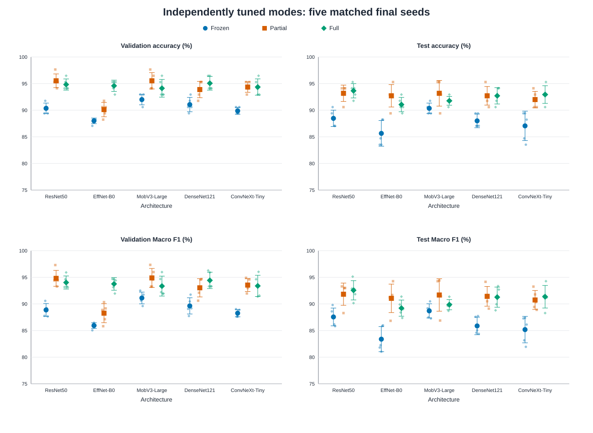

*ภาพที่ 15 เปรียบเทียบ validation และ test ณ checkpoint ที่เลือกของ final runs ทั้ง 15 คู่ จุดใหญ่คือค่าเฉลี่ย จุดจางคือแต่ละ seed และปลายเส้นคือ ±1 sample SD (n = 5); แกนตั้งทุกช่องเป็นเปอร์เซ็นต์ สีน้ำเงิน/วงกลม = Frozen, แดง/สี่เหลี่ยม = Partial, เขียว/ข้าวหลามตัด = Full การจัดอันดับ test เป็นเพียงผลที่สังเกตหลังล็อกโมเดลอ้างอิงแล้ว*

ResNet50/Full ให้ค่าเฉลี่ย Macro F1 สูงสุด 0.9256 ขณะที่โมเดลอ้างอิง MobileNetV3-Large/Partial ได้ 0.9168 ต่างกันประมาณ 0.0088 ส่วน MobileNetV3-Large/Full มี SD ของ Macro F1 ต่ำที่สุดที่ 0.0096 แต่มีค่าเฉลี่ย 0.8986 จึงต้องพิจารณาทั้งคะแนนและความสม่ำเสมอร่วมกัน

เมื่อเปรียบเทียบภายในสถาปัตยกรรม Partial ให้ค่าเฉลี่ย Macro F1 สูงสุดใน EfficientNet-B0, MobileNetV3-Large และ DenseNet121 ส่วน Full สูงสุดใน ResNet50 และ ConvNeXt-Tiny ขณะที่ Frozen มีค่าเฉลี่ยต่ำสุดในทั้งห้าสถาปัตยกรรม ผลนี้อธิบายการเปรียบเทียบหลัง tune แต่ละ mode แล้ว; ความต่างของค่าเฉลี่ยต้องพิจารณาควบคู่กับการทดสอบทางสถิติ

### 6.4 ผลการทดสอบทางสถิติ

หลังปรับ Holm พบผลที่มีนัยสำคัญ 2 จาก 28 สมมติฐานในกลุ่ม Primary และ 3 จาก 30 สมมติฐานในกลุ่ม Secondary ตารางแสดงผลทั้งห้าแถว พร้อมการเปรียบเทียบโมเดลอ้างอิงกับ ResNet50/Full ทุกแถวจับคู่ 5 seeds และคำนวณผลต่างเป็น **A − B** ในหน่วย 0–1

<!-- generated:STATS_TABLE -->

| Family | A − B | Metric | Mean Δ | 95% CI (unadjusted) | d_z | Holm p |
| --- | --- | --- | ---: | --- | ---: | ---: |
| Primary | MobileNetV3-Large/partial<br>− ResNet50/full | Accuracy | -0.0047 | [-0.0442, 0.0348] | -0.148 | 1.000000 |
| Primary | MobileNetV3-Large/partial<br>− ResNet50/full | Macro F1 | -0.0088 | [-0.0589, 0.0413] | -0.218 | 1.000000 |
| Primary | MobileNetV3-Large/partial<br>− ConvNeXt-Tiny/frozen | Accuracy | 0.0612 | [0.0452, 0.0772] | 4.747 | 0.012352 |
| Primary | MobileNetV3-Large/partial<br>− ConvNeXt-Tiny/frozen | Macro F1 | 0.0650 | [0.0481, 0.0820] | 4.760 | 0.012352 |
| Secondary | ResNet50/full<br>− ResNet50/frozen | Accuracy | 0.0518 | [0.0351, 0.0684] | 3.859 | 0.027767 |
| Secondary | DenseNet121/frozen<br>− DenseNet121/partial | Accuracy | -0.0471 | [-0.0617, -0.0325] | -4.000 | 0.025062 |
| Secondary | DenseNet121/frozen<br>− DenseNet121/partial | Macro F1 | -0.0555 | [-0.0716, -0.0395] | -4.295 | 0.019714 |

<!-- /generated:STATS_TABLE -->

โมเดลอ้างอิงมี Accuracy และ Macro F1 สูงกว่า ConvNeXt-Tiny/Frozen อย่างมีนัยสำคัญ ส่วนการเปรียบเทียบภายในสถาปัตยกรรมพบว่า ResNet50/Full มี Accuracy สูงกว่า Frozen และ DenseNet121/Partial มีทั้ง Accuracy และ Macro F1 สูงกว่า Frozen

สำหรับ ResNet50/Full เทียบกับโมเดลอ้างอิง ค่า Holm p เท่ากับ 1.0 ทั้งสอง metrics จึงยังไม่มีหลักฐานเพียงพอที่จะสรุปความเหนือกว่าจากการทดลองนี้ การไม่พบนัยสำคัญก็ไม่ได้ยืนยันว่าประสิทธิภาพเท่ากัน ดูผลครบ 58 แถว รวม raw p, effect size และช่วงความเชื่อมั่นได้ใน [verified_statistics.csv](report/verified_statistics.csv)

### 6.5 ผลรายคลาส

เปรียบเทียบ ResNet50/Full ซึ่งเป็นโมเดลสุดท้ายที่เลือกในรายงาน กับ MobileNetV3-Large/Partial ซึ่งเป็น reference ที่ล็อกไว้ก่อน test ค่า Precision, Recall และ F1 เป็น mean ± sample SD ส่วน support เป็นจำนวนภาพ test ต่อ run

<!-- generated:PERCLASS_TABLE -->

| Pair | Class | Support | Precision | Recall | F1 |
| --- | --- | ---: | ---: | ---: | ---: |
| ResNet50/full | san_phraphrom | 16 | 0.8898 ± 0.0648 | 0.9750 ± 0.0342 | 0.9294 ± 0.0396 |
| ResNet50/full | san_phraphum | 18 | 0.9217 ± 0.0539 | 0.7778 ± 0.0393 | 0.8435 ± 0.0443 |
| ResNet50/full | san_tayay | 21 | 0.9055 ± 0.0501 | 0.9714 ± 0.0261 | 0.9363 ± 0.0231 |
| ResNet50/full | tee_ju_eia | 30 | 1.0000 ± 0.0000 | 0.9867 ± 0.0183 | 0.9932 ± 0.0093 |
| MobileNetV3-Large/partial | san_phraphrom | 16 | 0.8448 ± 0.0519 | 1.0000 ± 0.0000 | 0.9152 ± 0.0312 |
| MobileNetV3-Large/partial | san_phraphum | 18 | 0.9589 ± 0.0377 | 0.7222 ± 0.1039 | 0.8193 ± 0.0675 |
| MobileNetV3-Large/partial | san_tayay | 21 | 0.9047 ± 0.0405 | 0.9714 ± 0.0261 | 0.9361 ± 0.0174 |
| MobileNetV3-Large/partial | tee_ju_eia | 30 | 1.0000 ± 0.0000 | 0.9933 ± 0.0149 | 0.9966 ± 0.0076 |

<!-- /generated:PERCLASS_TABLE -->

ศาลพระภูมิเป็นคลาสที่ยากที่สุดของทั้งสองคู่ ResNet50/Full มี Recall เฉลี่ย 0.7778 และ F1 0.8435 เทียบกับ 0.7222 และ 0.8193 ของ MobileNetV3-Large/Partial ขณะที่ MobileNet มี Recall ของศาลพระพรหมและศาลตี่จู้เอี๊ยะสูงกว่า จึงไม่ใช่กรณีที่ ResNet ชนะทุกคลาส แม้คะแนนภาพรวมจะสูงกว่า [ผลรายคลาสครบทั้ง 15 คู่](report/verified_per_class_summary.csv)

### 6.6 การเลือกโมเดลสุดท้ายจากผลประเมินหลายด้าน

**เลือก ResNet50/Full เป็นโมเดลสุดท้ายของรายงาน** โดยพิจารณาความถูกต้องภาพรวม ความสมดุลระหว่างคลาส ความสม่ำเสมอข้าม seeds และ calibration ร่วมกัน ไม่ได้สร้างคะแนนรวมด้วยการเฉลี่ย metrics ที่มีความเกี่ยวข้องกัน ตารางต่อไปใช้ mean ± sample SD จาก 5 seeds; ค่าทั้งหมดเป็นเปอร์เซ็นต์และ SD เป็นจุดเปอร์เซ็นต์

| ค่าวัด | ResNet50/Full — โมเดลที่เลือก | MobileNetV3-Large/Partial — reference เดิม |
| --- | ---: | ---: |
| Accuracy (%) ↑ | 93.65 ± 1.34 | 93.18 ± 2.41 |
| Macro precision (%) ↑ | 92.92 ± 2.07 | 92.71 ± 2.04 |
| Macro recall (%) ↑ | 92.77 ± 1.69 | 92.17 ± 2.66 |
| Macro F1 (%) ↑ | 92.56 ± 1.81 | 91.68 ± 3.05 |
| Recall ศาลพระภูมิ (%) ↑ | 77.78 ± 3.93 | 72.22 ± 10.39 |
| ECE 10 bins (%) ↓ | 4.94 ± 1.56 | 4.53 ± 1.67 |

ResNet50/Full มีคะแนนเฉลี่ยการจำแนกทั้งสี่ด้านสูงสุดในบรรดา 15 คู่ และมี SD ของ Accuracy, Macro recall และ Macro F1 ต่ำกว่า reference เดิม อีกทั้ง Recall ของศาลพระภูมิซึ่งเป็นคลาสที่ยากสูงกว่า ข้อแลกเปลี่ยนคือ ECE สูงกว่าเล็กน้อย และไม่ได้ให้ผลรายคลาสดีที่สุดทุกคลาส จึงเลือกจากภาพรวมของหลักฐานที่สังเกต ไม่ได้อ้างว่าชนะทุกด้านหรือเหนือกว่าทุกโมเดลอย่างมีนัยสำคัญ

การตัดสินใจนี้เกิดขึ้น **หลังพิจารณาผล test (post-hoc selection)** จึงต้องยืนยันความสามารถในการ generalize ด้วยข้อมูลภายนอกชุดใหม่ ผล Holm ระหว่าง ResNet50/Full กับ MobileNetV3-Large/Partial เท่ากับ 1.0 สำหรับ Accuracy และ Macro F1 หมายถึงยังยืนยันความเหนือกว่าทางสถิติไม่ได้ ไม่ใช่หลักฐานว่าโมเดลเท่ากัน และไม่ใช่เกณฑ์ตัดสินผู้ชนะ

เพื่อรักษาที่มาของการทดลอง `selection.json` และครอบครัวสถิติ 28/30 comparisons ยังคงใช้ MobileNetV3-Large/Partial เป็น reference ที่เลือกจาก validation Macro F1 ก่อน test ไม่มีการแก้ lock หรือคำนวณครอบครัวสถิติใหม่ตามโมเดลที่เลือกภายหลัง MobileNet จึงมีบทบาทเป็นจุดเปรียบเทียบในสถิติเดิม ส่วนข้อสรุปสุดท้ายของรายงานเลือก ResNet50/Full เพียงคู่เดียว

### 6.7 Confusion matrices: ค่าเฉลี่ย (%) ± SD (จุดเปอร์เซ็นต์)

คำนวณสัดส่วน **ภายในแต่ละ true class** ของแต่ละ seed ก่อน แล้วหาค่าเฉลี่ยและ sample SD ข้าม 5 seeds ช่องแนวทแยงคือ Recall ของคลาสนั้น สเกลสีทุกคู่กำหนด 0–100 เท่ากัน จึงเทียบข้ามภาพได้โดยตรง ตัวเลขบรรทัดแรกในช่องมีหน่วยเปอร์เซ็นต์ ส่วนบรรทัด `±` เป็น SD หน่วยจุดเปอร์เซ็นต์

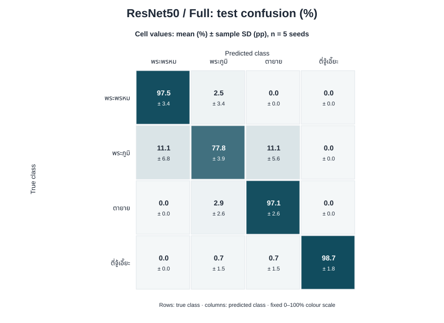

*ภาพที่ 16 ResNet50/Full จาก 5 seeds: ภาพศาลพระภูมิถูกทายเป็นศาลพระภูมิเฉลี่ย 77.8% โดยมี SD 3.9 จุดเปอร์เซ็นต์ คลาสนี้ยังมี Recall ต่ำที่สุดของโมเดลที่เลือก*

<details>
<summary>Confusion matrices ของทุก architecture × mode (5 seeds ต่อคู่)</summary>

| Architecture | Frozen | Partial | Full |
| --- | --- | --- | --- |
| ResNet50 | [กราฟ](report/report_assets/latest/confusion_resnet50_frozen.svg) | [กราฟ](report/report_assets/latest/confusion_resnet50_partial.svg) | [กราฟ](report/report_assets/latest/confusion_resnet50_full.svg) |
| EfficientNet-B0 | [กราฟ](report/report_assets/latest/confusion_efficientnet_b0_frozen.svg) | [กราฟ](report/report_assets/latest/confusion_efficientnet_b0_partial.svg) | [กราฟ](report/report_assets/latest/confusion_efficientnet_b0_full.svg) |
| MobileNetV3-Large | [กราฟ](report/report_assets/latest/confusion_mobilenet_v3_large_frozen.svg) | [กราฟ](report/report_assets/latest/confusion_mobilenet_v3_large_partial.svg) | [กราฟ](report/report_assets/latest/confusion_mobilenet_v3_large_full.svg) |
| DenseNet121 | [กราฟ](report/report_assets/latest/confusion_densenet121_frozen.svg) | [กราฟ](report/report_assets/latest/confusion_densenet121_partial.svg) | [กราฟ](report/report_assets/latest/confusion_densenet121_full.svg) |
| ConvNeXt-Tiny | [กราฟ](report/report_assets/latest/confusion_convnext_tiny_frozen.svg) | [กราฟ](report/report_assets/latest/confusion_convnext_tiny_partial.svg) | [กราฟ](report/report_assets/latest/confusion_convnext_tiny_full.svg) |

[ค่ารายช่องทั้ง 15 คู่](report/confusion_mean_sd.csv) ระบุค่าเฉลี่ย (%) และ SD (จุดเปอร์เซ็นต์) ที่ใช้วาดภาพ

</details>

### 6.8 Grad-CAM ของ ResNet50/Full

<!-- resnet-followup:gradcam:start -->

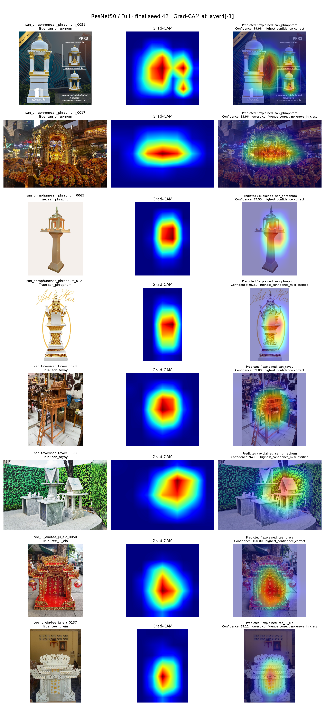

Grad-CAM ของ ResNet50/Full, final seed 42 จำนวน 8 ภาพ อธิบายคลาสที่โมเดลทำนาย เลือกกรณีถูก/ผิดแยกตาม true class; ถ้าไม่มีภาพผิดใช้กรณีถูกที่ confidence ต่ำ แผนที่จัดแนวกลับสู่ภาพต้นฉบับหลังตัด canvas padding ออก เป็นหลักฐานประกอบการวิเคราะห์ ไม่ได้พิสูจน์เหตุผลเชิงสาเหตุของโมเดล [ข้อมูลรายภาพ](report/resnet_gradcam_cases.csv)

ภาพ MobileNet ด้านล่างเป็นหลักฐานประกอบของ reference เดิม แยกจากโมเดล ResNet ที่เลือกในรายงาน

<!-- resnet-followup:gradcam:end -->

*ภาพที่ 17 ภาพต้นฉบับ แผนที่ Grad-CAM และภาพซ้อนทับของ ResNet50/Full, seed 42 ที่ชั้น `layer4[-1]` ตัวเลข confidence ในรูปมีหน่วยเปอร์เซ็นต์ ชุดตัวอย่างมีภาพทายถูก 6 ภาพและทายผิด 2 ภาพ*

บริเวณตอบสนองสูงในหลายภาพอยู่ใกล้ตัวเรือนหรือฐานศาล เช่น `san_phraphum_0065` และ `san_tayay_0078` อย่างไรก็ตาม ภาพ `san_phraphum_0121` ถูกทายเป็นศาลพระพรหมด้วย confidence 96.80% และ `san_tayay_0093` ถูกทายเป็นศาลพระภูมิด้วย confidence 94.18% แม้ heatmap จะทับอยู่ใกล้ตัวศาลก็ตาม การตอบสนองบนวัตถุจึงไม่ได้รับประกันว่าจำแนกประเภทถูกต้อง

บางภาพเป็นโฆษณาที่มีศาลหลายองค์ ข้อความ หรือฉากหลังร่วมอยู่ด้วย เช่น `san_phraphrom_0051` ภาพชุดนี้ยังไม่เพียงพอที่จะแยกอิทธิพลของรูปทรง ข้อความ และบริบท ต้องใช้การทดลองควบคุมเพิ่มเติมก่อนอธิบายเหตุผลของโมเดล ส่วนสองคลาสที่ไม่มีภาพผิดใน seed 42 ใช้ภาพถูกที่ confidence ต่ำเป็นกรณียากตามกติกา ไม่ได้สร้างตัวอย่างผิดขึ้นมาแทน

<details>
<summary>ผลทำนายของ ResNet50/Full ในตัวอย่าง Grad-CAM ทั้ง 8 ภาพ</summary>

| Image ID (stem) | True class | Predicted class | Confidence (%) | เหตุผลเลือก |
| --- | --- | --- | ---: | --- |
| san_phraphrom_0051 | san_phraphrom | san_phraphrom | 99.98 | ถูกและมั่นใจสูงสุดในคลาส |
| san_phraphrom_0017 | san_phraphrom | san_phraphrom | 83.96 | ถูกแต่มั่นใจต่ำสุด; คลาสนี้ไม่มีภาพผิด |
| san_phraphum_0065 | san_phraphum | san_phraphum | 99.95 | ถูกและมั่นใจสูงสุดในคลาส |
| san_phraphum_0121 | san_phraphum | san_phraphrom | 96.80 | ผิดและมั่นใจสูงสุดในคลาส |
| san_tayay_0078 | san_tayay | san_tayay | 99.89 | ถูกและมั่นใจสูงสุดในคลาส |
| san_tayay_0093 | san_tayay | san_phraphum | 94.18 | ผิดและมั่นใจสูงสุดในคลาส |
| tee_ju_eia_0050 | tee_ju_eia | tee_ju_eia | 100.00 | ถูกและมั่นใจสูงสุดในคลาส |
| tee_ju_eia_0137 | tee_ju_eia | tee_ju_eia | 83.11 | ถูกแต่มั่นใจต่ำสุด; คลาสนี้ไม่มีภาพผิด |

ค่าที่แสดงปัดทศนิยมสองตำแหน่ง เช่น 100.00 เป็น confidence ของโมเดล ไม่ใช่การรับประกันความถูกต้อง ตรวจค่าความน่าจะเป็นทั้งสี่คลาสและ checkpoint identity ได้ใน [resnet_gradcam_cases.csv](report/resnet_gradcam_cases.csv)

</details>

<details>
<summary>หลักฐานประกอบเดิม: Grad-CAM และ eyeball ของ MobileNetV3-Large/Partial</summary>

ใช้ MobileNetV3-Large/Partial, seed 42 วิเคราะห์ 8 ภาพ โดยเลือกตัวอย่างทายถูกและทายผิดแยกตาม true class หากคลาสนั้นไม่มีภาพผิด ใช้ภาพทายถูกที่ confidence ต่ำแทน ชุดตัวอย่างประกอบด้วยภาพทายถูก 7 ภาพและทายผิด 1 ภาพ

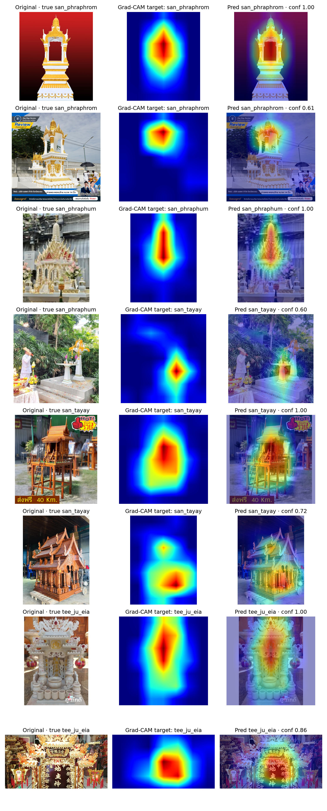

*ภาพประกอบ A1 ภาพต้นฉบับ heatmap และ overlay ของ reference เดิม MobileNetV3-Large/Partial โดย Grad-CAM อธิบายคลาสที่โมเดลทำนาย*

หลายตัวอย่างมีบริเวณตอบสนองสูงใกล้ส่วนกลางศาล หลังคา หรือฐาน กรณี `san_phraphum_0076` ถูกทายเป็นศาลตายายด้วย confidence 0.6001 และมี heatmap กระจุกใกล้ศาลด้านล่างขวา บางภาพมีข้อความและลายน้ำอยู่ใกล้บริเวณตอบสนองสูงด้วย จึงยังแยกไม่ได้ว่าโมเดลใช้รูปทรงหรือข้อความมากน้อยเพียงใด Grad-CAM ช่วยตั้งข้อสังเกต แต่ไม่ได้ยืนยันสาเหตุของการทำนาย

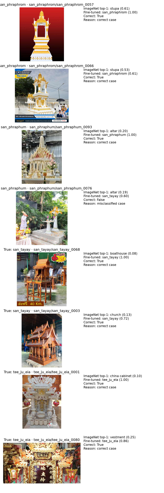

*ภาพประกอบ A2 ป้ายกำกับจาก ImageNet model และผลหลัง fine-tune ของ MobileNetV3-Large/Partial บนภาพเดียวกัน เช่น stupa, altar และ china cabinet เทียบกับประเภทศาลไทย*

<details>
<summary>ผลทำนายรายภาพในชุดตัวอย่าง</summary>

<!-- generated:CASE_TABLE -->

| Image ID | True | Fine-tuned prediction | Confidence (0–1) | ImageNet top1 |
| --- | --- | --- | --- | --- |
| san_phraphrom/san_phraphrom_0057 | san_phraphrom | san_phraphrom | 1.0000 | stupa |
| san_phraphrom/san_phraphrom_0066 | san_phraphrom | san_phraphrom | 0.6149 | stupa |
| san_phraphum/san_phraphum_0093 | san_phraphum | san_phraphum | 1.0000 | altar |
| san_phraphum/san_phraphum_0076 | san_phraphum | san_tayay | 0.6001 | altar |
| san_tayay/san_tayay_0068 | san_tayay | san_tayay | 1.0000 | boathouse |
| san_tayay/san_tayay_0003 | san_tayay | san_tayay | 0.7219 | church |
| tee_ju_eia/tee_ju_eia_0001 | tee_ju_eia | tee_ju_eia | 1.0000 | china cabinet |
| tee_ju_eia/tee_ju_eia_0080 | tee_ju_eia | tee_ju_eia | 0.8600 | vestment |

<!-- /generated:CASE_TABLE -->

</details>

</details>

นอกจากนี้นับความถี่ที่ภาพ test แต่ละภาพถูกทายผิดจากทั้ง 75 runs พบภาพศาลพระภูมิซ้ำในกลุ่มที่ผิดบ่อยที่สุด เช่น `san_phraphum_0043` ผิด 69/75 runs และ `san_phraphum_0121` ผิด 66/75 runs จึงเป็นภาพที่ควรทบทวนลักษณะร่วมกับภาพจากแหล่งใหม่

<details>
<summary>สิบภาพที่ถูกทายผิดบ่อยที่สุด</summary>

<!-- generated:ERROR_TABLE -->

| Image ID | True class | Wrong/75 | Wrong reference/5 | Wrong ResNet Full/5 |
| --- | --- | --- | --- | --- |
| san_phraphum/san_phraphum_0043 | san_phraphum | 69 | 2 | 5 |
| san_phraphum/san_phraphum_0121 | san_phraphum | 66 | 5 | 4 |
| san_phraphum/san_phraphum_0114 | san_phraphum | 60 | 3 | 1 |
| san_phraphum/san_phraphum_0015 | san_phraphum | 42 | 3 | 4 |
| san_phraphum/san_phraphum_0076 | san_phraphum | 42 | 3 | 2 |
| san_phraphum/san_phraphum_0113 | san_phraphum | 35 | 3 | 1 |
| san_tayay/san_tayay_0046 | san_tayay | 32 | 1 | 0 |
| san_tayay/san_tayay_0093 | san_tayay | 28 | 0 | 2 |
| tee_ju_eia/tee_ju_eia_0061 | tee_ju_eia | 23 | 1 | 1 |
| san_phraphum/san_phraphum_0064 | san_phraphum | 20 | 4 | 1 |

<!-- /generated:ERROR_TABLE -->

จำนวนครั้งเหล่านี้มาจากภาพชุดเดิมและโมเดลที่เกี่ยวข้องกัน ใช้อธิบายรูปแบบข้อผิดพลาด โดยไม่ได้ถือเป็นตัวอย่างอิสระ 75 ชุด ดูผลครบ 85 ภาพใน [error_frequency.csv](report/error_frequency.csv)

</details>

### 6.9 Confidence และ calibration ของโมเดลที่เลือก


*ภาพที่ 18 Reliability diagram ของ ResNet50/Full, seed 42 จาก test 85 ภาพ แกนทั้งสองเป็นเปอร์เซ็นต์; วงกลมแทน bin ที่มีข้อมูล ขนาดวงกลมสัมพันธ์กับจำนวนภาพ ตัวเลขข้างจุดคือจำนวนภาพ เส้นประคือกรณี confidence ตรงกับ accuracy ภาพนี้วาดจาก bin logs ที่บันทึกไว้แล้ว*

ResNet50/Full มี ECE เฉลี่ย **4.94% ± 1.56 จุดเปอร์เซ็นต์** จาก 5 seeds ส่วน seed 42 ในภาพเป็นเพียงตัวอย่างหนึ่ง ใน 10 bins ที่กำหนด bin 0.9–1.0 ของ seed 42 มี 73/85 ภาพ จึงต้องอ่าน bin ที่มีภาพน้อยด้วยความระมัดระวัง MobileNetV3-Large/Partial มี ECE เฉลี่ยต่ำกว่าที่ 4.53% ± 1.67 จุดเปอร์เซ็นต์ และ DenseNet121/Partial มีค่าเฉลี่ยต่ำสุด 4.44% ± 1.18 จุดเปอร์เซ็นต์ การเลือก ResNet จึงยอมรับข้อแลกเปลี่ยนด้าน calibration; การทดลองไม่ได้ทดสอบนัยสำคัญของ ECE

### 6.10 Ablation ของ ResNet50/Full

<!-- resnet-followup:ablation:start -->

ใช้ ResNet50/Full สูตรเดิมและ split เดิม เปลี่ยนทีละปัจจัย: ปิด augmentation หรือปิด class weights ฝึกใหม่จาก ImageNet variant ละ 5 matched seeds รวม 10 runs และใช้ baseline final เดิม 5 seeds โดยไม่ tune ใหม่ ค่าตารางเป็น mean (%) ± sample SD (จุดเปอร์เซ็นต์)

| Condition | Accuracy (%) | Macro precision (%) | Macro recall (%) | Macro F1 (%) |
| --- | ---: | ---: | ---: | ---: |
| baseline | 93.65 ± 1.34 | 92.92 ± 2.07 | 92.77 ± 1.69 | 92.56 ± 1.81 |
| no_augmentation | 92.71 ± 1.93 | 92.35 ± 1.92 | 91.41 ± 2.28 | 91.24 ± 2.39 |
| no_class_weights | 93.18 ± 2.10 | 92.77 ± 2.55 | 92.18 ± 2.22 | 91.89 ± 2.54 |

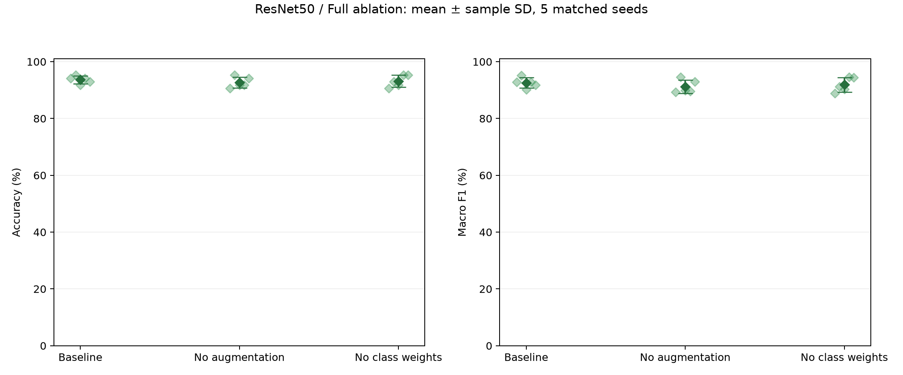

[ผลต่างจับคู่ราย seed](report/resnet_ablation_matched_deltas.csv) · [สถิติครบ 4 comparisons ใน Holm family แยก](report/resnet_ablation_statistical_tests.csv) · [ผลรายคลาส](report/resnet_ablation_per_class_summary.csv)

ผลนี้เป็น exploratory follow-up หลังเลือก ResNet จาก test บน split ที่เคยตรวจดูแล้ว สถิติอธิบายความแปรปรวนข้าม seeds ไม่ใช่การยืนยันกับข้อมูลภายนอก และ loss ของเงื่อนไขใช้/ไม่ใช้ class weights ไม่อยู่บนสเกลวัตถุประสงค์เดียวกัน

<!-- resnet-followup:ablation:end -->

*ภาพที่ 19 ค่าเฉลี่ย ± sample SD และคะแนนราย seed ของ baseline กับสอง ablation variants ทุกเงื่อนไขใช้ Full จึงใช้สีเขียวและสัญลักษณ์ข้าวหลามตัดร่วมกัน ชื่อบนแกนแยกปัจจัยที่ถอดออก*

Baseline ใช้ทั้ง augmentation และ class-weighted loss การฝึกเพิ่ม 10 runs ใช้จริง 145 epochs โดยคง architecture, mode, split, hyperparameters, seeds, จำนวน epochs สูงสุด และกติกาเลือก checkpoint เดิม แต่ละ variant เริ่มจาก ImageNet weights ใหม่ ไม่ได้เริ่มต่อจาก checkpoint ของ baseline และไม่ได้ tune ชดเชยหลังถอดปัจจัย

| ปัจจัยที่ถอดออก | Δ Accuracy (จุดเปอร์เซ็นต์) | Δ Macro F1 (จุดเปอร์เซ็นต์) | Holm p: Accuracy | Holm p: Macro F1 |
| --- | ---: | ---: | ---: | ---: |
| Augmentation | -0.94 | -1.32 | 1.0000 | 0.9002 |
| Class weights | -0.47 | -0.67 | 1.0000 | 1.0000 |

ผลต่างคำนวณแบบ **variant − baseline** โดยจับคู่ seed เดียวกัน ค่าเฉลี่ย Accuracy และ Macro F1 ลดลงทั้งสอง variants แต่ไม่พบความต่างที่มีนัยสำคัญหลังปรับ Holm ที่ระดับ 0.05 ทั้ง 4 comparisons ผลนี้สอดคล้องกับประโยชน์ของสูตร baseline ในแง่ค่าเฉลี่ยที่สังเกต แต่ยังยืนยันไม่ได้ว่าการถอดแต่ละปัจจัยทำให้ประสิทธิภาพลดลงอย่างแน่นอน หรือว่าปัจจัยเหล่านี้ไม่มีผล

ผลรายคลาสยังมีข้อแลกเปลี่ยน: Recall ศาลพระภูมิลดจาก 77.78% เป็น 74.44% ทั้งสอง variants ขณะที่ variant ไม่ใช้ class weights มี Precision ของคลาสนี้เพิ่มจาก 92.17% เป็น 95.00% จึงไม่ใช่การดีขึ้นหรือแย่ลงทุกค่าวัดพร้อมกัน รายงานคงเลือก **ResNet50/Full สูตร baseline ที่มีทั้ง augmentation และ class weights** และไม่ใช้ผล ablation ย้อนปรับ hyperparameters หรือสูตรการทดลองใหม่

## 7) Discussion and conclusions

การเปิดปรับน้ำหนัก backbone ช่วยให้โมเดลปรับตัวเข้ากับภาพศาลไทยได้ดีกว่าการฝึก classifier อย่างเดียวในแง่ค่าเฉลี่ย Macro F1 ที่สังเกต แต่ผลของ Full และ Partial ต่างกันตามสถาปัตยกรรม จึงยังไม่มีวิธีเดียวที่ให้คะแนนสูงสุดทุกโมเดล การค้นหา hyperparameters แยกแต่ละคู่ทำให้ข้อสรุปนี้ครอบคลุมวิธีฝึกพร้อมค่าที่เลือกได้ภายใต้งบเท่ากัน

**ข้อสรุปของรายงานเลือก ResNet50/Full** จากค่าเฉลี่ย Accuracy, Macro precision, Macro recall และ Macro F1 ที่สูงสุดในผลรอบนี้ ประกอบกับ Recall ของศาลพระภูมิและความสม่ำเสมอข้าม seeds เมื่อเทียบกับ reference เดิม โดยยอมรับว่า calibration ไม่ได้ดีที่สุด ความต่างของ Accuracy และ Macro F1 จาก MobileNetV3-Large/Partial ยังไม่มีนัยสำคัญหลังปรับ Holm การเลือกหลังดู test นี้จึงไม่ยืนยันว่า ResNet generalize ได้ดีที่สุด ต้องประเมินยืนยันกับภาพภายนอกชุดใหม่ ศาลพระภูมิยังเป็นจุดอ่อนของโมเดลที่เลือก แม้ Recall สูงกว่า reference เดิมก็ตาม

Ablation พบว่าสูตร baseline มีค่าเฉลี่ย Accuracy และ Macro F1 สูงกว่าทั้งสอง variants แต่ความต่างยังไม่มีนัยสำคัญหลังปรับ Holm จึงยังสรุปขนาดประโยชน์ของ augmentation หรือ class weights ได้ไม่แน่นอน ส่วน Grad-CAM แสดงตัวอย่างที่ heatmap อยู่ใกล้ศาลแต่ทายประเภทผิดด้วย confidence สูง ทำให้เห็นว่าต้องพิจารณาผลทำนายรายคลาสและ calibration ร่วมกับภาพอธิบาย

ข้อจำกัดของผลการทดลองมีดังนี้

1. **ขนาดและ split ของข้อมูล:** ชุด test มี 85 ภาพและเคยถูกตรวจดูในงานก่อนหน้า ผลรอบนี้จึงเป็นการศึกษาต่อบน split เดิม การยืนยันการใช้งานทั่วไปยังต้องอาศัยชุดทดสอบภายนอกจากแหล่งใหม่ Mean ± SD และ paired tests ในรายงานสะท้อนความต่างระหว่าง training seeds บนข้อมูลชุดเดียว
2. **ขอบเขตการค้นหา:** ใช้เพียง 5 configurations และ tuning seed เดียว อีกทั้งไม่มี SGD ถูกสุ่มมาทดลอง จึงยังไม่ครอบคลุม hyperparameters ที่เป็นไปได้ทั้งหมด
3. **ที่มาภาพและสิ่งแทรกในภาพ:** ยังไม่ทราบ URL 112 ภาพ และไม่มีบันทึกวิธีเก็บ วันที่ หรือสิทธิการใช้ครบทุกภาพ ข้อความ ลายน้ำ ฉากหลัง และสัดส่วนภาพอาจสัมพันธ์กับคลาส แม้กลุ่มภาพซ้ำที่ตรวจพบจะไม่ข้าม split ก็ตาม
4. **ขอบเขตการวิเคราะห์:** Grad-CAM ของ ResNet ใช้เพียง 8 ตัวอย่างจาก seed 42 ไม่ใช่การเปรียบเทียบ matched cases ครบทุกโมเดลหรือการพิสูจน์เหตุผลเชิงสาเหตุ Ablation มี 5 matched seeds ต่อเงื่อนไขบน split เดียวและทำหลังเลือกโมเดลจาก test; ผลไม่พบนัยสำคัญไม่ได้ยืนยันความเท่ากันหรือความไม่มีประโยชน์ของปัจจัย ยังไม่มีการวัด latency ภายใต้เงื่อนไขควบคุม

งานต่อไปควรให้ความสำคัญกับภาพศาลพระภูมิที่มีรูปทรงหรือบริบทชวนสับสน และประเมินกับภาพจากแหล่งใหม่ภายใต้วิธีฝึกที่กำหนดล่วงหน้า เพื่อดูว่าผลที่พบยังคงอยู่เมื่อเปลี่ยนข้อมูลหรือไม่

---

### ข้อมูลประกอบรายงาน

การรัน follow-up ด้วย `resnet_followup.py` เสร็จแล้ว ทั้ง Grad-CAM, ablation 10 runs, analysis และการนำผลเข้า README คำสั่งต่อไปนี้ระบุขั้นตอนที่ใช้สำหรับทำซ้ำจากโฟลเดอร์โครงการ โดยใช้ environment เดิมที่มี PyTorch/torchvision; ไม่จำเป็นต้องฝึกใหม่เพื่ออ่านรายงานนี้:

```powershell
python resnet_followup.py --stage gradcam
python resnet_followup.py --stage lock
python resnet_followup.py --stage ablation --resume --wandb-mode online --wandb-project thai-shrine-classifier-td
python resnet_followup.py --stage analyze
python resnet_followup.py --stage report
```

`gradcam` ใช้ checkpoint เดิมโดยไม่ฝึกใหม่; `lock` ตรวจ baseline/config/split และบันทึกแผน ablation; `ablation` ฝึกเพิ่ม 10 runs และ `--resume` reuse เฉพาะ run ที่เสร็จและไฟล์ตรงกัน; `analyze` สรุปค่าเฉลี่ย/SD ผลรายคลาส ผลต่างจับคู่และสถิติ; `report` นำเฉพาะรูป/ตารางที่สร้างเสร็จมาใส่ README ในเครื่องโดยไม่ push GitHub หากหยุดกลางการฝึก run ที่ไม่สมบูรณ์จะเริ่มเป็น attempt ใหม่ ผลใหม่อยู่ใต้ output เดิมในโฟลเดอร์เฉพาะ โดยไม่แก้ final registry หรือ statistical lock เดิม

- [ที่มาของผลและรูป](report/report_inventory.md) และ [รายละเอียดการตรวจสอบ](report/report_validation.md)
- [ผลราย run จำนวน 75 runs](report/verified_run_metrics.csv), [สรุป 15 คู่](report/verified_pair_summary.csv) และ [ผลรายคลาส](report/verified_per_class_summary.csv)
- [Paired tests พร้อม effect size และ CI](report/verified_statistics.csv)
- [ที่มาและ SHA256 ของ ResNet Grad-CAM/ablation](report/resnet_followup_sources.json), [ผลตรวจคำนวณซ้ำ](report/resnet_followup_verification.json) และ [สคริปต์ตรวจจาก saved outputs](report/verify_resnet_followup.js)
- [ที่มาของการเลือก ResNet50/Full ในรายงานและกราฟ calibration](report/selected_model_report_sources.json) และ [สคริปต์วาดจาก bin logs](report/generate_selected_model_calibration.js)
- [สคริปต์สร้างกราฟรอบล่าสุด](report/generate_latest_figures.js), [SHA256 ของไฟล์ต้นทาง](report/latest_figure_sources.json), [ค่าความสว่างที่คำนวณจากภาพต้นฉบับ](report/derived_brightness.csv) และ [ค่า confusion matrix เฉลี่ย/SD](report/confusion_mean_sd.csv)
- [สคริปต์สร้างตัวอย่าง padding/augmentation](report/generate_preprocessing_examples.js) และ [image IDs, split, SHA256, seed และค่าการแปลง](report/preprocessing_preview_sources.json)
- [ที่มาและ SHA256 ของ learning curves เดิม](report/learning_curve_sources.json) และ [จำนวน runs ที่มีข้อมูลต่อ epoch](report/learning_curve_epoch_counts.csv)
- [สคริปต์ตรวจตัวเลขจากไฟล์ผลที่บันทึกไว้](report/build_report.ps1)

ผลเชิงตัวเลขทั้งหมดใช้การทดลองรอบ `outputs_modes_v3_td` ส่วนข้อมูล audit, canonical split และ ImageNet baseline บางส่วนเป็นหลักฐานเดิมที่ใช้ข้อมูลชุดเดียวกันและมีสำเนาใน output ล่าสุด รายละเอียดการคัดผลรอบอื่นออกระบุไว้ใน inventory
