<!-- Generated mirror of ../README.md; edit the canonical README narrative. -->
# DADS7202 — การจำแนกภาพศาลไทยด้วย Transfer Learning

รายงานผลการทดลองจาก `outputs_modes_v3_td` · ปรับปรุง 19 ตุลาคม 2026

**บทคัดย่อ**

งานนี้ศึกษาการจำแนกภาพศาลไทย 4 ประเภท จากข้อมูล 560 ภาพ โดยเปรียบเทียบโมเดลที่ผ่านการฝึกบน ImageNet จำนวน 5 สถาปัตยกรรม แต่ละสถาปัตยกรรมฝึกด้วยวิธี Full, Frozen และ Partial รวม 15 คู่ แบ่งข้อมูลเป็นชุดฝึก ชุดตรวจสอบ และชุดทดสอบ จำนวน 390, 85 และ 85 ภาพตามลำดับ ค้นหา hyperparameters แยกคู่ละ 5 trials แล้วนำค่าที่เลือกได้มาฝึกซ้ำด้วย 5 seeds รวมทั้งสิ้น 75 tuning trials และ 75 final runs

MobileNetV3-Large/Partial ได้รับเลือกเป็นโมเดลอ้างอิงจากผล validation ก่อนประเมิน test ส่วน ResNet50/Full ให้ค่าเฉลี่ย test Macro F1 สูงสุดที่ **0.9256 ± 0.0181** และ Accuracy **93.65% ± 1.34 จุดเปอร์เซ็นต์** อย่างไรก็ตาม ผลต่างระหว่างสองคู่นี้ไม่มีนัยสำคัญทางสถิติหลังปรับค่า p ด้วยวิธี Holm ความผิดพลาดของโมเดลอ้างอิงพบในภาพศาลพระภูมิมากที่สุด ผลการทดลองจึงชี้ให้เห็นทั้งประโยชน์ของการปรับน้ำหนัก backbone และข้อจำกัดของการประเมินจากข้อมูลขนาดเล็กบน split เดียว

## 1) Dataset description

### 1.1 โจทย์และแหล่งข้อมูล

โจทย์คือการจำแนกภาพศาลพระพรหม ศาลพระภูมิ ศาลตายาย และศาลตี่จู้เอี๊ยะ ซึ่งมีรายละเอียดของโครงสร้างและบริบทในภาพแตกต่างกัน ข้อมูลอยู่ใน `dataset_cleaned/` และผ่านการตรวจป้ายกำกับด้วยมนุษย์แล้ว ใช้รหัสคลาสตามตารางเพื่อให้ตรงกับ logits และผลประเมินทุกไฟล์

<!-- generated:CLASS_COUNTS -->

| Class | ประเภทศาล | จำนวนภาพ | สัดส่วน |
| --- | --- | ---: | ---: |
| san_phraphrom | ศาลพระพรหม | 103 | 18.39% |
| san_phraphum | ศาลพระภูมิ | 124 | 22.14% |
| san_tayay | ศาลตายาย | 133 | 23.75% |
| tee_ju_eia | ศาลตี่จู้เอี๊ยะ | 200 | 35.71% |

<!-- /generated:CLASS_COUNTS -->

ไฟล์ `metadata_cleaned.csv` บันทึกชื่อไฟล์ ประเภทศาล และ URL ต้นทาง มี URL ระบุไว้ 448 ภาพ และไม่ทราบ URL 112 ภาพ แหล่งภาพที่พบมากแสดงในตารางต่อไปนี้ โดยนับเป็นจำนวนภาพจากแต่ละโดเมน

<!-- generated:DOMAINS -->

| Source domain | จำนวนภาพ |
| --- | --- |
| Unknown | 112 |
| down-th.img.susercontent.com | 65 |
| cy.lnwfile.com | 41 |
| brahmansiam.com | 38 |
| www.kt-spirithouse.com | 36 |
| www.korwattana.com | 35 |
| cf.shopee.co.th | 24 |
| fw.lnwfile.com | 14 |
| maneesuk.com | 14 |
| image.makewebeasy.net | 13 |

<!-- /generated:DOMAINS -->

### 1.2 การสำรวจข้อมูล

ศาลตี่จู้เอี๊ยะมีจำนวนภาพมากที่สุด คือ 200 ภาพ ขณะที่ศาลพระพรหมมี 103 ภาพ อัตราส่วนประมาณ 1.94:1 ความไม่สมดุลนี้เป็นเหตุผลที่ใช้ทั้ง Macro F1 และ class-weighted loss เพื่อให้แต่ละคลาสมีบทบาทในการฝึกและประเมินผล

*ภาพที่ 1 ตัวอย่างข้อมูล แสดงความแตกต่างของรูปทรง มุมมอง ฉากหลัง และระยะถ่าย*

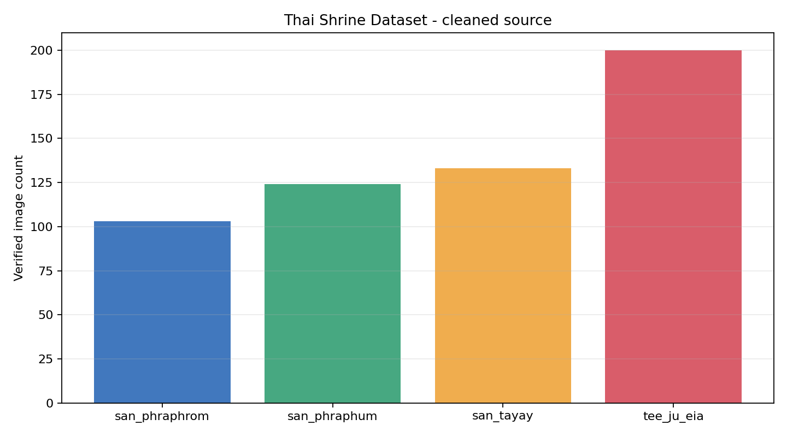

*ภาพที่ 2 การกระจายจำนวนภาพทั้งสี่คลาส*

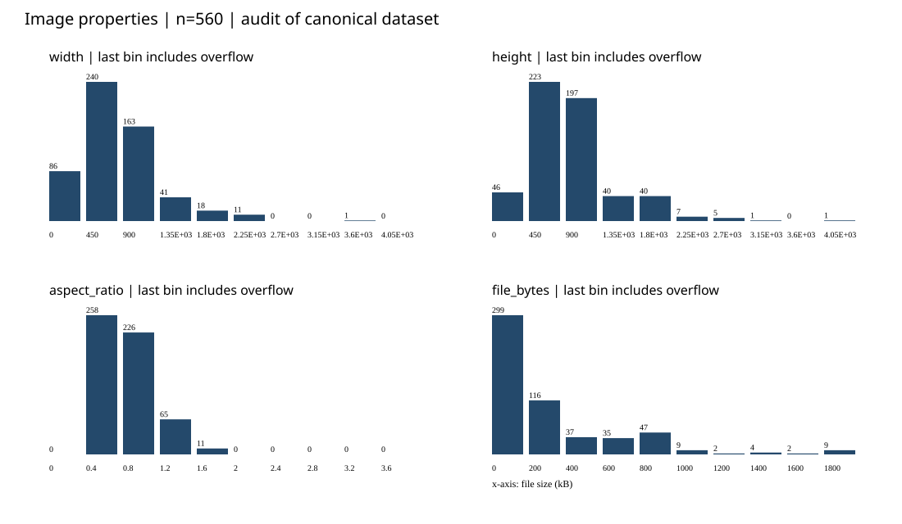

*ภาพที่ 3 การกระจายความกว้าง ความสูง อัตราส่วนกว้างต่อสูง และขนาดไฟล์ จากข้อมูล audit ของ 560 ภาพ ช่วงสุดท้ายของ histogram รวมค่าที่เกินขอบแกน*

ภาพมีขนาดแตกต่างกัน 206 แบบ ความกว้างอยู่ระหว่าง 145–4,032 พิกเซล และความสูง 225–4,214 พิกเซล ผล audit บันทึกโหมดสี RGB 543 ภาพ, RGBA 9 ภาพ, CMYK 3 ภาพ และ palette 5 ภาพ ส่วนรูปแบบที่ถอดรหัสได้จริงเป็น JPEG 526 ภาพ, PNG 22 ภาพ, WEBP 11 ภาพ และ GIF 1 ภาพ จึงต้องจัดการรูปแบบและโหมดสีให้สอดคล้องกันก่อนเข้าโมเดล

### 1.3 ภาพซ้ำและความสมบูรณ์ของข้อมูล

ผล audit ไม่พบไฟล์ที่อ่านไม่ได้ และพบภาพซ้ำแบบ decoded RGB ในคลาสศาลพระภูมิ 2 คู่ ได้แก่ `0002/0046` และ `0073/0077` เมื่อรวมกับกลุ่มภาพใกล้เคียงที่ผ่านการทบทวนแล้ว ได้ทั้งหมด 550 กลุ่ม การแบ่งข้อมูลใช้กลุ่มเหล่านี้เป็นหน่วย เพื่อเก็บภาพที่ยืนยันว่าเกี่ยวข้องกันไว้ในชุดเดียวกัน

## 2) Data preparation

### 2.1 การแบ่ง train, validation และ test

ใช้ split seed 42 และเลือกการแบ่งจาก deterministic GroupShuffleSplit จำนวน 256 × 12 candidates เพื่อให้ใกล้สัดส่วน 70/15/15 พร้อมรักษาสัดส่วนคลาส ทุกสถาปัตยกรรม ทุก mode และทุก training seed ใช้ภาพในแต่ละชุดตรงกัน

<!-- generated:SPLIT_TABLE -->

| Split | Total | พระพรหม | พระภูมิ | ตายาย | ตี่จู้ |
| --- | --- | --- | --- | --- | --- |
| train | 390 | 70 | 89 | 91 | 140 |
| validation | 85 | 17 | 17 | 21 | 30 |
| test | 85 | 16 | 18 | 21 | 30 |

<!-- /generated:SPLIT_TABLE -->

ตรวจจาก `splits.csv` แล้วไม่พบกลุ่มภาพที่ข้ามชุด และทุกชุดมีครบทั้งสี่คลาส ชุด train ใช้ปรับน้ำหนักโมเดล ชุด validation ใช้เลือก hyperparameters และ checkpoint ส่วน test ใช้ประเมินหลังล็อกค่าการทดลองแล้ว

### 2.2 การเตรียมภาพและ augmentation

ขั้นแรกถอดรหัสภาพ หมุนตาม EXIF และแปลงเป็น RGB โดยผสมส่วนโปร่งใสกับสีพื้นกลาง จากนั้น resize ด้วย LANCZOS โดยรักษาอัตราส่วนเดิม ให้ด้านยาวพอดีกับกรอบ 224 × 224 พิกเซล แล้ววางภาพกึ่งกลางบนพื้น RGB `(124,116,104)` วิธีนี้รักษาสัดส่วนของศาลโดยไม่ยืดภาพให้เป็นสี่เหลี่ยม

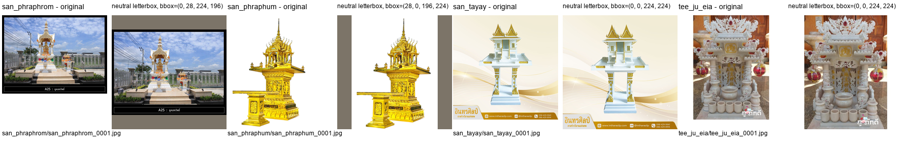

*ภาพที่ 4 ตัวอย่างก่อนและหลัง preprocessing พื้นที่ว่างรอบภาพเกิดจากการรักษาสัดส่วนเดิม*

ทำ augmentation เฉพาะชุด train ตามค่าต่อไปนี้

| การแปลง | ค่าที่ใช้ |
| --- | --- |
| Rotation | ±12° |
| Translation | ±5% |
| Scale | 0.92–1.08 |
| Perspective | Distortion 0.10, probability 0.20 |
| Horizontal flip | Probability 0.50 |
| Color jitter | Brightness/contrast/saturation 0.10, hue 0.02 |
| Random Erasing | Probability 0.05, area 0.02–0.08 |

ใช้สีพื้นกลางเติมพื้นที่จากการแปลงเชิงเรขาคณิตและ erasing แล้วแปลงเป็น tensor และ normalize ด้วย ImageNet mean `(0.485,0.456,0.406)` และ standard deviation `(0.229,0.224,0.225)` ส่วน validation และ test ใช้ preprocessing แบบคงที่

DataLoader สุ่มลำดับเฉพาะ train ใช้ `num_workers=0` และ `drop_last=False` เพื่อใช้ภาพครบทุก batch คำนวณ class weights จากจำนวนภาพ train ด้วยสูตร `390 / (4 × จำนวนภาพในคลาส)` ได้ `[1.392857, 1.095506, 1.071429, 0.696429]` ตามลำดับคลาสในตารางแรก

## 3) Model architecture

### 3.1 โมเดลและ classifier

ใช้ pretrained weights อย่างเป็นทางการของ torchvision ผ่าน `Weights.DEFAULT` และเปลี่ยนเฉพาะ linear layer สุดท้ายให้ส่งออก 4 logits โดยคงโครงสร้าง classifier ส่วนที่เหลือไว้

| Architecture | ลักษณะ backbone | การเปลี่ยน classifier |
| --- | --- | --- |
| ResNet50 | Residual blocks | เปลี่ยน `fc` เป็น linear สำหรับ 4 คลาส |
| EfficientNet-B0 | MBConv blocks | เปลี่ยน linear สุดท้าย คง Dropout 0.2 |
| MobileNetV3-Large | InvertedResidual blocks | เปลี่ยน linear สุดท้าย คง hidden linear, Hardswish และ Dropout 0.2 |
| DenseNet121 | Dense blocks ที่เชื่อม features ข้ามชั้น | เปลี่ยน `classifier` เป็น linear สำหรับ 4 คลาส |
| ConvNeXt-Tiny | ConvNeXt feature stages | เปลี่ยน linear สุดท้าย คง normalization และ flatten |

จำนวน parameters จาก config ที่บันทึกไว้แสดงดังนี้

<!-- generated:PARAM_TABLE -->

| Architecture | Total parameters | Trainable Full | Trainable Frozen | Trainable Partial |
| --- | --- | --- | --- | --- |
| ResNet50 | 23,516,228 | 23,516,228 | 8,196 | 14,972,932 |
| EfficientNet-B0 | 4,012,672 | 4,012,672 | 5,124 | 1,134,516 |
| MobileNetV3-Large | 4,207,156 | 4,207,156 | 1,235,204 | 3,414,668 |
| DenseNet121 | 6,957,956 | 6,957,956 | 4,100 | 2,164,228 |
| ConvNeXt-Tiny | 27,823,204 | 27,823,204 | 4,612 | 14,294,020 |

<!-- /generated:PARAM_TABLE -->

### 3.2 วิธีปรับน้ำหนัก

เปรียบเทียบสามวิธี โดยกำหนดส่วนที่ฝึกก่อนสร้าง optimizer ในทุก run

| Mode | ส่วนที่ปรับน้ำหนัก | สถานะระหว่างฝึก |
| --- | --- | --- |
| Full | Backbone และ classifier ทั้งหมด | ใช้ train mode ตามปกติ |
| Frozen | Classifier head | Backbone อยู่ใน eval mode รวมถึง BatchNorm buffers |
| Partial | Backbone stage สุดท้ายและ classifier | ส่วนต้นอยู่ใน eval mode ส่วนที่เปิดฝึกอยู่ใน train mode |

Partial ของ ResNet50 ใช้ `layer4`; DenseNet121 ใช้ `denseblock4` และ `norm5`; EfficientNet-B0 ใช้ MBConv stage สุดท้ายและ projection; ConvNeXt-Tiny ใช้ feature stage สุดท้าย ส่วน MobileNetV3-Large ใช้กลุ่ม InvertedResidual สุดท้ายและ projection ซึ่ง config ของโมเดลอ้างอิงระบุเป็น `features.13–16` พร้อม `classifier`

แต่ละ mode เริ่มฝึกจาก ImageNet weights ของตัวเองตลอดทั้ง run การทดลองนี้จึงเปรียบเทียบขอบเขตการปรับน้ำหนักสามแบบ โดยแต่ละแบบได้รับการค้นหา hyperparameters แยกกัน

### 3.3 การทำนายด้วย ImageNet model เดิม

ใช้ผลของ ResNet50 ที่ยังมี classifier 1,000 คลาสบนตัวอย่าง train เพื่อแสดงความต่างของชุดป้ายกำกับ เช่น โมเดลทายภาพศาลเป็น `stupa` ซึ่งสัมพันธ์กับรูปทรง แต่ยังไม่สามารถแยกศาลไทยทั้งสี่ประเภทได้โดยตรง ภาพประกอบส่วนนี้นำมาจาก baseline เดิมที่ใช้ข้อมูลชุดเดียวกัน และเก็บสำเนาไว้ใน output ล่าสุด

*ภาพที่ 5 ป้ายกำกับและ confidence ของ ResNet50/ImageNet ก่อนปรับ classifier ใช้ประกอบการอธิบาย transfer learning ไม่ได้นำมาคำนวณ accuracy ของโจทย์สี่คลาส*

## 4) Training method

### 4.1 การค้นหา hyperparameters

ลำดับการทดลองคือเตรียมข้อมูล → ค้นหา hyperparameters แยก 15 คู่ → เลือกสูตรชนะของแต่ละคู่ → ล็อกสูตรและโมเดลอ้างอิง → ฝึกซ้ำ 5 seeds → ประเมิน test และวิเคราะห์ผล

ใช้ local seeded random search คู่ละ 5 trials รวม 75 trials โดยบันทึกแต่ละ trial เป็น W&B run ขอบเขตการค้นหาคือ learning rate แบบ log-uniform `[1e-5,1e-3]`, weight decay แบบ log-uniform `[1e-6,1e-2]`, optimizer ใน `{AdamW, Adam, SGD}` และ batch size ใน `{16,32}` ทั้ง 15 คู่ได้รับชุดค่าที่สุ่มเหมือนกันตามตาราง แต่เลือกค่าชนะจาก validation ของตัวเอง

<!-- generated:SEARCH_TABLE -->

| Trial | LR | Weight decay | Optimizer | Batch |
| --- | --- | --- | --- | --- |
| 1 | 0.0003531117 | 5.695263E-05 | adam | 32 |
| 2 | 0.0002481624 | 2.380726E-06 | adam | 32 |
| 3 | 0.0003328736 | 0.001393982 | adam | 16 |
| 4 | 7.957413E-05 | 3.04223E-05 | adamw | 32 |
| 5 | 0.0001939681 | 0.001954549 | adam | 16 |

<!-- /generated:SEARCH_TABLE -->

ค่าที่สุ่มได้จริงประกอบด้วย Adam 4 ชุดและ AdamW 1 ชุด จึงยังไม่มีผลของ SGD ในการทดลองนี้ การสุ่มเพียง 5 ชุดช่วยจำกัดงบ แต่ครอบคลุม search space ได้เพียงบางส่วน

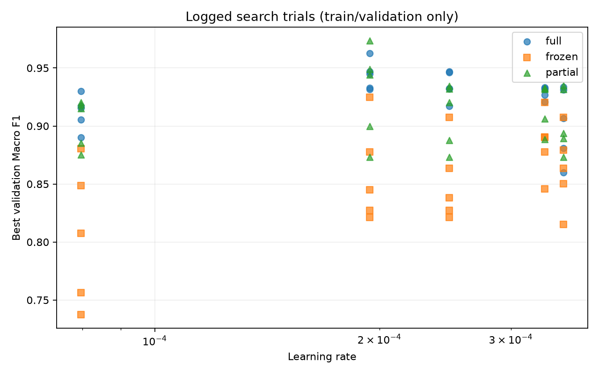

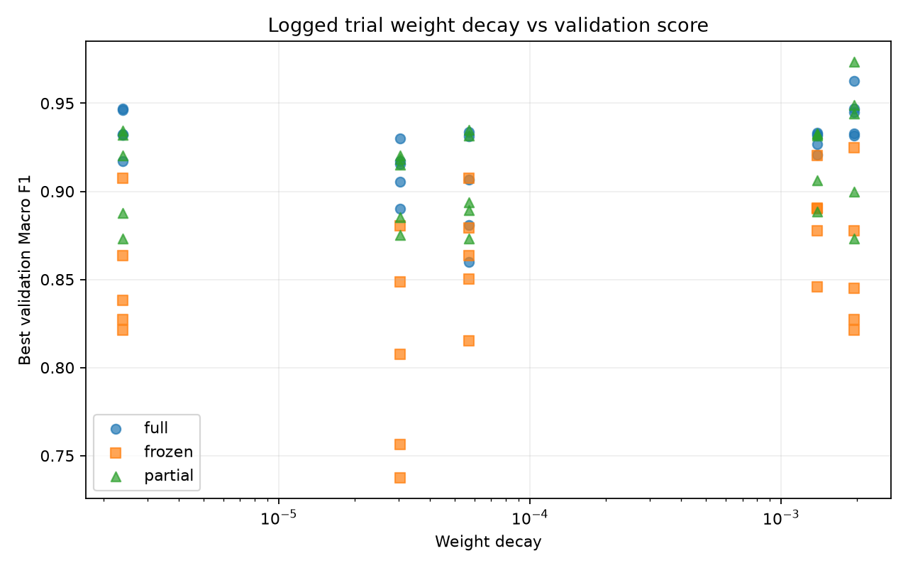

*ภาพที่ 6–7 Validation Macro F1 ของ checkpoint ที่เลือกในแต่ละ trial แกน x เป็น log scale และใช้สัญลักษณ์แยก mode จุดในกราฟรวมหลายสถาปัตยกรรม โดย optimizer และ batch size อาจต่างกันด้วย*

### 4.2 เงื่อนไขการฝึกและการเลือก checkpoint

| รายการ | ค่าที่ใช้ร่วมกัน |
| --- | --- |
| Loss | Class-weighted cross entropy |
| จำนวน epochs สูงสุด | 30 |
| Early stopping | Patience 7, `min_delta=0.0001` |
| Scheduler | `ReduceLROnPlateau(mode='max', factor=0.5, patience=3)` |
| ค่าที่ใช้กับ scheduler/early stopping | Validation Macro F1 |
| Adam defaults | Betas `(0.9,0.999)`, epsilon `1e-8` |
| Tuning seed | 42 |
| Final seeds | 42, 123, 456, 789, 1024 |

เลือก checkpoint ที่ validation Macro F1 สูงสุด หากเท่ากันใช้ validation loss ต่ำกว่า แล้วจึงเลือก epoch ก่อนหน้า สำหรับการเลือก trial ชนะ ใช้ validation Macro F1 ตามด้วย validation accuracy, validation loss และ trial index ตามลำดับ

### 4.3 สูตรที่เลือกและการประเมินรอบสุดท้าย

ตารางนี้ระบุ trial ที่ชนะของแต่ละคู่ โดยอ่านค่า optimizer, learning rate, weight decay และ batch size ได้จากตารางในหัวข้อ 4.1 ค่า validation ในที่นี้มาจาก tuning seed 42

<!-- generated:WINNER_TABLE -->

| Architecture | Mode | Trial ที่เลือก | Validation Macro F1 |
| --- | --- | ---: | ---: |
| ResNet50 | full | 5 | 0.9317 |
| ResNet50 | frozen | 3 | 0.8776 |
| ResNet50 | partial | 5 | 0.9440 |
| EfficientNet-B0 | full | 2 | 0.9468 |
| EfficientNet-B0 | frozen | 1 | 0.8504 |
| EfficientNet-B0 | partial | 3 | 0.8887 |
| MobileNetV3-Large | full | 5 | 0.9468 |
| MobileNetV3-Large | frozen | 5 | 0.9250 |
| MobileNetV3-Large | partial | 5 | 0.9734 |
| DenseNet121 | full | 5 | 0.9628 |
| DenseNet121 | frozen | 3 | 0.8906 |
| DenseNet121 | partial | 3 | 0.9061 |
| ConvNeXt-Tiny | full | 2 | 0.9463 |
| ConvNeXt-Tiny | frozen | 3 | 0.8902 |
| ConvNeXt-Tiny | partial | 5 | 0.9490 |

<!-- /generated:WINNER_TABLE -->

MobileNetV3-Large/Partial ได้รับเลือกเป็น **โมเดลอ้างอิง (reference)** ด้วย validation Macro F1 0.9734, Accuracy 97.65% และ loss 0.1718 ล็อกผลการเลือกนี้พร้อมสูตรทั้ง 15 คู่ใน `selection.json` ก่อนประเมิน test และกำหนด seed 42 สำหรับภาพวิเคราะห์รายตัวอย่าง

รอบ final ฝึกใหม่จาก ImageNet weights คู่ละ 5 seeds ด้วยสูตรของคู่นั้น เมื่อฝึกเสร็จจึงโหลด checkpoint ที่เลือกจาก validation กลับมาประเมิน test หนึ่งครั้งต่อ run รันครบ 75 final runs ใช้ 1,411 epochs รวมกับ tuning 1,350 epochs เป็น **2,761 epochs** จากเพดาน 4,500 epochs

สภาพแวดล้อมที่บันทึกไว้คือ Windows, Python 3.13.5, PyTorch 2.13.0+cu130, torchvision 0.28.0+cu130, CUDA 13.0 และ RTX 5060 ปิด AMP และตั้ง deterministic algorithms แบบ `warn_only` ผลจึงอาจต่างกันได้เมื่อเปลี่ยน hardware หรือ library version

บันทึกการทดลองใน W&B project [thai-shrine-classifier-td](https://wandb.ai/wichaidit-m-nida/thai-shrine-classifier-td) รายงานนี้อ้างอิงไฟล์ผลในเครื่องเป็นหลัก; registry ระบุ online ครบ 150 runs แต่ยังไม่ได้ตรวจความครบถ้วนของ cloud artifacts ทุกชิ้น

## 5) Evaluation metrics

ใช้ **Accuracy** วัดสัดส่วนภาพที่ทายถูก และใช้ **Precision, Recall และ F1 รายคลาส** เพื่อดูว่าข้อผิดพลาดกระจายอย่างไร โดย Precision = TP/(TP+FP), Recall = TP/(TP+FN) และ F1 = 2PR/(P+R) กรณีตัวหารเป็นศูนย์กำหนดค่าเป็น 0

**Macro precision, recall และ F1** เฉลี่ยค่ารายคลาสทั้งสี่เท่ากัน จึงให้ความสำคัญกับคลาสที่มีภาพน้อยด้วย Macro F1 เป็นค่าเฉลี่ยของ F1 รายคลาสโดยตรง ผลรวมรายงานเป็น mean ± sample SD จาก 5 seeds (`ddof=1`) ส่วน confusion matrix แสดง true class ตามแถวและ predicted class ตามคอลัมน์

ใช้ two-sided paired t-test จับคู่ด้วย seed เดียวกัน เพื่อเปรียบเทียบ Accuracy และ Macro F1 แล้วปรับค่า p ด้วย Holm ที่ระดับ 0.05 แยกตามสองกลุ่มสมมติฐานที่ล็อกไว้

| กลุ่มการทดสอบ | การเปรียบเทียบ | จำนวนสมมติฐาน |
| --- | --- | ---: |
| Primary | โมเดลอ้างอิงกับอีก 14 คู่ × 2 metrics | 28 |
| Secondary | สามคู่ mode ภายในแต่ละสถาปัตยกรรม × 5 สถาปัตยกรรม × 2 metrics | 30 |

รายงาน Cohen's d_z เป็น mean paired difference หารด้วย SD ของ paired differences และช่วงความเชื่อมั่น 95% ของ mean difference ด้วย t-distribution (`df=4`) ช่วงความเชื่อมั่นนี้ไม่ได้ปรับ multiple comparisons การตัดสินนัยสำคัญจึงใช้ค่า p หลังปรับ Holm

วิเคราะห์ confidence เพิ่มด้วย Expected Calibration Error (ECE) จำนวน 10 bins เพื่อเปรียบเทียบ confidence กับ accuracy ภายในแต่ละ bin ค่า ECE ต่ำหมายถึงความต่างสองค่านี้น้อยลงตามนิยามที่ใช้

## 6) Experimental results

### 6.1 ความครบถ้วนของผล

ผลรอบนี้ครบ 15 คู่ คู่ละ 5 seeds ตรวจซ้ำจาก `test_predictions.csv` ทั้ง 75 runs รวม 6,375 แถว พบ test IDs 85 ภาพเรียงตรงกันทุก run การคำนวณ Accuracy, Macro metrics, ผลรายคลาส และ paired tests ซ้ำให้ค่าตรงกับผลที่บันทึกไว้ภายในความคลาดเคลื่อนระดับ floating-point ดูรายละเอียดใน [verification.json](verification.json)

### 6.2 Learning curves: mean ± SD

กราฟต่อไปใช้รูปที่บันทึกใน `outputs_modes_v3_td/final/curves/` แยกสถาปัตยกรรมเพื่อให้เห็น Full, Frozen และ Partial ชัดเจน แถวบนเป็น weighted cross-entropy loss แถวล่างเป็น Accuracy

เส้นประสีน้ำเงินแสดงค่าเฉลี่ย train เส้นทึบสีส้มแสดงค่าเฉลี่ย validation พื้นที่แรเงาคือ ±1 sample SD และเส้นตั้งจุดสีเทาคือค่าเฉลี่ย epoch ที่เลือก checkpoint จาก validation Macro F1 ของแต่ละ seed

**วิธีอ่านช่วงท้ายกราฟ:** แต่ละคู่เริ่มจาก 5 seeds แต่หยุดฝึกคนละ epoch ตาม early stopping ค่าเฉลี่ยและ SD ใน epoch ถัดไปจึงใช้เฉพาะ runs ที่ยังมีข้อมูล ไม่มีการเติมค่าต่อหลังหยุด เมื่อเหลือ run เดียว script แสดง SD เป็น 0 เพื่อวาดกราฟ ซึ่งไม่ได้หมายความว่าความแปรปรวนระหว่าง 5 seeds เป็นศูนย์ จึงควรพิจารณาช่วงท้ายร่วมกับจำนวน runs ที่เหลือ

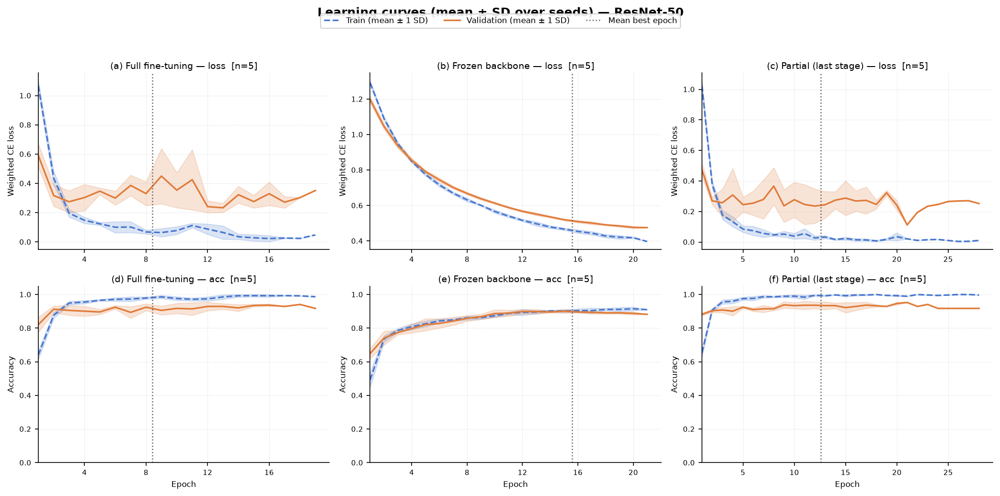

*ภาพที่ 8 ResNet50: Full และ Partial ลด train loss ได้มากกว่า Frozen แต่ validation loss ไม่ลดตามตลอดช่วงฝึก Full เลือก checkpoint เฉลี่ยที่ epoch 8.4 ก่อนหยุดเฉลี่ยที่ epoch 15.4*

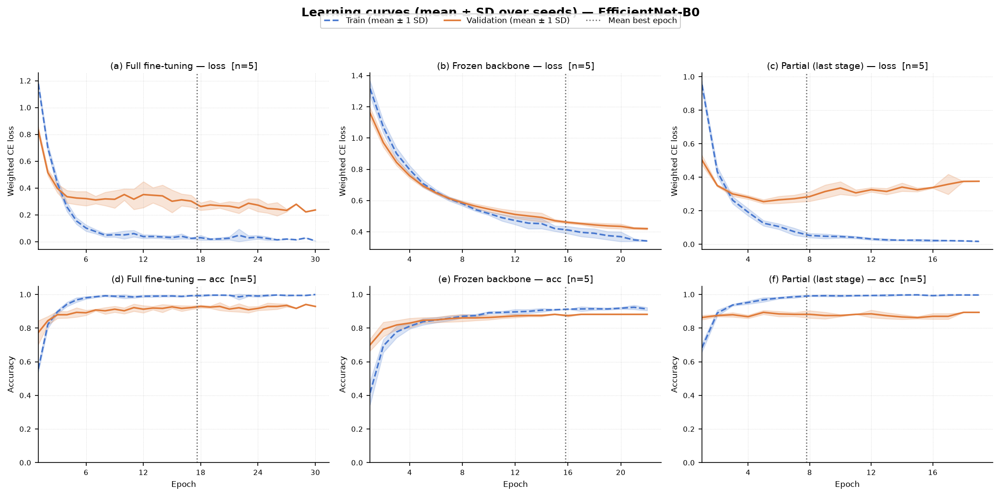

*ภาพที่ 9 EfficientNet-B0: Full ใช้เวลาฝึกเฉลี่ยนานกว่า Partial ขณะที่ Partial เริ่มมี train/validation loss แยกจากกันในช่วงต้น การลด train loss ต่อจึงไม่ได้เพิ่ม validation performance เสมอไป*

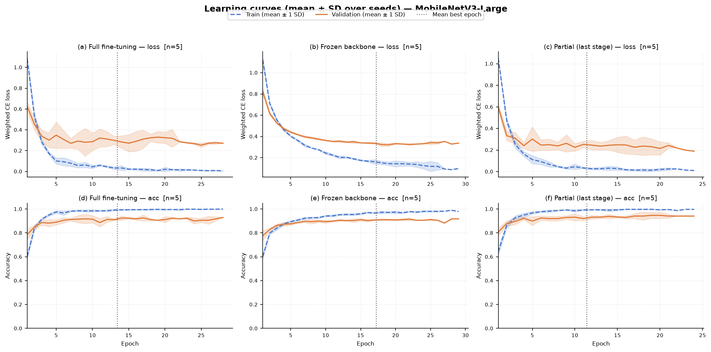

*ภาพที่ 10 MobileNetV3-Large: Full และ Partial มี train accuracy สูง ขณะที่ validation เริ่มคงตัว โมเดลอ้างอิง Partial เลือก checkpoint เฉลี่ยที่ epoch 11.4 และหยุดเฉลี่ยที่ epoch 17.8*

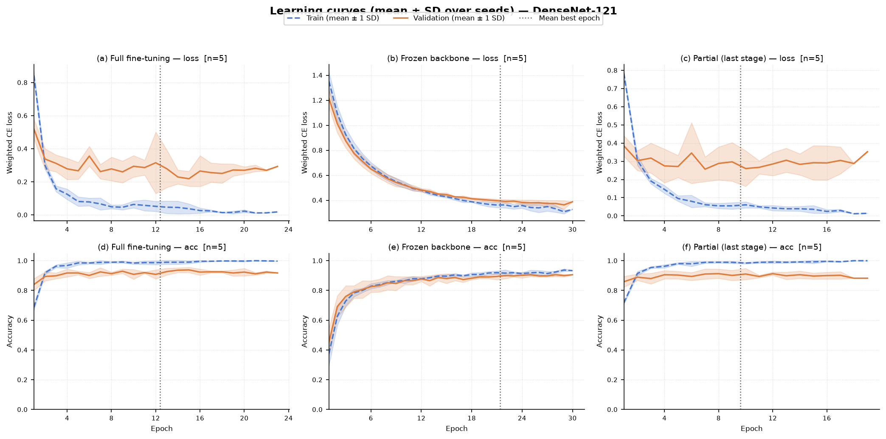

*ภาพที่ 11 DenseNet121: Full และ Partial เรียนรู้ชุด train ได้มากกว่า Frozen จาก history พบว่า Full มี train Macro F1 ณ checkpoint เฉลี่ย 0.9995 เทียบกับ validation 0.9442 จึงควรพิจารณาช่องว่างนี้ร่วมกับ loss ในช่วงท้าย*

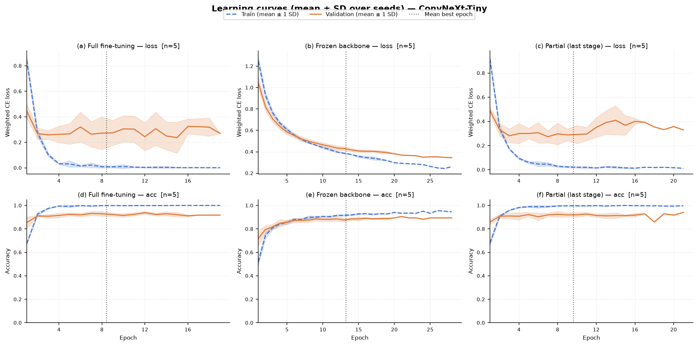

*ภาพที่ 12 ConvNeXt-Tiny: Full และ Partial มี train loss ต่ำกว่า Frozen และมีช่องว่างระหว่าง train/validation ชัดเจน Full เลือก checkpoint เฉลี่ยที่ epoch 8.4 ส่วน Partial ที่ epoch 9.6*

กราฟ Loss, Accuracy และ Macro F1 ของโมเดลอ้างอิง

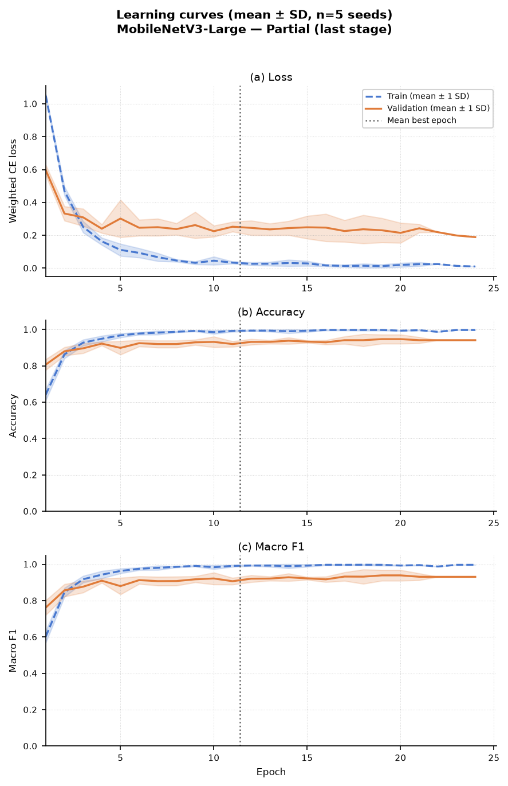

*ภาพที่ 13 MobileNetV3-Large/Partial รวมทั้ง 5 seeds ณ เริ่มต้นกราฟ เห็น validation Macro F1 เริ่มคงตัวขณะที่ train Macro F1 ยังสูงขึ้น การเลือก checkpoint ใช้ validation ของแต่ละ run แยกกัน*

[เปิดกราฟภาพรวมทั้ง 15 คู่](report_assets/learning_curves/all_pairs_grid.png) · [จำนวน runs ที่มีข้อมูลในแต่ละ epoch](learning_curve_epoch_counts.csv) · [ที่มาและ SHA256 ของรูป](learning_curve_sources.json)

ตาราง best/stop epochs และผล ณ checkpoint ของทั้ง 15 คู่

<!-- generated:DYNAMICS_TABLE -->

| Architecture | Mode | Mean best epoch | Mean stop epoch | Train F1@best | Val F1@best | Loss แยกตัวช่วงท้าย (runs) |
| --- | --- | --- | --- | --- | --- | --- |
| ResNet50 | full | 8.4 | 15.4 | 0.9707 | 0.9402 | 5/5 |
| ResNet50 | frozen | 15.6 | 19.2 | 0.8855 | 0.8886 | 0/5 |
| ResNet50 | partial | 12.6 | 19.6 | 0.9891 | 0.9480 | 4/5 |
| EfficientNet-B0 | full | 17.6 | 23.6 | 0.9941 | 0.9376 | 1/5 |
| EfficientNet-B0 | frozen | 15.8 | 18.6 | 0.8853 | 0.8593 | 0/5 |
| EfficientNet-B0 | partial | 7.8 | 14.6 | 0.9756 | 0.8826 | 5/5 |
| MobileNetV3-Large | full | 13.4 | 20.4 | 0.9929 | 0.9335 | 2/5 |
| MobileNetV3-Large | frozen | 17.2 | 23.8 | 0.9587 | 0.9111 | 1/5 |
| MobileNetV3-Large | partial | 11.4 | 17.8 | 0.9882 | 0.9488 | 3/5 |
| DenseNet121 | full | 12.4 | 18.8 | 0.9995 | 0.9442 | 2/5 |
| DenseNet121 | frozen | 21.4 | 25.0 | 0.9049 | 0.8963 | 0/5 |
| DenseNet121 | partial | 9.6 | 16.6 | 0.9849 | 0.9303 | 4/5 |
| ConvNeXt-Tiny | full | 8.4 | 15.4 | 0.9982 | 0.9338 | 3/5 |
| ConvNeXt-Tiny | frozen | 13.2 | 18.2 | 0.8913 | 0.8826 | 0/5 |
| ConvNeXt-Tiny | partial | 9.6 | 15.2 | 0.9917 | 0.9354 | 4/5 |

<!-- /generated:DYNAMICS_TABLE -->

ค่าทั้งหมดเป็นค่าเฉลี่ยข้าม 5 seeds คอลัมน์สุดท้ายนับ runs ที่ loss ของ train ณ epoch สุดท้ายต่ำกว่าที่ checkpoint แต่ validation loss สูงกว่าเดิม ใช้เป็นตัวบ่งชี้การแยกตัวช่วงท้าย Train metrics ได้จากภาพที่ทำ augmentation จึงมีเงื่อนไขต่างจาก validation

### 6.3 ผลบนชุดทดสอบ

ตารางรายงาน mean ± sample SD จาก 5 seeds ทุกคู่ Accuracy ใช้หน่วยเปอร์เซ็นต์ ส่วน Precision, Recall และ F1 ใช้ช่วง 0–1 เรียงตามค่าเฉลี่ย test Macro F1 เพื่อแสดงผลที่สังเกต โดยโมเดลอ้างอิงยังคงเป็นคู่ที่เลือกจาก validation

<!-- generated:RESULT_TABLE -->

| Rank | Architecture | Mode | Accuracy (%) | Macro precision | Macro recall | Macro F1 |
| --- | --- | --- | --- | --- | --- | --- |
| 1 | ResNet50 | full | 93.65 ± 1.34 | 0.9292 ± 0.0207 | 0.9277 ± 0.0169 | 0.9256 ± 0.0181 |
| 2 | ResNet50 | partial | 93.18 ± 1.53 | 0.9239 ± 0.0163 | 0.9211 ± 0.0180 | 0.9182 ± 0.0209 |
| 3 | MobileNetV3-Large | partial | 93.18 ± 2.41 | 0.9271 ± 0.0204 | 0.9217 ± 0.0266 | 0.9168 ± 0.0305 |
| 4 | DenseNet121 | partial | 92.71 ± 1.74 | 0.9181 ± 0.0210 | 0.9149 ± 0.0200 | 0.9142 ± 0.0185 |
| 5 | ConvNeXt-Tiny | full | 92.94 ± 1.66 | 0.9236 ± 0.0194 | 0.9179 ± 0.0190 | 0.9135 ± 0.0212 |
| 6 | DenseNet121 | full | 92.71 ± 1.53 | 0.9202 ± 0.0193 | 0.9144 ± 0.0185 | 0.9127 ± 0.0189 |
| 7 | EfficientNet-B0 | partial | 92.71 ± 2.10 | 0.9166 ± 0.0264 | 0.9129 ± 0.0246 | 0.9105 ± 0.0267 |
| 8 | ConvNeXt-Tiny | partial | 92.00 ± 1.53 | 0.9205 ± 0.0146 | 0.9080 ± 0.0172 | 0.9074 ± 0.0178 |
| 9 | MobileNetV3-Large | full | 91.76 ± 0.83 | 0.9145 ± 0.0157 | 0.9040 ± 0.0085 | 0.8986 ± 0.0096 |
| 10 | EfficientNet-B0 | full | 91.06 ± 1.34 | 0.8998 ± 0.0143 | 0.8925 ± 0.0153 | 0.8921 ± 0.0152 |
| 11 | MobileNetV3-Large | frozen | 90.35 ± 0.98 | 0.8914 ± 0.0093 | 0.8923 ± 0.0112 | 0.8869 ± 0.0133 |
| 12 | ResNet50 | frozen | 88.47 ± 1.53 | 0.8793 ± 0.0172 | 0.8765 ± 0.0159 | 0.8755 ± 0.0167 |
| 13 | DenseNet121 | frozen | 88.00 ± 1.29 | 0.8637 ± 0.0173 | 0.8586 ± 0.0157 | 0.8587 ± 0.0165 |
| 14 | ConvNeXt-Tiny | frozen | 87.06 ± 2.76 | 0.8614 ± 0.0352 | 0.8566 ± 0.0269 | 0.8517 ± 0.0248 |
| 15 | EfficientNet-B0 | frozen | 85.65 ± 2.41 | 0.8366 ± 0.0262 | 0.8378 ± 0.0230 | 0.8338 ± 0.0236 |

<!-- /generated:RESULT_TABLE -->

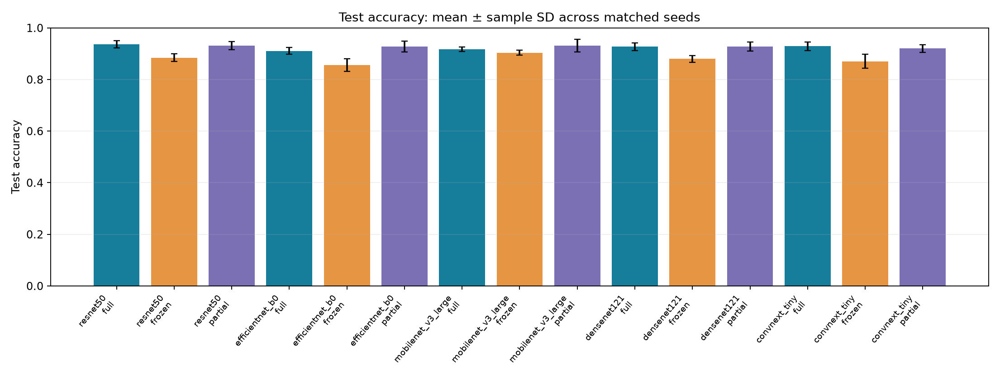

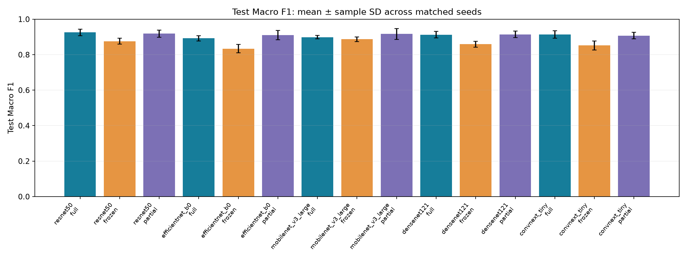

*ภาพที่ 14–15 ค่าเฉลี่ยและ sample SD ของ test Accuracy และ Macro F1 ข้าม 5 seeds*

ResNet50/Full ให้ค่าเฉลี่ย Macro F1 สูงสุด 0.9256 ขณะที่โมเดลอ้างอิง MobileNetV3-Large/Partial ได้ 0.9168 ต่างกันประมาณ 0.0088 ส่วน MobileNetV3-Large/Full มี SD ของ Macro F1 ต่ำที่สุดที่ 0.0096 แต่มีค่าเฉลี่ย 0.8986 จึงต้องพิจารณาทั้งคะแนนและความสม่ำเสมอร่วมกัน

เมื่อเปรียบเทียบภายในสถาปัตยกรรม Partial ให้ค่าเฉลี่ย Macro F1 สูงสุดใน EfficientNet-B0, MobileNetV3-Large และ DenseNet121 ส่วน Full สูงสุดใน ResNet50 และ ConvNeXt-Tiny ขณะที่ Frozen มีค่าเฉลี่ยต่ำสุดในทั้งห้าสถาปัตยกรรม ผลนี้อธิบายการเปรียบเทียบหลัง tune แต่ละ mode แล้ว; ความต่างของค่าเฉลี่ยต้องพิจารณาควบคู่กับการทดสอบทางสถิติ

### 6.4 ผลการทดสอบทางสถิติ

หลังปรับ Holm พบผลที่มีนัยสำคัญ 2 จาก 28 สมมติฐานในกลุ่ม Primary และ 3 จาก 30 สมมติฐานในกลุ่ม Secondary ตารางแสดงผลทั้งห้าแถว พร้อมการเปรียบเทียบโมเดลอ้างอิงกับ ResNet50/Full ทุกแถวจับคู่ 5 seeds และคำนวณผลต่างเป็น **A − B** ในหน่วย 0–1

<!-- generated:STATS_TABLE -->

| Family | A − B | Metric | Mean Δ | 95% CI (unadjusted) | d_z | Holm p |
| --- | --- | --- | ---: | --- | ---: | ---: |
| Primary | MobileNetV3-Large/partial − ResNet50/full | Accuracy | -0.0047 | [-0.0442, 0.0348] | -0.148 | 1.000000 |
| Primary | MobileNetV3-Large/partial − ResNet50/full | Macro F1 | -0.0088 | [-0.0589, 0.0413] | -0.218 | 1.000000 |
| Primary | MobileNetV3-Large/partial − ConvNeXt-Tiny/frozen | Accuracy | 0.0612 | [0.0452, 0.0772] | 4.747 | 0.012352 |
| Primary | MobileNetV3-Large/partial − ConvNeXt-Tiny/frozen | Macro F1 | 0.0650 | [0.0481, 0.0820] | 4.760 | 0.012352 |
| Secondary | ResNet50/full − ResNet50/frozen | Accuracy | 0.0518 | [0.0351, 0.0684] | 3.859 | 0.027767 |
| Secondary | DenseNet121/frozen − DenseNet121/partial | Accuracy | -0.0471 | [-0.0617, -0.0325] | -4.000 | 0.025062 |
| Secondary | DenseNet121/frozen − DenseNet121/partial | Macro F1 | -0.0555 | [-0.0716, -0.0395] | -4.295 | 0.019714 |

<!-- /generated:STATS_TABLE -->

โมเดลอ้างอิงมี Accuracy และ Macro F1 สูงกว่า ConvNeXt-Tiny/Frozen อย่างมีนัยสำคัญ ส่วนการเปรียบเทียบภายในสถาปัตยกรรมพบว่า ResNet50/Full มี Accuracy สูงกว่า Frozen และ DenseNet121/Partial มีทั้ง Accuracy และ Macro F1 สูงกว่า Frozen

สำหรับ ResNet50/Full เทียบกับโมเดลอ้างอิง ค่า Holm p เท่ากับ 1.0 ทั้งสอง metrics จึงยังไม่มีหลักฐานเพียงพอที่จะสรุปความเหนือกว่าจากการทดลองนี้ การไม่พบนัยสำคัญก็ไม่ได้ยืนยันว่าประสิทธิภาพเท่ากัน ดูผลครบ 58 แถว รวม raw p, effect size และช่วงความเชื่อมั่นได้ใน [verified_statistics.csv](verified_statistics.csv)

### 6.5 ผลรายคลาส

เปรียบเทียบโมเดลอ้างอิงกับ ResNet50/Full ซึ่งมีค่าเฉลี่ย test Macro F1 สูงสุด ค่า Precision, Recall และ F1 เป็น mean ± sample SD ส่วน support เป็นจำนวนภาพ test ต่อ run

<!-- generated:PERCLASS_TABLE -->

| Pair | Class | Support | Precision | Recall | F1 |
| --- | --- | ---: | ---: | ---: | ---: |
| ResNet50/full | san_phraphrom | 16 | 0.8898 ± 0.0648 | 0.9750 ± 0.0342 | 0.9294 ± 0.0396 |
| ResNet50/full | san_phraphum | 18 | 0.9217 ± 0.0539 | 0.7778 ± 0.0393 | 0.8435 ± 0.0443 |
| ResNet50/full | san_tayay | 21 | 0.9055 ± 0.0501 | 0.9714 ± 0.0261 | 0.9363 ± 0.0231 |
| ResNet50/full | tee_ju_eia | 30 | 1.0000 ± 0.0000 | 0.9867 ± 0.0183 | 0.9932 ± 0.0093 |
| MobileNetV3-Large/partial | san_phraphrom | 16 | 0.8448 ± 0.0519 | 1.0000 ± 0.0000 | 0.9152 ± 0.0312 |
| MobileNetV3-Large/partial | san_phraphum | 18 | 0.9589 ± 0.0377 | 0.7222 ± 0.1039 | 0.8193 ± 0.0675 |
| MobileNetV3-Large/partial | san_tayay | 21 | 0.9047 ± 0.0405 | 0.9714 ± 0.0261 | 0.9361 ± 0.0174 |
| MobileNetV3-Large/partial | tee_ju_eia | 30 | 1.0000 ± 0.0000 | 0.9933 ± 0.0149 | 0.9966 ± 0.0076 |

<!-- /generated:PERCLASS_TABLE -->

ศาลพระภูมิเป็นคลาสที่ยากที่สุดสำหรับโมเดลอ้างอิง มี F1 เฉลี่ย 0.8193 และ Recall 0.7222 ส่วนศาลตี่จู้เอี๊ยะมี F1 เฉลี่ย 0.9966 แม้ Accuracy รวมจะสูง ความผิดพลาดรายคลาสจึงยังแตกต่างกันมาก ศาลพระพรหมมี Recall เท่ากับ 1.0 แต่ Precision ต่ำกว่า 1.0 เนื่องจากมีภาพคลาสอื่นถูกทายเป็นพระพรหมด้วย [ผลรายคลาสครบทั้ง 15 คู่](verified_per_class_summary.csv)

### 6.6 Confusion matrices

ใช้ seed 42 ตามที่กำหนดไว้ก่อนประเมิน test โมเดลอ้างอิงใน seed นี้ได้ Accuracy 95.29% และ Macro F1 0.9427 ซึ่งสูงกว่าค่าเฉลี่ยห้า seeds ภาพต่อไปจึงใช้ดูรูปแบบความสับสนของ run ตัวอย่าง โดยรายงานผลรวมด้วยตาราง mean ± SD ในหัวข้อ 6.3

*ภาพที่ 16 Row-normalized confusion matrix ของ MobileNetV3-Large/Partial, seed 42 ค่าบนแนวทแยงแสดง Recall ของแต่ละคลาส*

Confusion matrices ของ Full ทั้งห้าสถาปัตยกรรม (seed 42)

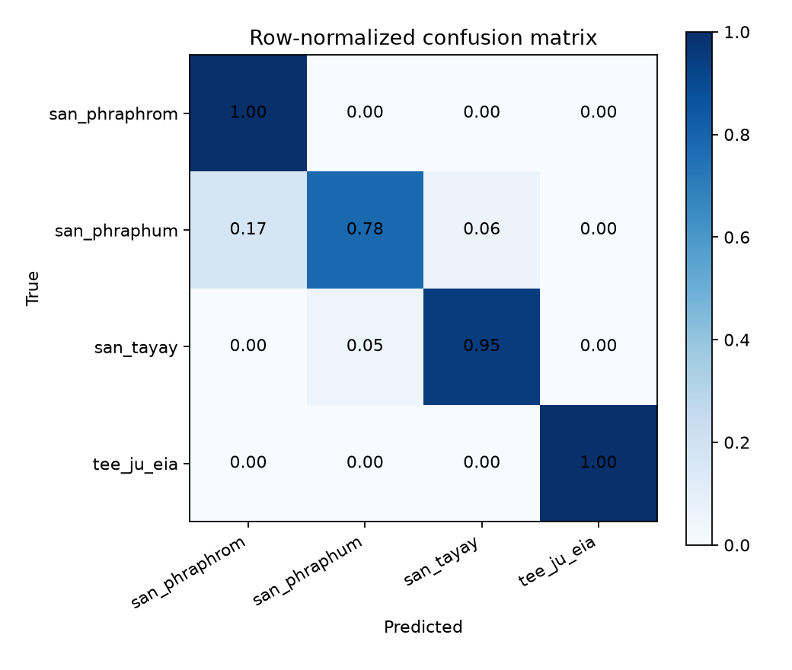

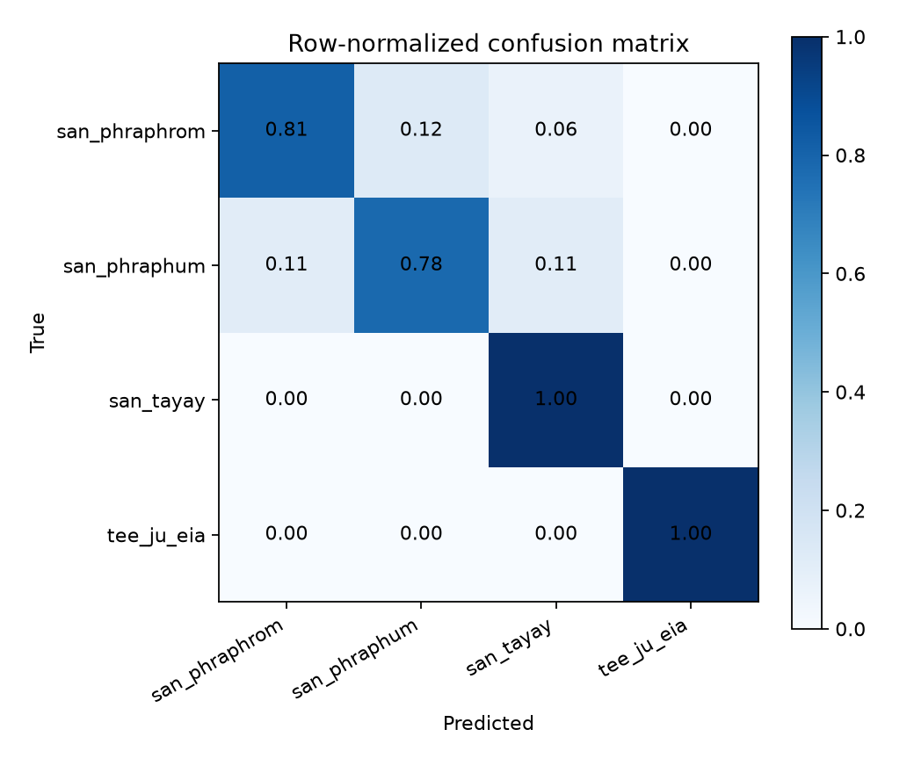

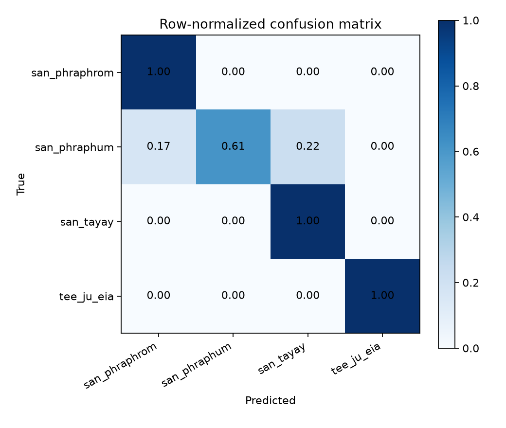

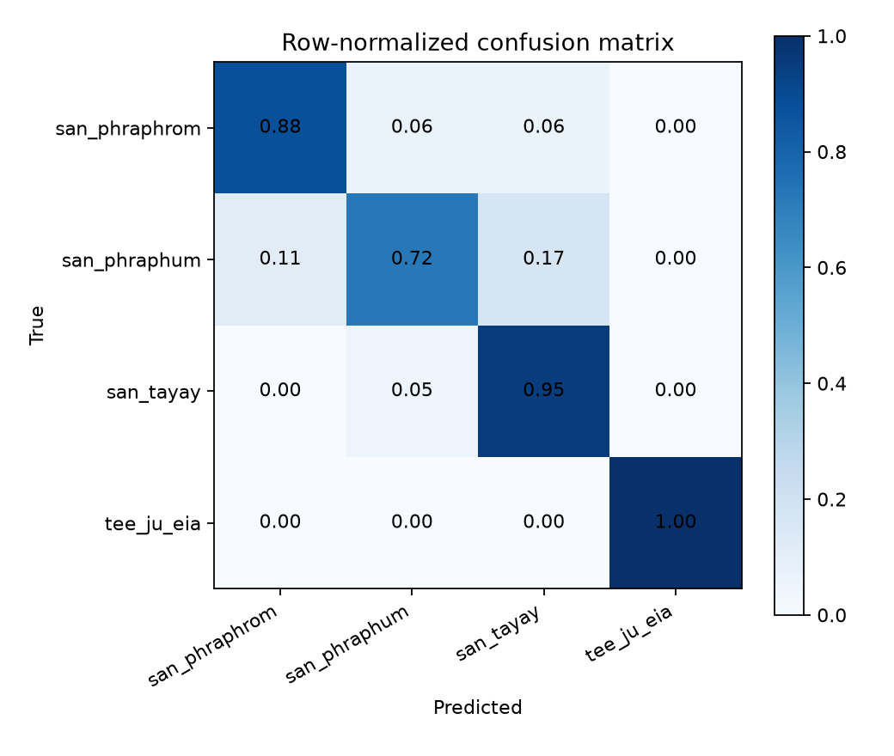

ภาพใช้สัดส่วนภายใน true class เหมือนกัน แต่ขอบ colorbar อาจต่างกันตามแต่ละ run จึงควรเปรียบเทียบตัวเลขในช่องประกอบสี

### 6.7 Grad-CAM และการวิเคราะห์ตัวอย่าง

ใช้ MobileNetV3-Large/Partial, seed 42 วิเคราะห์ 8 ภาพ โดยเลือกตัวอย่างทายถูกและทายผิดแยกตาม true class หากคลาสนั้นไม่มีภาพผิด ใช้ภาพทายถูกที่ confidence ต่ำแทน ชุดตัวอย่างประกอบด้วยภาพทายถูก 7 ภาพและทายผิด 1 ภาพ

*ภาพที่ 17 ภาพต้นฉบับ heatmap และ overlay ของโมเดลอ้างอิง โดย Grad-CAM อธิบายคลาสที่โมเดลทำนาย*

หลายตัวอย่างมีบริเวณตอบสนองสูงใกล้ส่วนกลางศาล หลังคา หรือฐาน กรณี `san_phraphum_0076` ถูกทายเป็นศาลตายายด้วย confidence 0.6001 และมี heatmap กระจุกใกล้ศาลด้านล่างขวา บางภาพมีข้อความและลายน้ำอยู่ใกล้บริเวณตอบสนองสูงด้วย จึงยังแยกไม่ได้ว่าโมเดลใช้รูปทรงหรือข้อความมากน้อยเพียงใด Grad-CAM ช่วยตั้งข้อสังเกต แต่ไม่ได้ยืนยันสาเหตุของการทำนาย

*ภาพที่ 18 ป้ายกำกับจาก ImageNet model และผลหลัง fine-tune บนภาพเดียวกัน เช่น stupa, altar และ china cabinet เทียบกับประเภทศาลไทย*

ผลทำนายรายภาพในชุดตัวอย่าง

<!-- generated:CASE_TABLE -->

| Image ID | True | Fine-tuned prediction | Confidence | ImageNet top1 |
| --- | --- | --- | --- | --- |
| san_phraphrom/san_phraphrom_0057 | san_phraphrom | san_phraphrom | 1.0000 | stupa |
| san_phraphrom/san_phraphrom_0066 | san_phraphrom | san_phraphrom | 0.6149 | stupa |
| san_phraphum/san_phraphum_0093 | san_phraphum | san_phraphum | 1.0000 | altar |
| san_phraphum/san_phraphum_0076 | san_phraphum | san_tayay | 0.6001 | altar |
| san_tayay/san_tayay_0068 | san_tayay | san_tayay | 1.0000 | boathouse |
| san_tayay/san_tayay_0003 | san_tayay | san_tayay | 0.7219 | church |
| tee_ju_eia/tee_ju_eia_0001 | tee_ju_eia | tee_ju_eia | 1.0000 | china cabinet |
| tee_ju_eia/tee_ju_eia_0080 | tee_ju_eia | tee_ju_eia | 0.8600 | vestment |

<!-- /generated:CASE_TABLE -->

นอกจากนี้นับความถี่ที่ภาพ test แต่ละภาพถูกทายผิดจากทั้ง 75 runs พบภาพศาลพระภูมิซ้ำในกลุ่มที่ผิดบ่อยที่สุด เช่น `san_phraphum_0043` ผิด 69/75 runs และ `san_phraphum_0121` ผิด 66/75 runs จึงเป็นภาพที่ควรทบทวนลักษณะร่วมกับภาพจากแหล่งใหม่

สิบภาพที่ถูกทายผิดบ่อยที่สุด

<!-- generated:ERROR_TABLE -->

| Image ID | True class | Wrong/75 | Wrong reference/5 | Wrong ResNet Full/5 |
| --- | --- | --- | --- | --- |
| san_phraphum/san_phraphum_0043 | san_phraphum | 69 | 2 | 5 |
| san_phraphum/san_phraphum_0121 | san_phraphum | 66 | 5 | 4 |
| san_phraphum/san_phraphum_0114 | san_phraphum | 60 | 3 | 1 |
| san_phraphum/san_phraphum_0015 | san_phraphum | 42 | 3 | 4 |
| san_phraphum/san_phraphum_0076 | san_phraphum | 42 | 3 | 2 |
| san_phraphum/san_phraphum_0113 | san_phraphum | 35 | 3 | 1 |
| san_tayay/san_tayay_0046 | san_tayay | 32 | 1 | 0 |
| san_tayay/san_tayay_0093 | san_tayay | 28 | 0 | 2 |
| tee_ju_eia/tee_ju_eia_0061 | tee_ju_eia | 23 | 1 | 1 |
| san_phraphum/san_phraphum_0064 | san_phraphum | 20 | 4 | 1 |

<!-- /generated:ERROR_TABLE -->

จำนวนครั้งเหล่านี้มาจากภาพชุดเดิมและโมเดลที่เกี่ยวข้องกัน ใช้อธิบายรูปแบบข้อผิดพลาด โดยไม่ได้ถือเป็นตัวอย่างอิสระ 75 ชุด ดูผลครบ 85 ภาพใน [error_frequency.csv](error_frequency.csv)

### 6.8 Confidence และ calibration

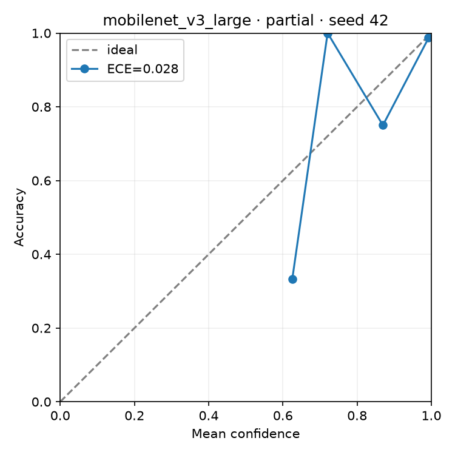

*ภาพที่ 19 Reliability diagram ของ MobileNetV3-Large/Partial, seed 42 เปรียบเทียบ confidence กับ accuracy ภายใน bin จาก test 85 ภาพ*

โมเดลอ้างอิงมี ECE เฉลี่ย 0.04528 ± 0.01666 และ ResNet50/Full มี 0.04941 ± 0.01565 ส่วน DenseNet121/Partial มีค่าเฉลี่ยต่ำสุดที่ 0.04437 ± 0.01184 การทดลองไม่ได้ทดสอบนัยสำคัญของ ECE และบาง bins มีภาพน้อย จึงใช้ผลนี้ประกอบการประเมินความมั่นใจของโมเดล

## 7) Discussion and conclusions

การเปิดปรับน้ำหนัก backbone ช่วยให้โมเดลปรับตัวเข้ากับภาพศาลไทยได้ดีกว่าการฝึก classifier อย่างเดียวในแง่ค่าเฉลี่ย Macro F1 ที่สังเกต แต่ผลของ Full และ Partial ต่างกันตามสถาปัตยกรรม จึงยังไม่มีวิธีเดียวที่ให้คะแนนสูงสุดทุกโมเดล การค้นหา hyperparameters แยกแต่ละคู่ทำให้ข้อสรุปนี้ครอบคลุมวิธีฝึกพร้อมค่าที่เลือกได้ภายใต้งบเท่ากัน

MobileNetV3-Large/Partial เป็นโมเดลอ้างอิงที่เลือกจาก validation ส่วน ResNet50/Full ให้ค่าเฉลี่ย test Macro F1 สูงสุด ความต่าง 0.0088 ระหว่างสองคู่ยังไม่มีนัยสำคัญหลังปรับ Holm สำหรับการจำแนกรายคลาส ศาลพระภูมิยังมี Recall ต่ำกว่าคลาสอื่นและพบข้อผิดพลาดซ้ำหลาย seeds จึงเป็นประเด็นสำคัญกว่าการพิจารณา Accuracy รวมเพียงค่าเดียว

ข้อจำกัดของผลการทดลองมีดังนี้

1. **ขนาดและ split ของข้อมูล:** ชุด test มี 85 ภาพและเคยถูกตรวจดูในงานก่อนหน้า ผลรอบนี้จึงเป็นการศึกษาต่อบน split เดิม การยืนยันการใช้งานทั่วไปยังต้องอาศัยชุดทดสอบภายนอกจากแหล่งใหม่ Mean ± SD และ paired tests ในรายงานสะท้อนความต่างระหว่าง training seeds บนข้อมูลชุดเดียว
2. **ขอบเขตการค้นหา:** ใช้เพียง 5 configurations และ tuning seed เดียว อีกทั้งไม่มี SGD ถูกสุ่มมาทดลอง จึงยังไม่ครอบคลุม hyperparameters ที่เป็นไปได้ทั้งหมด
3. **ที่มาภาพและสิ่งแทรกในภาพ:** ยังไม่ทราบ URL 112 ภาพ และไม่มีบันทึกวิธีเก็บ วันที่ หรือสิทธิการใช้ครบทุกภาพ ข้อความ ลายน้ำ ฉากหลัง และสัดส่วนภาพอาจสัมพันธ์กับคลาส แม้กลุ่มภาพซ้ำที่ตรวจพบจะไม่ข้าม split ก็ตาม
4. **ขอบเขตการวิเคราะห์:** Grad-CAM มีเฉพาะโมเดลอ้างอิง ไม่ได้เปรียบเทียบ matched cases ครบห้าโมเดล และยังไม่มีการทดลองถอด augmentation/class weights หรือการวัด latency ภายใต้เงื่อนไขควบคุม จึงไม่สามารถสรุปผลเฉพาะขององค์ประกอบเหล่านี้ได้

งานต่อไปควรให้ความสำคัญกับภาพศาลพระภูมิที่มีรูปทรงหรือบริบทชวนสับสน และประเมินกับภาพจากแหล่งใหม่ภายใต้วิธีฝึกที่กำหนดล่วงหน้า เพื่อดูว่าผลที่พบยังคงอยู่เมื่อเปลี่ยนข้อมูลหรือไม่

---

### ข้อมูลประกอบรายงาน

- [ที่มาของผลและรูป](report_inventory.md) และ [รายละเอียดการตรวจสอบ](report_validation.md)
- [ผลราย run จำนวน 75 runs](verified_run_metrics.csv), [สรุป 15 คู่](verified_pair_summary.csv) และ [ผลรายคลาส](verified_per_class_summary.csv)
- [Paired tests พร้อม effect size และ CI](verified_statistics.csv)
- [ที่มาและ SHA256 ของ learning curves](learning_curve_sources.json) และ [จำนวน runs ที่มีข้อมูลต่อ epoch](learning_curve_epoch_counts.csv)
- [สคริปต์ตรวจตัวเลขจากไฟล์ผลที่บันทึกไว้](build_report.ps1)

ผลเชิงตัวเลขทั้งหมดใช้การทดลองรอบ `outputs_modes_v3_td` ส่วนข้อมูล audit, canonical split และ ImageNet baseline บางส่วนเป็นหลักฐานเดิมที่ใช้ข้อมูลชุดเดียวกันและมีสำเนาใน output ล่าสุด รายละเอียดการคัดผลรอบอื่นออกระบุไว้ใน inventory
