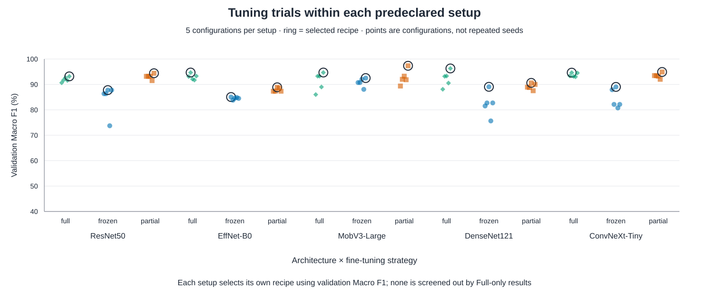
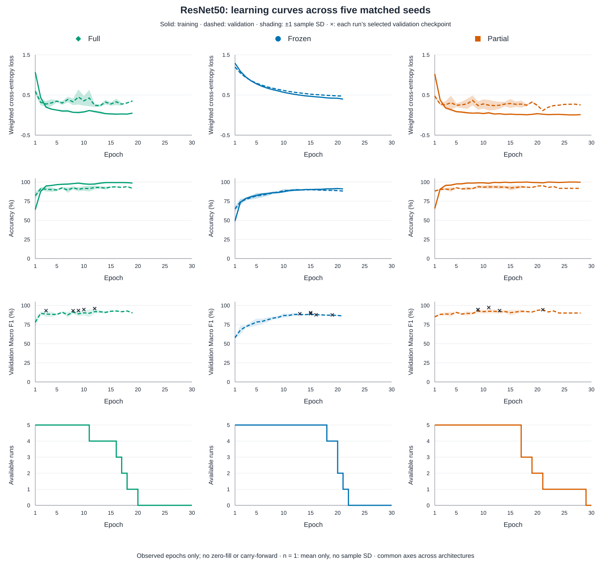
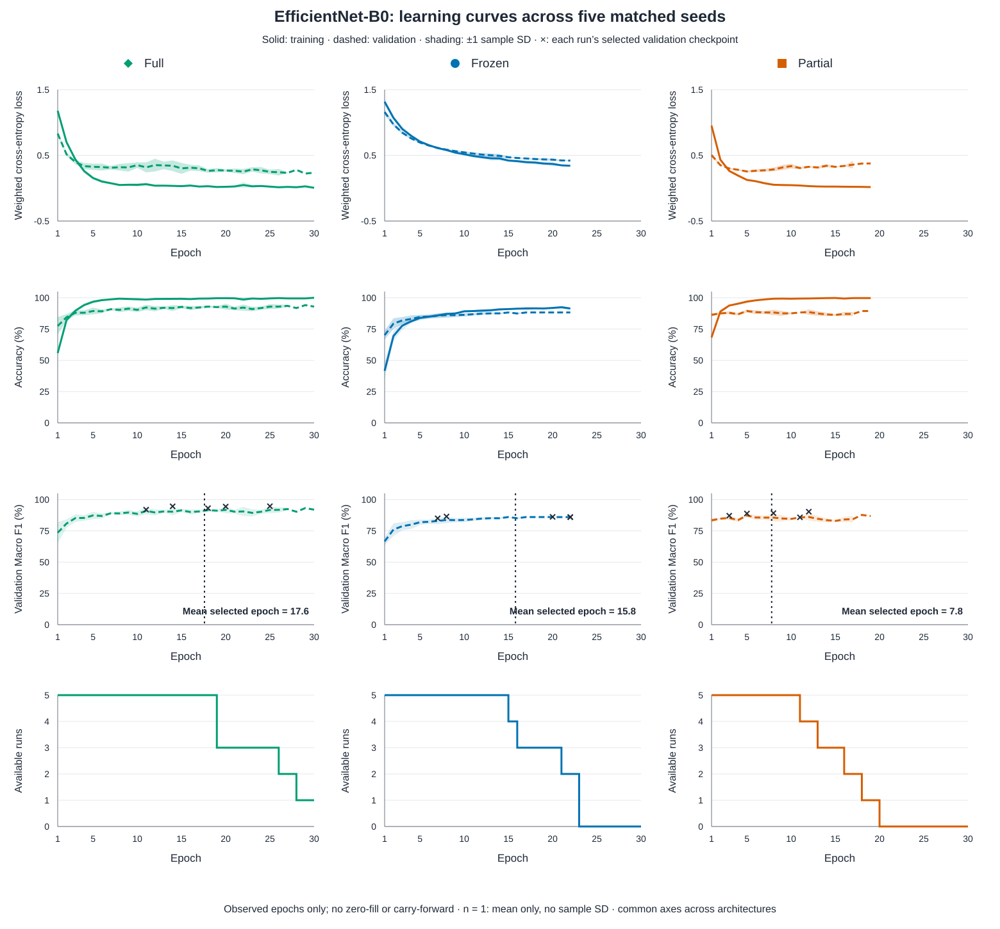
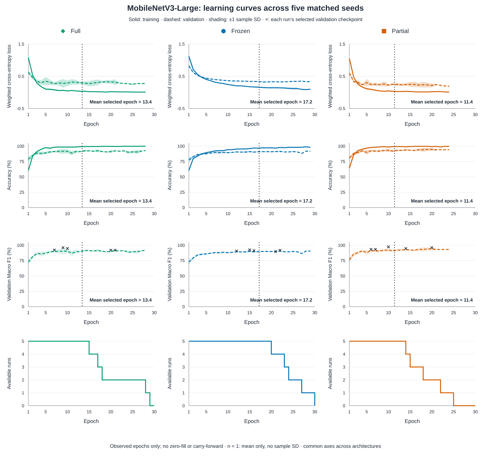
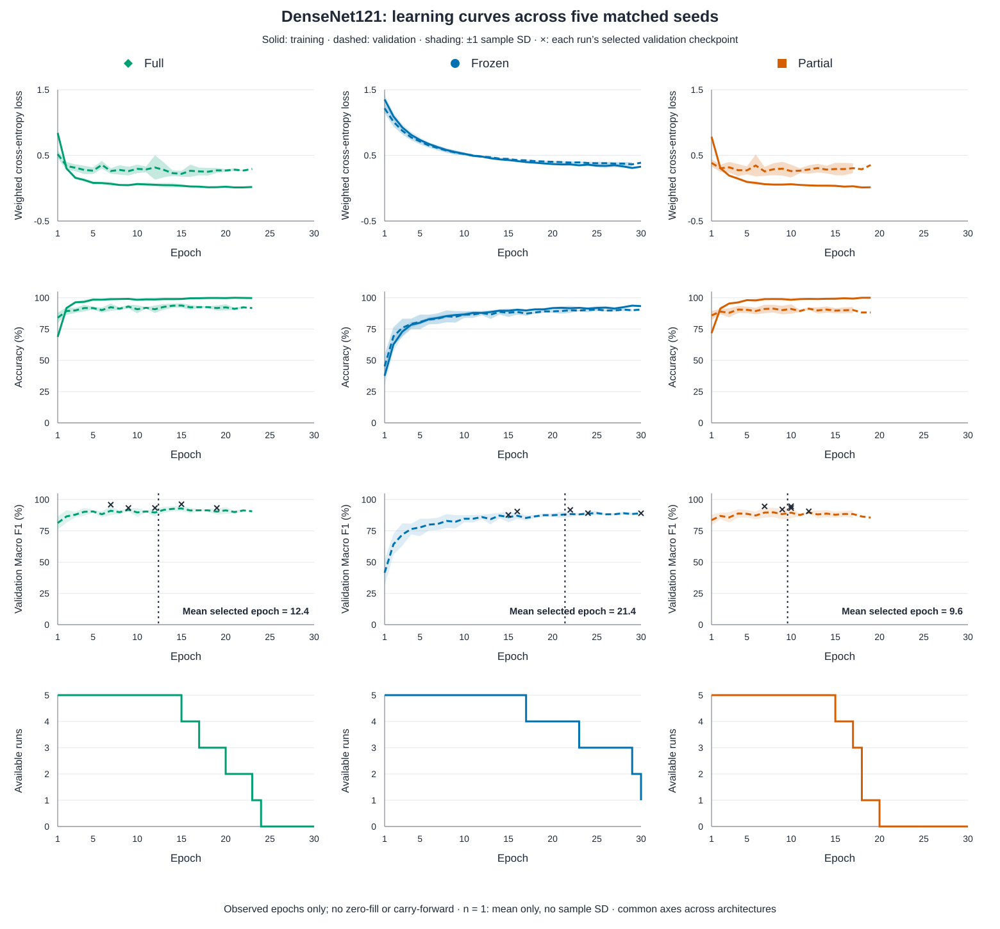
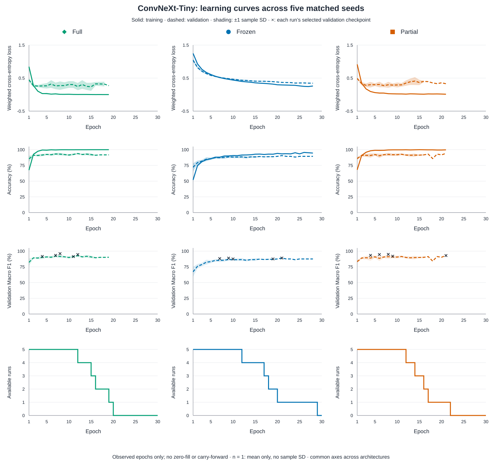
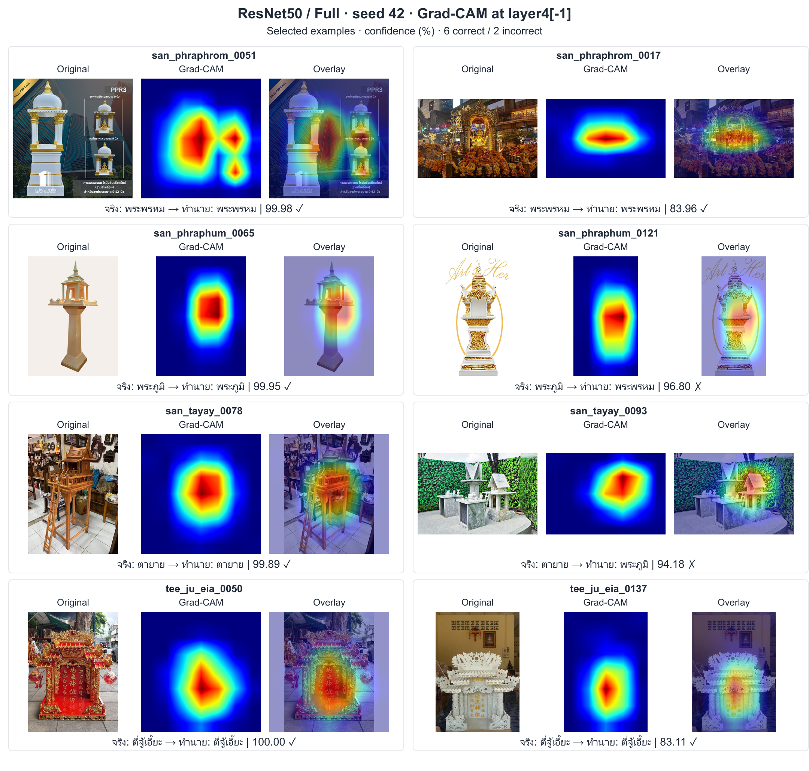
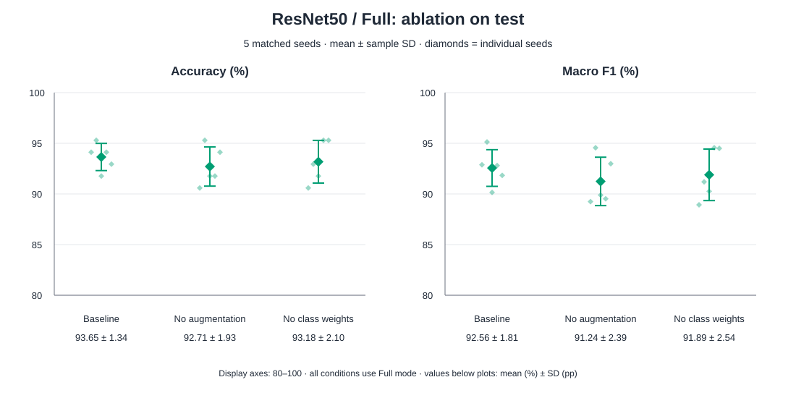
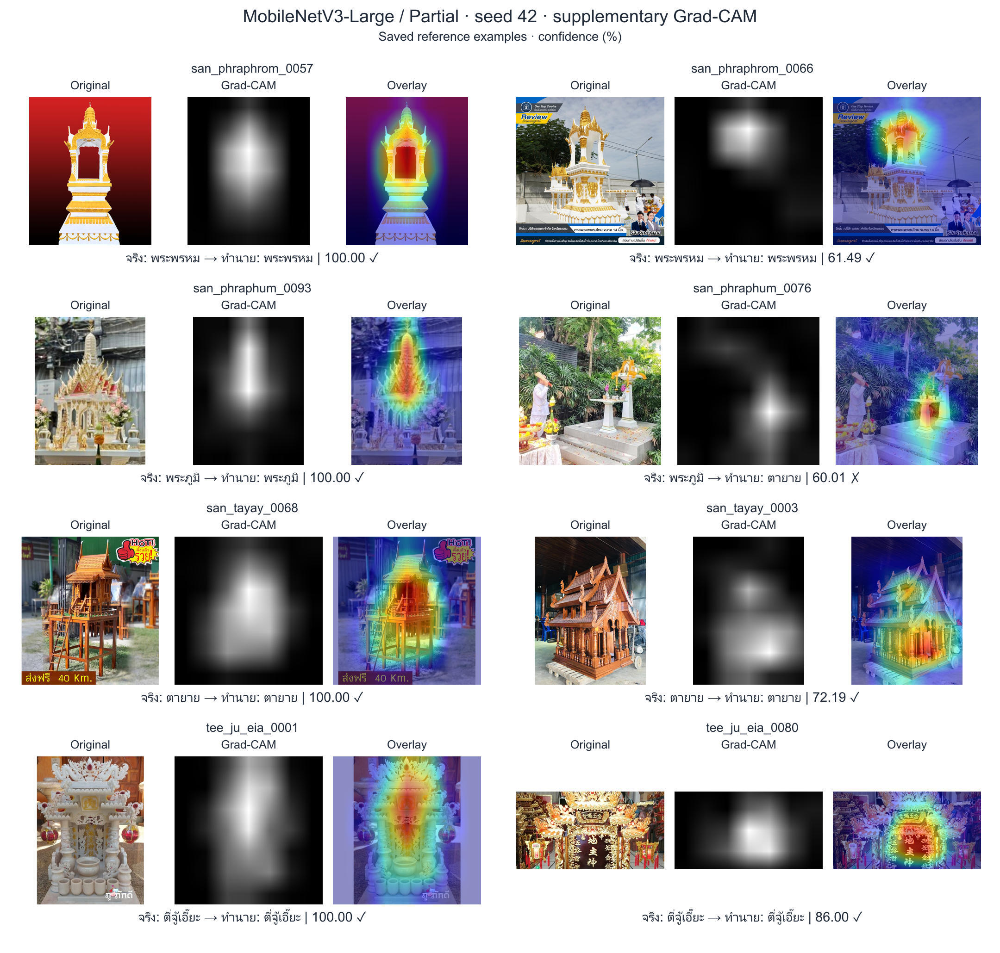
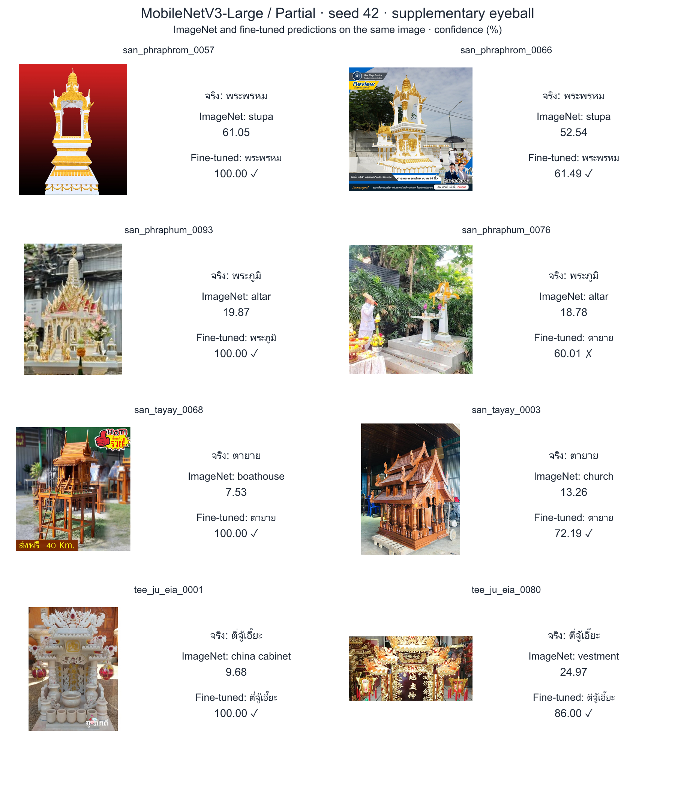

<!-- Generated mirror of ../README.md; edit report/readme_template.md and run node report/render_readme.js. -->
# DADS7202 — Thai shrine image classification using transfer learning

## Abstract

การศึกษานี้เปรียบเทียบโมเดลที่ผ่านการฝึกบน ImageNet จำนวน 5 แบบ สำหรับจำแนกภาพศาลไทย 4 ประเภทจากข้อมูล 560 ภาพ แต่ละโมเดลนำมาฝึกด้วย 3 fine-tuning strategies ได้แก่ Full ซึ่งปรับน้ำหนักทั้งโมเดล Frozen ซึ่งตรึงส่วนสกัดลักษณะภาพและฝึกเฉพาะส่วนจำแนกคลาส และ Partial ซึ่งปรับน้ำหนักเฉพาะส่วนท้ายของส่วนสกัดลักษณะภาพร่วมกับส่วนจำแนกคลาส รวมเป็น 15 setups

ข้อมูลแบ่งโดยจัดภาพซ้ำและภาพใกล้เคียงที่ผ่านการตรวจสอบให้อยู่ในกลุ่มเดียวกัน แล้วแบ่งกลุ่มเป็น train 390 ภาพ validation 85 ภาพ และ test 85 ภาพ โดยเลือกการแบ่งที่รักษาสัดส่วนคลาสให้ใกล้เคียงกัน แต่ละ setup ค้นหา hyperparameters แยกกันจำนวน 5 trials ก่อนฝึกซ้ำด้วย 5 seeds รวม 75 tuning trials และ 75 final runs

**ResNet50/Full ได้รับเลือกเป็นโมเดลสุดท้ายของการศึกษา** เนื่องจากมีค่าเฉลี่ย Accuracy, Macro precision, Macro recall และ Macro F1 บน test สูงสุดจาก 15 setups ประกอบกับมี Recall ของศาลพระภูมิสูงกว่าโมเดลอ้างอิง และมี SD ของ Accuracy และ Macro F1 ระหว่าง seeds ต่ำกว่าโมเดลอ้างอิง โดยได้ Accuracy 93.65% ± 1.34 pp และ Macro F1 92.56% ± 1.81 pp อย่างไรก็ตาม ค่า ECE สูงกว่า MobileNetV3-Large/Partial เล็กน้อย และความแตกต่างของ Accuracy และ Macro F1 ยังไม่มีนัยสำคัญหลังปรับ Holm การเลือกนี้เกิดขึ้นหลังพิจารณาผล test บน split ที่เคยถูกตรวจดูแล้ว จึงต้องประเมินยืนยันด้วยข้อมูลภายนอกชุดใหม่

การศึกษา ablation ใช้ตรวจสอบผลของ augmentation และ class weights โดยนำองค์ประกอบออกจากสูตรเดิมทีละอย่าง การไม่ใช้ augmentation มี Macro F1 เฉลี่ยลดลง 1.32 pp ส่วนการไม่ใช้ class weights ลดลง 0.67 pp แต่ยังไม่พบความแตกต่างอย่างมีนัยสำคัญหลังปรับ Holm ทั้ง 4 comparisons การฝึกเพิ่ม 10 runs ทำให้รวมทั้งงานเป็น 160 runs นอกจากนี้ใช้ Grad-CAM จาก checkpoint เดิมวิเคราะห์บริเวณภาพที่สัมพันธ์กับผลทำนาย รวมถึงตัวอย่างที่ทายผิดด้วยความมั่นใจสูง

## 1. Dataset overview

### 1.1 Study objective and data sources

การศึกษามีวัตถุประสงค์เพื่อจำแนกภาพศาลพระพรหม ศาลพระภูมิ ศาลตายาย และศาลตี่จู้เอี๊ยะ ซึ่งมีรูปทรงและบริบทในภาพบางส่วนคล้ายกัน ข้อมูลผ่านการตรวจป้ายกำกับโดยมนุษย์และจัดเก็บใน `dataset_cleaned/` ตารางใช้รหัสคลาสเดียวกับไฟล์ผลการทดลองและลำดับคะแนนที่โมเดลส่งออก

| Class | Class ID | Image count | Proportion (%) |
| --- | --- | ---: | ---: |
| พระพรหม | san_phraphrom | 103 | 18.39 |
| พระภูมิ | san_phraphum | 124 | 22.14 |
| ตายาย | san_tayay | 133 | 23.75 |
| ตี่จู้เอี๊ยะ | tee_ju_eia | 200 | 35.71 |

ไฟล์ `metadata_cleaned.csv` ระบุชื่อไฟล์ คลาส และ URL ต้นทาง มี URL สำหรับ 448 ภาพ และไม่ทราบ URL 112 ภาพ โดเมนที่พบมากที่สุดคือ `down-th.img.susercontent.com` จำนวน 65 ภาพ รายการแหล่งภาพอยู่ใน Appendix C ส่วนวิธีเก็บ วันที่ และสิทธิการใช้ยังมีข้อมูลไม่ครบทุกภาพ

### 1.2 Class distribution and loss weighting

ศาลตี่จู้เอี๊ยะมีภาพมากที่สุด 200 ภาพ ขณะที่ศาลพระพรหมมี 103 ภาพ อัตราส่วนประมาณ 1.94:1 การประเมินจึงใช้ Macro metrics ซึ่งให้น้ำหนักแต่ละคลาสเท่ากัน และการฝึกใช้ **class-weighted cross-entropy** เพื่อชดเชยความไม่สมดุลของจำนวนภาพ

น้ำหนักคำนวณจากข้อมูล train เท่านั้นด้วยสูตร `weight_c = N_train / (K × n_c)` โดย `N_train = 390`, `K = 4` และ `n_c` คือจำนวนภาพ train ของคลาสนั้น

| Class | Training images | Class weight |
| --- | ---: | ---: |
| พระพรหม | 70 | 1.392857 |
| พระภูมิ | 89 | 1.095506 |
| ตายาย | 91 | 1.071429 |
| ตี่จู้เอี๊ยะ | 140 | 0.696429 |

ค่า loss ของแต่ละภาพถูกคูณด้วยน้ำหนักของคลาสจริง ก่อนรวมและหารด้วยจำนวนภาพ ดังนั้น หากโมเดลให้ความน่าจะเป็นของคลาสจริงเท่ากัน ภาพพระพรหมจะมีน้ำหนักใน loss ประมาณสองเท่าของภาพตี่จู้เอี๊ยะ วิธีนี้เพิ่มบทบาทของคลาสที่มีภาพน้อยระหว่างฝึก โดยไม่เพิ่มจำนวนภาพหรือสุ่มภาพซ้ำ และไม่ได้รับประกันว่าคะแนนทุกคลาสจะสูงขึ้นเสมอ


*Figure 1. ตัวอย่างภาพทั้งสี่คลาส แสดงความแตกต่างของรูปทรง มุมมอง และฉากหลัง*


*Figure 2. จำนวนภาพต่อคลาสก่อนแบ่งข้อมูล*

### 1.3 Image dimensions, colour modes and brightness


*Figure 3. ขนาดภาพต้นฉบับและ histogram ของอัตราส่วนกว้างต่อสูง โดยใช้ bins ร่วมกันและแสดงสัดส่วนภาพภายในแต่ละคลาส*

ค่า aspect ratio เท่ากับ 1 หมายถึงภาพจัตุรัส มากกว่า 1 หมายถึงภาพแนวนอน และน้อยกว่า 1 หมายถึงภาพแนวตั้ง เส้นประที่ ratio = 1 ใช้อ้างอิง Histogram วางซ้อนกันด้วยสีโปร่งใสและเส้นขอบรูปแบบต่างกัน ความสูงของแต่ละ bin คำนวณจากจำนวนภาพใน bin หารด้วยจำนวนภาพทั้งหมดของคลาสนั้น ไม่ใช่ probability density ตัวอย่างเช่น ภาพจัตุรัสที่มี ratio เท่ากับ 1 มีจริงรวม 190 ภาพ


*Figure 4. จำนวนและสัดส่วนของโหมดสีที่ถอดรหัสได้จริง พร้อมกราฟขยายกลุ่ม non-RGB เพื่อให้เห็นกลุ่มที่มีภาพน้อย*

RGB ใช้ช่องสีแดง เขียว และน้ำเงิน ส่วน RGBA เพิ่มช่อง alpha สำหรับความโปร่งใส Palette หรือโหมด P ใช้ตารางอ้างอิงสี และ CMYK ใช้ช่องสี cyan, magenta, yellow และ black ภาพถูกแปลงเป็น RGB แบบเดียวกันก่อนเข้าโมเดล โดยผสมส่วนโปร่งใสกับพื้นกลางเมื่อมี alpha

ผล audit พบ RGB 543 ภาพ RGBA 9 ภาพ Palette 5 ภาพ และ CMYK 3 ภาพ รูปแบบไฟล์ที่ถอดรหัสได้จริงคือ JPEG 526 ภาพ PNG 22 ภาพ WEBP 11 ภาพ และ GIF 1 ภาพ ส่วนภาพต้นฉบับมีขนาดต่างกัน 206 แบบ ความกว้าง 145–4,032 พิกเซล และความสูง 225–4,214 พิกเซล


*Figure 5. ความสว่างเฉลี่ยรายภาพแยกคลาส กล่องแสดง IQR และมัธยฐาน เครื่องหมาย × แสดงค่าเฉลี่ยรายคลาส เส้นประแนวนอนแสดงค่าเฉลี่ยรวม*

Histogram ใช้ bins ร่วมกันและสัดส่วนภาพภายในแต่ละคลาส เส้นแนวตั้งตามสีคลาสแสดงค่าเฉลี่ยของคลาสนั้น ความสว่างเฉลี่ยของแต่ละภาพคำนวณก่อนนำมาสร้างทั้ง histogram และ box plot

**EXIF** คือข้อมูลประกอบไฟล์ภาพที่อาจระบุทิศทางจากกล้อง ภาพถูกจัดให้ตั้งตรงตามข้อมูลนี้ก่อนวิเคราะห์ หากมีส่วนโปร่งใสจะผสมกับพื้น RGB (124,116,104) จากนั้นใช้ค่าสีถ่วงน้ำหนัก `0.2126R + 0.7152G + 0.0722B` ตามสัมประสิทธิ์ Rec.709 แล้วเฉลี่ยทุกพิกเซล เป็นค่าความสว่างโดยประมาณระหว่าง 0–255 ไม่ใช่การวัดแสงทางกายภาพ กล่องครอบคลุมข้อมูลช่วงกลาง 50% (IQR) เส้นในกล่องคือมัธยฐาน และปลายเส้นคือค่าต่ำสุด–สูงสุดที่สังเกตตามนิยามกราฟนี้

### 1.4 Duplicates and data integrity

ไม่พบไฟล์ภาพที่อ่านไม่ได้ พบภาพซ้ำแบบ decoded RGB ในคลาสพระภูมิ 2 คู่ ได้แก่ `0002/0046` และ `0073/0077` เมื่อรวมกับกลุ่มภาพใกล้เคียงที่ผ่านการทบทวน ได้ทั้งหมด 550 กลุ่ม ภาพที่ยืนยันว่าเกี่ยวข้องกันถูกเก็บใน split เดียวกัน การตรวจนี้ยังไม่ครอบคลุมความสัมพันธ์จากแหล่งภาพหรือการถ่ายครั้งเดียวกันที่ไม่มี metadata ยืนยัน

## 2. Data preparation

### 2.1 Group-based data splitting

แบ่งกลุ่มด้วย GroupShuffleSplit โดยใช้ split seed 42 และเลือกจาก 256 × 12 deterministic candidates ให้ใกล้สัดส่วน 70/15/15 พร้อมรักษาสัดส่วนคลาสให้ใกล้เคียงกัน การเลือก candidate พิจารณาทั้งขนาด split และสมดุลคลาส

| Split | Total images | Phra Phrom | Phra Phum | Ta Yai | Tee Ju Eia |
| --- | ---: | ---: | ---: | ---: | ---: |
| Train | 390 | 70 | 89 | 91 | 140 |
| Validation | 85 | 17 | 17 | 21 | 30 |
| Test | 85 | 16 | 18 | 21 | 30 |

แบ่งข้อมูลก่อนทำ augmentation ทุก split มีครบสี่คลาสและไม่พบกลุ่มที่ข้าม split ทุก architecture, mode และ training seed ใช้ชุดภาพตรงกัน Train ใช้ปรับน้ำหนัก validation ใช้เลือกสูตรและ checkpoint ส่วน test ใช้ประเมิน final checkpoint หลังล็อกสูตรแล้ว ทั้งนี้ test split เดิมเคยถูกตรวจดูในงานก่อนหน้า จึงคงสถานะการศึกษาต่อแบบ exploratory บน split เดิม

### 2.2 Image preprocessing and normalization

ขั้นตอนเตรียมภาพประกอบด้วยการถอดรหัส จัดทิศทางตาม EXIF แปลงโหมดสีและจัดการความโปร่งใส จากนั้นย่อด้วย LANCZOS โดยรักษาอัตราส่วน ให้ด้านยาวเท่ากับ 224 พิกเซล แล้ววางกึ่งกลางบนพื้น RGB (124,116,104) ขนาด 224 × 224 โดยคงขอบเดิมที่ติดมากับภาพไว้


*Figure 6. ภาพ train `san_phraphrom_0001` ขนาด 960 × 720 เทียบกับผล preprocessing 224 × 224 ที่ขยายให้เห็นรายละเอียด*

หลัง augmentation สำหรับ train ภาพถูกแปลงเป็น tensor ซึ่งเป็นชุดตัวเลขที่โมเดลนำไปคำนวณ ค่าพิกเซล RGB ถูกปรับจาก 0–255 เป็น 0–1 และ normalize แต่ละช่องสีด้วยสูตร `(x − mean) / SD` การลบ mean ปรับจุดศูนย์กลาง ส่วนการหารด้วย SD ปรับขนาดการกระจายของค่า

ใช้ mean `(0.485,0.456,0.406)` และ SD `(0.229,0.224,0.225)` อ้างอิง ImageNet ให้สอดคล้องกับ preprocessing ของโมเดล pretrained ค่านี้ไม่ได้คำนวณใหม่จากภาพศาล 560 ภาพ และไม่ได้รับประกันว่าข้อมูลศาลหลังแปลงจะมี mean = 0 และ SD = 1 พอดี ส่วน SD นี้เป็นค่าปรับสเกลช่องสี ไม่ใช่ SD ของคะแนนจากห้า seeds

### 2.3 Training augmentation

Augmentation ใช้เฉพาะ train เพื่อเพิ่มความหลากหลายของภาพที่โมเดลพบระหว่างฝึก ส่วน validation และ test ใช้ preprocessing แบบคงที่

| Transformation | Parameter / probability | Description | Purpose |
| --- | --- | --- | --- |
| Rotation | ±12° | หมุนภาพเล็กน้อย | จำลองการถือกล้องเอียง |
| Translation | ±5% | เลื่อนภาพแนวนอนและแนวตั้ง | ลดการยึดติดกับตำแหน่งเดิม |
| Scale | 0.92–1.08 | ย่อหรือขยายภาพเล็กน้อย | จำลองขนาดวัตถุที่ต่างกัน |
| Perspective | Distortion 0.10; probability 0.20 | ปรับมุมมองภาพเล็กน้อยใน 20% ของโอกาส | เพิ่มความแปรผันของมุมถ่าย |
| Horizontal flip | Probability 0.50 | สะท้อนภาพซ้าย–ขวา | เพิ่มความหลากหลายของการจัดวาง |
| Color jitter | Brightness/contrast/saturation 0.10; hue 0.02 | ปรับแสงและสีภายในช่วงที่กำหนด | จำลองสภาพแสงและสีที่ต่างกัน |
| Random erasing | Probability 0.05; area 0.02–0.08 | แทนที่พื้นที่เล็ก ๆ ด้วยสีพื้นกลาง | จำลองการบดบังบางส่วน |

Probability คือโอกาสที่การแปลงจะเกิดขึ้นกับแต่ละภาพ ส่วน area ของ erasing คือสัดส่วนพื้นที่ที่เลือกแทนที่ พื้นที่ว่างจากการแปลงเชิงเรขาคณิตและ erasing ใช้สีพื้นกลางเดียวกัน โดยคำนึงถึงสเกลหลัง normalization สำหรับ erasing


*Figure 7. ตัวอย่าง augmentation จากภาพ train จริงคลาสละห้าภาพ ใช้ seed คงที่เพื่อสร้างซ้ำได้*

ภาพนี้สร้างเพื่อสาธิตนโยบาย augmentation โดย seed ควบคุมการสุ่มให้สร้างตัวอย่างเดิมซ้ำได้ ไม่ใช่ minibatch ที่บันทึกระหว่างฝึก การเรนเดอร์ JavaScript อาจต่างจาก torchvision ในรายละเอียดระดับพิกเซล ตรวจ [image IDs และค่าการแปลง](preprocessing_preview_sources.json) ได้จากไฟล์ประกอบ

### 2.4 Batch loading

DataLoader แบ่งภาพเป็น batches เพื่อคำนวณและอัปเดตน้ำหนัก สุ่มลำดับเฉพาะ train ระหว่างฝึก ส่วน validation และ test คงลำดับเดิมเพื่อให้ตรวจผลรายภาพตรงกันทุก run

กำหนด `drop_last=False` เพื่อใช้ batch สุดท้ายด้วย แม้จำนวนภาพไม่ครบตาม batch size และ `num_workers=0` เพื่อโหลดข้อมูลใน process หลักโดยไม่สร้าง worker แยก การตั้งค่านี้เกี่ยวกับวิธีโหลดข้อมูล ส่วนการให้น้ำหนักคลาสใช้ค่าที่คำนวณจาก train ในหัวข้อ 1.2

## 3. Model architecture

### 3.1 Feature extraction and classification

โมเดลประกอบด้วย **backbone** ซึ่งสกัดลักษณะจากภาพ และ **classifier** ซึ่งนำลักษณะเหล่านั้นมาให้คะแนนแต่ละคลาส ใช้ pretrained weights อย่างเป็นทางการของ torchvision ผ่าน `Weights.DEFAULT` ตาม environment ที่บันทึกไว้

โมเดล ImageNet เดิมให้คะแนน 1,000 คลาส การศึกษานี้เปลี่ยนเฉพาะชั้นให้คะแนนสุดท้ายให้เหลือ 4 คะแนนสำหรับศาลไทย ชั้นดังกล่าวเรียกว่า **linear layer** เพราะคำนวณคะแนนจากผลรวมถ่วงน้ำหนักของลักษณะภาพ แล้วบวกค่าคงที่หรือ bias ตามสมการ `z = Wx + b` โดย `x` คือลักษณะที่สกัดได้ `W` และ `b` เป็นค่าที่เรียนรู้ และ `z` คือคะแนน logits ของแต่ละคลาส คลาสที่ได้คะแนนสูงสุดเป็นคำทำนาย

| Architecture | Backbone structure | Classification-head adaptation |
| --- | --- | --- |
| ResNet50 | Residual blocks | เปลี่ยนชั้น `fc` สุดท้ายเป็นชั้นให้คะแนน 4 คลาส |
| EfficientNet-B0 | MBConv blocks | เปลี่ยนชั้นให้คะแนนสุดท้าย คง Dropout 0.2 |
| MobileNetV3-Large | InvertedResidual blocks | เปลี่ยนชั้นให้คะแนนสุดท้าย คง hidden linear, Hardswish และ Dropout 0.2 |
| DenseNet121 | Dense blocks | เปลี่ยน `classifier` เป็นชั้นให้คะแนน 4 คลาส |
| ConvNeXt-Tiny | ConvNeXt feature stages | เปลี่ยนชั้นให้คะแนนสุดท้าย คง normalization และ flatten |

สถาปัตยกรรมทั้งห้าเป็นกลุ่มเปรียบเทียบที่กำหนดไว้ล่วงหน้า เพื่อศึกษาวิธีเชื่อมต่อและขอบเขตการปรับน้ำหนักที่ต่างกัน เหตุผลเชิงโครงสร้างนี้แยกจากเหตุผลที่เลือก ResNet50/Full เป็นโมเดลสุดท้าย ซึ่งอ้างผลประเมินจริงในหัวข้อ 6.6 จำนวน parameters แบบเต็มและแยก trainable ตาม mode อยู่ใน Appendix C

### 3.2 Fine-tuning strategies

กำหนดส่วนที่อนุญาตให้ปรับน้ำหนักก่อนสร้าง optimizer ในทุก run การ freeze หมายถึงตรึง parameters ของส่วนที่กำหนดไม่ให้ถูกอัปเดตระหว่าง optimization

| Strategy | Updated parameters | Backbone behavior during training | Purpose |
| --- | --- | --- | --- |
| Full | Backbone และ classifier ทั้งหมด | ส่วนทั้งหมดอยู่ใน train mode | ปรับลักษณะ pretrained ให้เข้ากับข้อมูลศาลทั้งโมเดล |
| Frozen | Classifier head ทั้งส่วน | Backbone ตรึงน้ำหนักและอยู่ใน eval mode | ประเมินการใช้ลักษณะ pretrained เดิมกับ classifier ที่ฝึกได้ |
| Partial | Backbone stage สุดท้ายและ classifier | ส่วนต้นตรึงน้ำหนักและอยู่ใน eval; ส่วนท้ายอยู่ใน train | ปรับลักษณะระดับท้ายโดยคงส่วนต้นไว้ |

Train/eval mode กำหนดพฤติกรรมของชั้นบางชนิด เช่น BatchNorm ใช้สถิติของ batch และปรับสถิติสะสมระหว่างฝึก ส่วน Dropout สุ่มระงับค่าบางส่วนเมื่อฝึก สำหรับ validation และ test ใช้ eval mode ให้ทำงานสำหรับการประเมิน ส่วนการเลือกว่าจะปรับ parameters ใดเป็นหน้าที่ของ fine-tuning strategy ดังนั้น Frozen ยังมีการเรียนรู้ที่ classifier และไม่ได้ตรึงทั้งโมเดล

Partial ของ ResNet50 ใช้ `layer4`; DenseNet121 ใช้ `denseblock4` และ `norm5`; EfficientNet-B0 ใช้ MBConv stage สุดท้ายและ projection; ConvNeXt-Tiny ใช้ feature stage สุดท้าย; MobileNetV3-Large ใช้ `features.13–16` และ `classifier` ทุก run เริ่มจาก ImageNet weights ใหม่ โดยแต่ละ setup ค้นหา hyperparameters ของตนเอง

กราฟเปรียบเทียบใช้ Frozen = น้ำเงิน ●, Partial = ส้มแดง ■ และ Full = เขียว ◆ ตามชุดสี Okabe–Ito ร่วมกับรูปทรงและ line styles ส่วนกราฟคลาสใช้ชุดสีแยกกัน คงลำดับคลาส และไม่อาศัยสีเพียงอย่างเดียวในการสื่อความหมาย

### 3.3 Predictions before fine-tuning

ผล ResNet50/ImageNet เดิมบนตัวอย่าง train แสดงว่าชุดป้ายกำกับ 1,000 คลาสยังไม่ตรงกับสี่ประเภทศาล เช่น ผลทำนาย `stupa` อาจสัมพันธ์กับรูปทรง แต่ไม่ใช่ป้ายศาลไทยตามการศึกษานี้ ใช้ตัวเลข baseline เดิมที่เข้ากันได้กับข้อมูลชุดเดียวกัน โดยไม่นำมาคำนวณ Accuracy แบบสี่คลาส


*Figure 8. ป้าย ImageNet และ confidence (%) จากตัวอย่าง train เดิม ใช้อธิบายความต่างของชุดป้ายกำกับก่อนปรับ classifier*

## 4. Training method

### 4.1 Hyperparameter search

ลำดับการทดลองคือเตรียมข้อมูล → ค้นหา hyperparameters แยกทุก setup → เลือกสูตรแต่ละ setup ด้วย validation → ล็อกสูตรและโมเดลอ้างอิง → ฝึก final ด้วยห้า seeds → ประเมิน test และวิเคราะห์ผล

| Term | Meaning | Count in this study |
| --- | --- | --- |
| Setup | Architecture × fine-tuning strategy | 5 × 3 = 15 |
| Tuning trial | ทดลอง hyperparameters หนึ่งชุดภายใน setup ด้วย seed 42 | 5 ต่อ setup รวม 75 |
| Final run | ฝึกสูตรที่เลือกใหม่ด้วย seed หนึ่งค่า | 5 ต่อ setup รวม 75 |
| Selected checkpoint | น้ำหนักที่เลือกจาก validation ภายในแต่ละ run | หนึ่ง checkpoint ต่อ run |

คำว่า sweep หมายถึง local seeded random search ที่บันทึกผลแต่ละ trial ผ่าน W&B ทุก setup ได้รับชุดค่าสุ่มเดียวกันห้าชุดภายใต้งบเท่ากัน แต่เลือกสูตรที่ชนะด้วย validation ของตนเอง ไม่ใช้สูตร Full แทน Frozen หรือ Partial และไม่ได้เลือก Top 15 จากการค้นหารวม

| Hyperparameter | Search space |
| --- | --- |
| Learning rate | Log-uniform [1e-5, 1e-3] |
| Weight decay | Log-uniform [1e-6, 1e-2] |
| Optimizer | AdamW, Adam, SGD |
| Batch size | 16, 32 |

<!-- generated:SEARCH_TABLE -->

| Trial | Learning rate | Weight decay | Optimizer | Batch |
| ---: | ---: | ---: | --- | ---: |
| 1 | 3.531117e-4 | 5.695263e-5 | Adam | 32 |
| 2 | 2.481624e-4 | 2.380726e-6 | Adam | 32 |
| 3 | 3.328736e-4 | 1.393982e-3 | Adam | 16 |
| 4 | 7.957413e-5 | 3.042230e-5 | AdamW | 32 |
| 5 | 1.939681e-4 | 1.954549e-3 | Adam | 16 |

<!-- /generated:SEARCH_TABLE -->

ค่าที่สุ่มได้จริงเป็น Adam สี่ชุดและ AdamW หนึ่งชุด จึงไม่มีผลของ SGD ในรอบนี้ การใช้ห้าชุดจำกัดขอบเขตการค้นหา และไม่ได้ sweep dropout



*Figure 9a. คะแนน validation ของห้า trials ภายในแต่ละ setup วงแหวนระบุสูตรที่เลือก จุดเหล่านี้เป็น configurations ต่างกัน ไม่ใช่ repeated seeds*


*Figure 9b. Learning rate, weight decay และผลที่ selected epoch เทียบกับ Validation Macro F1 (%) จาก 75 tuning trials*

กราฟแยกตัวแปรแกน X เป็น learning rate, weight decay, training loss, validation loss, selected epoch, training accuracy และ validation accuracy ทุก panel ใช้ Validation Macro F1 บนแกน Y ค่าผลระหว่างฝึกอ่านจาก epoch เดียวกับ checkpoint ที่เลือก จุดอาจซ้อนกันเพราะใช้ชุด hyperparameters ร่วมกัน และความสัมพันธ์ในกราฟยังปนกับผลของ architecture, optimizer และ batch size จึงไม่ใช้ยืนยันผลเชิงสาเหตุ ตรวจค่าราย trial ได้ใน [tuning checkpoint observations](tuning_checkpoint_observations.csv)

### 4.2 Training settings and checkpoint selection

Epoch คือการใช้ภาพ train ครบหนึ่งรอบ ส่วน batch size คือจำนวนภาพต่อหนึ่งขั้นตอนคำนวณ gradient Learning rate กำหนดขนาดการปรับน้ำหนัก Optimizer กำหนดวิธีปรับน้ำหนัก และ weight decay เป็น regularization ที่ควบคุมน้ำหนักตามกลไกของ optimizer ที่เลือก การศึกษานี้ใช้ค่า search configuration จริง ไม่ตีความว่า weight decay ของ Adam และ AdamW มีกลไกเหมือนกันทุกประการ

| Setting | Value | Role |
| --- | --- | --- |
| Loss | Class-weighted cross-entropy | ให้น้ำหนักข้อผิดพลาดตามจำนวนภาพ train |
| Maximum epochs | 30 | จำกัดความยาวของแต่ละ run |
| Early stopping | Patience 7; min_delta 0.0001 (0.01 pp) | หยุดเมื่อไม่มีการพัฒนาตามเกณฑ์ต่อเนื่องเจ็ด epochs |
| Scheduler | ReduceLROnPlateau; mode=max; factor=0.5; patience=3 | ลด learning rate ลงครึ่งหนึ่งเมื่อ validation Macro F1 ไม่พัฒนาตามเกณฑ์ |
| Monitored metric | Validation Macro F1 | ใช้กับ scheduler และ early stopping |
| Adam defaults | Betas (0.9,0.999); epsilon 1e-8 | ค่าร่วมของ optimizer ตาม config |
| Tuning seed | 42 | ควบคุมการสุ่มในการฝึก tuning |
| Final seeds | 42, 123, 456, 789, 1024 | ฝึกสูตรเดิมซ้ำห้าครั้งเพื่อดูความแปรปรวน |

หลังแต่ละ epoch ประเมิน validation และบันทึก metrics เลือก checkpoint ที่ validation Macro F1 สูงสุด หากเท่ากันใช้ validation loss ต่ำกว่า แล้วเลือก epoch ก่อนหน้า เกณฑ์นี้แยกจาก min_delta ของ early stopping จึงอาจบันทึก checkpoint ใหม่ได้แม้คะแนนเพิ่มเล็กน้อยไม่ถึงเกณฑ์ reset การหยุดฝึก Checkpoint สุดท้ายที่ใช้ประเมิน test อาจอยู่ก่อน epoch ที่หยุดฝึก

การเลือกสูตรภายในแต่ละ setup เรียงจาก validation Macro F1 สูงสุด ตามด้วย validation Accuracy สูงกว่า validation loss ต่ำกว่า และ trial index การใช้ seed คงที่ช่วยควบคุมการสุ่ม แต่ไม่รับประกันผลเหมือนกันทุก hardware และ library version

### 4.3 Selected configurations and final evaluation

ตารางแสดง hyperparameters ที่นำไปใช้จริงของทั้ง 15 setups ค่า validation มาจาก tuning seed 42 และไม่ใช่ค่าเฉลี่ย final ห้า seeds

<!-- generated:WINNER_TABLE -->

| Setup | Learning rate | Weight decay | Optimizer | Batch size | Tuning validation F1 (%) |
| --- | ---: | ---: | --- | ---: | ---: |
| ResNet50/Full | 1.939681e-4 | 1.954549e-3 | Adam | 16 | 93.17 |
| ResNet50/Frozen | 3.328736e-4 | 1.393982e-3 | Adam | 16 | 87.76 |
| ResNet50/Partial | 1.939681e-4 | 1.954549e-3 | Adam | 16 | 94.40 |
| EfficientNet-B0/Full | 2.481624e-4 | 2.380726e-6 | Adam | 32 | 94.68 |
| EfficientNet-B0/Frozen | 3.531117e-4 | 5.695263e-5 | Adam | 32 | 85.04 |
| EfficientNet-B0/Partial | 3.328736e-4 | 1.393982e-3 | Adam | 16 | 88.87 |
| MobileNetV3-Large/Full | 1.939681e-4 | 1.954549e-3 | Adam | 16 | 94.68 |
| MobileNetV3-Large/Frozen | 1.939681e-4 | 1.954549e-3 | Adam | 16 | 92.50 |
| MobileNetV3-Large/Partial | 1.939681e-4 | 1.954549e-3 | Adam | 16 | 97.34 |
| DenseNet121/Full | 1.939681e-4 | 1.954549e-3 | Adam | 16 | 96.28 |
| DenseNet121/Frozen | 3.328736e-4 | 1.393982e-3 | Adam | 16 | 89.06 |
| DenseNet121/Partial | 3.328736e-4 | 1.393982e-3 | Adam | 16 | 90.61 |
| ConvNeXt-Tiny/Full | 2.481624e-4 | 2.380726e-6 | Adam | 32 | 94.63 |
| ConvNeXt-Tiny/Frozen | 3.328736e-4 | 1.393982e-3 | Adam | 16 | 89.02 |
| ConvNeXt-Tiny/Partial | 1.939681e-4 | 1.954549e-3 | Adam | 16 | 94.90 |

<!-- /generated:WINNER_TABLE -->

MobileNetV3-Large/Partial ได้รับเลือกเป็น **statistical reference** ด้วย tuning validation Macro F1 97.34%, Accuracy 97.65% และ loss 0.1718 ผลการเลือกและสูตรทั้ง 15 setups ถูกล็อกใน `selection.json` ก่อน final evaluation

รอบ final เริ่มจาก ImageNet weights ใหม่ setup ละห้า seeds โดยไม่ใช้ tuning checkpoint เป็นจุดเริ่มต้น เมื่อฝึกเสร็จจึงโหลด checkpoint ที่เลือกด้วย validation ของ run นั้นกลับมาประเมิน test หนึ่งครั้ง Selected epoch จึงเป็นค่าราย seed ไม่ใช่ epoch เดียวร่วมกันทั้ง setup

<!-- generated:CHECKPOINT_SUMMARY_TABLE -->

| Setup | Final runs | Mean selected epoch | Selected epoch range | Seeds |
| --- | ---: | ---: | --- | --- |
| ResNet50/Full | 5 | 8.4 | 3–12 | 42, 123, 456, 789, 1024 |
| ResNet50/Frozen | 5 | 15.6 | 13–19 | 42, 123, 456, 789, 1024 |
| ResNet50/Partial | 5 | 12.6 | 9–21 | 42, 123, 456, 789, 1024 |
| EfficientNet-B0/Full | 5 | 17.6 | 11–25 | 42, 123, 456, 789, 1024 |
| EfficientNet-B0/Frozen | 5 | 15.8 | 7–22 | 42, 123, 456, 789, 1024 |
| EfficientNet-B0/Partial | 5 | 7.8 | 3–12 | 42, 123, 456, 789, 1024 |
| MobileNetV3-Large/Full | 5 | 13.4 | 7–21 | 42, 123, 456, 789, 1024 |
| MobileNetV3-Large/Frozen | 5 | 17.2 | 12–22 | 42, 123, 456, 789, 1024 |
| MobileNetV3-Large/Partial | 5 | 11.4 | 6–20 | 42, 123, 456, 789, 1024 |
| DenseNet121/Full | 5 | 12.4 | 7–19 | 42, 123, 456, 789, 1024 |
| DenseNet121/Frozen | 5 | 21.4 | 15–30 | 42, 123, 456, 789, 1024 |
| DenseNet121/Partial | 5 | 9.6 | 7–12 | 42, 123, 456, 789, 1024 |
| ConvNeXt-Tiny/Full | 5 | 8.4 | 4–12 | 42, 123, 456, 789, 1024 |
| ConvNeXt-Tiny/Frozen | 5 | 13.2 | 7–21 | 42, 123, 456, 789, 1024 |
| ConvNeXt-Tiny/Partial | 5 | 9.6 | 4–21 | 42, 123, 456, 789, 1024 |

<!-- /generated:CHECKPOINT_SUMMARY_TABLE -->

รายละเอียดทั้ง 75 final checkpoints รวม run identity, seed, selected epoch, checkpoint path และ SHA256 ของ history อยู่ใน [final checkpoint summary](final_checkpoint_summary.csv)

Tuning ใช้จริง 1,350 epochs และ final ใช้ 1,411 epochs รวม 2,761 epochs จากเพดาน 4,500 epochs ส่วน ablation เพิ่ม 10 runs ใช้ 145 epochs จากเพดาน 300 epochs รวมทั้งงานเป็น **160 training runs และ 2,906 epochs**

Environment ที่บันทึกไว้คือ Windows, Python 3.13.5, PyTorch 2.13.0+cu130, torchvision 0.28.0+cu130, CUDA 13.0 และ RTX 5060 ปิด AMP และตั้ง deterministic algorithms แบบ warn_only รายละเอียด W&B project, CoreWeave และข้อจำกัดการตรวจ cloud artifacts อยู่ใน Appendix C


## 5. Evaluation metrics

### 5.1 Classification metrics

ตารางผลใช้ mean (%) ± sample SD (pp) จากห้า seeds โดย pp หมายถึงจุดเปอร์เซ็นต์ ผลต่างและ CI ของ Accuracy/F1 ใช้ pp ส่วน p, t และ effect size ไม่ใช่เปอร์เซ็นต์ CSV/JSON ต้นทางคงหน่วยเดิม

Accuracy คือสัดส่วนภาพที่ทายถูก Precision = TP/(TP+FP), Recall = TP/(TP+FN) และ F1 = 2PR/(P+R) โดย TP คือทายถูกในคลาสนั้น FP คือทายว่าเป็นคลาสนั้นทั้งที่ไม่ใช่ และ FN คือภาพของคลาสนั้นที่ถูกทายเป็นคลาสอื่น กรณีตัวหารเป็นศูนย์ให้ค่าเป็น 0 Macro precision, recall และ F1 เฉลี่ยค่ารายคลาสทั้งสี่เท่ากัน โดย Macro F1 เป็นค่าเฉลี่ยของ F1 รายคลาสโดยตรง ผลรวมข้าม seeds ใช้ sample SD (ddof=1) บน split เดียวกัน

### 5.2 Paired statistical comparisons

ใช้ two-sided paired t-test จับคู่ seed เดียวกันสำหรับ Accuracy และ Macro F1 แล้วปรับ p ด้วย Holm ที่ระดับ 0.05 แยกสองครอบครัวสมมติฐานที่ล็อกไว้

| Family | Planned comparisons | Family size |
| --- | --- | ---: |
| Primary | Validation-selected reference กับอีก 14 setups × 2 metrics | 28 |
| Secondary | สามคู่ mode ภายในห้า architectures × 2 metrics | 30 |

Cohen’s d_z คือ mean paired difference หารด้วย SD ของ paired differences ส่วน 95% CI ของ mean difference ใช้ t-distribution (df=4) และไม่ได้ปรับ multiple comparisons การตัดสินนัยสำคัญจึงใช้ Holm p ความแปรปรวนนี้สะท้อน training seeds บน split เดียว ไม่ใช่ความไม่แน่นอนข้ามชุดข้อมูลใหม่

### 5.3 Confidence calibration

Confidence คือความน่าจะเป็นสูงสุดที่โมเดลให้กับคลาสที่ทำนาย Calibration ตรวจว่าระดับความมั่นใจนั้นสอดคล้องกับความถูกต้องที่สังเกตหรือไม่ Expected Calibration Error (ECE) แบ่งผลทำนายเป็นสิบช่วงความกว้างเท่ากันตั้งแต่ 0–10% ถึง 90–100% ตาม implementation จริง จากนั้นคำนวณขนาดความต่างระหว่าง confidence เฉลี่ยกับ accuracy ของแต่ละช่วง แล้วเฉลี่ยโดยถ่วงน้ำหนักตามจำนวนภาพ ช่วงที่ไม่มีภาพไม่มีส่วนร่วมในผลรวม

**ตัวอย่างเพื่ออธิบาย:** กลุ่มที่มี confidence เฉลี่ย 85% แต่ทายถูก 70% มี calibration gap 15 pp ECE รวมพิจารณาทุกกลุ่ม ค่า ECE ต่ำจึงหมายถึงความมั่นใจกับความถูกต้องสอดคล้องกันมากขึ้นภายใต้วิธีแบ่ง bins นี้ ไม่ได้วัด Accuracy โดยตรง และอาจเปลี่ยนตามวิธีแบ่ง bins กับจำนวนตัวอย่าง ตัวอย่างตัวเลขนี้ไม่ใช่ผลทดลองเพิ่มเติม

## 6. Experimental results

### 6.1 Experiment completeness

ผลครบ 15 setups × 5 seeds ตรวจ `test_predictions.csv` ของทั้ง 75 runs (6,375 แถว) พบ test IDs 85 ภาพเรียงตรงกันทุก run และคำนวณ Accuracy, Macro metrics, ผลรายคลาส และ paired tests ซ้ำได้ตรงกับผลที่บันทึก ส่วน ablation ตรวจ 1,275 แถวจาก 15 runs ได้ตรงเช่นกัน ภาพ test ยังเป็น 85 ภาพเดิม จำนวน runs ที่เพิ่มขึ้นจึงไม่ได้เพิ่มตัวอย่างอิสระ

ไฟล์ประกอบ: [verification.json](verification.json) · [resnet_followup_verification.json](resnet_followup_verification.json)

### 6.2 Learning curves across five seeds

กราฟแสดงค่าเฉลี่ยจากห้า matched seeds และพื้นที่แรเงา ±1 sample SD แต่ละภาพมีสามคอลัมน์สำหรับ Full, Frozen และ Partial แถวบนแสดง train/validation loss แถวที่สองแสดง accuracy แถวที่สามแสดง Validation Macro F1 และแถวล่างแสดงจำนวน runs ที่มีข้อมูลจริงต่อ epoch เส้นทึบแทน training และเส้นประแทน validation ส่วนเครื่องหมาย × บนกราฟ F1 คือ selected checkpoint ของแต่ละ run



*Figure 10. ResNet50: mean ± sample SD ของ loss, accuracy และ Validation Macro F1 พร้อมจำนวน runs ต่อ epoch*



*Figure 11. EfficientNet-B0: mean ± sample SD ของ loss, accuracy และ Validation Macro F1 พร้อมจำนวน runs ต่อ epoch*



*Figure 12. MobileNetV3-Large: mean ± sample SD ของ loss, accuracy และ Validation Macro F1 พร้อมจำนวน runs ต่อ epoch*



*Figure 13. DenseNet121: mean ± sample SD ของ loss, accuracy และ Validation Macro F1 พร้อมจำนวน runs ต่อ epoch*



*Figure 14. ConvNeXt-Tiny: mean ± sample SD ของ loss, accuracy และ Validation Macro F1 พร้อมจำนวน runs ต่อ epoch*

คำนวณจาก runs ที่มี observation จริงในแต่ละ epoch เท่านั้น ไม่เติมศูนย์หรือยืดค่าหลัง early stopping หากเหลือหนึ่ง run จะแสดงเส้นค่าเฉลี่ยโดยไม่มี sample SD และหากไม่เหลือ runs จะไม่แสดงค่า metrics ช่วงนั้น ช่วงท้ายจึงอาจสะท้อนเฉพาะ runs ที่ฝึกนาน แกนแต่ละ metric ใช้ช่วงร่วมกันทุก architecture และครอบคลุมแถบ SD ที่คำนวณได้ แถบ mean ± SD อาจเลยช่วง 0–100 หรืออยู่ต่ำกว่า loss = 0 ทางคณิตศาสตร์ได้ ไม่ใช่ค่า metric ราย run ที่เกิดจริง และไม่ใช่ช่วงความเชื่อมั่น 95%

Training metrics บันทึกขณะฝึกด้วย augmentation ส่วน validation ประเมินหลังจบ epoch ด้วย preprocessing คงที่และ eval mode จึงต้องพิจารณาเงื่อนไขนี้เมื่ออ่านช่องว่างระหว่างเส้น จุดสูงสุดของเส้นเฉลี่ยไม่ใช่ checkpoint ร่วมที่เลือกให้ทุก seed แต่ละ run มี selected epoch ของตนเอง

ตรวจ [ค่า mean/SD และจำนวน runs ราย epoch](learning_curve_summary.csv), [selected checkpoints ราย seed](final_checkpoint_summary.csv) และ [source files / SHA256](enhanced_figure_sources.json) ได้จากไฟล์ประกอบ ส่วน box plots และไฟล์กราฟเดิมเก็บไว้ใน Appendix C

### 6.3 Test performance

**ResNet50/Full ได้ Macro F1 เฉลี่ยสูงสุดจาก 15 setups** (92.56%) ตามด้วย ResNet50/Partial (91.82%) และ MobileNetV3-Large/Partial (91.68%) ทุกค่าเป็น mean (%) ± sample SD (pp) จาก 5 seeds ตารางเรียงตาม Macro F1

<!-- generated:RESULT_TABLE -->

| Setup | Accuracy (%) | Macro precision (%) | Macro recall (%) | Macro F1 (%) |
| --- | ---: | ---: | ---: | ---: |
| ResNet50/Full | 93.65 ± 1.34 | 92.92 ± 2.07 | 92.77 ± 1.69 | 92.56 ± 1.81 |
| ResNet50/Partial | 93.18 ± 1.53 | 92.39 ± 1.63 | 92.11 ± 1.80 | 91.82 ± 2.09 |
| MobileNetV3-Large/Partial | 93.18 ± 2.41 | 92.71 ± 2.04 | 92.17 ± 2.66 | 91.68 ± 3.05 |
| DenseNet121/Partial | 92.71 ± 1.74 | 91.81 ± 2.10 | 91.49 ± 2.00 | 91.42 ± 1.85 |
| ConvNeXt-Tiny/Full | 92.94 ± 1.66 | 92.36 ± 1.94 | 91.79 ± 1.90 | 91.35 ± 2.12 |
| DenseNet121/Full | 92.71 ± 1.53 | 92.02 ± 1.93 | 91.44 ± 1.85 | 91.27 ± 1.89 |
| EfficientNet-B0/Partial | 92.71 ± 2.10 | 91.66 ± 2.64 | 91.29 ± 2.46 | 91.05 ± 2.67 |
| ConvNeXt-Tiny/Partial | 92.00 ± 1.53 | 92.05 ± 1.46 | 90.80 ± 1.72 | 90.74 ± 1.78 |
| MobileNetV3-Large/Full | 91.76 ± 0.83 | 91.45 ± 1.57 | 90.40 ± 0.85 | 89.86 ± 0.96 |
| EfficientNet-B0/Full | 91.06 ± 1.34 | 89.98 ± 1.43 | 89.25 ± 1.53 | 89.21 ± 1.52 |
| MobileNetV3-Large/Frozen | 90.35 ± 0.98 | 89.14 ± 0.93 | 89.23 ± 1.12 | 88.69 ± 1.33 |
| ResNet50/Frozen | 88.47 ± 1.53 | 87.93 ± 1.72 | 87.65 ± 1.59 | 87.55 ± 1.67 |
| DenseNet121/Frozen | 88.00 ± 1.29 | 86.37 ± 1.73 | 85.86 ± 1.57 | 85.87 ± 1.65 |
| ConvNeXt-Tiny/Frozen | 87.06 ± 2.76 | 86.14 ± 3.52 | 85.66 ± 2.69 | 85.17 ± 2.48 |
| EfficientNet-B0/Frozen | 85.65 ± 2.41 | 83.66 ± 2.62 | 83.78 ± 2.30 | 83.38 ± 2.36 |

<!-- /generated:RESULT_TABLE -->


*Figure 15 Validation และ test Accuracy / Macro F1 ของ 15 setups จุดใหญ่คือค่าเฉลี่ย จุดจางคือแต่ละ seed เส้นคือ ± 1 SD (n = 5)*

ข้อสังเกตจากตาราง

- ผลต่าง Macro F1 ระหว่าง ResNet50/Full กับโมเดลอ้างอิงคือ 0.88 pp
- MobileNetV3-Large/Full มี SD ของ Macro F1 ต่ำที่สุด (0.96 pp) แต่ค่าเฉลี่ยอยู่อันดับ 9 จึงต้องดูคะแนนและความสม่ำเสมอควบคู่กัน
- ภายในโมเดล Partial ให้ Macro F1 เฉลี่ยสูงสุดใน EfficientNet-B0, MobileNetV3-Large และ DenseNet121 ส่วน Full สูงสุดใน ResNet50 และ ConvNeXt-Tiny
- Frozen ต่ำสุดในทั้ง 5 โมเดล

อันดับนี้เป็นผลที่สังเกตหลังล็อกโมเดลอ้างอิงแล้ว ความต่างของค่าเฉลี่ยต้องอ่านร่วมกับผลทางสถิติในหัวข้อ 6.4

### 6.4 Statistical comparisons

หลังปรับ Holm มี 2 จาก 28 สมมติฐานใน Primary และ 3 จาก 30 ใน Secondary ที่มีนัยสำคัญ ตารางแสดงรายการเหล่านั้นและการเทียบโมเดลอ้างอิงกับ ResNet50/Full Δ = A − B หน่วย pp

<!-- generated:STATS_TABLE -->

| Family | A − B | Metric | Mean Δ (pp) | 95% CI (pp)¹ | Holm p |
| --- | --- | --- | ---: | --- | ---: |
| Primary | MobileNetV3-Large/Partial<br>− ResNet50/Full | Accuracy | -0.47 | [-4.42, 3.48] | 1.000 |
| Primary | MobileNetV3-Large/Partial<br>− ResNet50/Full | Macro F1 | -0.88 | [-5.89, 4.13] | 1.000 |
| Primary | MobileNetV3-Large/Partial<br>− ConvNeXt-Tiny/Frozen | Accuracy | 6.12 | [4.52, 7.72] | 0.012 |
| Primary | MobileNetV3-Large/Partial<br>− ConvNeXt-Tiny/Frozen | Macro F1 | 6.50 | [4.81, 8.20] | 0.012 |
| Secondary | ResNet50/Full<br>− ResNet50/Frozen | Accuracy | 5.18 | [3.51, 6.84] | 0.028 |
| Secondary | DenseNet121/Frozen<br>− DenseNet121/Partial | Accuracy | -4.71 | [-6.17, -3.25] | 0.025 |
| Secondary | DenseNet121/Frozen<br>− DenseNet121/Partial | Macro F1 | -5.55 | [-7.16, -3.95] | 0.020 |

<!-- /generated:STATS_TABLE -->

ผลที่มีนัยสำคัญ

- โมเดลอ้างอิงสูงกว่า ConvNeXt-Tiny/Frozen ทั้ง Accuracy และ Macro F1
- ResNet50/Full สูงกว่า ResNet50/Frozen ใน Accuracy
- DenseNet121/Partial สูงกว่า DenseNet121/Frozen ทั้ง Accuracy และ Macro F1

ResNet50/Full เทียบกับโมเดลอ้างอิงได้ Holm-adjusted p = 1.000 ทั้งสอง metrics จึงยังไม่มีหลักฐานเพียงพอว่าประสิทธิภาพต่างกัน และไม่ได้ยืนยันว่าทั้งสองโมเดลเท่ากัน

¹ ช่วงความเชื่อมั่น 95% ยังไม่ปรับ multiple comparisons การตัดสินนัยสำคัญใช้ Holm p ส่วนค่า t, raw p และ Cohen’s d_z อยู่ในไฟล์ประกอบ

ไฟล์ประกอบ: [verified_statistics.csv](verified_statistics.csv) (58 แถว พร้อม raw p, effect size และ CI)

### 6.5 Per-class performance

เปรียบเทียบ ResNet50/Full (โมเดลที่เลือก) กับ MobileNetV3-Large/Partial (โมเดลอ้างอิง) ค่าเป็น mean (%) ± sample SD (pp) จาก 5 seeds Support คือจำนวนภาพ test ต่อ run

<!-- generated:PERCLASS_TABLE -->

| Setup | Class | Support | Precision (%) | Recall (%) | F1 (%) |
| --- | --- | ---: | ---: | ---: | ---: |
| ResNet50/Full | พระพรหม | 16 | 88.98 ± 6.48 | 97.50 ± 3.42 | 92.94 ± 3.96 |
| ResNet50/Full | พระภูมิ | 18 | 92.17 ± 5.39 | 77.78 ± 3.93 | 84.35 ± 4.43 |
| ResNet50/Full | ตายาย | 21 | 90.55 ± 5.01 | 97.14 ± 2.61 | 93.63 ± 2.31 |
| ResNet50/Full | ตี่จู้เอี๊ยะ | 30 | 100.00 ± 0.00 | 98.67 ± 1.83 | 99.32 ± 0.93 |
| MobileNetV3-Large/Partial | พระพรหม | 16 | 84.48 ± 5.19 | 100.00 ± 0.00 | 91.52 ± 3.12 |
| MobileNetV3-Large/Partial | พระภูมิ | 18 | 95.89 ± 3.77 | 72.22 ± 10.39 | 81.93 ± 6.75 |
| MobileNetV3-Large/Partial | ตายาย | 21 | 90.47 ± 4.05 | 97.14 ± 2.61 | 93.61 ± 1.74 |
| MobileNetV3-Large/Partial | ตี่จู้เอี๊ยะ | 30 | 100.00 ± 0.00 | 99.33 ± 1.49 | 99.66 ± 0.76 |

<!-- /generated:PERCLASS_TABLE -->

พระภูมิเป็นคลาสที่ยากที่สุดของทั้งสองโมเดล ResNet50/Full ได้ Recall 77.78% และ F1 84.35% สูงกว่า MobileNetV3-Large/Partial (72.22% และ 81.93%) แต่ MobileNetV3-Large/Partial ได้ Recall ของพระพรหมและตี่จู้เอี๊ยะสูงกว่า ดังนั้น ResNet50/Full ไม่ได้ชนะทุกคลาส

ไฟล์ประกอบ: [verified_per_class_summary.csv](verified_per_class_summary.csv) (ครบ 15 setups)

### 6.6 Final model selection

**ResNet50/Full ได้รับเลือกเป็นโมเดลสุดท้าย** โดยพิจารณา 4 ด้านร่วมกัน: ความถูกต้องรวม ความสมดุลระหว่างคลาส ความสม่ำเสมอข้าม seeds และ calibration ไม่ได้รวมเป็นคะแนนเดียว เพราะ metrics เหล่านี้สัมพันธ์กันอยู่แล้ว

| Metric (%) | ResNet50/Full (selected) | MobileNetV3-Large/Partial (reference) |
|---|---|---|
| Accuracy ↑ | 93.65 ± 1.34 | 93.18 ± 2.41 |
| Macro precision ↑ | 92.92 ± 2.07 | 92.71 ± 2.04 |
| Macro recall ↑ | 92.77 ± 1.69 | 92.17 ± 2.66 |
| Macro F1 ↑ | 92.56 ± 1.81 | 91.68 ± 3.05 |
| Phra Phum recall ↑ | 77.78 ± 3.93 | 72.22 ± 10.39 |
| ECE (10 bins) ↓ | 4.94 ± 1.56 | 4.53 ± 1.67 |

ResNet50/Full มีค่าเฉลี่ยสูงสุดทั้ง 4 metrics รวม และมี SD ของ Accuracy, Macro recall และ Macro F1 ต่ำกว่าโมเดลอ้างอิง Recall ของพระภูมิก็สูงกว่า ข้อแลกเปลี่ยนคือ ECE สูงกว่าเล็กน้อย

การเลือกนี้เกิดขึ้นหลังดูผล test (post-hoc) และความต่างจากโมเดลอ้างอิงยังสรุปไม่ได้ทางสถิติ ข้อสรุปนี้จึงต้องยืนยันด้วยภาพจากแหล่งภายนอก คง MobileNetV3-Large/Partial เป็น reference ในการทดสอบทางสถิติ (28/30 สมมติฐาน) ตามที่ล็อกไว้ใน `selection.json` โดยไม่แก้ lock หรือครอบครัวการทดสอบเดิม

### 6.7 Confusion matrices

คำนวณสัดส่วนภายในแต่ละ true class ของแต่ละ seed ก่อน แล้วเฉลี่ยและหา sample SD ข้าม 5 seeds ช่องแนวทแยงคือ Recall ของคลาสนั้น สเกลสีเป็น 0–100 เท่ากันทุกภาพ


*Figure 16 Confusion matrix ของ ResNet50/Full (ค่าเฉลี่ย % และ SD เป็น pp ข้าม 5 seeds) พระภูมิถูกทายถูกเฉลี่ย 77.8% ± 3.9 pp ซึ่งต่ำสุดในสี่คลาส*

<details>
<summary>Confusion matrices for all 15 setups (five seeds each)</summary>

| Architecture | Frozen | Partial | Full |
| --- | --- | --- | --- |
| ResNet50 | [ดูภาพ](report_assets/latest/confusion_resnet50_frozen.svg) | [ดูภาพ](report_assets/latest/confusion_resnet50_partial.svg) | [ดูภาพ](report_assets/latest/confusion_resnet50_full.svg) |
| EfficientNet-B0 | [ดูภาพ](report_assets/latest/confusion_efficientnet_b0_frozen.svg) | [ดูภาพ](report_assets/latest/confusion_efficientnet_b0_partial.svg) | [ดูภาพ](report_assets/latest/confusion_efficientnet_b0_full.svg) |
| MobileNetV3-Large | [ดูภาพ](report_assets/latest/confusion_mobilenet_v3_large_frozen.svg) | [ดูภาพ](report_assets/latest/confusion_mobilenet_v3_large_partial.svg) | [ดูภาพ](report_assets/latest/confusion_mobilenet_v3_large_full.svg) |
| DenseNet121 | [ดูภาพ](report_assets/latest/confusion_densenet121_frozen.svg) | [ดูภาพ](report_assets/latest/confusion_densenet121_partial.svg) | [ดูภาพ](report_assets/latest/confusion_densenet121_full.svg) |
| ConvNeXt-Tiny | [ดูภาพ](report_assets/latest/confusion_convnext_tiny_frozen.svg) | [ดูภาพ](report_assets/latest/confusion_convnext_tiny_partial.svg) | [ดูภาพ](report_assets/latest/confusion_convnext_tiny_full.svg) |

[ค่ารายช่องทั้ง 15 คู่](confusion_mean_sd.csv) ระบุค่าเฉลี่ย (%) และ SD (pp) ที่ใช้วาดภาพ

</details>

### 6.8 Grad-CAM analysis of ResNet50/Full

<!-- resnet-followup:gradcam:start -->

สร้าง Grad-CAM 8 ภาพจาก ResNet50/Full seed 42 ที่ชั้น `layer4[-1]` อธิบายคลาสที่โมเดลทำนาย เลือกตัวอย่างทายถูกและทายผิดแยกตามคลาส ถ้าคลาสไหนไม่มีภาพผิด ใช้ภาพที่ทายถูกแต่ confidence ต่ำสุดแทน ชุดนี้มีภาพทายถูก 6 ภาพและทายผิด 2 ภาพ Heatmap จัดแนวกลับสู่ภาพต้นฉบับหลังตัด padding



*Figure 17 ตัวอย่าง ResNet50/Full seed 42 จัดเป็น 2 คอลัมน์ × 4 แถว แต่ละกรณีมีภาพต้นฉบับ heatmap และ overlay*

<!-- resnet-followup:gradcam:end -->

ข้อสังเกต
- หลายภาพมี heatmap อยู่ที่ตัวเรือนหรือฐานศาล เช่น `san_phraphum_0065` และ `san_tayay_0078`
- ภาพที่ทายผิดก็มี heatmap อยู่ใกล้ตัวศาลเช่นกัน: `san_phraphum_0121` ถูกทายเป็นพระพรหม (96.80%) และ `san_tayay_0093` ถูกทายเป็นพระภูมิ (94.18%) การตอบสนองใกล้ตัวศาลจึงยังไม่รับประกันว่าทายถูก
- บางภาพเป็นโฆษณาที่มีศาลหลายองค์ ข้อความ หรือฉากหลังร่วมอยู่ เช่น `san_phraphrom_0051` ชุดนี้ยังแยกไม่ได้ว่าโมเดลใช้รูปทรง ข้อความ หรือบริบทมากน้อยแค่ไหน

Grad-CAM ใช้ประกอบการวิเคราะห์ ไม่ได้พิสูจน์สาเหตุของการทำนาย

<!-- generated:RESNET_CASE_TABLE -->

| Image ID (stem) | True class | Predicted class | Confidence (%) | Selection reason |
| --- | --- | --- | ---: | --- |
| san_phraphrom_0051 | พระพรหม | พระพรหม ✓ | 99.98 | ถูก มั่นใจสูงสุดในคลาส |
| san_phraphrom_0017 | พระพรหม | พระพรหม ✓ | 83.96 | ถูก มั่นใจต่ำสุด; คลาสนี้ไม่มีภาพผิด |
| san_phraphum_0065 | พระภูมิ | พระภูมิ ✓ | 99.95 | ถูก มั่นใจสูงสุดในคลาส |
| san_phraphum_0121 | พระภูมิ | พระพรหม ✗ | 96.80 | ผิด มั่นใจสูงสุดในคลาส |
| san_tayay_0078 | ตายาย | ตายาย ✓ | 99.89 | ถูก มั่นใจสูงสุดในคลาส |
| san_tayay_0093 | ตายาย | พระภูมิ ✗ | 94.18 | ผิด มั่นใจสูงสุดในคลาส |
| tee_ju_eia_0050 | ตี่จู้เอี๊ยะ | ตี่จู้เอี๊ยะ ✓ | 100.00 | ถูก มั่นใจสูงสุดในคลาส |
| tee_ju_eia_0137 | ตี่จู้เอี๊ยะ | ตี่จู้เอี๊ยะ ✓ | 83.11 | ถูก มั่นใจต่ำสุด; คลาสนี้ไม่มีภาพผิด |

<!-- /generated:RESNET_CASE_TABLE -->

Confidence ปัดทศนิยมสองตำแหน่ง ค่า 100.00 จึงไม่ใช่การรับประกันความถูกต้อง ตัวอย่างที่คัดเลือกนี้ใช้ตรวจพฤติกรรมรายภาพ จึงไม่นำสัดส่วน 6/8 ไปประมาณ Accuracy รวม

**ภาพที่ถูกทายผิดบ่อยที่สุด** นับจากทั้ง 75 runs ภาพพระภูมิอยู่ในกลุ่มที่ผิดบ่อยที่สุดซ้ำ ๆ เช่น `san_phraphum_0043` ผิด 69/75 runs และ `san_phraphum_0121` ผิด 66/75 runs ตัวเลขเหล่านี้มาจากภาพชุดเดียวกันและโมเดลที่เกี่ยวข้องกัน จึงไม่ใช่ตัวอย่างอิสระ 75 ชุด ตารางสิบอันดับแรกอยู่ใน Appendix C และมีผลครบ 85 ภาพใน [error_frequency.csv](error_frequency.csv)

ไฟล์ประกอบ: [resnet_gradcam_cases.csv](resnet_gradcam_cases.csv)

*ดู Grad-CAM และ eyeball ของ MobileNetV3-Large/Partial ซึ่งเป็นหลักฐานประกอบของโมเดลอ้างอิงใน Appendix B*

### 6.9 Confidence and calibration


*Figure 18 Reliability diagram ของ ResNet50/Full seed 42 จาก test 85 ภาพ วงกลมคือ bin ที่มีข้อมูล ขนาดตามจำนวนภาพ เส้นประคือ confidence เท่ากับ accuracy*

ResNet50/Full มี ECE เฉลี่ย 4.94% ± 1.56 pp จาก 5 seeds ใน seed 42 bin 90–100% มี 73 จาก 85 ภาพ จึงควรอ่าน bin ที่มีภาพน้อยด้วยความระวัง MobileNetV3-Large/Partial มี ECE เฉลี่ยต่ำกว่า (4.53% ± 1.67 pp) และ DenseNet121/Partial ต่ำสุด (4.44% ± 1.18 pp) การเลือก ResNet50/Full จึงยอมรับ calibration ที่ไม่ดีที่สุด ยังไม่ได้ทดสอบนัยสำคัญของ ECE

### 6.10 Ablation study of ResNet50/Full

<!-- resnet-followup:ablation:start -->

ใช้สูตรและ split เดิมของ ResNet50/Full แล้วนำองค์ประกอบออกทีละอย่าง: augmentation หรือ class weights ฝึกใหม่จาก ImageNet อย่างละ 5 matched seeds รวม 10 runs และใช้ baseline เดิม 5 seeds เป็นตัวเทียบ ไม่ได้ tune ใหม่หลังถอดปัจจัย

<!-- generated:ABLATION_TABLE -->

| Condition | Accuracy (%) | Macro precision (%) | Macro recall (%) | Macro F1 (%) |
| --- | ---: | ---: | ---: | ---: |
| Baseline | 93.65 ± 1.34 | 92.92 ± 2.07 | 92.77 ± 1.69 | 92.56 ± 1.81 |
| ไม่ใช้ augmentation | 92.71 ± 1.93 | 92.35 ± 1.92 | 91.41 ± 2.28 | 91.24 ± 2.39 |
| ไม่ใช้ class weights | 93.18 ± 2.10 | 92.77 ± 2.55 | 92.18 ± 2.22 | 91.89 ± 2.54 |

<!-- /generated:ABLATION_TABLE -->



*Figure 19 Accuracy และ Macro F1 ของ baseline กับสอง variants แสดง mean ± SD และแต่ละ seed ใช้ช่วงแกน 80–100*

ทุกเงื่อนไขใช้ Full จึงใช้สีเขียวและข้าวหลามตัดเหมือนกัน แยกเงื่อนไขด้วยตำแหน่งบนแกน x

<!-- resnet-followup:ablation:end -->

<!-- generated:ABLATION_DELTAS -->

| Removed component | Δ Accuracy (pp) | Δ Macro F1 (pp) | Holm p: Accuracy | Holm p: Macro F1 |
| --- | ---: | ---: | ---: | ---: |
| Augmentation | -0.94 | -1.32 | 1.000 | 0.900 |
| Class weights | -0.47 | -0.67 | 1.000 | 1.000 |

<!-- /generated:ABLATION_DELTAS -->

Δ คือ variant − baseline จับคู่ด้วย seed ค่าเฉลี่ย (%) ± sample SD (pp) มาจากห้า seeds ต่อเงื่อนไข

Baseline มี Accuracy และ Macro F1 เฉลี่ยสูงกว่าทั้งสอง variants ในข้อมูลชุดนี้ แต่การทดสอบทั้ง 4 comparisons ยังไม่พบความแตกต่างอย่างมีนัยสำคัญหลังปรับ Holm ที่ระดับ 0.05 ผลต่างที่สังเกตบอกทิศทางและขนาดเฉลี่ยในรอบนี้ แต่ยังยืนยันประโยชน์ของแต่ละปัจจัยหรือความเท่ากันของเงื่อนไขไม่ได้

ผลรายคลาสมีข้อแลกเปลี่ยน: Recall ของพระภูมิลดจาก 77.78% เป็น 74.44% ในทั้งสอง variants แต่ Precision ของคลาสนี้ในกรณีไม่ใช้ class weights เพิ่มจาก 92.17% เป็น 95.00% คงเลือกสูตร baseline (มีทั้ง augmentation และ class weights) และไม่นำผล ablation ไปปรับ hyperparameters

Ablation นี้เป็นผลเชิงสำรวจ ทำหลังเลือก ResNet50/Full จาก test บน split ที่เคยดูแล้ว และ loss ของกรณีใช้/ไม่ใช้ class weights อยู่คนละสเกลวัตถุประสงค์

ไฟล์ประกอบ: [matched deltas](resnet_ablation_matched_deltas.csv) · [statistical tests](resnet_ablation_statistical_tests.csv) · [per-class summary](resnet_ablation_per_class_summary.csv)

---

## 7. Discussion and conclusions

**Mode:** ในผลรอบนี้ การเปิดให้ backbone ปรับน้ำหนักได้ให้ Macro F1 เฉลี่ยสูงกว่าการฝึกเฉพาะ classifier ผลต่างระหว่าง Full กับ Partial ขึ้นกับโมเดล ไม่มี mode เดียวที่ดีที่สุดทุกโมเดล ข้อสรุปนี้ใช้ได้ภายใต้งบ hyperparameters เท่ากัน (5 trials ต่อ setup)

**โมเดลที่เลือก:** ResNet50/Full ได้ค่าเฉลี่ยสูงสุดทั้ง Accuracy, Macro precision, Macro recall และ Macro F1 และมี Recall ของพระภูมิสูงกว่าโมเดลอ้างอิง ข้อแลกเปลี่ยนคือ calibration ไม่ใช่ดีที่สุด ความต่างจาก MobileNetV3-Large/Partial ยังสรุปไม่ได้ทางสถิติ และเลือกหลังดูผล test จึงยังไม่รู้ว่า ResNet50/Full จะ generalize ได้ดีที่สุดหรือไม่

**Ablation และ Grad-CAM:** Baseline ได้ค่าเฉลี่ยสูงกว่าทั้งสอง variants แต่ยังสรุปไม่ได้ทางสถิติ Grad-CAM แสดงว่าโมเดลทายผิดด้วย confidence สูงได้ แม้ heatmap อยู่ที่ตัวศาล ดังนั้นต้องดูผลรายคลาสและ calibration ควบคู่กับภาพอธิบาย

**จุดอ่อนที่ชัดที่สุด** คือพระภูมิ ทั้งสองโมเดลมี Recall ต่ำสุดในคลาสนี้

### 7.1 Limitations

1. **ขนาดและ split ของข้อมูล** Test มี 85 ภาพและเคยถูกดูในงานก่อนหน้า Mean ± SD และ paired tests สะท้อนความแปรปรวนระหว่าง seeds บนข้อมูลชุดเดียว การยืนยันต้องใช้ภาพจากแหล่งภายนอก
2. **ขอบเขตการค้นหา** ใช้ 5 configurations และ tuning seed เดียว และไม่มี SGD ในชุดที่สุ่มได้
3. **ที่มาภาพและสิ่งที่ปนอยู่ในภาพ** ไม่ทราบ URL 112 ภาพ และไม่มีบันทึกวิธีเก็บ วันที่ หรือสิทธิการใช้ครบทุกภาพ ข้อความ ลายน้ำ ฉากหลัง และสัดส่วนภาพอาจสัมพันธ์กับคลาส
4. **ขอบเขตการวิเคราะห์** Grad-CAM ใช้ 8 ตัวอย่างจาก seed 42 Ablation มี 5 seeds ต่อเงื่อนไขบน split เดียวและทำหลังเลือกโมเดล การไม่พบนัยสำคัญไม่ได้ยืนยันว่าปัจจัยไม่มีประโยชน์หรือว่าเงื่อนไขให้ผลเท่ากัน และยังไม่ได้วัด latency ภายใต้เงื่อนไขควบคุม

### 7.2 Future work

1. เก็บภาพพระภูมิที่รูปทรงหรือบริบทสับสนเพิ่ม
2. ประเมินโมเดลด้วยภาพจากแหล่งใหม่ โดยกำหนดวิธีฝึกและเกณฑ์เลือกล่วงหน้า

---

## Appendix

### A. Reproducing the follow-up study

`resnet_followup.py` รันครบแล้ว (Grad-CAM, ablation 10 runs, analysis และการนำผลเข้า README) คำสั่งด้านล่างใช้ทำซ้ำจากโฟลเดอร์โครงการ ใน environment เดิมที่มี PyTorch/torchvision ไม่ต้องฝึกใหม่เพื่ออ่านรายงานนี้

```powershell
python resnet_followup.py --stage gradcam
python resnet_followup.py --stage lock
python resnet_followup.py --stage ablation --resume --wandb-mode online --wandb-project thai-shrine-classifier-td
python resnet_followup.py --stage analyze
python resnet_followup.py --stage report
```

| Stage | Purpose |
|---|---|
| `gradcam` | สร้าง Grad-CAM จาก checkpoint เดิม ไม่ฝึกใหม่ |
| `lock` | ตรวจ baseline, config, split และบันทึกแผน ablation |
| `ablation` | ฝึกเพิ่ม 10 runs (`--resume` ใช้ซ้ำเฉพาะ run ที่เสร็จและไฟล์ตรงกัน) |
| `analyze` | สรุป mean/SD ผลรายคลาส ผลต่างจับคู่ และสถิติ |
| `report` | นำรูปและตารางที่สร้างเสร็จใส่ README ในเครื่อง โดยไม่ push GitHub |

ถ้าหยุดกลางการฝึก run ที่ไม่สมบูรณ์จะเริ่มเป็น attempt ใหม่ ผลใหม่อยู่ใต้ output เดิมในโฟลเดอร์เฉพาะ และไม่แก้ final registry หรือ statistical lock เดิม

### B. Reference-model diagnostics

<details>
<summary>Supplementary Grad-CAM and eyeball: MobileNetV3-Large/Partial</summary>

ใช้ MobileNetV3-Large/Partial, seed 42 วิเคราะห์ 8 ภาพ โดยเลือกตัวอย่างทายถูกและทายผิดแยกตาม true class หากคลาสนั้นไม่มีภาพผิด ใช้ภาพทายถูกที่ confidence ต่ำแทน ชุดตัวอย่างประกอบด้วยภาพทายถูก 7 ภาพและทายผิด 1 ภาพ



*Supplementary figure A1 ภาพต้นฉบับ heatmap และ overlay ของ MobileNetV3-Large/Partial seed 42 จัดวางใหม่จากภาพที่บันทึกไว้*

หลายตัวอย่างมีบริเวณตอบสนองสูงใกล้ส่วนกลางศาล หลังคา หรือฐาน กรณี `san_phraphum_0076` ถูกทายเป็นศาลตายายด้วย confidence 60.01% และมี heatmap กระจุกใกล้ศาลด้านล่างขวา บางภาพมีข้อความและลายน้ำอยู่ใกล้บริเวณตอบสนองสูงด้วย จึงยังแยกไม่ได้ว่าโมเดลใช้รูปทรงหรือข้อความมากน้อยเพียงใด Grad-CAM ช่วยตั้งข้อสังเกต แต่ไม่ได้ยืนยันสาเหตุของการทำนาย



*Supplementary figure A2 ป้ายกำกับจาก ImageNet model และผลหลัง fine-tune ของ MobileNetV3-Large/Partial บนภาพเดียวกัน เช่น stupa, altar และ china cabinet เทียบกับประเภทศาลไทย*

<details>
<summary>Predictions for selected reference examples</summary>

<!-- generated:CASE_TABLE -->

| Image ID (stem) | True class | Fine-tuned prediction | Confidence (%) | ImageNet top-1 |
| --- | --- | --- | ---: | --- |
| san_phraphrom_0057 | พระพรหม | พระพรหม ✓ | 100.00 | stupa |
| san_phraphrom_0066 | พระพรหม | พระพรหม ✓ | 61.49 | stupa |
| san_phraphum_0093 | พระภูมิ | พระภูมิ ✓ | 100.00 | altar |
| san_phraphum_0076 | พระภูมิ | ตายาย ✗ | 60.01 | altar |
| san_tayay_0068 | ตายาย | ตายาย ✓ | 100.00 | boathouse |
| san_tayay_0003 | ตายาย | ตายาย ✓ | 72.19 | church |
| tee_ju_eia_0001 | ตี่จู้เอี๊ยะ | ตี่จู้เอี๊ยะ ✓ | 100.00 | china cabinet |
| tee_ju_eia_0080 | ตี่จู้เอี๊ยะ | ตี่จู้เอี๊ยะ ✓ | 86.00 | vestment |

<!-- /generated:CASE_TABLE -->

</details>

</details>

ตัวอย่างของ MobileNet และ ResNet เลือกคนละชุด ภาพประกอบเหล่านี้จึงใช้วิเคราะห์แต่ละโมเดล และยังใช้ตัดสินว่าโมเดลใดตอบสนองต่อวัตถุได้ดีกว่ากันไม่ได้

### C. Supporting evidence

#### Source domains

จำนวนภาพจากสิบโดเมนอันดับแรก รวมรายการที่ไม่ทราบ URL

<!-- generated:DOMAINS -->

| Source domain | Image count |
| --- | ---: |
| Unknown | 112 |
| down-th.img.susercontent.com | 65 |
| cy.lnwfile.com | 41 |
| brahmansiam.com | 38 |
| www.kt-spirithouse.com | 36 |
| www.korwattana.com | 35 |
| cf.shopee.co.th | 24 |
| fw.lnwfile.com | 14 |
| maneesuk.com | 14 |
| image.makewebeasy.net | 13 |

<!-- /generated:DOMAINS -->

#### Parameter counts

จำนวนเต็มจาก saved mode configurations

<!-- generated:PARAM_TABLE -->

| Architecture | Total parameters | Trainable Full | Trainable Frozen | Trainable Partial |
| --- | ---: | ---: | ---: | ---: |
| ResNet50 | 23,516,228 | 23,516,228 | 8,196 | 14,972,932 |
| EfficientNet-B0 | 4,012,672 | 4,012,672 | 5,124 | 1,134,516 |
| MobileNetV3-Large | 4,207,156 | 4,207,156 | 1,235,204 | 3,414,668 |
| DenseNet121 | 6,957,956 | 6,957,956 | 4,100 | 2,164,228 |
| ConvNeXt-Tiny | 27,823,204 | 27,823,204 | 4,612 | 14,294,020 |

<!-- /generated:PARAM_TABLE -->

#### Checkpoint distributions

<details>
<summary>Validation Macro F1 and selected-epoch distributions</summary>


กล่องแสดง IQR และมัธยฐาน ปลายเส้นคือ min–max ที่สังเกต และจุดคือแต่ละ seed เป็นการกระจาย ณ selected checkpoint ส่วนพัฒนาการราย epoch แสดงในหัวข้อ 6.2

</details>

[Archived curve exports](report_assets/learning_curves/all_pairs_grid.png) · [Archived source mapping](learning_curve_sources.json)

#### Training dynamics

<!-- generated:DYNAMICS_TABLE -->

| Setup | Mean selected epoch | Mean stop epoch | Training F1 (%) | Validation F1 (%) | Late loss divergence (runs) |
| --- | ---: | ---: | ---: | ---: | ---: |
| ResNet50/Full | 8.4 | 15.4 | 97.07 | 94.02 | 5/5 |
| ResNet50/Frozen | 15.6 | 19.2 | 88.55 | 88.86 | 0/5 |
| ResNet50/Partial | 12.6 | 19.6 | 98.91 | 94.80 | 4/5 |
| EfficientNet-B0/Full | 17.6 | 23.6 | 99.41 | 93.76 | 1/5 |
| EfficientNet-B0/Frozen | 15.8 | 18.6 | 88.53 | 85.93 | 0/5 |
| EfficientNet-B0/Partial | 7.8 | 14.6 | 97.56 | 88.26 | 5/5 |
| MobileNetV3-Large/Full | 13.4 | 20.4 | 99.29 | 93.35 | 2/5 |
| MobileNetV3-Large/Frozen | 17.2 | 23.8 | 95.87 | 91.11 | 1/5 |
| MobileNetV3-Large/Partial | 11.4 | 17.8 | 98.82 | 94.88 | 3/5 |
| DenseNet121/Full | 12.4 | 18.8 | 99.95 | 94.42 | 2/5 |
| DenseNet121/Frozen | 21.4 | 25.0 | 90.49 | 89.63 | 0/5 |
| DenseNet121/Partial | 9.6 | 16.6 | 98.49 | 93.03 | 4/5 |
| ConvNeXt-Tiny/Full | 8.4 | 15.4 | 99.82 | 93.38 | 3/5 |
| ConvNeXt-Tiny/Frozen | 13.2 | 18.2 | 89.13 | 88.26 | 0/5 |
| ConvNeXt-Tiny/Partial | 9.6 | 15.2 | 99.17 | 93.54 | 4/5 |

<!-- /generated:DYNAMICS_TABLE -->

คอลัมน์สุดท้ายนับ runs ที่ train loss ณ epoch สุดท้ายต่ำกว่าที่ checkpoint แต่ validation loss สูงกว่า เป็นสัญญาณการแยกตัวช่วงท้ายตามนิยามนี้ ยังไม่ใช่การวินิจฉัย overfitting โดยตรง Train metrics มาจากภาพที่ทำ augmentation จึงมีเงื่อนไขต่างจาก validation

#### Frequent classification errors

<!-- generated:ERROR_TABLE -->

| Image ID (stem) | True class | Errors / 75 | Reference errors / 5 | ResNet Full errors / 5 |
| --- | --- | ---: | ---: | ---: |
| san_phraphum_0043 | พระภูมิ | 69 | 2 | 5 |
| san_phraphum_0121 | พระภูมิ | 66 | 5 | 4 |
| san_phraphum_0114 | พระภูมิ | 60 | 3 | 1 |
| san_phraphum_0015 | พระภูมิ | 42 | 3 | 4 |
| san_phraphum_0076 | พระภูมิ | 42 | 3 | 2 |
| san_phraphum_0113 | พระภูมิ | 35 | 3 | 1 |
| san_tayay_0046 | ตายาย | 32 | 1 | 0 |
| san_tayay_0093 | ตายาย | 28 | 0 | 2 |
| tee_ju_eia_0061 | ตี่จู้เอี๊ยะ | 23 | 1 | 1 |
| san_phraphum_0064 | พระภูมิ | 20 | 4 | 1 |

<!-- /generated:ERROR_TABLE -->

นับบน test 85 ภาพเดิม ดูผลครบใน [error_frequency.csv](error_frequency.csv) จำนวนครั้งจาก 75 runs ไม่ใช่ตัวอย่างอิสระ 75 ชุด

#### Experiment tracking and CoreWeave

บันทึกการทดลองอยู่ใน [W&B: thai-shrine-classifier-td](https://wandb.ai/wichaidit-m-nida/thai-shrine-classifier-td) ส่วนเว็บไซต์ของ CoreWeave คือ [coreweave.com](https://coreweave.com/)

ไฟล์ environment บันทึกเครื่อง Windows/RTX 5060 จึงยังไม่ยืนยันว่ารันบน CoreWeave Registry ระบุ online สำหรับงานหลัก 150 runs และ ablation เพิ่ม 10 runs แต่ยังไม่ได้ตรวจ cloud artifacts ครบทุกชิ้น

#### Rendering the report from saved results

คำสั่งต่อไปนี้ใช้เฉพาะ Node.js เพื่อจัดรูปและตารางจากไฟล์เดิม

```powershell
node report/generate_latest_figures.js
node report/generate_selected_model_calibration.js
node report/generate_followup_figures.js
node report/generate_context_figures.js
node report/render_readme.js
```

หลังใช้คำสั่ง `python resnet_followup.py --stage report` ซึ่ง export รูปแบบเดิม ให้ใช้ `node report/render_readme.js` เพื่อคืนรูปแบบภาษาและหน่วยของรายงานฉบับนี้ โดยอ่านเฉพาะผลที่มีอยู่

### D. Report files

ผลตรวจฉบับนี้: [numerical and editorial validation](qa/report_revision_validation.json), [offline render validation](qa/readme_render_validation.json) และ [validation script](validate_report_presentation.js) กราฟได้รับการตรวจภาพสีและ grayscale โดยใช้สีร่วมกับสัญลักษณ์ เส้น และป้ายกำกับ

กราฟและตารางที่เพิ่มในฉบับนี้อ่านจาก saved results เท่านั้น: [enhanced figure sources](enhanced_figure_sources.json), [histogram values](image_property_histograms.csv), [colour-mode counts](colour_mode_counts.csv), [tuning observations](tuning_checkpoint_observations.csv), [learning-curve summary](learning_curve_summary.csv) และ [final checkpoints](final_checkpoint_summary.csv) ตัวสร้างคือ [generate_learning_report.js](generate_learning_report.js) ซึ่งถูกเรียกโดย generate_latest_figures.js

- ที่มาและการตรวจ: [report_inventory.md](report_inventory.md) · [report_validation.md](report_validation.md)
- ผลราย run และสรุป: [verified_run_metrics.csv](verified_run_metrics.csv) · [verified_pair_summary.csv](verified_pair_summary.csv) · [verified_per_class_summary.csv](verified_per_class_summary.csv)
- สถิติ: [verified_statistics.csv](verified_statistics.csv)
- ResNet50 follow-up: [resnet_followup_sources.json](resnet_followup_sources.json) · [resnet_followup_verification.json](resnet_followup_verification.json) · [verify_resnet_followup.js](verify_resnet_followup.js)
- โมเดลที่เลือกและ calibration: [selected_model_report_sources.json](selected_model_report_sources.json) · [generate_selected_model_calibration.js](generate_selected_model_calibration.js)
- กราฟรอบล่าสุด: [generate_latest_figures.js](generate_latest_figures.js) · [latest_figure_sources.json](latest_figure_sources.json) · [derived_brightness.csv](derived_brightness.csv) · [confusion_mean_sd.csv](confusion_mean_sd.csv)
- Preprocessing: [generate_preprocessing_examples.js](generate_preprocessing_examples.js) · [preprocessing_preview_sources.json](preprocessing_preview_sources.json)
- Learning curves: [learning_curve_sources.json](learning_curve_sources.json) · [learning_curve_epoch_counts.csv](learning_curve_epoch_counts.csv)
- การตรวจรูปแบบ: [presentation_validation.json](qa/presentation_validation.json) · [evidence_preservation.json](qa/evidence_preservation.json)
- รูปแบบรายงาน: [readme_template.md](readme_template.md) · [render_readme.js](render_readme.js) · [figure_theme.js](figure_theme.js)
- ภาพบริบทที่ปรับหน่วย: [generate_context_figures.js](generate_context_figures.js) · [context_figure_sources.json](context_figure_sources.json)
- รูป follow-up ที่จัดใหม่: [generate_followup_figures.js](generate_followup_figures.js) · [followup_figure_sources.json](followup_figure_sources.json)
- ตรวจตัวเลข: [build_report.ps1](build_report.ps1)

ผลเชิงตัวเลขทั้งหมดมาจากการทดลองรอบ `outputs_modes_v3_td` ส่วน audit, canonical split และ ImageNet baseline บางส่วนเป็นหลักฐานเดิมที่ใช้ข้อมูลชุดเดียวกัน และมีสำเนาใน output ล่าสุด รายละเอียดการคัดผลรอบอื่นออกอยู่ใน inventory

---
